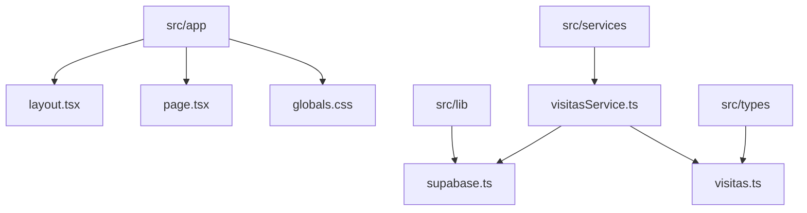
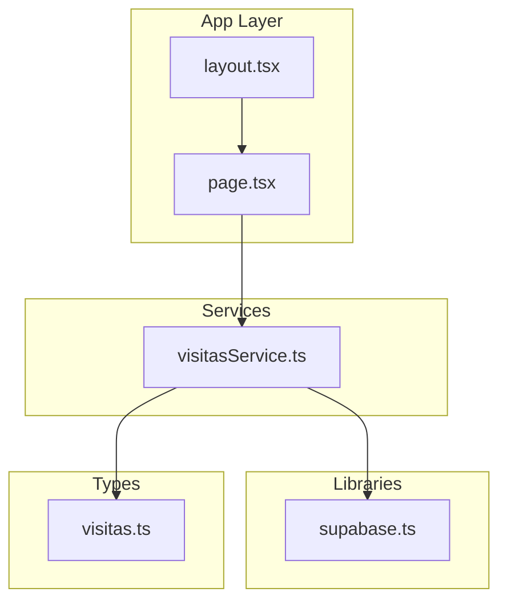
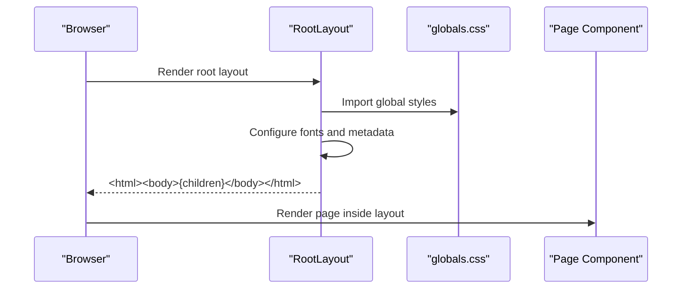
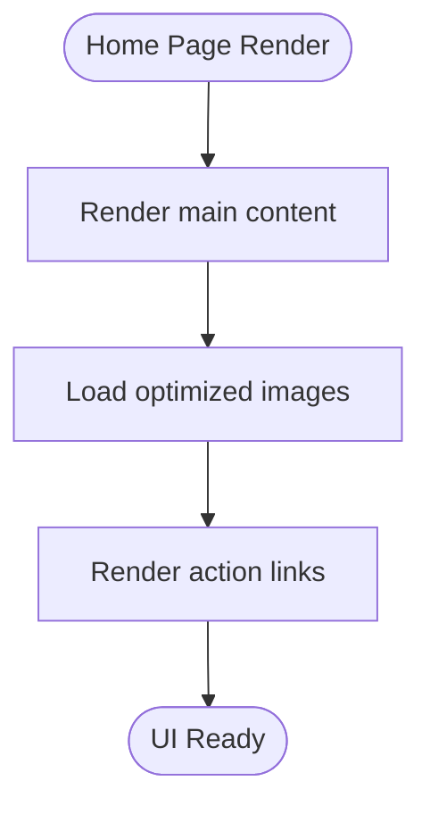
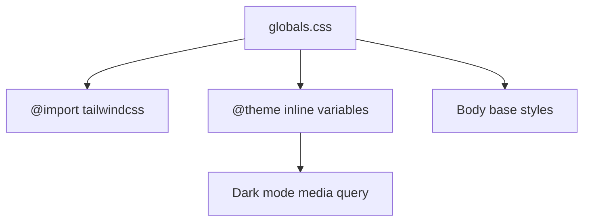
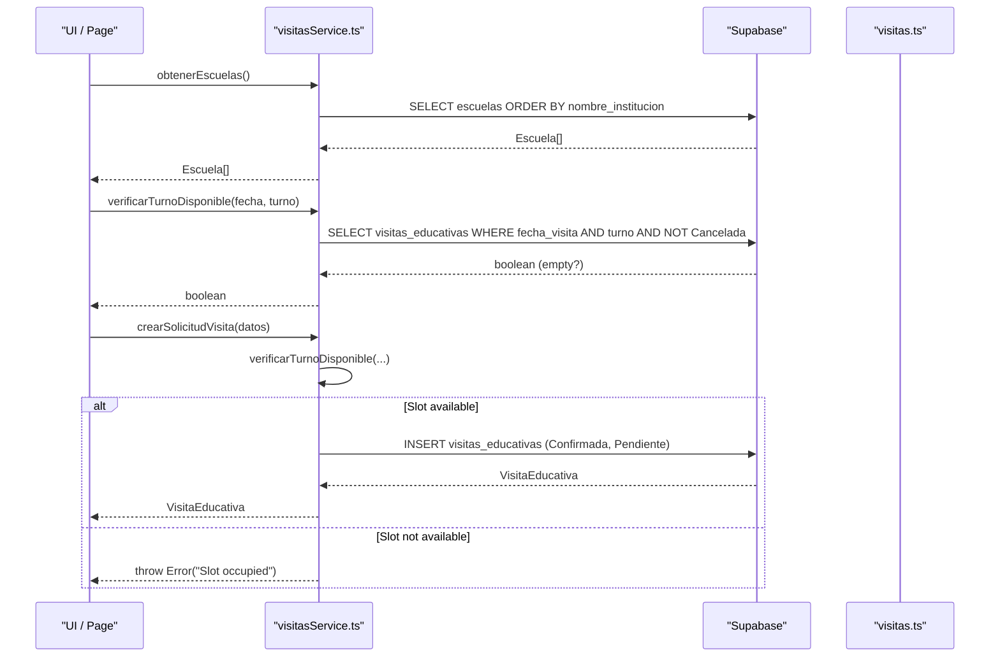
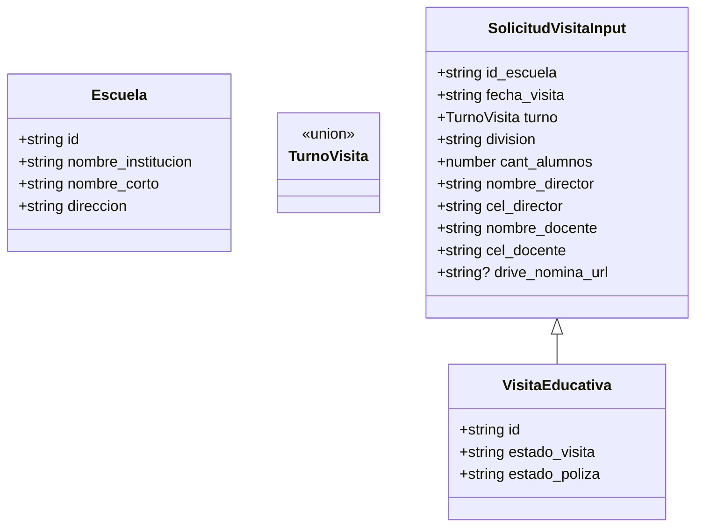
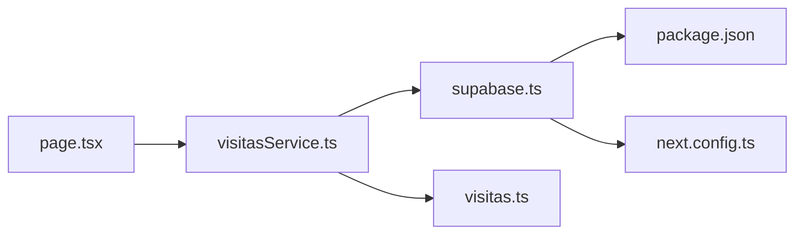

# Application Structure & Organization

<cite>
**Referenced Files in This Document**
- [layout.tsx](file://src/app/layout.tsx)
- [page.tsx](file://src/app/page.tsx)
- [globals.css](file://src/app/globals.css)
- [supabase.ts](file://src/lib/supabase.ts)
- [visitasService.ts](file://src/services/visitasService.ts)
- [visitas.ts](file://src/types/visitas.ts)
- [package.json](file://package.json)
- [next.config.ts](file://next.config.ts)
- [README.md](file://README.md)
</cite>

## Table of Contents
1. [Introduction](#introduction)
2. [Project Structure](#project-structure)
3. [Core Components](#core-components)
4. [Architecture Overview](#architecture-overview)
5. [Detailed Component Analysis](#detailed-component-analysis)
6. [Dependency Analysis](#dependency-analysis)
7. [Performance Considerations](#performance-considerations)
8. [Troubleshooting Guide](#troubleshooting-guide)
9. [Conclusion](#conclusion)
10. [Appendices](#appendices)

## Introduction
This document explains the application structure and file organization of the Simu-Twin-Web project, a Next.js App Router application. It focuses on how pages and layouts are organized under src/app, shared utilities in src/lib, business logic in src/services, and TypeScript definitions in src/types. It also provides guidelines for adding new pages, organizing components, maintaining naming conventions, and managing styles with Tailwind CSS and global CSS.

## Project Structure
The project follows the Next.js App Router convention with feature-oriented directories:

- src/app: Routes, layouts, and global styles
  - layout.tsx: Root layout that configures fonts, metadata, and wraps all pages
  - page.tsx: Default home page component
  - globals.css: Global styles and Tailwind configuration
- src/lib: Shared client libraries (e.g., Supabase client)
- src/services: Business logic modules (e.g., visit scheduling service)
- src/types: TypeScript interfaces and types used across the app



**Diagram sources**
- [layout.tsx:1-35](file://src/app/layout.tsx#L1-L35)
- [page.tsx:1-104](file://src/app/page.tsx#L1-L104)
- [globals.css:1-27](file://src/app/globals.css#L1-L27)
- [supabase.ts:1-7](file://src/lib/supabase.ts#L1-L7)
- [visitasService.ts:1-59](file://src/services/visitasService.ts#L1-L59)
- [visitas.ts:1-28](file://src/types/visitas.ts#L1-L28)

**Section sources**
- [layout.tsx:1-35](file://src/app/layout.tsx#L1-L35)
- [page.tsx:1-104](file://src/app/page.tsx#L1-L104)
- [globals.css:1-27](file://src/app/globals.css#L1-L27)
- [supabase.ts:1-7](file://src/lib/supabase.ts#L1-L7)
- [visitasService.ts:1-59](file://src/services/visitasService.ts#L1-L59)
- [visitas.ts:1-28](file://src/types/visitas.ts#L1-L28)

## Core Components
- Root Layout (src/app/layout.tsx): Configures global metadata, imports global styles, sets up Google Fonts via next/font, and renders the HTML shell with children.
- Home Page (src/app/page.tsx): The default route rendering the landing UI using Tailwind utility classes and Next.js Image optimization.
- Global Styles (src/app/globals.css): Imports Tailwind, defines theme variables, and applies base body styles including dark mode support.
- Supabase Client (src/lib/supabase.ts): Exports a configured Supabase client instance using environment variables.
- Visit Service (src/services/visitasService.ts): Encapsulates business logic for fetching schools, checking slot availability, and creating educational visit requests.
- Types (src/types/visitas.ts): Defines TypeScript interfaces for school data, visit slots, input payloads, and created visit records.

**Section sources**
- [layout.tsx:1-35](file://src/app/layout.tsx#L1-L35)
- [page.tsx:1-104](file://src/app/page.tsx#L1-L104)
- [globals.css:1-27](file://src/app/globals.css#L1-L27)
- [supabase.ts:1-7](file://src/lib/supabase.ts#L1-L7)
- [visitasService.ts:1-59](file://src/services/visitasService.ts#L1-L59)
- [visitas.ts:1-28](file://src/types/visitas.ts#L1-L28)

## Architecture Overview
The application uses a layered approach:
- Presentation layer: src/app contains routes and layouts; pages compose UI using Tailwind and React components.
- Services layer: src/services encapsulate domain operations and orchestrate calls to external services.
- Data access layer: src/lib provides shared clients (Supabase) for database interactions.
- Type layer: src/types centralizes shared TypeScript definitions consumed by services and UI.



**Diagram sources**
- [layout.tsx:1-35](file://src/app/layout.tsx#L1-L35)
- [page.tsx:1-104](file://src/app/page.tsx#L1-L104)
- [visitasService.ts:1-59](file://src/services/visitasService.ts#L1-L59)
- [supabase.ts:1-7](file://src/lib/supabase.ts#L1-L7)
- [visitas.ts:1-28](file://src/types/visitas.ts#L1-L28)

## Detailed Component Analysis

### Root Layout (src/app/layout.tsx)
- Purpose: Define global metadata, import global styles, configure fonts, and render the HTML wrapper.
- Responsibilities:
  - Metadata export for title and description
  - Font setup using next/font with CSS variables
  - Body class composition for font variables and antialiasing
  - Rendering children within html/body shell



**Diagram sources**
- [layout.tsx:1-35](file://src/app/layout.tsx#L1-L35)
- [globals.css:1-27](file://src/app/globals.css#L1-L27)

**Section sources**
- [layout.tsx:1-35](file://src/app/layout.tsx#L1-L35)

### Home Page (src/app/page.tsx)
- Purpose: Default route showcasing the starter UI with optimized images and Tailwind styling.
- Responsibilities:
  - Compose layout using Tailwind grid/flex utilities
  - Use Next.js Image for performance optimizations
  - Provide links to documentation and deployment



**Diagram sources**
- [page.tsx:1-104](file://src/app/page.tsx#L1-L104)

**Section sources**
- [page.tsx:1-104](file://src/app/page.tsx#L1-L104)

### Global Styles (src/app/globals.css)
- Purpose: Centralize global styles and Tailwind integration.
- Responsibilities:
  - Import Tailwind
  - Define theme variables for colors and fonts
  - Apply base body styles and dark mode preferences



**Diagram sources**
- [globals.css:1-27](file://src/app/globals.css#L1-L27)

**Section sources**
- [globals.css:1-27](file://src/app/globals.css#L1-L27)

### Supabase Client (src/lib/supabase.ts)
- Purpose: Provide a single, reusable Supabase client instance.
- Responsibilities:
  - Create client using environment variables for URL and anon key
  - Export client for use in services

```mermaid
classDiagram
class SupabaseClient {
+createClient(url, anonKey)
}
SupabaseClient <.. "used by" : visitasService.ts
```

**Diagram sources**
- [supabase.ts:1-7](file://src/lib/supabase.ts#L1-L7)
- [visitasService.ts:1-59](file://src/services/visitasService.ts#L1-L59)

**Section sources**
- [supabase.ts:1-7](file://src/lib/supabase.ts#L1-L7)

### Visit Service (src/services/visitasService.ts)
- Purpose: Encapsulate business logic related to educational visits.
- Responsibilities:
  - Fetch schools list
  - Check slot availability for a given date and shift
  - Create a visit request after validating availability
- Error handling: Throws errors from Supabase responses or business rules (e.g., slot already occupied).



**Diagram sources**
- [visitasService.ts:1-59](file://src/services/visitasService.ts#L1-L59)
- [supabase.ts:1-7](file://src/lib/supabase.ts#L1-L7)
- [visitas.ts:1-28](file://src/types/visitas.ts#L1-L28)

**Section sources**
- [visitasService.ts:1-59](file://src/services/visitasService.ts#L1-L59)

### Types (src/types/visitas.ts)
- Purpose: Centralize TypeScript definitions for domain models and inputs.
- Responsibilities:
  - Define Escuela interface
  - Define TurnoVisita union type
  - Define SolicitudVisitaInput and VisitaEducativa interfaces



**Diagram sources**
- [visitas.ts:1-28](file://src/types/visitas.ts#L1-L28)

**Section sources**
- [visitas.ts:1-28](file://src/types/visitas.ts#L1-L28)

## Dependency Analysis
- Services depend on lib for data access and on types for contracts.
- Pages and layouts depend on global styles and can call services when needed.
- Configuration files define runtime behavior and tooling.



**Diagram sources**
- [page.tsx:1-104](file://src/app/page.tsx#L1-L104)
- [visitasService.ts:1-59](file://src/services/visitasService.ts#L1-L59)
- [supabase.ts:1-7](file://src/lib/supabase.ts#L1-L7)
- [visitas.ts:1-28](file://src/types/visitas.ts#L1-L28)
- [package.json:1-29](file://package.json#L1-L29)
- [next.config.ts:1-8](file://next.config.ts#L1-L8)

**Section sources**
- [package.json:1-29](file://package.json#L1-L29)
- [next.config.ts:1-8](file://next.config.ts#L1-L8)

## Performance Considerations
- Use Next.js Image for optimized image loading and lazy loading where appropriate.
- Keep global styles minimal and leverage Tailwind utilities to reduce custom CSS.
- Prefer server-side or edge-compatible patterns when possible; keep heavy logic in services to avoid bloating UI components.
- Reuse the Supabase client instance to minimize initialization overhead.

[No sources needed since this section provides general guidance]

## Troubleshooting Guide
- Environment variables: Ensure NEXT_PUBLIC_SUPABASE_URL and NEXT_PUBLIC_SUPABASE_ANON_KEY are set; the Supabase client reads these at runtime.
- Errors from services: The visit service throws errors when Supabase returns errors or when business rules fail (e.g., slot already occupied). Handle these in UI layers with user-friendly messages.
- Styling issues: Verify Tailwind is imported in globals.css and that CSS variables are correctly applied in layout.tsx.

**Section sources**
- [supabase.ts:1-7](file://src/lib/supabase.ts#L1-L7)
- [visitasService.ts:1-59](file://src/services/visitasService.ts#L1-L59)
- [globals.css:1-27](file://src/app/globals.css#L1-L27)
- [layout.tsx:1-35](file://src/app/layout.tsx#L1-L35)

## Conclusion
Simu-Twin-Web follows a clean separation of concerns aligned with Next.js App Router best practices. Pages and layouts handle presentation, services encapsulate business logic, lib provides shared clients, and types ensure consistent contracts. With Tailwind CSS and global styles centralized, the codebase remains maintainable and scalable as new features are added.

[No sources needed since this section summarizes without analyzing specific files]

## Appendices

### Guidelines for Adding New Pages
- Create a new file under src/app following the route segment pattern (e.g., src/app/about/page.tsx).
- If the page shares layout with others, create a nested layout.tsx in the same directory to wrap child pages.
- Import only what you need; keep components co-located with the page or in a shared components folder if reused.

[No sources needed since this section provides general guidance]

### Organizing Components
- Place reusable UI components near their usage or in a dedicated components directory under src if shared across multiple pages.
- Keep components small and focused; prefer composition over large monolithic components.

[No sources needed since this section provides general guidance]

### Naming Conventions
- File names: Use lowercase with hyphens for directories and PascalCase for components (e.g., UserProfile.tsx).
- Types: Group by feature (e.g., src/types/visitas.ts) and name interfaces descriptively.
- Services: Name functions verb-noun (e.g., obtenerEscuelas, verificarTurnoDisponible).

[No sources needed since this section provides general guidance]

### CSS Organization with Tailwind and Global Styles
- Use Tailwind utilities extensively in components for layout and styling.
- Reserve globals.css for theme variables, base styles, and Tailwind imports.
- Avoid deep nesting in CSS; prefer utility-first approach for consistency.

**Section sources**
- [globals.css:1-27](file://src/app/globals.css#L1-L27)

### Running and Building
- Development: npm run dev
- Build: npm run build
- Start production: npm run start

**Section sources**
- [package.json:1-29](file://package.json#L1-L29)
- [README.md:1-37](file://README.md#L1-L37)