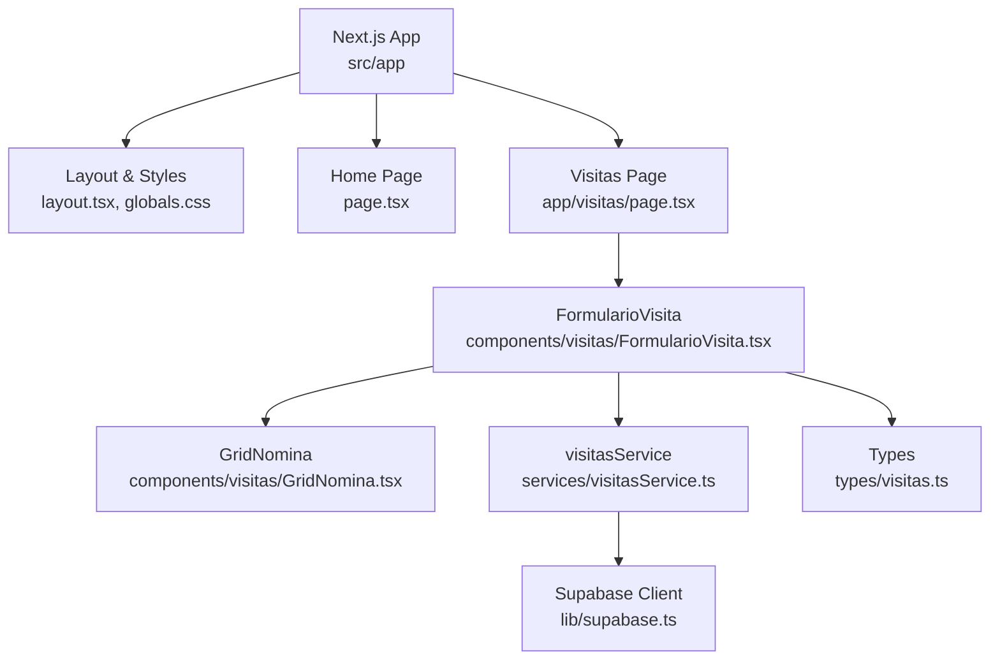
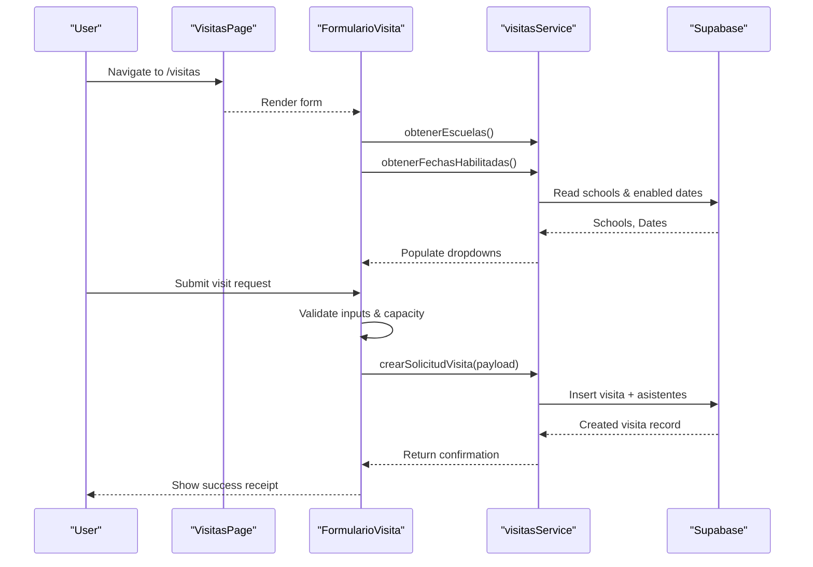
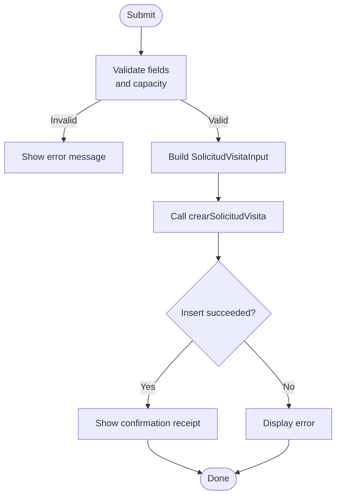
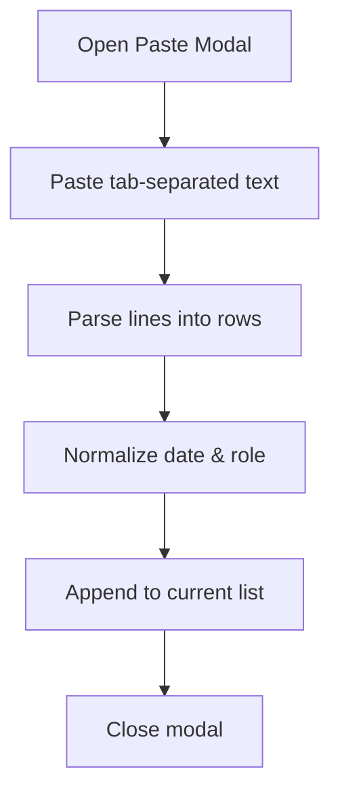
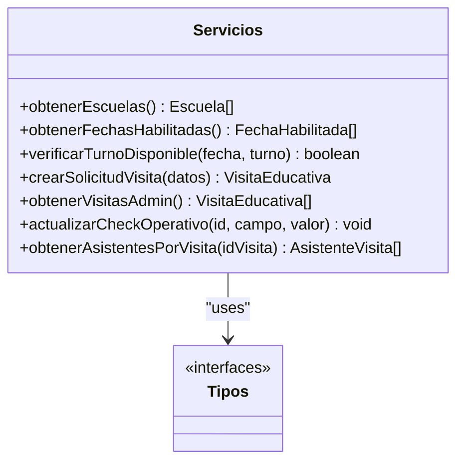
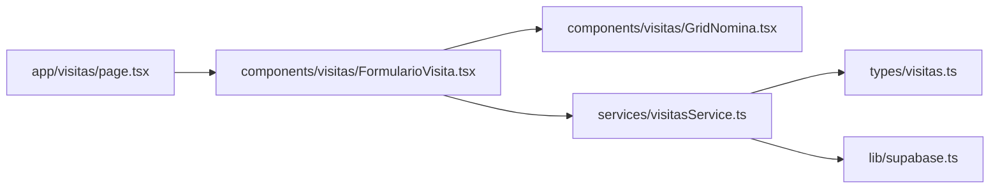

# Administrative Panel

<cite>
**Referenced Files in This Document**
- [README.md](file://README.md)
- [package.json](file://package.json)
- [src/app/layout.tsx](file://src/app/layout.tsx)
- [src/app/page.tsx](file://src/app/page.tsx)
- [src/app/globals.css](file://src/app/globals.css)
- [src/app/visitas/page.tsx](file://src/app/visitas/page.tsx)
- [src/components/visitas/FormularioVisita.tsx](file://src/components/visitas/FormularioVisita.tsx)
- [src/components/visitas/GridNomina.tsx](file://src/components/visitas/GridNomina.tsx)
- [src/services/visitasService.ts](file://src/services/visitasService.ts)
- [src/types/visitas.ts](file://src/types/visitas.ts)
- [src/lib/supabase.ts](file://src/lib/supabase.ts)
</cite>

## Table of Contents
1. [Introduction](#introduction)
2. [Project Structure](#project-structure)
3. [Core Components](#core-components)
4. [Architecture Overview](#architecture-overview)
5. [Detailed Component Analysis](#detailed-component-analysis)
6. [Dependency Analysis](#dependency-analysis)
7. [Performance Considerations](#performance-considerations)
8. [Troubleshooting Guide](#troubleshooting-guide)
9. [Conclusion](#conclusion)

## Introduction
This project is a Next.js application that provides an administrative panel for managing educational visits to a simulation center. It enables institutions to request visit slots, manage attendee rosters, and supports operational checks (insurance, transport, invoices, and file storage). The system integrates with Supabase for data persistence and exposes service functions used by the UI components.

The application uses Tailwind CSS for styling, Google fonts via Next.js font loader, and includes utilities for Excel-style roster import and client-side validation before submission.

## Project Structure
The codebase follows a feature-oriented layout under src:
- app: Next.js App Router pages and global styles
- components/visitas: UI components for the visit form and attendee grid
- services/visitasService: API-like functions wrapping Supabase queries
- types/visitas.ts: Shared TypeScript interfaces and types
- lib/supabase.ts: Supabase client configuration

**Diagram sources**
- [src/app/layout.tsx:1-35](file://src/app/layout.tsx#L1-L35)
- [src/app/page.tsx:1-104](file://src/app/page.tsx#L1-L104)
- [src/app/visitas/page.tsx:1-28](file://src/app/visitas/page.tsx#L1-L28)
- [src/components/visitas/FormularioVisita.tsx:1-723](file://src/components/visitas/FormularioVisita.tsx#L1-L723)
- [src/components/visitas/GridNomina.tsx:1-277](file://src/components/visitas/GridNomina.tsx#L1-L277)
- [src/services/visitasService.ts:1-169](file://src/services/visitasService.ts#L1-L169)
- [src/lib/supabase.ts:1-7](file://src/lib/supabase.ts#L1-L7)
- [src/types/visitas.ts:1-84](file://src/types/visitas.ts#L1-L84)

**Section sources**
- [README.md:1-37](file://README.md#L1-L37)
- [package.json:1-31](file://package.json#L1-L31)
- [src/app/layout.tsx:1-35](file://src/app/layout.tsx#L1-L35)
- [src/app/globals.css:1-27](file://src/app/globals.css#L1-L27)

## Core Components
- Visitas page: Renders the public-facing form for scheduling educational visits and sets metadata for SEO.
- FormularioVisita: Client component handling form state, validation, loading states, success view, and integration with the service layer.
- GridNomina: Interactive table for adding, editing, deleting attendees; supports bulk paste from Excel with tab-separated columns.
- visitasService: Encapsulates Supabase operations for schools, available dates, creating visit requests, listing visits for admin, updating operational checkboxes, and fetching attendee lists.
- Types: Centralized TypeScript definitions for entities like Escuela, FechaHabilitada, VisitaEducativa, AsistenteInput, and related enums.

Key responsibilities:
- Data fetching for dropdowns (schools and available dates)
- Client-side validation (capacity limits, required fields, legal consent)
- Submission flow to create a visit record and associated attendees
- Admin-ready endpoints to list visits and update operational flags

**Section sources**
- [src/app/visitas/page.tsx:1-28](file://src/app/visitas/page.tsx#L1-L28)
- [src/components/visitas/FormularioVisita.tsx:1-723](file://src/components/visitas/FormularioVisita.tsx#L1-L723)
- [src/components/visitas/GridNomina.tsx:1-277](file://src/components/visitas/GridNomina.tsx#L1-L277)
- [src/services/visitasService.ts:1-169](file://src/services/visitasService.ts#L1-L169)
- [src/types/visitas.ts:1-84](file://src/types/visitas.ts#L1-L84)

## Architecture Overview
The application is a client-rendered Next.js app using the App Router. The Visitas page composes the FormularioVisita component, which orchestrates user interactions and delegates data operations to visitasService. The service interacts with Supabase to read/write data. Types ensure consistent contracts across layers.

**Diagram sources**
- [src/app/visitas/page.tsx:1-28](file://src/app/visitas/page.tsx#L1-L28)
- [src/components/visitas/FormularioVisita.tsx:83-217](file://src/components/visitas/FormularioVisita.tsx#L83-L217)
- [src/services/visitasService.ts:12-121](file://src/services/visitasService.ts#L12-L121)
- [src/lib/supabase.ts:1-7](file://src/lib/supabase.ts#L1-L7)

## Detailed Component Analysis

### Visitas Page
- Purpose: Entry point for the visit reservation flow; sets page title and description.
- Behavior: Renders a centered layout and mounts the FormularioVisita component.

**Section sources**
- [src/app/visitas/page.tsx:1-28](file://src/app/visitas/page.tsx#L1-L28)

### FormularioVisita
- Responsibilities:
  - Load schools and available dates on mount
  - Manage form state including institution selection, date, academic year, division, student count, contact details, and legal consents
  - Validate inputs (student count limit, required fields, consent)
  - Submit payload to service and handle success/error states
  - Display a printable confirmation receipt with key details
- Key logic highlights:
  - Capacity enforcement with a maximum per turn
  - Conditional field behavior for “other institution” input
  - Integration with GridNomina for attendee management
  - Error display and retry mechanism for initial data load

**Diagram sources**
- [src/components/visitas/FormularioVisita.tsx:137-217](file://src/components/visitas/FormularioVisita.tsx#L137-L217)
- [src/services/visitasService.ts:58-121](file://src/services/visitasService.ts#L58-L121)

**Section sources**
- [src/components/visitas/FormularioVisita.tsx:1-723](file://src/components/visitas/FormularioVisita.tsx#L1-L723)

### GridNomina
- Responsibilities:
  - Add/remove rows for attendees
  - Edit name, ID, birth date, role
  - Bulk paste from Excel (tab-separated columns)
  - Normalize roles and dates for compatibility
- UX features:
  - Inline table with editable cells
  - Modal dialog for pasting data
  - Clear instructions and warnings about format expectations

**Diagram sources**
- [src/components/visitas/GridNomina.tsx:55-70](file://src/components/visitas/GridNomina.tsx#L55-L70)
- [src/components/visitas/GridNomina.tsx:92-104](file://src/components/visitas/GridNomina.tsx#L92-L104)

**Section sources**
- [src/components/visitas/GridNomina.tsx:1-277](file://src/components/visitas/GridNomina.tsx#L1-L277)

### visitasService
- Responsibilities:
  - Fetch schools and enabled dates
  - Create visit requests with validation and default TUP schedule
  - List all visits for admin purposes
  - Update operational checkboxes (insurance, transport, invoices, Drive)
  - Retrieve attendee lists per visit
- Data model alignment:
  - Uses shared types for consistency between UI and backend calls

**Diagram sources**
- [src/services/visitasService.ts:12-169](file://src/services/visitasService.ts#L12-L169)
- [src/types/visitas.ts:1-84](file://src/types/visitas.ts#L1-L84)

**Section sources**
- [src/services/visitasService.ts:1-169](file://src/services/visitasService.ts#L1-L169)
- [src/types/visitas.ts:1-84](file://src/types/visitas.ts#L1-L84)

### Supabase Client
- Purpose: Initializes the Supabase client using environment variables for URL and anonymous key.
- Usage: Consumed by visitasService for all database operations.

**Section sources**
- [src/lib/supabase.ts:1-7](file://src/lib/supabase.ts#L1-L7)

## Dependency Analysis
- UI components depend on service functions for data operations.
- Services depend on the Supabase client and shared types.
- Pages compose components and set metadata.

**Diagram sources**
- [src/app/visitas/page.tsx:1-28](file://src/app/visitas/page.tsx#L1-L28)
- [src/components/visitas/FormularioVisita.tsx:1-723](file://src/components/visitas/FormularioVisita.tsx#L1-L723)
- [src/components/visitas/GridNomina.tsx:1-277](file://src/components/visitas/GridNomina.tsx#L1-L277)
- [src/services/visitasService.ts:1-169](file://src/services/visitasService.ts#L1-L169)
- [src/types/visitas.ts:1-84](file://src/types/visitas.ts#L1-L84)
- [src/lib/supabase.ts:1-7](file://src/lib/supabase.ts#L1-L7)

**Section sources**
- [src/app/visitas/page.tsx:1-28](file://src/app/visitas/page.tsx#L1-L28)
- [src/components/visitas/FormularioVisita.tsx:1-723](file://src/components/visitas/FormularioVisita.tsx#L1-L723)
- [src/components/visitas/GridNomina.tsx:1-277](file://src/components/visitas/GridNomina.tsx#L1-L277)
- [src/services/visitasService.ts:1-169](file://src/services/visitasService.ts#L1-L169)
- [src/types/visitas.ts:1-84](file://src/types/visitas.ts#L1-L84)
- [src/lib/supabase.ts:1-7](file://src/lib/supabase.ts#L1-L7)

## Performance Considerations
- Parallel data loading: Initial fetches for schools and dates are executed concurrently to reduce latency.
- Client-side validation: Prevents unnecessary network calls by validating constraints early.
- Minimal re-renders: Form state updates are localized; GridNomina manages its own row list efficiently.
- Database queries: Use selective column projections where possible (e.g., limited fields when listing schools/dates).

[No sources needed since this section provides general guidance]

## Troubleshooting Guide
Common issues and resolutions:
- Loading errors for schools or dates:
  - Check Supabase environment variables and permissions
  - Use the provided retry control to reload data
- Validation errors:
  - Ensure student count does not exceed the allowed maximum
  - Confirm all required fields and legal consents are completed
- Submission failures:
  - Verify network connectivity and Supabase availability
  - Inspect error messages returned by the service layer
- Attendee import problems:
  - Ensure Excel paste uses tab separators and correct column order
  - Validate date formats and role values; use manual entry if parsing fails

**Section sources**
- [src/components/visitas/FormularioVisita.tsx:93-116](file://src/components/visitas/FormularioVisita.tsx#L93-L116)
- [src/components/visitas/FormularioVisita.tsx:137-217](file://src/components/visitas/FormularioVisita.tsx#L137-L217)
- [src/components/visitas/GridNomina.tsx:55-70](file://src/components/visitas/GridNomina.tsx#L55-L70)
- [src/services/visitasService.ts:12-33](file://src/services/visitasService.ts#L12-L33)

## Conclusion
The Administrative Panel provides a robust, user-friendly interface for scheduling educational visits, managing attendee rosters, and supporting operational workflows through Supabase integration. Its modular architecture separates concerns between UI, services, and types, enabling maintainability and scalability. With clear validation, error handling, and performance-conscious patterns, it offers a solid foundation for further enhancements such as authentication, advanced reporting, and expanded admin capabilities.