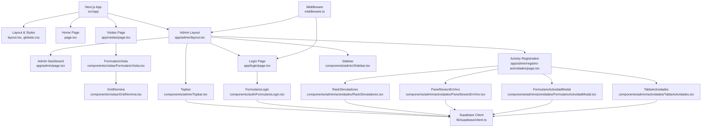
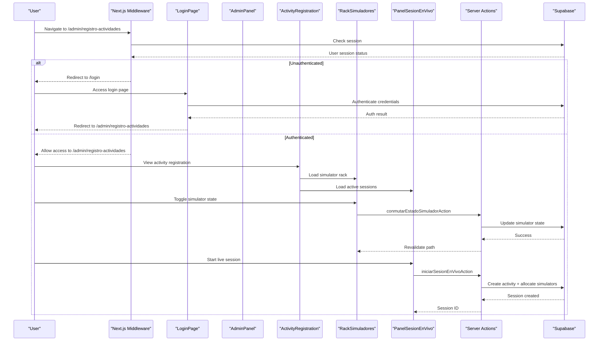
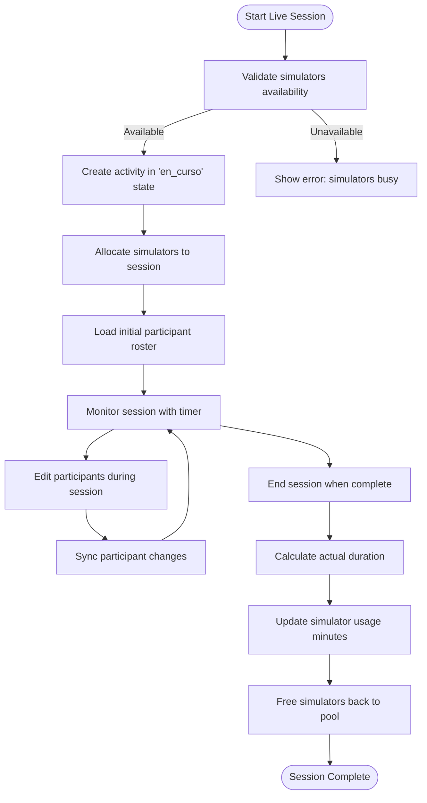
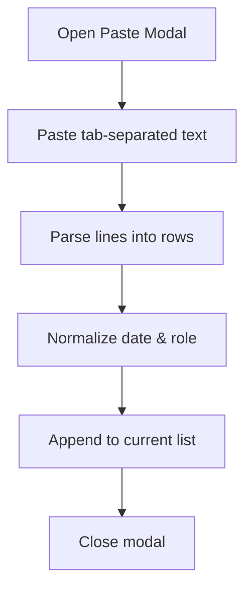
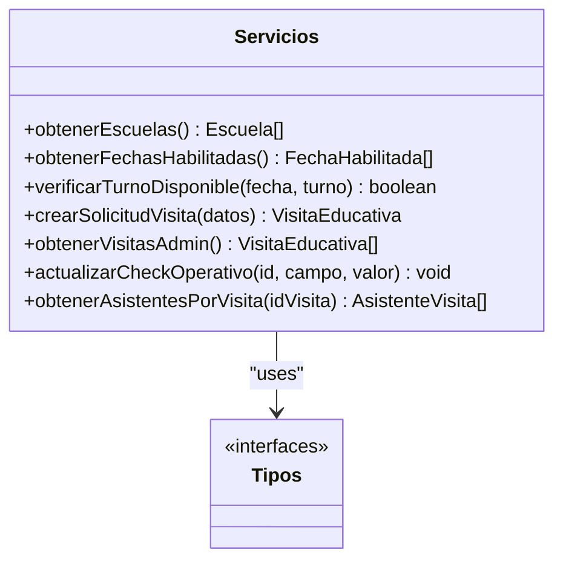
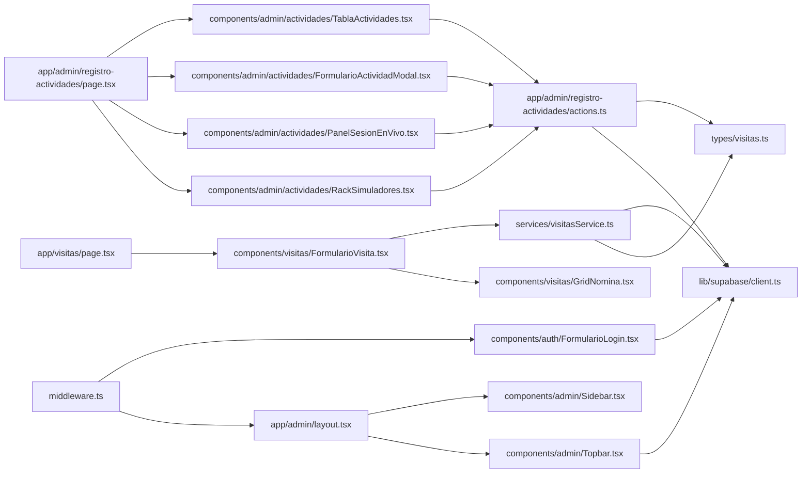

Based on my analysis of the codebase, I can now update the documentation to reflect the comprehensive activity registration and live session management system that has been added. Here's the updated documentation:

<cite>
**Referenced Files in This Document**
- [README.md](file://README.md)
- [package.json](file://package.json)
- [src/app/layout.tsx](file://src/app/layout.tsx)
- [src/app/page.tsx](file://src/app/page.tsx)
- [src/app/globals.css](file://src/app/globals.css)
- [src/app/visitas/page.tsx](file://src/app/visitas/page.tsx)
- [src/app/admin/layout.tsx](file://src/app/admin/layout.tsx)
- [src/app/admin/page.tsx](file://src/app/admin/page.tsx)
- [src/app/admin/registro-actividades/page.tsx](file://src/app/admin/registro-actividades/page.tsx)
- [src/app/admin/registro-actividades/actions.ts](file://src/app/admin/registro-actividades/actions.ts)
- [src/app/login/page.tsx](file://src/app/login/page.tsx)
- [src/components/admin/Topbar.tsx](file://src/components/admin/Topbar.tsx)
- [src/components/admin/Sidebar.tsx](file://src/components/admin/Sidebar.tsx)
- [src/components/auth/FormularioLogin.tsx](file://src/components/auth/FormularioLogin.tsx)
- [src/components/visitas/FormularioVisita.tsx](file://src/components/visitas/FormularioVisita.tsx)
- [src/components/visitas/GridNomina.tsx](file://src/components/visitas/GridNomina.tsx)
- [src/components/admin/actividades/RackSimuladores.tsx](file://src/components/admin/actividades/RackSimuladores.tsx)
- [src/components/admin/actividades/PanelSesionEnVivo.tsx](file://src/components/admin/actividades/PanelSesionEnVivo.tsx)
- [src/components/admin/actividades/FormularioActividadModal.tsx](file://src/components/admin/actividades/FormularioActividadModal.tsx)
- [src/components/admin/actividades/TablaActividades.tsx](file://src/components/admin/actividades/TablaActividades.tsx)
- [src/services/visitasService.ts](file://src/services/visitasService.ts)
- [src/types/visitas.ts](file://src/types/visitas.ts)
- [src/types/actividades.ts](file://src/types/actividades.ts)
- [src/lib/supabase/client.ts](file://src/lib/supabase/client.ts)
- [src/middleware.ts](file://src/middleware.ts)
</cite>

## Update Summary
**Changes Made**
- Added comprehensive activity registration and live session management system
- Implemented server actions for complete activity lifecycle management
- Created real-time simulator rack interface with SCADA-style controls
- Built live session controls with dual viewing modes (list/tablet)
- Integrated activity dashboard with comprehensive participant management
- Enhanced admin panel with new "Registro de Actividades" navigation section

## Table of Contents
1. [Introduction](#introduction)
2. [Project Structure](#project-structure)
3. [Core Components](#core-components)
4. [Architecture Overview](#architecture-overview)
5. [Authentication System](#authentication-system)
6. [Activity Registration System](#activity-registration-system)
7. [Live Session Management](#live-session-management)
8. [Detailed Component Analysis](#detailed-component-analysis)
9. [Dependency Analysis](#dependency-analysis)
10. [Performance Considerations](#performance-considerations)
11. [Troubleshooting Guide](#troubleshooting-guide)
12. [Conclusion](#conclusion)

## Introduction
This project is a Next.js application that provides an administrative panel for managing educational visits to a simulation center. It enables institutions to request visit slots, manage attendee rosters, and supports operational checks (insurance, transport, invoices, and file storage). The system integrates with Supabase for data persistence and exposes service functions used by the UI components.

The application now includes a complete authentication system with secure admin panel access, featuring role-based routing, session management, and responsive design patterns. **Additionally, it features a comprehensive activity registration and live session management system** that allows operators to register presential activities, manage real-time sessions, control simulator racks, and track participant attendance with full audit trails.

It uses Tailwind CSS for styling, Google fonts via Next.js font loader, and includes utilities for Excel-style roster import and client-side validation before submission.

## Project Structure
The codebase follows a feature-oriented layout under src:
- app: Next.js App Router pages and global styles with protected routes
- components/admin: Admin panel components including Topbar, Sidebar, and dashboard
- components/admin/actividades: Activity registration and live session management components
- components/auth: Authentication components for login functionality
- components/visitas: UI components for the visit form and attendee grid
- services/visitasService: API-like functions wrapping Supabase queries
- types: Shared TypeScript interfaces and types for both visits and activities
- lib/supabase: Supabase client configuration for browser and server environments
- middleware: Route protection and session management

**Diagram sources**
- [src/app/layout.tsx:1-35](file://src/app/layout.tsx#L1-L35)
- [src/app/page.tsx:1-104](file://src/app/page.tsx#L1-L104)
- [src/app/visitas/page.tsx:1-28](file://src/app/visitas/page.tsx#L1-L28)
- [src/app/admin/layout.tsx:1-26](file://src/app/admin/layout.tsx#L1-L26)
- [src/app/admin/page.tsx:1-38](file://src/app/admin/page.tsx#L1-L38)
- [src/app/admin/registro-actividades/page.tsx:1-261](file://src/app/admin/registro-actividades/page.tsx#L1-L261)
- [src/app/login/page.tsx:1-31](file://src/app/login/page.tsx#L1-L31)
- [src/components/admin/Topbar.tsx:1-132](file://src/components/admin/Topbar.tsx#L1-L132)
- [src/components/admin/Sidebar.tsx:1-113](file://src/components/admin/Sidebar.tsx#L1-L113)
- [src/components/auth/FormularioLogin.tsx:1-107](file://src/components/auth/FormularioLogin.tsx#L1-L107)
- [src/components/admin/actividades/RackSimuladores.tsx:1-153](file://src/components/admin/actividades/RackSimuladores.tsx#L1-L153)
- [src/components/admin/actividades/PanelSesionEnVivo.tsx:1-866](file://src/components/admin/actividades/PanelSesionEnVivo.tsx#L1-L866)
- [src/components/admin/actividades/FormularioActividadModal.tsx:1-606](file://src/components/admin/actividades/FormularioActividadModal.tsx#L1-L606)
- [src/components/admin/actividades/TablaActividades.tsx:1-434](file://src/components/admin/actividades/TablaActividades.tsx#L1-L434)
- [src/lib/supabase/client.ts:1-34](file://src/lib/supabase/client.ts#L1-L34)
- [src/middleware.ts:1-100](file://src/middleware.ts#L1-L100)

**Section sources**
- [README.md:1-37](file://README.md#L1-L37)
- [package.json:1-31](file://package.json#L1-L31)
- [src/app/layout.tsx:1-35](file://src/app/layout.tsx#L1-L35)
- [src/app/globals.css:1-27](file://src/app/globals.css#L1-L27)

## Core Components
- **Visitas page**: Renders the public-facing form for scheduling educational visits and sets metadata for SEO.
- **Admin Dashboard**: Protected admin interface with live status monitoring and placeholder for digital twin integration.
- **Activity Registration System**: Comprehensive module for registering presential activities with participant management and simulator allocation.
- **Live Session Management**: Real-time session controls with dual viewing modes (list/tablet) for active session monitoring.
- **Real-time Simulator Rack**: SCADA-style interface for direct simulator state control with optimistic updates.
- **Authentication System**: Complete login/logout functionality with Supabase integration and middleware-based route protection.
- **Topbar Component**: Enhanced with logout functionality, real-time clock, and responsive mobile navigation.
- **FormularioVisita**: Client component handling form state, validation, loading states, success view, and integration with the service layer.
- **GridNomina**: Interactive table for adding, editing, deleting attendees; supports bulk paste from Excel with tab-separated columns.
- **visitasService**: Encapsulates Supabase operations for schools, available dates, creating visit requests, listing visits for admin, updating operational checkboxes, and fetching attendee lists.
- **Types**: Centralized TypeScript definitions for entities like Escuela, FechaHabilitada, VisitaEducativa, AsistenteInput, Actividad, Simulador, and related enums.

Key responsibilities:
- Secure authentication flow with role-based access control
- Data fetching for dropdowns (schools and available dates)
- Client-side validation (capacity limits, required fields, legal consent)
- Submission flow to create a visit record and associated attendees
- Activity lifecycle management from planning to completion
- Real-time session tracking with participant synchronization
- Simulator rack control with concurrent session management
- Admin-ready endpoints to list visits and update operational flags
- Session management with automatic redirects and cleanup

**Section sources**
- [src/app/visitas/page.tsx:1-28](file://src/app/visitas/page.tsx#L1-L28)
- [src/app/admin/page.tsx:1-38](file://src/app/admin/page.tsx#L1-L38)
- [src/app/admin/registro-actividades/page.tsx:1-261](file://src/app/admin/registro-actividades/page.tsx#L1-L261)
- [src/components/admin/Topbar.tsx:1-132](file://src/components/admin/Topbar.tsx#L1-L132)
- [src/components/auth/FormularioLogin.tsx:1-107](file://src/components/auth/FormularioLogin.tsx#L1-L107)
- [src/components/visitas/FormularioVisita.tsx:1-723](file://src/components/visitas/FormularioVisita.tsx#L1-L723)
- [src/components/visitas/GridNomina.tsx:1-277](file://src/components/visitas/GridNomina.tsx#L1-L277)
- [src/components/admin/actividades/RackSimuladores.tsx:1-153](file://src/components/admin/actividades/RackSimuladores.tsx#L1-L153)
- [src/components/admin/actividades/PanelSesionEnVivo.tsx:1-866](file://src/components/admin/actividades/PanelSesionEnVivo.tsx#L1-L866)
- [src/components/admin/actividades/FormularioActividadModal.tsx:1-606](file://src/components/admin/actividades/FormularioActividadModal.tsx#L1-L606)
- [src/components/admin/actividades/TablaActividades.tsx:1-434](file://src/components/admin/actividades/TablaActividades.tsx#L1-L434)
- [src/services/visitasService.ts:1-169](file://src/services/visitasService.ts#L1-L169)
- [src/types/visitas.ts:1-84](file://src/types/visitas.ts#L1-L84)
- [src/types/actividades.ts:1-177](file://src/types/actividades.ts#L1-L177)

## Architecture Overview
The application is a client-rendered Next.js app using the App Router with comprehensive authentication. The Visitas page composes the FormularioVisita component, which orchestrates user interactions and delegates data operations to visitasService. The admin panel is protected by middleware that validates sessions and redirects unauthenticated users. **The activity registration system uses Server Actions for all database operations, providing type-safe, validated mutations with optimistic UI updates.** The service interacts with Supabase to read/write data. Types ensure consistent contracts across layers.

**Diagram sources**
- [src/middleware.ts:14-85](file://src/middleware.ts#L14-L85)
- [src/app/login/page.tsx:1-31](file://src/app/login/page.tsx#L1-L31)
- [src/app/admin/layout.tsx:11-25](file://src/app/admin/layout.tsx#L11-L25)
- [src/app/admin/registro-actividades/page.tsx:151-188](file://src/app/admin/registro-actividades/page.tsx#L151-L188)
- [src/components/admin/actividades/RackSimuladores.tsx:45-54](file://src/components/admin/actividades/RackSimuladores.tsx#L45-L54)
- [src/components/admin/actividades/PanelSesionEnVivo.tsx:251-297](file://src/components/admin/actividades/PanelSesionEnVivo.tsx#L251-L297)
- [src/app/admin/registro-actividades/actions.ts:87-135](file://src/app/admin/registro-actividades/actions.ts#L87-L135)
- [src/app/admin/registro-actividades/actions.ts:370-577](file://src/app/admin/registro-actividades/actions.ts#L370-L577)

## Authentication System
The application implements a robust authentication system using Supabase with Next.js middleware for route protection.

### Key Features:
- **Middleware Protection**: Routes are protected server-side, preventing unauthorized access to admin pages
- **Session Management**: Automatic session validation and refresh using Supabase SSR
- **Login Flow**: Email/password authentication with error handling and user feedback
- **Logout Functionality**: Clean session termination with proper redirect to login page
- **Responsive Design**: Mobile-friendly navigation with collapsible menu sections

### Security Implementation:
- Server-side route protection prevents direct URL access to admin pages
- Client-side logout ensures proper session cleanup
- Environment variable validation for Supabase configuration
- Automatic redirects based on authentication status

**Section sources**
- [src/middleware.ts:14-85](file://src/middleware.ts#L14-L85)
- [src/components/auth/FormularioLogin.tsx:21-51](file://src/components/auth/FormularioLogin.tsx#L21-L51)
- [src/components/admin/Topbar.tsx:62-72](file://src/components/admin/Topbar.tsx#L62-L72)

## Activity Registration System
**New Feature** - A comprehensive activity registration system that manages the complete lifecycle of presential activities at the simulation center.

### Core Capabilities:
- **Activity Creation**: Register new activities with entity details, contact information, scheduling, and participant rosters
- **Simulator Allocation**: Link specific simulators to activities with usage time tracking
- **Participant Management**: Dynamic participant roster with gender categorization and role assignment
- **Status Tracking**: Activities progress through planned → in-progress → completed states
- **Audit Trail**: Complete history of all activities with detailed participant and equipment usage records

### Data Model:
- **Activities**: Main entity storing activity metadata, scheduling, and status
- **Participants**: Individual attendees linked to activities with personal details
- **Simulator Links**: Many-to-many relationship between activities and simulators
- **Usage Tracking**: Minutes of simulator usage per activity for resource accounting

### Validation & Safety:
- Server-side validation prevents invalid data entry
- Concurrent session protection prevents double-booking of simulators
- Transactional operations ensure data consistency
- Rollback mechanisms handle partial failures gracefully

**Section sources**
- [src/app/admin/registro-actividades/actions.ts:184-344](file://src/app/admin/registro-actividades/actions.ts#L184-L344)
- [src/types/actividades.ts:59-104](file://src/types/actividades.ts#L59-L104)
- [src/components/admin/actividades/FormularioActividadModal.tsx:147-203](file://src/components/admin/actividades/FormularioActividadModal.tsx#L147-L203)

## Live Session Management
**New Feature** - Real-time session management system for conducting live training sessions or demonstrations.

### Key Features:
- **Session Lifecycle**: Start, monitor, and end live sessions with full audit trail
- **Dual Viewing Modes**: List view for desktop administration, tablet mode for hands-on operation
- **Real-time Participant Sync**: Live updates to participant rosters during sessions
- **Timer Integration**: Accurate session duration tracking with start/end time calculation
- **Concurrent Session Control**: Prevents multiple simultaneous sessions on the same simulators

### Interface Components:
- **SCADA-style Rack**: Visual simulator control panel with LED indicators and status displays
- **Session Panel**: Full-screen modal for session management with participant editing
- **Confirmation Dialogs**: Safety checks before critical operations like session termination
- **Optimistic Updates**: Immediate UI feedback while server operations complete

### Technical Implementation:
- **Server Actions**: All database operations handled securely on the server
- **State Management**: React hooks manage complex session state transitions
- **Error Handling**: Comprehensive error recovery with rollback capabilities
- **Performance Optimization**: Memoized calculations and isolated sub-components prevent unnecessary re-renders

**Diagram sources**
- [src/components/admin/actividades/PanelSesionEnVivo.tsx:251-297](file://src/components/admin/actividades/PanelSesionEnVivo.tsx#L251-L297)
- [src/app/admin/registro-actividades/actions.ts:370-577](file://src/app/admin/registro-actividades/actions.ts#L370-L577)
- [src/app/admin/registro-actividades/actions.ts:714-800](file://src/app/admin/registro-actividades/actions.ts#L714-L800)

**Section sources**
- [src/components/admin/actividades/PanelSesionEnVivo.tsx:1-866](file://src/components/admin/actividades/PanelSesionEnVivo.tsx#L1-L866)
- [src/components/admin/actividades/RackSimuladores.tsx:1-153](file://src/components/admin/actividades/RackSimuladores.tsx#L1-L153)
- [src/components/admin/actividades/TablaActividades.tsx:105-434](file://src/components/admin/actividades/TablaActividades.tsx#L105-L434)
- [src/app/admin/registro-actividades/actions.ts:370-800](file://src/app/admin/registro-actividades/actions.ts#L370-L800)

## Detailed Component Analysis

### Admin Layout and Pages
- **Admin Layout**: Provides the shell structure for all admin pages with sidebar and topbar integration
- **Dashboard Page**: Placeholder for future digital twin integration with live status indicators
- **Login Page**: Dedicated authentication interface with form validation and error handling
- **Activity Registration Page**: Server component that loads simulator fleet and activity history in parallel

**Section sources**
- [src/app/admin/layout.tsx:11-25](file://src/app/admin/layout.tsx#L11-L25)
- [src/app/admin/page.tsx:5-37](file://src/app/admin/page.tsx#L5-L37)
- [src/app/login/page.tsx:9-30](file://src/app/login/page.tsx#L9-L30)
- [src/app/admin/registro-actividades/page.tsx:151-188](file://src/app/admin/registro-actividades/page.tsx#L151-L188)

### Enhanced Topbar Component
- **Logout Functionality**: Implements secure session termination with Supabase auth.signOut()
- **Real-time Clock**: Live date/time display with Argentine locale formatting
- **Responsive Navigation**: Mobile-optimized navigation with collapsible menu sections
- **Status Indicators**: Visual feedback for system status and user actions
- **Breadcrumb Navigation**: Dynamic section identification based on current pathname

**Diagram sources**
- [src/components/admin/Topbar.tsx:62-72](file://src/components/admin/Topbar.tsx#L62-L72)

**Section sources**
- [src/components/admin/Topbar.tsx:1-132](file://src/components/admin/Topbar.tsx#L1-L132)

### Sidebar Navigation
- **Route Configuration**: Centralized navigation map with icons and labels
- **Active State Detection**: Smart highlighting of current section
- **Mobile Integration**: Responsive navigation that works alongside topbar on smaller screens
- **External Links**: Integration with public visit portal
- **Activity Registration**: New navigation item for the activity management module

**Section sources**
- [src/components/admin/Sidebar.tsx:1-113](file://src/components/admin/Sidebar.tsx#L1-L113)

### Visitas Page
- Purpose: Entry point for the visit reservation flow; sets page title and description.
- Behavior: Renders a centered layout and mounts the FormularioVisita component.

**Section sources**
- [src/app/visitas/page.tsx:1-28](file://src/app/visitas/page.tsx#L1-L28)

### FormularioVisita
- Responsibilities:
  - Load schools and available dates on mount
  - Manage form state including institution selection, date, academic year, division, student count, contact details, and legal consents
  - Validate inputs (student count limit, required fields, consent)
  - Submit payload to service and handle success/error states
  - Display a printable confirmation receipt with key details
- Key logic highlights:
  - Capacity enforcement with a maximum per turn
  - Conditional field behavior for "other institution" input
  - Integration with GridNomina for attendee management
  - Error display and retry mechanism for initial data load

**Diagram sources**
- [src/components/visitas/FormularioVisita.tsx:137-217](file://src/components/visitas/FormularioVisita.tsx#L137-L217)
- [src/services/visitasService.ts:58-121](file://src/services/visitasService.ts#L58-L121)

**Section sources**
- [src/components/visitas/FormularioVisita.tsx:1-723](file://src/components/visitas/FormularioVisita.tsx#L1-L723)

### GridNomina
- Responsibilities:
  - Add/remove rows for attendees
  - Edit name, ID, birth date, role
  - Bulk paste from Excel (tab-separated columns)
  - Normalize roles and dates for compatibility
- UX features:
  - Inline table with editable cells
  - Modal dialog for pasting data
  - Clear instructions and warnings about format expectations

**Diagram sources**
- [src/components/visitas/GridNomina.tsx:55-70](file://src/components/visitas/GridNomina.tsx#L55-L70)
- [src/components/visitas/GridNomina.tsx:92-104](file://src/components/visitas/GridNomina.tsx#L92-L104)

**Section sources**
- [src/components/visitas/GridNomina.tsx:1-277](file://src/components/visitas/GridNomina.tsx#L1-L277)

### Real-time Simulator Rack
**New Component** - SCADA-style interface for direct simulator control with industrial aesthetics.

- **Visual Status Indicators**: LED-style indicators showing simulator states (free, operating, maintenance)
- **Direct State Control**: One-click switching between free and operating states
- **Optimistic Updates**: Immediate visual feedback while server operations complete
- **Responsive Grid**: Adapts from single column on mobile to 4 columns on large screens
- **Usage Statistics**: Displays total hours of use per simulator

**Section sources**
- [src/components/admin/actividades/RackSimuladores.tsx:1-153](file://src/components/admin/actividades/RackSimuladores.tsx#L1-L153)

### Live Session Panel
**New Component** - Comprehensive session management interface with dual-phase workflow.

- **Phase A (Setup)**: Entity details, simulator selection, and initial participant roster
- **Phase B (Monitoring)**: Active session with timer, participant editing, and session termination
- **Isolated Timer**: Separate memoized component prevents unnecessary re-renders
- **Confirmation Dialogs**: Safety checks before critical operations
- **Tablet Mode**: Optimized interface for touch devices and hands-on operation

**Section sources**
- [src/components/admin/actividades/PanelSesionEnVivo.tsx:1-866](file://src/components/admin/actividades/PanelSesionEnVivo.tsx#L1-L866)

### Activity Form Modal
**New Component** - Industrial-styled form for registering new activities with comprehensive validation.

- **Auto-calculated Duration**: Automatically computes duration from start/end times when provided
- **Dynamic Participant Grid**: Add/remove participants with inline editing
- **Simulator Selection**: Visual selector showing simulator availability and status
- **Validation Feedback**: Real-time validation with clear error messages
- **Type-safe Submission**: Full TypeScript integration with server action payloads

**Section sources**
- [src/components/admin/actividades/FormularioActividadModal.tsx:1-606](file://src/components/admin/actividades/FormularioActividadModal.tsx#L1-L606)

### Activity History Table
**New Component** - Comprehensive activity history with dual viewing modes.

- **List Mode**: Traditional table view with sorting and filtering capabilities
- **Tablet Mode**: Simplified interface optimized for touch devices and active session management
- **Gender Analytics**: Shows participant breakdown by gender (e.g., "8 (5M / 3H)")
- **Simulator Usage**: Displays linked simulators with individual usage minutes
- **Status Badges**: Color-coded status indicators with animated pulse for active sessions

**Section sources**
- [src/components/admin/actividades/TablaActividades.tsx:1-434](file://src/components/admin/actividades/TablaActividades.tsx#L1-L434)

### Server Actions
**New Module** - Comprehensive server-side logic for activity and session management.

- **Activity Lifecycle**: Complete CRUD operations for activities with validation
- **Session Management**: Start, sync, and end live sessions with concurrency control
- **Simulator Control**: Direct state management with TOCTOU protection
- **Data Integrity**: Transactional operations with rollback capabilities
- **Error Handling**: Comprehensive error logging and user-friendly error messages

**Section sources**
- [src/app/admin/registro-actividades/actions.ts:1-909](file://src/app/admin/registro-actividades/actions.ts#L1-L909)

### visitasService
- Responsibilities:
  - Fetch schools and enabled dates
  - Create visit requests with validation and default TUP schedule
  - List all visits for admin purposes
  - Update operational checkboxes (insurance, transport, invoices, Drive)
  - Retrieve attendee lists per visit
- Data model alignment:
  - Uses shared types for consistency between UI and backend calls

**Diagram sources**
- [src/services/visitasService.ts:12-169](file://src/services/visitasService.ts#L12-L169)
- [src/types/visitas.ts:1-84](file://src/types/visitas.ts#L1-L84)

**Section sources**
- [src/services/visitasService.ts:1-169](file://src/services/visitasService.ts#L1-L169)
- [src/types/visitas.ts:1-84](file://src/types/visitas.ts#L1-L84)

### Supabase Client and Middleware
- **Client Configuration**: Initializes the Supabase client using environment variables for URL and anonymous key with proper error handling
- **Middleware Protection**: Server-side route protection that validates sessions and manages redirects
- **Session Management**: Automatic session refresh and cleanup across the application lifecycle

**Section sources**
- [src/lib/supabase/client.ts:1-34](file://src/lib/supabase/client.ts#L1-L34)
- [src/middleware.ts:1-100](file://src/middleware.ts#L1-L100)

## Dependency Analysis
- UI components depend on service functions for data operations
- Services depend on the Supabase client and shared types
- Pages compose components and set metadata
- Middleware protects routes and manages authentication flow
- Authentication components integrate with Supabase for credential validation
- **Server Actions provide type-safe database operations for the activity system**
- **Activity components depend on shared types for consistent data structures**

**Diagram sources**
- [src/app/visitas/page.tsx:1-28](file://src/app/visitas/page.tsx#L1-L28)
- [src/components/visitas/FormularioVisita.tsx:1-723](file://src/components/visitas/FormularioVisita.tsx#L1-L723)
- [src/components/visitas/GridNomina.tsx:1-277](file://src/components/visitas/GridNomina.tsx#L1-L277)
- [src/services/visitasService.ts:1-169](file://src/services/visitasService.ts#L1-L169)
- [src/types/visitas.ts:1-84](file://src/types/visitas.ts#L1-L84)
- [src/lib/supabase/client.ts:1-34](file://src/lib/supabase/client.ts#L1-L34)
- [src/app/admin/layout.tsx:1-26](file://src/app/admin/layout.tsx#L1-L26)
- [src/components/admin/Topbar.tsx:1-132](file://src/components/admin/Topbar.tsx#L1-L132)
- [src/components/admin/Sidebar.tsx:1-113](file://src/components/admin/Sidebar.tsx#L1-L113)
- [src/components/auth/FormularioLogin.tsx:1-107](file://src/components/auth/FormularioLogin.tsx#L1-L107)
- [src/middleware.ts:1-100](file://src/middleware.ts#L1-L100)
- [src/app/admin/registro-actividades/page.tsx:1-261](file://src/app/admin/registro-actividades/page.tsx#L1-L261)
- [src/components/admin/actividades/RackSimuladores.tsx:1-153](file://src/components/admin/actividades/RackSimuladores.tsx#L1-L153)
- [src/components/admin/actividades/PanelSesionEnVivo.tsx:1-866](file://src/components/admin/actividades/PanelSesionEnVivo.tsx#L1-L866)
- [src/components/admin/actividades/FormularioActividadModal.tsx:1-606](file://src/components/admin/actividades/FormularioActividadModal.tsx#L1-L606)
- [src/components/admin/actividades/TablaActividades.tsx:1-434](file://src/components/admin/actividades/TablaActividades.tsx#L1-L434)
- [src/app/admin/registro-actividades/actions.ts:1-909](file://src/app/admin/registro-actividades/actions.ts#L1-L909)

**Section sources**
- [src/app/visitas/page.tsx:1-28](file://src/app/visitas/page.tsx#L1-L28)
- [src/components/visitas/FormularioVisita.tsx:1-723](file://src/components/visitas/FormularioVisita.tsx#L1-L723)
- [src/components/visitas/GridNomina.tsx:1-277](file://src/components/visitas/GridNomina.tsx#L1-L277)
- [src/services/visitasService.ts:1-169](file://src/services/visitasService.ts#L1-L169)
- [src/types/visitas.ts:1-84](file://src/types/visitas.ts#L1-L84)
- [src/lib/supabase/client.ts:1-34](file://src/lib/supabase/client.ts#L1-L34)
- [src/app/admin/layout.tsx:1-26](file://src/app/admin/layout.tsx#L1-L26)
- [src/components/admin/Topbar.tsx:1-132](file://src/components/admin/Topbar.tsx#L1-L132)
- [src/components/admin/Sidebar.tsx:1-113](file://src/components/admin/Sidebar.tsx#L1-L113)
- [src/components/auth/FormularioLogin.tsx:1-107](file://src/components/auth/FormularioLogin.tsx#L1-L107)
- [src/middleware.ts:1-100](file://src/middleware.ts#L1-L100)
- [src/app/admin/registro-actividades/page.tsx:1-261](file://src/app/admin/registro-actividades/page.tsx#L1-L261)
- [src/components/admin/actividades/RackSimuladores.tsx:1-153](file://src/components/admin/actividades/RackSimuladores.tsx#L1-L153)
- [src/components/admin/actividades/PanelSesionEnVivo.tsx:1-866](file://src/components/admin/actividades/PanelSesionEnVivo.tsx#L1-L866)
- [src/components/admin/actividades/FormularioActividadModal.tsx:1-606](file://src/components/admin/actividades/FormularioActividadModal.tsx#L1-L606)
- [src/components/admin/actividades/TablaActividades.tsx:1-434](file://src/components/admin/actividades/TablaActividades.tsx#L1-L434)
- [src/app/admin/registro-actividades/actions.ts:1-909](file://src/app/admin/registro-actividades/actions.ts#L1-L909)

## Performance Considerations
- **Parallel data loading**: Initial fetches for schools and dates are executed concurrently to reduce latency
- **Client-side validation**: Prevents unnecessary network calls by validating constraints early
- **Minimal re-renders**: Form state updates are localized; GridNomina manages its own row list efficiently
- **Database queries**: Use selective column projections where possible (e.g., limited fields when listing schools/dates)
- **Middleware optimization**: Route matching excludes static assets to minimize server processing
- **Session caching**: Supabase client instance is cached to prevent redundant initialization
- **Responsive rendering**: Mobile-first design reduces unnecessary DOM manipulation on smaller screens
- **Memoized Calculations**: Activity history uses useMemo for expensive computations like gender summaries
- **Isolated Sub-components**: Timer component is memoized to prevent parent re-renders
- **Optimistic Updates**: Server actions use revalidatePath for efficient UI updates without full page reloads

## Troubleshooting Guide
Common issues and resolutions:
- **Authentication failures**:
  - Check Supabase environment variables and permissions
  - Verify email/password credentials are correct
  - Ensure middleware is properly configured for route protection
- **Loading errors for schools or dates**:
  - Check Supabase environment variables and permissions
  - Use the provided retry control to reload data
- **Validation errors**:
  - Ensure student count does not exceed the allowed maximum
  - Confirm all required fields and legal consents are completed
- **Submission failures**:
  - Verify network connectivity and Supabase availability
  - Inspect error messages returned by the service layer
- **Attendee import problems**:
  - Ensure Excel paste uses tab separators and correct column order
  - Validate date formats and role values; use manual entry if parsing fails
- **Logout issues**:
  - Verify Supabase auth.signOut() completes successfully
  - Check that router.refresh() clears any cached authentication state
  - Ensure middleware properly handles unauthenticated redirects
- **Activity registration issues**:
  - Check that simulators are available before attempting to allocate them
  - Verify participant names are not empty when submitting forms
  - Ensure duration calculations are valid (positive integers)
- **Live session problems**:
  - Verify concurrent session protection is working correctly
  - Check that session timers are calculating durations accurately
  - Ensure participant synchronization maintains data integrity
- **Simulator rack control**:
  - Confirm state transitions follow allowed patterns (free ↔ operating)
  - Verify maintenance mode cannot be toggled directly from the rack
  - Check that activity references are properly cleaned up when freeing simulators

**Section sources**
- [src/components/auth/FormularioLogin.tsx:21-51](file://src/components/auth/FormularioLogin.tsx#L21-L51)
- [src/components/admin/Topbar.tsx:62-72](file://src/components/admin/Topbar.tsx#L62-L72)
- [src/middleware.ts:66-78](file://src/middleware.ts#L66-L78)
- [src/components/visitas/FormularioVisita.tsx:93-116](file://src/components/visitas/FormularioVisita.tsx#L93-L116)
- [src/components/visitas/FormularioVisita.tsx:137-217](file://src/components/visitas/FormularioVisita.tsx#L137-L217)
- [src/components/visitas/GridNomina.tsx:55-70](file://src/components/visitas/GridNomina.tsx#L55-L70)
- [src/services/visitasService.ts:12-33](file://src/services/visitasService.ts#L12-L33)
- [src/app/admin/registro-actividades/actions.ts:87-135](file://src/app/admin/registro-actividades/actions.ts#L87-L135)
- [src/app/admin/registro-actividades/actions.ts:370-577](file://src/app/admin/registro-actividades/actions.ts#L370-L577)
- [src/app/admin/registro-actividades/actions.ts:714-800](file://src/app/admin/registro-actividades/actions.ts#L714-L800)

## Conclusion
The Administrative Panel now provides a comprehensive, secure, and user-friendly interface for scheduling educational visits, managing attendee rosters, and supporting operational workflows through Supabase integration. **The addition of a complete activity registration and live session management system significantly enhances the platform's capabilities**, enabling operators to conduct real-time training sessions, manage simulator resources effectively, and maintain detailed audit trails of all activities.

The enhanced authentication system with middleware-based route protection ensures only authorized users can access admin functionality. Its modular architecture separates concerns between UI, services, types, and authentication, enabling maintainability and scalability. With clear validation, error handling, performance-conscious patterns, and responsive design improvements, it offers a solid foundation for further enhancements such as advanced reporting, expanded admin capabilities, and additional security features.

**The new activity system demonstrates sophisticated software engineering practices**, including transactional operations, concurrent session management, optimistic UI updates, and comprehensive error handling. The dual-view interface (desktop list vs. tablet mode) showcases thoughtful UX design that adapts to different operational contexts. The SCADA-style simulator rack provides an intuitive industrial interface that mirrors real-world control systems, making it familiar to operators accustomed to similar environments.

The addition of logout functionality with proper session cleanup demonstrates the system's commitment to security best practices, while the responsive design improvements ensure accessibility across different device sizes and screen orientations. **The comprehensive activity management system represents a significant evolution from simple visit scheduling to full-scale simulation center operations management**, positioning the platform as a complete solution for simulation center administration.