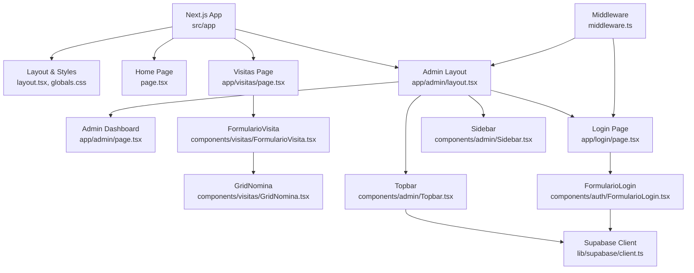
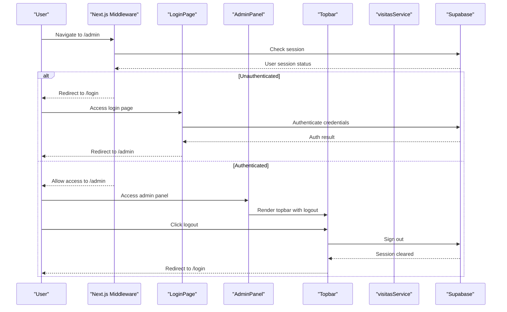
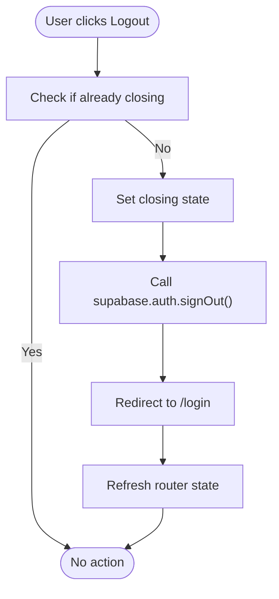
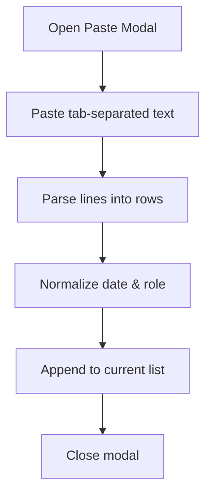
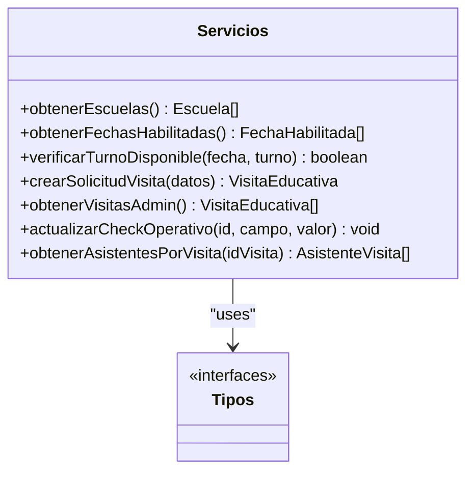
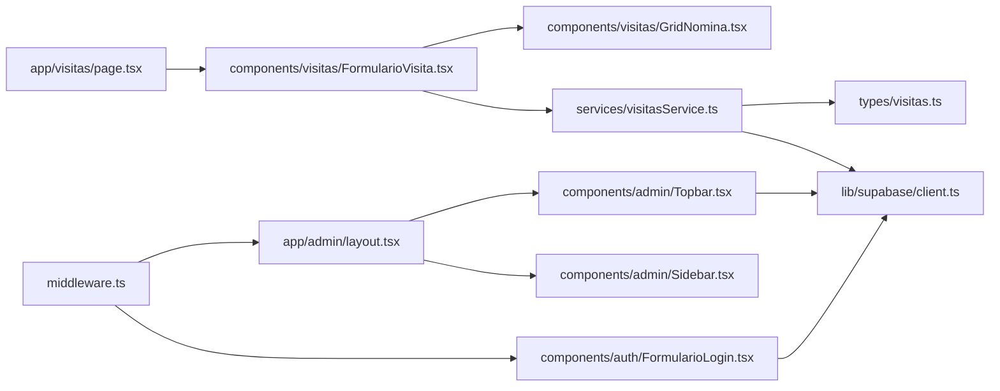

# Administrative Panel

<cite>
**Referenced Files in This Document**
- [README.md](file://README.md)
- [package.json](file://package.json)
- [src/app/layout.tsx](file://src/app/layout.tsx)
- [src/app/page.tsx](file://src/app/page.tsx)
- [src/app/globals.css](file://src/app/globals.css)
- [src/app/visitas/page.tsx](file://src/app/visitas/page.tsx)
- [src/app/admin/layout.tsx](file://src/app/admin/layout.tsx)
- [src/app/admin/page.tsx](file://src/app/admin/page.tsx)
- [src/app/login/page.tsx](file://src/app/login/page.tsx)
- [src/components/admin/Topbar.tsx](file://src/components/admin/Topbar.tsx)
- [src/components/admin/Sidebar.tsx](file://src/components/admin/Sidebar.tsx)
- [src/components/auth/FormularioLogin.tsx](file://src/components/auth/FormularioLogin.tsx)
- [src/components/visitas/FormularioVisita.tsx](file://src/components/visitas/FormularioVisita.tsx)
- [src/components/visitas/GridNomina.tsx](file://src/components/visitas/GridNomina.tsx)
- [src/services/visitasService.ts](file://src/services/visitasService.ts)
- [src/types/visitas.ts](file://src/types/visitas.ts)
- [src/lib/supabase/client.ts](file://src/lib/supabase/client.ts)
- [src/middleware.ts](file://src/middleware.ts)
</cite>

## Update Summary
**Changes Made**
- Added comprehensive authentication system with login/logout functionality
- Implemented secure admin panel with middleware-based route protection
- Enhanced Topbar component with logout button and session management
- Added responsive design improvements for mobile navigation
- Integrated Supabase authentication with Next.js middleware for session handling

## Table of Contents
1. [Introduction](#introduction)
2. [Project Structure](#project-structure)
3. [Core Components](#core-components)
4. [Architecture Overview](#architecture-overview)
5. [Authentication System](#authentication-system)
6. [Detailed Component Analysis](#detailed-component-analysis)
7. [Dependency Analysis](#dependency-analysis)
8. [Performance Considerations](#performance-considerations)
9. [Troubleshooting Guide](#troubleshooting-guide)
10. [Conclusion](#conclusion)

## Introduction
This project is a Next.js application that provides an administrative panel for managing educational visits to a simulation center. It enables institutions to request visit slots, manage attendee rosters, and supports operational checks (insurance, transport, invoices, and file storage). The system integrates with Supabase for data persistence and exposes service functions used by the UI components.

The application now includes a complete authentication system with secure admin panel access, featuring role-based routing, session management, and responsive design patterns. It uses Tailwind CSS for styling, Google fonts via Next.js font loader, and includes utilities for Excel-style roster import and client-side validation before submission.

## Project Structure
The codebase follows a feature-oriented layout under src:
- app: Next.js App Router pages and global styles with protected routes
- components/admin: Admin panel components including Topbar, Sidebar, and dashboard
- components/auth: Authentication components for login functionality
- components/visitas: UI components for the visit form and attendee grid
- services/visitasService: API-like functions wrapping Supabase queries
- types/visitas.ts: Shared TypeScript interfaces and types
- lib/supabase: Supabase client configuration for browser and server environments
- middleware: Route protection and session management

**Diagram sources**
- [src/app/layout.tsx:1-35](file://src/app/layout.tsx#L1-L35)
- [src/app/page.tsx:1-104](file://src/app/page.tsx#L1-L104)
- [src/app/visitas/page.tsx:1-28](file://src/app/visitas/page.tsx#L1-L28)
- [src/app/admin/layout.tsx:1-26](file://src/app/admin/layout.tsx#L1-L26)
- [src/app/admin/page.tsx:1-38](file://src/app/admin/page.tsx#L1-L38)
- [src/app/login/page.tsx:1-31](file://src/app/login/page.tsx#L1-L31)
- [src/components/admin/Topbar.tsx:1-132](file://src/components/admin/Topbar.tsx#L1-L132)
- [src/components/admin/Sidebar.tsx:1-113](file://src/components/admin/Sidebar.tsx#L1-L113)
- [src/components/auth/FormularioLogin.tsx:1-107](file://src/components/auth/FormularioLogin.tsx#L1-L107)
- [src/lib/supabase/client.ts:1-34](file://src/lib/supabase/client.ts#L1-L34)
- [src/middleware.ts:1-100](file://src/middleware.ts#L1-L100)

**Section sources**
- [README.md:1-37](file://README.md#L1-L37)
- [package.json:1-31](file://package.json#L1-L31)
- [src/app/layout.tsx:1-35](file://src/app/layout.tsx#L1-L35)
- [src/app/globals.css:1-27](file://src/app/globals.css#L1-L27)

## Core Components
- **Visitas page**: Renders the public-facing form for scheduling educational visits and sets metadata for SEO.
- **Admin Dashboard**: Protected admin interface with live status monitoring and placeholder for digital twin integration.
- **Authentication System**: Complete login/logout functionality with Supabase integration and middleware-based route protection.
- **Topbar Component**: Enhanced with logout functionality, real-time clock, and responsive mobile navigation.
- **FormularioVisita**: Client component handling form state, validation, loading states, success view, and integration with the service layer.
- **GridNomina**: Interactive table for adding, editing, deleting attendees; supports bulk paste from Excel with tab-separated columns.
- **visitasService**: Encapsulates Supabase operations for schools, available dates, creating visit requests, listing visits for admin, updating operational checkboxes, and fetching attendee lists.
- **Types**: Centralized TypeScript definitions for entities like Escuela, FechaHabilitada, VisitaEducativa, AsistenteInput, and related enums.

Key responsibilities:
- Secure authentication flow with role-based access control
- Data fetching for dropdowns (schools and available dates)
- Client-side validation (capacity limits, required fields, legal consent)
- Submission flow to create a visit record and associated attendees
- Admin-ready endpoints to list visits and update operational flags
- Session management with automatic redirects and cleanup

**Section sources**
- [src/app/visitas/page.tsx:1-28](file://src/app/visitas/page.tsx#L1-L28)
- [src/app/admin/page.tsx:1-38](file://src/app/admin/page.tsx#L1-L38)
- [src/components/admin/Topbar.tsx:1-132](file://src/components/admin/Topbar.tsx#L1-L132)
- [src/components/auth/FormularioLogin.tsx:1-107](file://src/components/auth/FormularioLogin.tsx#L1-L107)
- [src/components/visitas/FormularioVisita.tsx:1-723](file://src/components/visitas/FormularioVisita.tsx#L1-L723)
- [src/components/visitas/GridNomina.tsx:1-277](file://src/components/visitas/GridNomina.tsx#L1-L277)
- [src/services/visitasService.ts:1-169](file://src/services/visitasService.ts#L1-L169)
- [src/types/visitas.ts:1-84](file://src/types/visitas.ts#L1-L84)

## Architecture Overview
The application is a client-rendered Next.js app using the App Router with comprehensive authentication. The Visitas page composes the FormularioVisita component, which orchestrates user interactions and delegates data operations to visitasService. The admin panel is protected by middleware that validates sessions and redirects unauthenticated users. The service interacts with Supabase to read/write data. Types ensure consistent contracts across layers.

**Diagram sources**
- [src/middleware.ts:14-85](file://src/middleware.ts#L14-L85)
- [src/app/login/page.tsx:1-31](file://src/app/login/page.tsx#L1-L31)
- [src/app/admin/layout.tsx:11-25](file://src/app/admin/layout.tsx#L11-L25)
- [src/components/admin/Topbar.tsx:62-72](file://src/components/admin/Topbar.tsx#L62-L72)
- [src/components/auth/FormularioLogin.tsx:21-51](file://src/components/auth/FormularioLogin.tsx#L21-L51)

## Authentication System
The application implements a robust authentication system using Supabase with Next.js middleware for route protection.

### Key Features:
- **Middleware Protection**: Routes are protected server-side, preventing unauthorized access to admin pages
- **Session Management**: Automatic session validation and refresh using Supabase SSR
- **Login Flow**: Email/password authentication with error handling and user feedback
- **Logout Functionality**: Clean session termination with proper redirect to login page
- **Responsive Design**: Mobile-friendly navigation with collapsible menu sections

### Security Implementation:
- Server-side route protection prevents direct URL access to admin pages
- Client-side logout ensures proper session cleanup
- Environment variable validation for Supabase configuration
- Automatic redirects based on authentication status

**Section sources**
- [src/middleware.ts:14-85](file://src/middleware.ts#L14-L85)
- [src/components/auth/FormularioLogin.tsx:21-51](file://src/components/auth/FormularioLogin.tsx#L21-L51)
- [src/components/admin/Topbar.tsx:62-72](file://src/components/admin/Topbar.tsx#L62-L72)

## Detailed Component Analysis

### Admin Layout and Pages
- **Admin Layout**: Provides the shell structure for all admin pages with sidebar and topbar integration
- **Dashboard Page**: Placeholder for future digital twin integration with live status indicators
- **Login Page**: Dedicated authentication interface with form validation and error handling

**Section sources**
- [src/app/admin/layout.tsx:11-25](file://src/app/admin/layout.tsx#L11-L25)
- [src/app/admin/page.tsx:5-37](file://src/app/admin/page.tsx#L5-L37)
- [src/app/login/page.tsx:9-30](file://src/app/login/page.tsx#L9-L30)

### Enhanced Topbar Component
- **Logout Functionality**: Implements secure session termination with Supabase auth.signOut()
- **Real-time Clock**: Live date/time display with Argentine locale formatting
- **Responsive Navigation**: Mobile-optimized navigation with collapsible menu sections
- **Status Indicators**: Visual feedback for system status and user actions
- **Breadcrumb Navigation**: Dynamic section identification based on current pathname

**Diagram sources**
- [src/components/admin/Topbar.tsx:62-72](file://src/components/admin/Topbar.tsx#L62-L72)

**Section sources**
- [src/components/admin/Topbar.tsx:1-132](file://src/components/admin/Topbar.tsx#L1-L132)

### Sidebar Navigation
- **Route Configuration**: Centralized navigation map with icons and labels
- **Active State Detection**: Smart highlighting of current section
- **Mobile Integration**: Responsive navigation that works alongside topbar on smaller screens
- **External Links**: Integration with public visit portal

**Section sources**
- [src/components/admin/Sidebar.tsx:1-113](file://src/components/admin/Sidebar.tsx#L1-L113)

### Visitas Page
- Purpose: Entry point for the visit reservation flow; sets page title and description.
- Behavior: Renders a centered layout and mounts the FormularioVisita component.

**Section sources**
- [src/app/visitas/page.tsx:1-28](file://src/app/visitas/page.tsx#L1-L28)

### FormularioVisita
- Responsibilities:
  - Load schools and available dates on mount
  - Manage form state including institution selection, date, academic year, division, student count, contact details, and legal consents
  - Validate inputs (student count limit, required fields, consent)
  - Submit payload to service and handle success/error states
  - Display a printable confirmation receipt with key details
- Key logic highlights:
  - Capacity enforcement with a maximum per turn
  - Conditional field behavior for "other institution" input
  - Integration with GridNomina for attendee management
  - Error display and retry mechanism for initial data load

**Diagram sources**
- [src/components/visitas/FormularioVisita.tsx:137-217](file://src/components/visitas/FormularioVisita.tsx#L137-L217)
- [src/services/visitasService.ts:58-121](file://src/services/visitasService.ts#L58-L121)

**Section sources**
- [src/components/visitas/FormularioVisita.tsx:1-723](file://src/components/visitas/FormularioVisita.tsx#L1-L723)

### GridNomina
- Responsibilities:
  - Add/remove rows for attendees
  - Edit name, ID, birth date, role
  - Bulk paste from Excel (tab-separated columns)
  - Normalize roles and dates for compatibility
- UX features:
  - Inline table with editable cells
  - Modal dialog for pasting data
  - Clear instructions and warnings about format expectations

**Diagram sources**
- [src/components/visitas/GridNomina.tsx:55-70](file://src/components/visitas/GridNomina.tsx#L55-L70)
- [src/components/visitas/GridNomina.tsx:92-104](file://src/components/visitas/GridNomina.tsx#L92-L104)

**Section sources**
- [src/components/visitas/GridNomina.tsx:1-277](file://src/components/visitas/GridNomina.tsx#L1-L277)

### visitasService
- Responsibilities:
  - Fetch schools and enabled dates
  - Create visit requests with validation and default TUP schedule
  - List all visits for admin purposes
  - Update operational checkboxes (insurance, transport, invoices, Drive)
  - Retrieve attendee lists per visit
- Data model alignment:
  - Uses shared types for consistency between UI and backend calls

**Diagram sources**
- [src/services/visitasService.ts:12-169](file://src/services/visitasService.ts#L12-L169)
- [src/types/visitas.ts:1-84](file://src/types/visitas.ts#L1-L84)

**Section sources**
- [src/services/visitasService.ts:1-169](file://src/services/visitasService.ts#L1-L169)
- [src/types/visitas.ts:1-84](file://src/types/visitas.ts#L1-L84)

### Supabase Client and Middleware
- **Client Configuration**: Initializes the Supabase client using environment variables for URL and anonymous key with proper error handling
- **Middleware Protection**: Server-side route protection that validates sessions and manages redirects
- **Session Management**: Automatic session refresh and cleanup across the application lifecycle

**Section sources**
- [src/lib/supabase/client.ts:1-34](file://src/lib/supabase/client.ts#L1-L34)
- [src/middleware.ts:1-100](file://src/middleware.ts#L1-L100)

## Dependency Analysis
- UI components depend on service functions for data operations
- Services depend on the Supabase client and shared types
- Pages compose components and set metadata
- Middleware protects routes and manages authentication flow
- Authentication components integrate with Supabase for credential validation

**Diagram sources**
- [src/app/visitas/page.tsx:1-28](file://src/app/visitas/page.tsx#L1-L28)
- [src/components/visitas/FormularioVisita.tsx:1-723](file://src/components/visitas/FormularioVisita.tsx#L1-L723)
- [src/components/visitas/GridNomina.tsx:1-277](file://src/components/visitas/GridNomina.tsx#L1-L277)
- [src/services/visitasService.ts:1-169](file://src/services/visitasService.ts#L1-L169)
- [src/types/visitas.ts:1-84](file://src/types/visitas.ts#L1-L84)
- [src/lib/supabase/client.ts:1-34](file://src/lib/supabase/client.ts#L1-L34)
- [src/app/admin/layout.tsx:1-26](file://src/app/admin/layout.tsx#L1-L26)
- [src/components/admin/Topbar.tsx:1-132](file://src/components/admin/Topbar.tsx#L1-L132)
- [src/components/admin/Sidebar.tsx:1-113](file://src/components/admin/Sidebar.tsx#L1-L113)
- [src/components/auth/FormularioLogin.tsx:1-107](file://src/components/auth/FormularioLogin.tsx#L1-L107)
- [src/middleware.ts:1-100](file://src/middleware.ts#L1-L100)

**Section sources**
- [src/app/visitas/page.tsx:1-28](file://src/app/visitas/page.tsx#L1-L28)
- [src/components/visitas/FormularioVisita.tsx:1-723](file://src/components/visitas/FormularioVisita.tsx#L1-L723)
- [src/components/visitas/GridNomina.tsx:1-277](file://src/components/visitas/GridNomina.tsx#L1-L277)
- [src/services/visitasService.ts:1-169](file://src/services/visitasService.ts#L1-L169)
- [src/types/visitas.ts:1-84](file://src/types/visitas.ts#L1-L84)
- [src/lib/supabase/client.ts:1-34](file://src/lib/supabase/client.ts#L1-L34)
- [src/app/admin/layout.tsx:1-26](file://src/app/admin/layout.tsx#L1-L26)
- [src/components/admin/Topbar.tsx:1-132](file://src/components/admin/Topbar.tsx#L1-L132)
- [src/components/admin/Sidebar.tsx:1-113](file://src/components/admin/Sidebar.tsx#L1-L113)
- [src/components/auth/FormularioLogin.tsx:1-107](file://src/components/auth/FormularioLogin.tsx#L1-L107)
- [src/middleware.ts:1-100](file://src/middleware.ts#L1-L100)

## Performance Considerations
- **Parallel data loading**: Initial fetches for schools and dates are executed concurrently to reduce latency
- **Client-side validation**: Prevents unnecessary network calls by validating constraints early
- **Minimal re-renders**: Form state updates are localized; GridNomina manages its own row list efficiently
- **Database queries**: Use selective column projections where possible (e.g., limited fields when listing schools/dates)
- **Middleware optimization**: Route matching excludes static assets to minimize server processing
- **Session caching**: Supabase client instance is cached to prevent redundant initialization
- **Responsive rendering**: Mobile-first design reduces unnecessary DOM manipulation on smaller screens

## Troubleshooting Guide
Common issues and resolutions:
- **Authentication failures**:
  - Check Supabase environment variables and permissions
  - Verify email/password credentials are correct
  - Ensure middleware is properly configured for route protection
- **Loading errors for schools or dates**:
  - Check Supabase environment variables and permissions
  - Use the provided retry control to reload data
- **Validation errors**:
  - Ensure student count does not exceed the allowed maximum
  - Confirm all required fields and legal consents are completed
- **Submission failures**:
  - Verify network connectivity and Supabase availability
  - Inspect error messages returned by the service layer
- **Attendee import problems**:
  - Ensure Excel paste uses tab separators and correct column order
  - Validate date formats and role values; use manual entry if parsing fails
- **Logout issues**:
  - Verify Supabase auth.signOut() completes successfully
  - Check that router.refresh() clears any cached authentication state
  - Ensure middleware properly handles unauthenticated redirects

**Section sources**
- [src/components/auth/FormularioLogin.tsx:21-51](file://src/components/auth/FormularioLogin.tsx#L21-L51)
- [src/components/admin/Topbar.tsx:62-72](file://src/components/admin/Topbar.tsx#L62-L72)
- [src/middleware.ts:66-78](file://src/middleware.ts#L66-L78)
- [src/components/visitas/FormularioVisita.tsx:93-116](file://src/components/visitas/FormularioVisita.tsx#L93-L116)
- [src/components/visitas/FormularioVisita.tsx:137-217](file://src/components/visitas/FormularioVisita.tsx#L137-L217)
- [src/components/visitas/GridNomina.tsx:55-70](file://src/components/visitas/GridNomina.tsx#L55-L70)
- [src/services/visitasService.ts:12-33](file://src/services/visitasService.ts#L12-L33)

## Conclusion
The Administrative Panel now provides a comprehensive, secure, and user-friendly interface for scheduling educational visits, managing attendee rosters, and supporting operational workflows through Supabase integration. The enhanced authentication system with middleware-based route protection ensures only authorized users can access admin functionality. Its modular architecture separates concerns between UI, services, types, and authentication, enabling maintainability and scalability. With clear validation, error handling, performance-conscious patterns, and responsive design improvements, it offers a solid foundation for further enhancements such as advanced reporting, expanded admin capabilities, and additional security features.

The addition of logout functionality with proper session cleanup demonstrates the system's commitment to security best practices, while the responsive design improvements ensure accessibility across different device sizes and screen orientations.