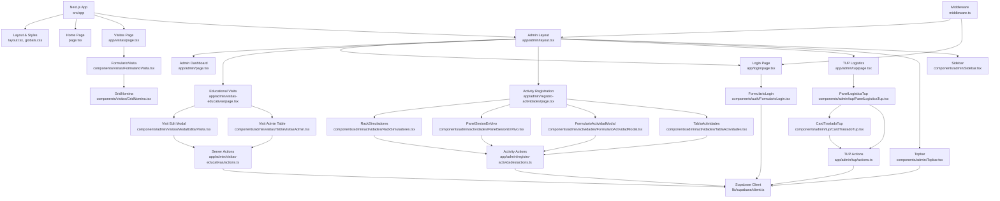
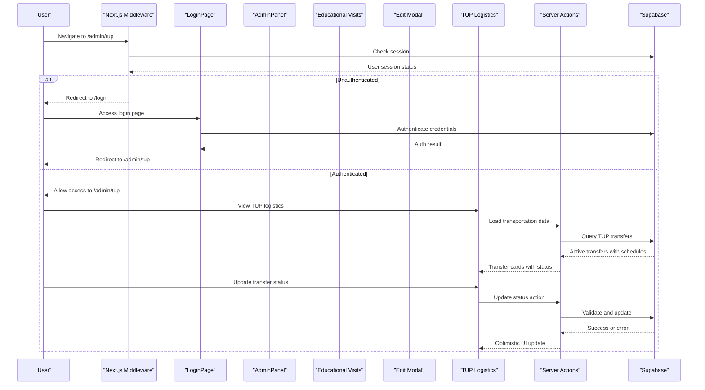
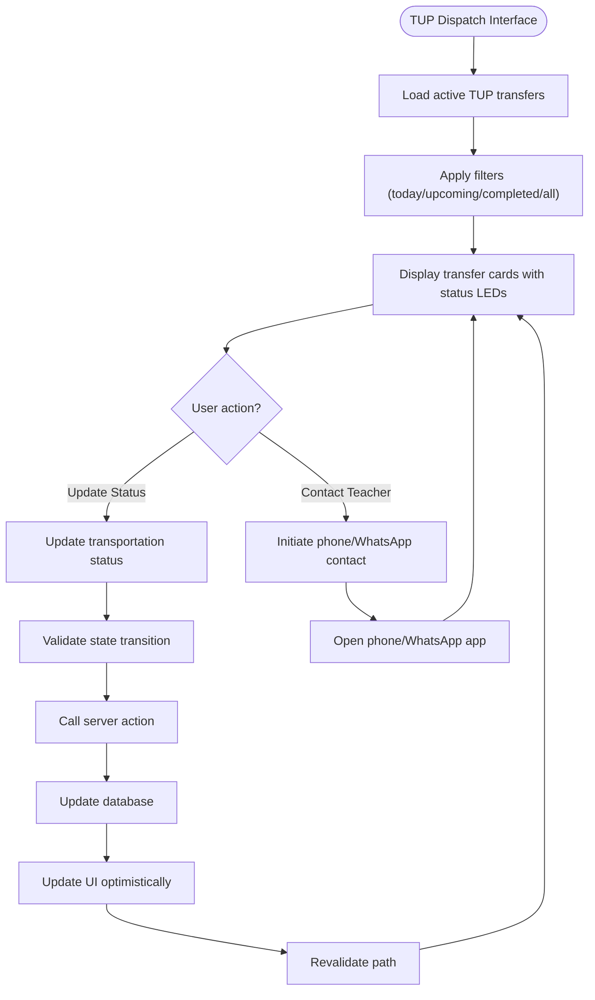
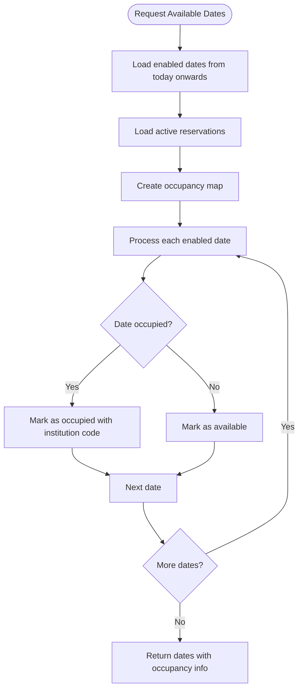
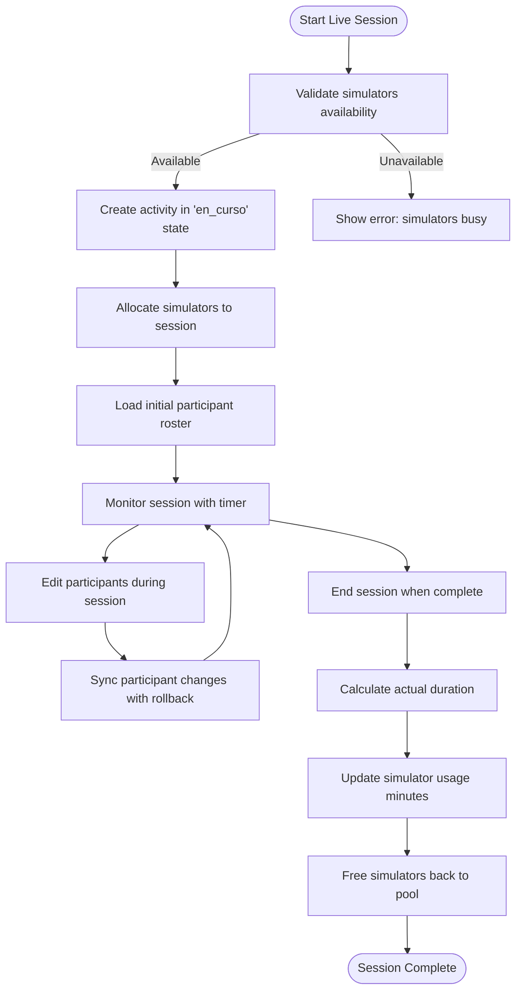
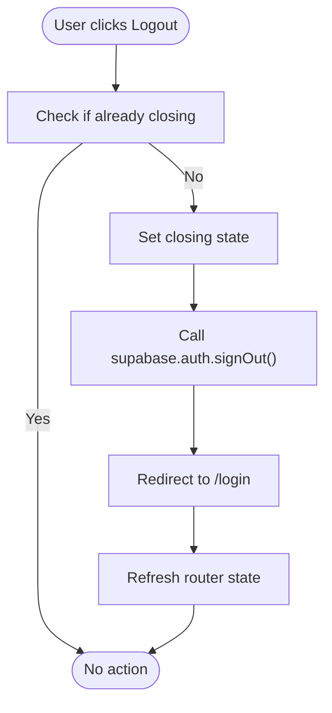
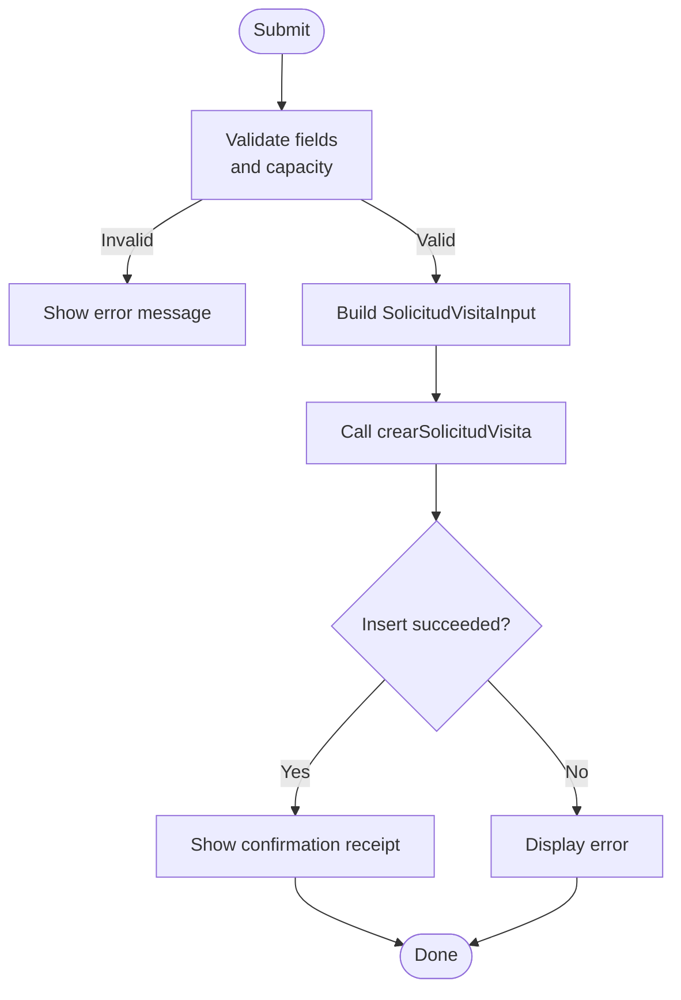
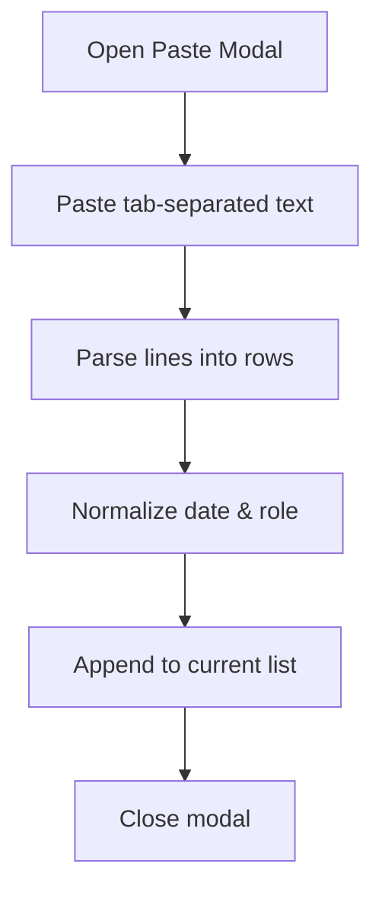
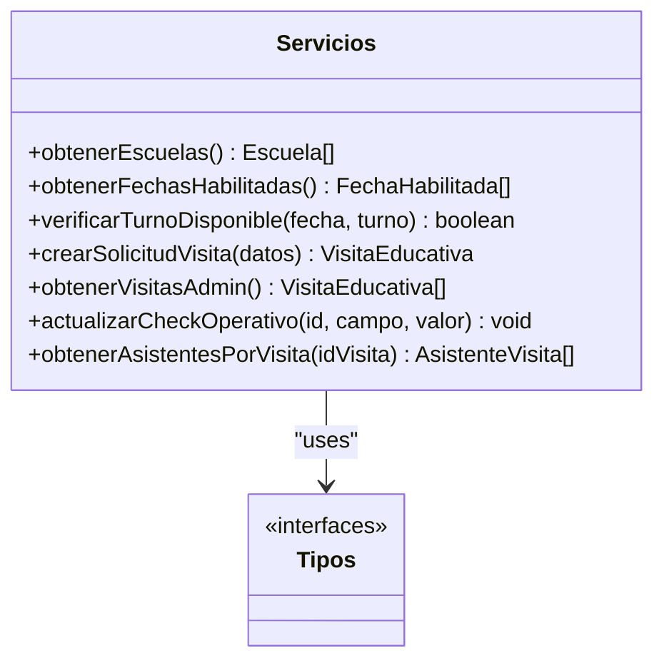
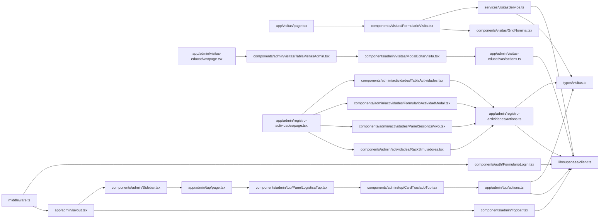

# Administrative Panel

<cite>
**Referenced Files in This Document**
- [README.md](file://README.md)
- [package.json](file://package.json)
- [src/app/layout.tsx](file://src/app/layout.tsx)
- [src/app/page.tsx](file://src/app/page.tsx)
- [src/app/globals.css](file://src/app/globals.css)
- [src/app/visitas/page.tsx](file://src/app/visitas/page.tsx)
- [src/app/admin/layout.tsx](file://src/app/admin/layout.tsx)
- [src/app/admin/page.tsx](file://src/app/admin/page.tsx)
- [src/app/admin/visitas-educativas/page.tsx](file://src/app/admin/visitas-educativas/page.tsx)
- [src/app/admin/visitas-educativas/actions.ts](file://src/app/admin/visitas-educativas/actions.ts)
- [src/app/admin/registro-actividades/page.tsx](file://src/app/admin/registro-actividades/page.tsx)
- [src/app/admin/registro-actividades/actions.ts](file://src/app/admin/registro-actividades/actions.ts)
- [src/app/admin/tup/page.tsx](file://src/app/admin/tup/page.tsx)
- [src/app/admin/tup/actions.ts](file://src/app/admin/tup/actions.ts)
- [src/app/login/page.tsx](file://src/app/login/page.tsx)
- [src/components/admin/Topbar.tsx](file://src/components/admin/Topbar.tsx)
- [src/components/admin/Sidebar.tsx](file://src/components/admin/Sidebar.tsx)
- [src/components/auth/FormularioLogin.tsx](file://src/components/auth/FormularioLogin.tsx)
- [src/components/visitas/FormularioVisita.tsx](file://src/components/visitas/FormularioVisita.tsx)
- [src/components/visitas/GridNomina.tsx](file://src/components/visitas/GridNomina.tsx)
- [src/components/admin/actividades/RackSimuladores.tsx](file://src/components/admin/actividades/RackSimuladores.tsx)
- [src/components/admin/actividades/PanelSesionEnVivo.tsx](file://src/components/admin/actividades/PanelSesionEnVivo.tsx)
- [src/components/admin/actividades/FormularioActividadModal.tsx](file://src/components/admin/actividades/FormularioActividadModal.tsx)
- [src/components/admin/actividades/TablaActividades.tsx](file://src/components/admin/actividades/TablaActividades.tsx)
- [src/components/admin/visitas/ModalEditarVisita.tsx](file://src/components/admin/visitas/ModalEditarVisita.tsx)
- [src/components/admin/visitas/TablaVisitasAdmin.tsx](file://src/components/admin/visitas/TablaVisitasAdmin.tsx)
- [src/components/admin/tup/PanelLogisticaTup.tsx](file://src/components/admin/tup/PanelLogisticaTup.tsx)
- [src/components/admin/tup/CardTrasladoTup.tsx](file://src/components/admin/tup/CardTrasladoTup.tsx)
- [src/services/visitasService.ts](file://src/services/visitasService.ts)
- [src/types/visitas.ts](file://src/types/visitas.ts)
- [src/types/actividades.ts](file://src/types/actividades.ts)
- [src/types/tup.ts](file://src/types/tup.ts)
- [src/lib/supabase/client.ts](file://src/lib/supabase/client.ts)
- [src/middleware.ts](file://src/middleware.ts)
- [supabase/migrations/0003_agregar_columnas_tup.sql](file://supabase/migrations/0003_agregar_columnas_tup.sql)
</cite>

## Update Summary
**Changes Made**
- Added comprehensive TUP (Municipal Transportation) logistics management module for coordinating school bus transportation
- Implemented dedicated TUP navigation integration in the admin sidebar with truck icon
- Created mobile-optimized dispatch interface for drivers and operators to manage transportation status
- Enhanced educational visit system with transportation scheduling and driver assignment capabilities
- Added database schema extensions for TUP logistics tracking including time schedules and transport states
- Integrated real-time transportation status updates with optimistic UI updates and rollback support

## Table of Contents
1. [Introduction](#introduction)
2. [Project Structure](#project-structure)
3. [Core Components](#core-components)
4. [Architecture Overview](#architecture-overview)
5. [Authentication System](#authentication-system)
6. [Educational Visit Management System](#educational-visit-management-system)
7. [TUP Logistics Management Module](#tup-logistics-management-module)
8. [Date Availability Checking](#date-availability-checking)
9. [Visit Editing System](#visit-editing-system)
10. [Enhanced Payroll Processing](#enhanced-payroll-processing)
11. [Live Session Management](#live-session-management)
12. [Detailed Component Analysis](#detailed-component-analysis)
13. [Dependency Analysis](#dependency-analysis)
14. [Performance Considerations](#performance-considerations)
15. [Troubleshooting Guide](#troubleshooting-guide)
16. [Conclusion](#conclusion)

## Introduction
This project is a Next.js application that provides an administrative panel for managing educational visits to a simulation center. It enables institutions to request visit slots, manage attendee rosters, and supports operational checks (insurance, transport, invoices, and file storage). The system integrates with Supabase for data persistence and exposes service functions used by the UI components.

The application now includes a complete authentication system with secure admin panel access, featuring role-based routing, session management, and responsive design patterns. **Additionally, it features a comprehensive educational visit management system with advanced server actions for date availability checking, visit editing with rollback capabilities, enhanced payroll processing with improved error recovery mechanisms, and a new TUP logistics management module for coordinating municipal transportation for educational visits.**

It uses Tailwind CSS for styling, Google fonts via Next.js font loader, and includes utilities for Excel-style roster import and client-side validation before submission.

## Project Structure
The codebase follows a feature-oriented layout under src:
- app: Next.js App Router pages and global styles with protected routes
- components/admin: Admin panel components including Topbar, Sidebar, and dashboard
- components/admin/visitas: Educational visit management components with editing capabilities
- components/admin/actividades: Activity registration and live session management components
- components/admin/tup: TUP logistics management components for transportation coordination
- components/auth: Authentication components for login functionality
- components/visitas: UI components for the visit form and attendee grid
- services/visitasService: API-like functions wrapping Supabase queries
- types: Shared TypeScript interfaces and types for both visits, activities, and TUP logistics
- lib/supabase: Supabase client configuration for browser and server environments
- middleware: Route protection and session management

**Diagram sources**
- [src/app/layout.tsx:1-35](file://src/app/layout.tsx#L1-L35)
- [src/app/page.tsx:1-104](file://src/app/page.tsx#L1-L104)
- [src/app/visitas/page.tsx:1-28](file://src/app/visitas/page.tsx#L1-L28)
- [src/app/admin/layout.tsx:1-26](file://src/app/admin/layout.tsx#L1-L26)
- [src/app/admin/page.tsx:1-38](file://src/app/admin/page.tsx#L1-L38)
- [src/app/admin/visitas-educativas/page.tsx:1-26](file://src/app/admin/visitas-educativas/page.tsx#L1-L26)
- [src/app/admin/registro-actividades/page.tsx:1-261](file://src/app/admin/registro-actividades/page.tsx#L1-L261)
- [src/app/admin/tup/page.tsx:1-145](file://src/app/admin/tup/page.tsx#L1-L145)
- [src/app/login/page.tsx:1-31](file://src/app/login/page.tsx#L1-L31)
- [src/components/admin/Topbar.tsx:1-132](file://src/components/admin/Topbar.tsx#L1-L132)
- [src/components/admin/Sidebar.tsx:1-113](file://src/components/admin/Sidebar.tsx#L1-L113)
- [src/components/auth/FormularioLogin.tsx:1-107](file://src/components/auth/FormularioLogin.tsx#L1-L107)
- [src/components/admin/visitas/ModalEditarVisita.tsx:1-625](file://src/components/admin/visitas/ModalEditarVisita.tsx#L1-L625)
- [src/components/admin/visitas/TablaVisitasAdmin.tsx:1-349](file://src/components/admin/visitas/TablaVisitasAdmin.tsx#L1-L349)
- [src/components/admin/actividades/RackSimuladores.tsx:1-153](file://src/components/admin/actividades/RackSimuladores.tsx#L1-L153)
- [src/components/admin/actividades/PanelSesionEnVivo.tsx:1-866](file://src/components/admin/actividades/PanelSesionEnVivo.tsx#L1-L866)
- [src/components/admin/actividades/FormularioActividadModal.tsx:1-606](file://src/components/admin/actividades/FormularioActividadModal.tsx#L1-L606)
- [src/components/admin/actividades/TablaActividades.tsx:1-434](file://src/components/admin/actividades/TablaActividades.tsx#L1-L434)
- [src/components/admin/tup/PanelLogisticaTup.tsx:1-175](file://src/components/admin/tup/PanelLogisticaTup.tsx#L1-L175)
- [src/components/admin/tup/CardTrasladoTup.tsx:1-319](file://src/components/admin/tup/CardTrasladoTup.tsx#L1-L319)
- [src/lib/supabase/client.ts:1-34](file://src/lib/supabase/client.ts#L1-L34)
- [src/middleware.ts:1-100](file://src/middleware.ts#L1-L100)

**Section sources**
- [README.md:1-37](file://README.md#L1-L37)
- [package.json:1-31](file://package.json#L1-L31)
- [src/app/layout.tsx:1-35](file://src/app/layout.tsx#L1-L35)
- [src/app/globals.css:1-27](file://src/app/globals.css#L1-L27)

## Core Components
- **Visitas page**: Renders the public-facing form for scheduling educational visits and sets metadata for SEO.
- **Admin Dashboard**: Protected admin interface with live status monitoring and placeholder for digital twin integration.
- **Educational Visit Management**: Comprehensive system for managing confirmed visits with editing capabilities and date conflict resolution.
- **Visit Editing Interface**: Advanced modal interface for modifying visit details with real-time date availability checking.
- **Activity Registration System**: Module for registering presential activities with participant management and simulator allocation.
- **Live Session Management**: Real-time session controls with dual viewing modes (list/tablet) for active session monitoring.
- **Real-time Simulator Rack**: SCADA-style interface for direct simulator state control with optimistic updates.
- **TUP Logistics Management**: Mobile-optimized dispatch interface for managing municipal transportation coordination for educational visits.
- **Authentication System**: Complete login/logout functionality with Supabase integration and middleware-based route protection.
- **Topbar Component**: Enhanced with logout functionality, real-time clock, and responsive mobile navigation.
- **FormularioVisita**: Client component handling form state, validation, loading states, success view, and integration with the service layer.
- **GridNomina**: Interactive table for adding, editing, deleting attendees; supports bulk paste from Excel with tab-separated columns.
- **visitasService**: Encapsulates Supabase operations for schools, available dates, creating visit requests, listing visits for admin, updating operational checkboxes, and fetching attendee lists.
- **Types**: Centralized TypeScript definitions for entities like Escuela, FechaHabilitada, VisitaEducativa, AsistenteInput, Actividad, Simulador, TrasladoTupItem, and related enums.

Key responsibilities:
- Secure authentication flow with role-based access control
- Data fetching for dropdowns (schools and available dates)
- Client-side validation (capacity limits, required fields, legal consent)
- Submission flow to create a visit record and associated attendees
- **Educational visit management with server-side date conflict detection and validation**
- **Advanced visit editing with rollback capabilities and comprehensive error handling**
- **Enhanced payroll processing with improved rollback operations for participant synchronization**
- **TUP logistics coordination with real-time transportation status updates and driver assignment**
- Activity lifecycle management from planning to completion
- Real-time session tracking with participant synchronization
- Simulator rack control with concurrent session management
- Admin-ready endpoints to list visits and update operational flags
- Session management with automatic redirects and cleanup

**Section sources**
- [src/app/visitas/page.tsx:1-28](file://src/app/visitas/page.tsx#L1-L28)
- [src/app/admin/page.tsx:1-38](file://src/app/admin/page.tsx#L1-L38)
- [src/app/admin/visitas-educativas/page.tsx:1-26](file://src/app/admin/visitas-educativas/page.tsx#L1-L26)
- [src/components/admin/visitas/ModalEditarVisita.tsx:1-625](file://src/components/admin/visitas/ModalEditarVisita.tsx#L1-L625)
- [src/components/admin/visitas/TablaVisitasAdmin.tsx:1-349](file://src/components/admin/visitas/TablaVisitasAdmin.tsx#L1-L349)
- [src/app/admin/registro-actividades/page.tsx:1-261](file://src/app/admin/registro-actividades/page.tsx#L1-L261)
- [src/app/admin/tup/page.tsx:1-145](file://src/app/admin/tup/page.tsx#L1-L145)
- [src/components/admin/Topbar.tsx:1-132](file://src/components/admin/Topbar.tsx#L1-L132)
- [src/components/auth/FormularioLogin.tsx:1-107](file://src/components/auth/FormularioLogin.tsx#L1-L107)
- [src/components/visitas/FormularioVisita.tsx:1-723](file://src/components/visitas/FormularioVisita.tsx#L1-L723)
- [src/components/visitas/GridNomina.tsx:1-277](file://src/components/visitas/GridNomina.tsx#L1-L277)
- [src/components/admin/actividades/RackSimuladores.tsx:1-153](file://src/components/admin/actividades/RackSimuladores.tsx#L1-L153)
- [src/components/admin/actividades/PanelSesionEnVivo.tsx:1-866](file://src/components/admin/actividades/PanelSesionEnVivo.tsx#L1-L866)
- [src/components/admin/actividades/FormularioActividadModal.tsx:1-606](file://src/components/admin/actividades/FormularioActividadModal.tsx#L1-L606)
- [src/components/admin/actividades/TablaActividades.tsx:1-434](file://src/components/admin/actividades/TablaActividades.tsx#L1-L434)
- [src/components/admin/tup/PanelLogisticaTup.tsx:1-175](file://src/components/admin/tup/PanelLogisticaTup.tsx#L1-L175)
- [src/components/admin/tup/CardTrasladoTup.tsx:1-319](file://src/components/admin/tup/CardTrasladoTup.tsx#L1-L319)
- [src/services/visitasService.ts:1-169](file://src/services/visitasService.ts#L1-L169)
- [src/types/visitas.ts:1-128](file://src/types/visitas.ts#L1-L128)
- [src/types/actividades.ts:1-177](file://src/types/actividades.ts#L1-L177)
- [src/types/tup.ts:1-41](file://src/types/tup.ts#L1-L41)

## Architecture Overview
The application is a client-rendered Next.js app using the App Router with comprehensive authentication. The Visitas page composes the FormularioVisita component, which orchestrates user interactions and delegates data operations to visitasService. The admin panel is protected by middleware that validates sessions and redirects unauthenticated users. **The educational visit management system uses Server Actions for all database operations, providing type-safe, validated mutations with optimistic UI updates and robust rollback capabilities. The new TUP logistics module extends this architecture with specialized transportation coordination workflows.** The service interacts with Supabase to read/write data. Types ensure consistent contracts across layers.

**Diagram sources**
- [src/middleware.ts:14-85](file://src/middleware.ts#L14-L85)
- [src/app/login/page.tsx:1-31](file://src/app/login/page.tsx#L1-L31)
- [src/app/admin/layout.tsx:11-25](file://src/app/admin/layout.tsx#L11-L25)
- [src/app/admin/tup/page.tsx:101-145](file://src/app/admin/tup/page.tsx#L101-L145)
- [src/components/admin/tup/PanelLogisticaTup.tsx:63-175](file://src/components/admin/tup/PanelLogisticaTup.tsx#L63-L175)
- [src/app/admin/tup/actions.ts:33-86](file://src/app/admin/tup/actions.ts#L33-L86)

## Authentication System
The application implements a robust authentication system using Supabase with Next.js middleware for route protection.

### Key Features:
- **Middleware Protection**: Routes are protected server-side, preventing unauthorized access to admin pages
- **Session Management**: Automatic session validation and refresh using Supabase SSR
- **Login Flow**: Email/password authentication with error handling and user feedback
- **Logout Functionality**: Clean session termination with proper redirect to login page
- **Responsive Design**: Mobile-friendly navigation with collapsible menu sections

### Security Implementation:
- Server-side route protection prevents direct URL access to admin pages
- Client-side logout ensures proper session cleanup
- Environment variable validation for Supabase configuration
- Automatic redirects based on authentication status

**Section sources**
- [src/middleware.ts:14-85](file://src/middleware.ts#L14-L85)
- [src/components/auth/FormularioLogin.tsx:21-51](file://src/components/auth/FormularioLogin.tsx#L21-L51)
- [src/components/admin/Topbar.tsx:62-72](file://src/components/admin/Topbar.tsx#L62-L72)

## Educational Visit Management System
**New Feature** - A comprehensive educational visit management system that handles the complete lifecycle of confirmed educational visits with advanced editing capabilities.

### Core Capabilities:
- **Visit Administration**: Dedicated interface for managing confirmed educational visits with full CRUD operations
- **Date Conflict Resolution**: Real-time detection of date conflicts with other reservations
- **Advanced Validation**: Server-side validation with comprehensive error handling and rollback support
- **Operational Tracking**: Integration with existing operational check system (insurance, transport, invoices, Drive)
- **Export Capabilities**: Excel export functionality for attendee rosters and visit information
- **TUP Integration**: Seamless integration with transportation logistics for coordinated scheduling

### Data Model Enhancements:
- **FechaDisponibleItem**: Extended date model with occupancy status and conflict information
- **EditarVisitaInput**: Specialized input type for visit editing with enhanced validation
- **ResultadoEdicionVisita**: Typed response format for edit operations with error handling
- **Enhanced VisitaEducativa**: Extended visit model with additional operational fields and TUP scheduling

### Validation & Safety:
- **PII-Safe Logging**: Error logging that excludes sensitive personal information
- **Concurrent Access Protection**: Database-level unique constraints prevent double-booking
- **Transaction Support**: Rollback mechanisms handle partial failures gracefully
- **Type Safety**: Full TypeScript integration ensures compile-time validation

**Section sources**
- [src/app/admin/visitas-educativas/actions.ts:114-176](file://src/app/admin/visitas-educativas/actions.ts#L114-L176)
- [src/app/admin/visitas-educativas/actions.ts:200-332](file://src/app/admin/visitas-educativas/actions.ts#L200-L332)
- [src/types/visitas.ts:91-128](file://src/types/visitas.ts#L91-L128)
- [src/components/admin/visitas/ModalEditarVisita.tsx:178-225](file://src/components/admin/visitas/ModalEditarVisita.tsx#L178-L225)

## TUP Logistics Management Module
**New Feature** - A comprehensive municipal transportation coordination system designed specifically for managing school bus transportation (TUP - Transporte Urbano de Pasajeros) for educational visits.

### Core Capabilities:
- **Transportation Status Management**: Real-time tracking of bus transportation status from pending to completed
- **Driver Assignment**: Driver name assignment and contact management for each transportation
- **Schedule Coordination**: Morning departure and return trip scheduling with time validation
- **Mobile-Optimized Interface**: Touch-friendly dispatch interface designed for use in vehicles
- **Contact Integration**: Direct phone calling and WhatsApp messaging capabilities for teacher coordination
- **Filtering and Organization**: Smart filtering by today's trips, upcoming trips, completed trips, and all trips

### Data Model:
- **TrasladoTupItem**: Core transportation item containing visit details, institution info, schedules, and status
- **EstadoTrasladoTup**: Enumerated states (pendiente, en_camino, en_destino, completado, cancelado)
- **ActualizarEstadoTrasladoInput**: Input type for status updates with optional driver assignment

### Technical Implementation:
- **Server Action**: `actualizarEstadoTrasladoAction` handles status updates with validation and security
- **Database Schema**: Extended `visitas_educativas` table with TUP-specific columns and constraints
- **PostgREST Integration**: Efficient data querying with institution name resolution via foreign key relationships
- **Optimistic Updates**: Immediate UI feedback while server operations complete
- **Error Handling**: Comprehensive error handling with user-friendly messages and rollback support

### User Interface Features:
- **LED Status Indicators**: Visual status indicators with animated pulses for active transportation
- **Touch-Friendly Controls**: Large buttons (44px minimum) optimized for vehicle use
- **Contact Quick Actions**: One-touch phone calls and WhatsApp message generation
- **Schedule Display**: Clear presentation of departure and return times
- **Capacity Information**: Student count display for transportation planning

**Diagram sources**
- [src/app/admin/tup/page.tsx:101-145](file://src/app/admin/tup/page.tsx#L101-L145)
- [src/components/admin/tup/PanelLogisticaTup.tsx:63-175](file://src/components/admin/tup/PanelLogisticaTup.tsx#L63-L175)
- [src/components/admin/tup/CardTrasladoTup.tsx:117-319](file://src/components/admin/tup/CardTrasladoTup.tsx#L117-L319)
- [src/app/admin/tup/actions.ts:33-86](file://src/app/admin/tup/actions.ts#L33-L86)

**Section sources**
- [src/app/admin/tup/page.tsx:1-145](file://src/app/admin/tup/page.tsx#L1-L145)
- [src/app/admin/tup/actions.ts:1-86](file://src/app/admin/tup/actions.ts#L1-L86)
- [src/components/admin/tup/PanelLogisticaTup.tsx:1-175](file://src/components/admin/tup/PanelLogisticaTup.tsx#L1-L175)
- [src/components/admin/tup/CardTrasladoTup.tsx:1-319](file://src/components/admin/tup/CardTrasladoTup.tsx#L1-L319)
- [src/types/tup.ts:1-41](file://src/types/tup.ts#L1-L41)
- [supabase/migrations/0003_agregar_columnas_tup.sql:1-118](file://supabase/migrations/0003_agregar_columnas_tup.sql#L1-L118)

## Date Availability Checking
**New Feature** - Sophisticated date availability checking system that provides real-time conflict detection and occupancy status for educational visits.

### Key Features:
- **Real-time Conflict Detection**: Identifies dates occupied by other active reservations
- **Occupancy Status**: Shows which institution occupies each date with their reservation code
- **Current Visit Exemption**: Allows keeping the current visit's date even if marked as occupied
- **Parallel Data Loading**: Efficiently loads enabled dates and occupancy data simultaneously
- **Error Handling**: Comprehensive error handling with user-friendly messages

### Technical Implementation:
- **Server Action**: `obtenerFechasDisponiblesAction` provides date availability with conflict information
- **Database Queries**: Parallel queries for enabled dates and active reservations
- **Conflict Mapping**: Efficient mapping of occupied dates to their occupying institutions
- **State Management**: React hooks manage loading states and error conditions

**Diagram sources**
- [src/app/admin/visitas-educativas/actions.ts:114-176](file://src/app/admin/visitas-educativas/actions.ts#L114-L176)

**Section sources**
- [src/app/admin/visitas-educativas/actions.ts:114-176](file://src/app/admin/visitas-educativas/actions.ts#L114-L176)
- [src/components/admin/visitas/ModalEditarVisita.tsx:133-153](file://src/components/admin/visitas/ModalEditarVisita.tsx#L133-L153)
- [src/types/visitas.ts:91-100](file://src/types/visitas.ts#L91-L100)

## Visit Editing System
**New Feature** - Advanced visit editing system with comprehensive validation, rollback capabilities, and user-friendly error handling.

### Core Capabilities:
- **Comprehensive Validation**: Server-side validation for dates, times, capacity limits, and state transitions
- **Rollback Support**: Automatic rollback mechanisms handle database errors gracefully
- **Capacity Management**: Different capacity limits for editing (45) vs. creation (40)
- **State Transition Logic**: Intelligent state management for date changes and confirmations
- **Transportation Logistics**: Enhanced TUP (transport) field validation and management

### Validation Rules:
- **Date Validation**: ISO format validation with calendar validity checks
- **Time Format Validation**: HH:MM or HH:MM:SS format enforcement for transportation schedules
- **Capacity Limits**: Maximum 45 students for editing operations
- **State Validation**: Only allowed states can be set (Confirmed, Rescheduled, Cancelled, Completed, Pending)
- **Transportation Validation**: Required time fields when TUP is enabled

### Error Handling:
- **PII-Safe Logging**: Error logs exclude sensitive personal information
- **User-Friendly Messages**: Clear error messages without exposing internal database details
- **Rollback Mechanisms**: Automatic restoration of previous data on failed operations
- **Conflict Detection**: Early detection of date conflicts before database operations

**Section sources**
- [src/app/admin/visitas-educativas/actions.ts:200-332](file://src/app/admin/visitas-educativas/actions.ts#L200-L332)
- [src/components/admin/visitas/ModalEditarVisita.tsx:178-225](file://src/components/admin/visitas/ModalEditarVisita.tsx#L178-L225)
- [src/types/visitas.ts:102-128](file://src/types/visitas.ts#L102-L128)

## Enhanced Payroll Processing
**Enhanced Feature** - Improved payroll processing system with enhanced rollback operations and better error handling for participant synchronization.

### Key Improvements:
- **Enhanced Rollback Operations**: Improved rollback mechanisms for participant synchronization failures
- **Better Error Recovery**: More robust error handling during participant data synchronization
- **Data Integrity**: Enhanced validation and consistency checks for participant data
- **Performance Optimization**: Optimized batch operations for large participant lists

### Technical Enhancements:
- **Improved Sync Logic**: Better handling of participant list synchronization with rollback support
- **Enhanced Validation**: More comprehensive validation of participant data before insertion
- **Error Isolation**: Better isolation of errors to prevent cascading failures
- **Logging Improvements**: Enhanced logging for debugging payroll processing issues

**Section sources**
- [src/app/admin/registro-actividades/actions.ts:650-699](file://src/app/admin/registro-actividades/actions.ts#L650-L699)
- [src/components/admin/actividades/PanelSesionEnVivo.tsx:625-654](file://src/components/admin/actividades/PanelSesionEnVivo.tsx#L625-L654)

## Live Session Management
**Existing Feature** - Real-time session management system for conducting live training sessions or demonstrations.

### Key Features:
- **Session Lifecycle**: Start, monitor, and end live sessions with full audit trail
- **Dual Viewing Modes**: List view for desktop administration, tablet mode for hands-on operation
- **Real-time Participant Sync**: Live updates to participant rosters during sessions
- **Timer Integration**: Accurate session duration tracking with start/end time calculation
- **Concurrent Session Control**: Prevents multiple simultaneous sessions on the same simulators

### Interface Components:
- **SCADA-style Rack**: Visual simulator control panel with LED indicators and status displays
- **Session Panel**: Full-screen modal for session management with participant editing
- **Confirmation Dialogs**: Safety checks before critical operations like session termination
- **Optimistic Updates**: Immediate UI feedback while server operations complete

### Technical Implementation:
- **Server Actions**: All database operations handled securely on the server
- **State Management**: React hooks manage complex session state transitions
- **Error Handling**: Comprehensive error recovery with rollback capabilities
- **Performance Optimization**: Memoized calculations and isolated sub-components prevent unnecessary re-renders

**Diagram sources**
- [src/components/admin/actividades/PanelSesionEnVivo.tsx:251-297](file://src/components/admin/actividades/PanelSesionEnVivo.tsx#L251-L297)
- [src/app/admin/registro-actividades/actions.ts:370-577](file://src/app/admin/registro-actividades/actions.ts#L370-L577)
- [src/app/admin/registro-actividades/actions.ts:714-800](file://src/app/admin/registro-actividades/actions.ts#L714-L800)

**Section sources**
- [src/components/admin/actividades/PanelSesionEnVivo.tsx:1-866](file://src/components/admin/actividades/PanelSesionEnVivo.tsx#L1-L866)
- [src/components/admin/actividades/RackSimuladores.tsx:1-153](file://src/components/admin/actividades/RackSimuladores.tsx#L1-L153)
- [src/components/admin/actividades/TablaActividades.tsx:105-434](file://src/components/admin/actividades/TablaActividades.tsx#L105-L434)
- [src/app/admin/registro-actividades/actions.ts:370-800](file://src/app/admin/registro-actividades/actions.ts#L370-L800)

## Detailed Component Analysis

### TUP Logistics Management Pages
**New Module** - Dedicated interface for managing municipal transportation coordination for educational visits.

- **TUP Page**: Server component that loads active transportation transfers with institution name resolution and schedule information
- **Panel Logística TUP**: Client component providing filtering, counting, and display of transportation cards with touch-optimized interface
- **Card Traslado TUP**: Individual transportation card with status management, contact integration, and schedule display

**Section sources**
- [src/app/admin/tup/page.tsx:101-145](file://src/app/admin/tup/page.tsx#L101-L145)
- [src/components/admin/tup/PanelLogisticaTup.tsx:63-175](file://src/components/admin/tup/PanelLogisticaTup.tsx#L63-L175)
- [src/components/admin/tup/CardTrasladoTup.tsx:117-319](file://src/components/admin/tup/CardTrasladoTup.tsx#L117-L319)

### Enhanced Server Actions
- **Date Availability Action**: Provides real-time date availability with conflict detection and occupancy information
- **Visit Update Action**: Handles comprehensive visit editing with validation, rollback support, and error handling
- **TUP Status Update Action**: Manages transportation status updates with validation and security controls
- **Enhanced Error Handling**: PII-safe logging and user-friendly error messages throughout the system

**Section sources**
- [src/app/admin/visitas-educativas/actions.ts:114-176](file://src/app/admin/visitas-educativas/actions.ts#L114-L176)
- [src/app/admin/visitas-educativas/actions.ts:200-332](file://src/app/admin/visitas-educativas/actions.ts#L200-L332)
- [src/app/admin/tup/actions.ts:33-86](file://src/app/admin/tup/actions.ts#L33-L86)

### Enhanced Topbar Component
- **Logout Functionality**: Implements secure session termination with Supabase auth.signOut()
- **Real-time Clock**: Live date/time display with Argentine locale formatting
- **Responsive Navigation**: Mobile-optimized navigation with collapsible menu sections
- **Status Indicators**: Visual feedback for system status and user actions
- **Breadcrumb Navigation**: Dynamic section identification based on current pathname

**Diagram sources**
- [src/components/admin/Topbar.tsx:62-72](file://src/components/admin/Topbar.tsx#L62-L72)

**Section sources**
- [src/components/admin/Topbar.tsx:1-132](file://src/components/admin/Topbar.tsx#L1-L132)

### Enhanced Sidebar Navigation
**Updated** - Added TUP logistics navigation with truck icon and proper routing integration.

- **Route Configuration**: Centralized navigation map with icons and labels including new TUP logistics module
- **Active State Detection**: Smart highlighting of current section with TUP route support
- **Mobile Integration**: Responsive navigation that works alongside topbar on smaller screens
- **External Links**: Integration with public visit portal
- **TUP Integration**: New navigation item for the TUP logistics management module with truck icon

**Section sources**
- [src/components/admin/Sidebar.tsx:26-32](file://src/components/admin/Sidebar.tsx#L26-L32)
- [src/components/admin/Sidebar.tsx:79-97](file://src/components/admin/Sidebar.tsx#L79-L97)

### Visitas Page
- Purpose: Entry point for the visit reservation flow; sets page title and description.
- Behavior: Renders a centered layout and mounts the FormularioVisita component.

**Section sources**
- [src/app/visitas/page.tsx:1-28](file://src/app/visitas/page.tsx#L1-L28)

### FormularioVisita
- Responsibilities:
  - Load schools and available dates on mount
  - Manage form state including institution selection, date, academic year, division, student count, contact details, and legal consents
  - Validate inputs (student count limit, required fields, consent)
  - Submit payload to service and handle success/error states
  - Display a printable confirmation receipt with key details
- Key logic highlights:
  - Capacity enforcement with a maximum per turn
  - Conditional field behavior for "other institution" input
  - Integration with GridNomina for attendee management
  - Error display and retry mechanism for initial data load

**Diagram sources**
- [src/components/visitas/FormularioVisita.tsx:137-217](file://src/components/visitas/FormularioVisita.tsx#L137-L217)
- [src/services/visitasService.ts:58-121](file://src/services/visitasService.ts#L58-L121)

**Section sources**
- [src/components/visitas/FormularioVisita.tsx:1-723](file://src/components/visitas/FormularioVisita.tsx#L1-L723)

### GridNomina
- Responsibilities:
  - Add/remove rows for attendees
  - Edit name, ID, birth date, role
  - Bulk paste from Excel (tab-separated columns)
  - Normalize roles and dates for compatibility
- UX features:
  - Inline table with editable cells
  - Modal dialog for pasting data
  - Clear instructions and warnings about format expectations

**Diagram sources**
- [src/components/visitas/GridNomina.tsx:55-70](file://src/components/visitas/GridNomina.tsx#L55-L70)
- [src/components/visitas/GridNomina.tsx:92-104](file://src/components/visitas/GridNomina.tsx#L92-L104)

**Section sources**
- [src/components/visitas/GridNomina.tsx:1-277](file://src/components/visitas/GridNomina.tsx#L1-L277)

### Real-time Simulator Rack
**Existing Component** - SCADA-style interface for direct simulator control with industrial aesthetics.

- **Visual Status Indicators**: LED-style indicators showing simulator states (free, operating, maintenance)
- **Direct State Control**: One-click switching between free and operating states
- **Optimistic Updates**: Immediate visual feedback while server operations complete
- **Responsive Grid**: Adapts from single column on mobile to 4 columns on large screens
- **Usage Statistics**: Displays total hours of use per simulator

**Section sources**
- [src/components/admin/actividades/RackSimuladores.tsx:1-153](file://src/components/admin/actividades/RackSimuladores.tsx#L1-L153)

### Live Session Panel
**Existing Component** - Comprehensive session management interface with dual-phase workflow.

- **Phase A (Setup)**: Entity details, simulator selection, and initial participant roster
- **Phase B (Monitoring)**: Active session with timer, participant editing, and session termination
- **Isolated Timer**: Separate memoized component prevents unnecessary re-renders
- **Confirmation Dialogs**: Safety checks before critical operations
- **Tablet Mode**: Optimized interface for touch devices and hands-on operation

**Section sources**
- [src/components/admin/actividades/PanelSesionEnVivo.tsx:1-866](file://src/components/admin/actividades/PanelSesionEnVivo.tsx#L1-L866)

### Activity Form Modal
**Existing Component** - Industrial-styled form for registering new activities with comprehensive validation.

- **Auto-calculated Duration**: Automatically computes duration from start/end times when provided
- **Dynamic Participant Grid**: Add/remove participants with inline editing
- **Simulator Selection**: Visual selector showing simulator availability and status
- **Validation Feedback**: Real-time validation with clear error messages
- **Type-safe Submission**: Full TypeScript integration with server action payloads

**Section sources**
- [src/components/admin/actividades/FormularioActividadModal.tsx:1-606](file://src/components/admin/actividades/FormularioActividadModal.tsx#L1-L606)

### Activity History Table
**Existing Component** - Comprehensive activity history with dual viewing modes.

- **List Mode**: Traditional table view with sorting and filtering capabilities
- **Tablet Mode**: Simplified interface optimized for touch devices and active session management
- **Gender Analytics**: Shows participant breakdown by gender (e.g., "8 (5M / 3H)")
- **Simulator Usage**: Displays linked simulators with individual usage minutes
- **Status Badges**: Color-coded status indicators with animated pulse for active sessions

**Section sources**
- [src/components/admin/actividades/TablaActividades.tsx:1-434](file://src/components/admin/actividades/TablaActividades.tsx#L1-L434)

### Enhanced Server Actions
**Enhanced Module** - Comprehensive server-side logic for educational visit management, activity/session management, and TUP logistics coordination.

- **Educational Visit Management**: Complete CRUD operations for educational visits with enhanced validation
- **Date Availability Checking**: Real-time conflict detection and occupancy status for dates
- **TUP Logistics Management**: Transportation status updates with validation and security controls
- **Enhanced Rollback Support**: Improved rollback mechanisms for participant synchronization
- **PII-Safe Logging**: Error logging that excludes sensitive personal information
- **Type Safety**: Full TypeScript integration with comprehensive error handling

**Section sources**
- [src/app/admin/visitas-educativas/actions.ts:1-333](file://src/app/admin/visitas-educativas/actions.ts#L1-L333)
- [src/app/admin/registro-actividades/actions.ts:1-909](file://src/app/admin/registro-actividades/actions.ts#L1-L909)
- [src/app/admin/tup/actions.ts:1-86](file://src/app/admin/tup/actions.ts#L1-L86)

### visitasService
- Responsibilities:
  - Fetch schools and enabled dates
  - Create visit requests with validation and default TUP schedule
  - List all visits for admin purposes
  - Update operational checkboxes (insurance, transport, invoices, Drive)
  - Retrieve attendee lists per visit
- Data model alignment:
  - Uses shared types for consistency between UI and backend calls

**Diagram sources**
- [src/services/visitasService.ts:12-169](file://src/services/visitasService.ts#L12-L169)
- [src/types/visitas.ts:1-84](file://src/types/visitas.ts#L1-L84)

**Section sources**
- [src/services/visitasService.ts:1-169](file://src/services/visitasService.ts#L1-L169)
- [src/types/visitas.ts:1-84](file://src/types/visitas.ts#L1-L84)

### Supabase Client and Middleware
- **Client Configuration**: Initializes the Supabase client using environment variables for URL and anonymous key with proper error handling
- **Middleware Protection**: Server-side route protection that validates sessions and manages redirects
- **Session Management**: Automatic session refresh and cleanup across the application lifecycle

**Section sources**
- [src/lib/supabase/client.ts:1-34](file://src/lib/supabase/client.ts#L1-L34)
- [src/middleware.ts:1-100](file://src/middleware.ts#L1-L100)

## Dependency Analysis
- UI components depend on service functions for data operations
- Services depend on the Supabase client and shared types
- Pages compose components and set metadata
- Middleware protects routes and manages authentication flow
- Authentication components integrate with Supabase for credential validation
- **Server Actions provide type-safe database operations for educational visit management, activity systems, and TUP logistics coordination**
- **Enhanced error handling and rollback mechanisms improve system reliability**
- **Educational visit components depend on specialized server actions for date availability and editing**
- **TUP logistics components depend on dedicated server actions for transportation status management**

**Diagram sources**
- [src/app/visitas/page.tsx:1-28](file://src/app/visitas/page.tsx#L1-L28)
- [src/components/visitas/FormularioVisita.tsx:1-723](file://src/components/visitas/FormularioVisita.tsx#L1-L723)
- [src/components/visitas/GridNomina.tsx:1-277](file://src/components/visitas/GridNomina.tsx#L1-L277)
- [src/services/visitasService.ts:1-169](file://src/services/visitasService.ts#L1-L169)
- [src/types/visitas.ts:1-128](file://src/types/visitas.ts#L1-L128)
- [src/lib/supabase/client.ts:1-34](file://src/lib/supabase/client.ts#L1-L34)
- [src/app/admin/layout.tsx:1-26](file://src/app/admin/layout.tsx#L1-L26)
- [src/components/admin/Topbar.tsx:1-132](file://src/components/admin/Topbar.tsx#L1-L132)
- [src/components/admin/Sidebar.tsx:1-113](file://src/components/admin/Sidebar.tsx#L1-L113)
- [src/components/auth/FormularioLogin.tsx:1-107](file://src/components/auth/FormularioLogin.tsx#L1-L107)
- [src/middleware.ts:1-100](file://src/middleware.ts#L1-L100)
- [src/app/admin/visitas-educativas/page.tsx:1-26](file://src/app/admin/visitas-educativas/page.tsx#L1-L26)
- [src/components/admin/visitas/TablaVisitasAdmin.tsx:1-349](file://src/components/admin/visitas/TablaVisitasAdmin.tsx#L1-L349)
- [src/components/admin/visitas/ModalEditarVisita.tsx:1-625](file://src/components/admin/visitas/ModalEditarVisita.tsx#L1-L625)
- [src/app/admin/visitas-educativas/actions.ts:1-333](file://src/app/admin/visitas-educativas/actions.ts#L1-L333)
- [src/app/admin/registro-actividades/page.tsx:1-261](file://src/app/admin/registro-actividades/page.tsx#L1-L261)
- [src/components/admin/actividades/RackSimuladores.tsx:1-153](file://src/components/admin/actividades/RackSimuladores.tsx#L1-L153)
- [src/components/admin/actividades/PanelSesionEnVivo.tsx:1-866](file://src/components/admin/actividades/PanelSesionEnVivo.tsx#L1-L866)
- [src/components/admin/actividades/FormularioActividadModal.tsx:1-606](file://src/components/admin/actividades/FormularioActividadModal.tsx#L1-L606)
- [src/components/admin/actividades/TablaActividades.tsx:1-434](file://src/components/admin/actividades/TablaActividades.tsx#L1-L434)
- [src/app/admin/registro-actividades/actions.ts:1-909](file://src/app/admin/registro-actividades/actions.ts#L1-L909)
- [src/app/admin/tup/page.tsx:1-145](file://src/app/admin/tup/page.tsx#L1-L145)
- [src/components/admin/tup/PanelLogisticaTup.tsx:1-175](file://src/components/admin/tup/PanelLogisticaTup.tsx#L1-L175)
- [src/components/admin/tup/CardTrasladoTup.tsx:1-319](file://src/components/admin/tup/CardTrasladoTup.tsx#L1-L319)
- [src/app/admin/tup/actions.ts:1-86](file://src/app/admin/tup/actions.ts#L1-L86)

**Section sources**
- [src/app/visitas/page.tsx:1-28](file://src/app/visitas/page.tsx#L1-L28)
- [src/components/visitas/FormularioVisita.tsx:1-723](file://src/components/visitas/FormularioVisita.tsx#L1-L723)
- [src/components/visitas/GridNomina.tsx:1-277](file://src/components/visitas/GridNomina.tsx#L1-L277)
- [src/services/visitasService.ts:1-169](file://src/services/visitasService.ts#L1-L169)
- [src/types/visitas.ts:1-128](file://src/types/visitas.ts#L1-L128)
- [src/lib/supabase/client.ts:1-34](file://src/lib/supabase/client.ts#L1-L34)
- [src/app/admin/layout.tsx:1-26](file://src/app/admin/layout.tsx#L1-L26)
- [src/components/admin/Topbar.tsx:1-132](file://src/components/admin/Topbar.tsx#L1-L132)
- [src/components/admin/Sidebar.tsx:1-113](file://src/components/admin/Sidebar.tsx#L1-L113)
- [src/components/auth/FormularioLogin.tsx:1-107](file://src/components/auth/FormularioLogin.tsx#L1-L107)
- [src/middleware.ts:1-100](file://src/middleware.ts#L1-L100)
- [src/app/admin/visitas-educativas/page.tsx:1-26](file://src/app/admin/visitas-educativas/page.tsx#L1-L26)
- [src/components/admin/visitas/TablaVisitasAdmin.tsx:1-349](file://src/components/admin/visitas/TablaVisitasAdmin.tsx#L1-L349)
- [src/components/admin/visitas/ModalEditarVisita.tsx:1-625](file://src/components/admin/visitas/ModalEditarVisita.tsx#L1-L625)
- [src/app/admin/visitas-educativas/actions.ts:1-333](file://src/app/admin/visitas-educativas/actions.ts#L1-L333)
- [src/app/admin/registro-actividades/page.tsx:1-261](file://src/app/admin/registro-actividades/page.tsx#L1-L261)
- [src/components/admin/actividades/RackSimuladores.tsx:1-153](file://src/components/admin/actividades/RackSimuladores.tsx#L1-L153)
- [src/components/admin/actividades/PanelSesionEnVivo.tsx:1-866](file://src/components/admin/actividades/PanelSesionEnVivo.tsx#L1-L866)
- [src/components/admin/actividades/FormularioActividadModal.tsx:1-606](file://src/components/admin/actividades/FormularioActividadModal.tsx#L1-L606)
- [src/components/admin/actividades/TablaActividades.tsx:1-434](file://src/components/admin/actividades/TablaActividades.tsx#L1-L434)
- [src/app/admin/registro-actividades/actions.ts:1-909](file://src/app/admin/registro-actividades/actions.ts#L1-L909)
- [src/app/admin/tup/page.tsx:1-145](file://src/app/admin/tup/page.tsx#L1-L145)
- [src/components/admin/tup/PanelLogisticaTup.tsx:1-175](file://src/components/admin/tup/PanelLogisticaTup.tsx#L1-L175)
- [src/components/admin/tup/CardTrasladoTup.tsx:1-319](file://src/components/admin/tup/CardTrasladoTup.tsx#L1-L319)
- [src/app/admin/tup/actions.ts:1-86](file://src/app/admin/tup/actions.ts#L1-L86)

## Performance Considerations
- **Parallel data loading**: Initial fetches for schools and dates are executed concurrently to reduce latency
- **Client-side validation**: Prevents unnecessary network calls by validating constraints early
- **Minimal re-renders**: Form state updates are localized; GridNomina manages its own row list efficiently
- **Database queries**: Use selective column projections where possible (e.g., limited fields when listing schools/dates)
- **Middleware optimization**: Route matching excludes static assets to minimize server processing
- **Session caching**: Supabase client instance is cached to prevent redundant initialization
- **Responsive rendering**: Mobile-first design reduces unnecessary DOM manipulation on smaller screens
- **Memoized Calculations**: Activity history uses useMemo for expensive computations like gender summaries
- **Isolated Sub-components**: Timer component is memoized to prevent parent re-renders
- **Optimistic Updates**: Server actions use revalidatePath for efficient UI updates without full page reloads
- **Enhanced Performance**: Educational visit management uses parallel queries for date availability and occupancy data
- **Efficient Conflict Detection**: Map-based conflict detection minimizes computational overhead
- **TUP Optimization**: PostgREST embeds for efficient institution name resolution and filtered queries for active transfers only
- **Touch-Optimized UI**: TUP interface uses large touch targets and minimal animations for vehicle usability

## Troubleshooting Guide
Common issues and resolutions:
- **Authentication failures**:
  - Check Supabase environment variables and permissions
  - Verify email/password credentials are correct
  - Ensure middleware is properly configured for route protection
- **Loading errors for schools or dates**:
  - Check Supabase environment variables and permissions
  - Use the provided retry control to reload data
- **Validation errors**:
  - Ensure student count does not exceed the allowed maximum
  - Confirm all required fields and legal consents are completed
- **Submission failures**:
  - Verify network connectivity and Supabase availability
  - Inspect error messages returned by the service layer
- **Attendee import problems**:
  - Ensure Excel paste uses tab separators and correct column order
  - Validate date formats and role values; use manual entry if parsing fails
- **Logout issues**:
  - Verify Supabase auth.signOut() completes successfully
  - Check that router.refresh() clears any cached authentication state
  - Ensure middleware properly handles unauthenticated redirects
- **Activity registration issues**:
  - Check that simulators are available before attempting to allocate them
  - Verify participant names are not empty when submitting forms
  - Ensure duration calculations are valid (positive integers)
- **Live session problems**:
  - Verify concurrent session protection is working correctly
  - Check that session timers are calculating durations accurately
  - Ensure participant synchronization maintains data integrity
- **Simulator rack control**:
  - Confirm state transitions follow allowed patterns (free ↔ operating)
  - Verify maintenance mode cannot be toggled directly from the rack
  - Check that activity references are properly cleaned up when freeing simulators
- **Educational visit management issues**:
  - Check date availability conflicts before attempting to save changes
  - Verify TUP transportation schedules are in correct format (HH:MM or HH:MM:SS)
  - Ensure capacity limits are respected (45 students maximum for editing)
  - Check that state transitions are valid (only allowed states can be set)
- **Date availability problems**:
  - Verify enabled dates are properly configured in the database
  - Check that conflict detection is working correctly for active reservations
  - Ensure current visit dates are exempt from conflict detection
- **Visit editing failures**:
  - Review server-side validation errors for specific field issues
  - Check database constraints for unique date requirements
  - Verify rollback mechanisms are functioning correctly on failed operations
- **Payroll processing issues**:
  - Check enhanced rollback operations for participant synchronization
  - Verify data integrity during batch participant operations
  - Review improved error handling for participant data validation
- **TUP logistics issues**:
  - Verify transportation schedules are properly formatted and within valid ranges
  - Check that institution names resolve correctly via foreign key relationships
  - Ensure driver assignment updates are properly validated and secured
  - Verify contact information normalization for phone and WhatsApp integration
  - Check that transportation status transitions follow allowed state patterns
  - Ensure mobile interface renders correctly on various screen sizes

**Section sources**
- [src/components/auth/FormularioLogin.tsx:21-51](file://src/components/auth/FormularioLogin.tsx#L21-L51)
- [src/components/admin/Topbar.tsx:62-72](file://src/components/admin/Topbar.tsx#L62-L72)
- [src/middleware.ts:66-78](file://src/middleware.ts#L66-L78)
- [src/components/visitas/FormularioVisita.tsx:93-116](file://src/components/visitas/FormularioVisita.tsx#L93-L116)
- [src/components/visitas/FormularioVisita.tsx:137-217](file://src/components/visitas/FormularioVisita.tsx#L137-L217)
- [src/components/visitas/GridNomina.tsx:55-70](file://src/components/visitas/GridNomina.tsx#L55-L70)
- [src/services/visitasService.ts:12-33](file://src/services/visitasService.ts#L12-L33)
- [src/app/admin/visitas-educativas/actions.ts:82-88](file://src/app/admin/visitas-educativas/actions.ts#L82-L88)
- [src/app/admin/visitas-educativas/actions.ts:200-332](file://src/app/admin/visitas-educativas/actions.ts#L200-L332)
- [src/app/admin/registro-actividades/actions.ts:650-699](file://src/app/admin/registro-actividades/actions.ts#L650-L699)
- [src/app/admin/tup/actions.ts:33-86](file://src/app/admin/tup/actions.ts#L33-L86)

## Conclusion
The Administrative Panel now provides a comprehensive, secure, and user-friendly interface for scheduling educational visits, managing attendee rosters, supporting operational workflows through Supabase integration, and coordinating municipal transportation for educational visits. **The addition of a complete educational visit management system with advanced server actions for date availability checking, visit editing with rollback capabilities, enhanced payroll processing with improved error recovery mechanisms, and a new TUP logistics management module significantly enhances the platform's capabilities**, enabling administrators to effectively manage confirmed educational visits with sophisticated conflict resolution, error handling, and transportation coordination.

The enhanced authentication system with middleware-based route protection ensures only authorized users can access admin functionality. Its modular architecture separates concerns between UI, services, types, and authentication, enabling maintainability and scalability. With clear validation, error handling, performance-conscious patterns, and responsive design improvements, it offers a solid foundation for further enhancements such as advanced reporting, expanded admin capabilities, and additional security features.

**The new TUP logistics management module demonstrates sophisticated software engineering practices**, including mobile-optimized interfaces for vehicle use, real-time status updates with optimistic UI, comprehensive validation and security controls, and seamless integration with existing educational visit workflows. The transportation coordination system provides essential functionality for managing school bus transportation with driver assignment, schedule management, and contact integration for teacher communication.

The enhanced educational visit management system showcases transactional operations, concurrent access protection, optimistic UI updates, comprehensive error handling, and PII-safe logging. The enhanced rollback mechanisms for payroll processing demonstrate robust error recovery strategies that maintain data integrity even during partial failures. The sophisticated date conflict detection system provides real-time feedback to users while maintaining database consistency.

The addition of logout functionality with proper session cleanup demonstrates the system's commitment to security best practices, while the responsive design improvements ensure accessibility across different device sizes and screen orientations. **The comprehensive educational visit management system combined with the new TUP logistics module represents a significant evolution from simple visit scheduling to full-scale educational institution administration**, positioning the platform as a complete solution for simulation center operations management with advanced administrative capabilities and transportation coordination.

**The enhanced payroll processing with improved rollback operations ensures data integrity and reliability** during complex participant synchronization operations, making the system more robust and user-friendly for administrative staff managing large groups of educational visitors. **The TUP logistics module fills a critical gap in educational visit coordination**, providing municipal transportation management that was previously missing from the administrative toolkit.