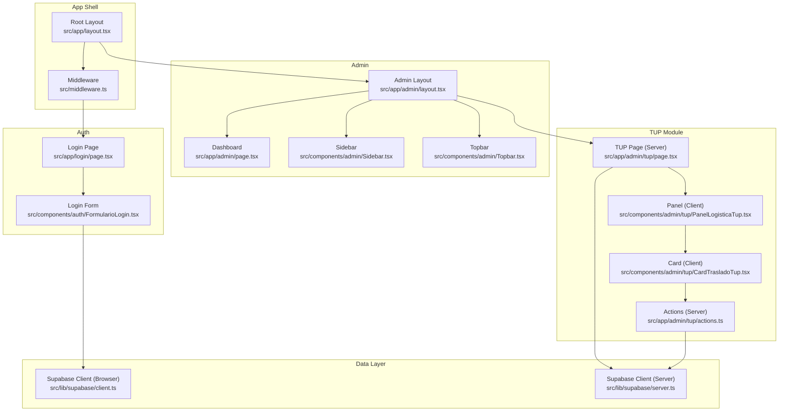
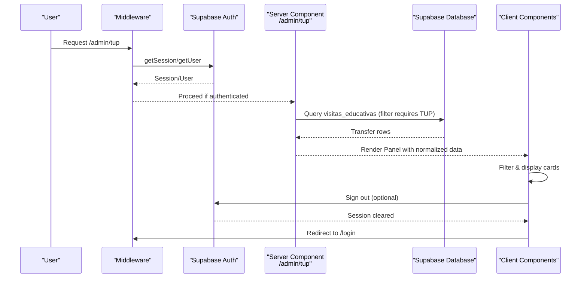
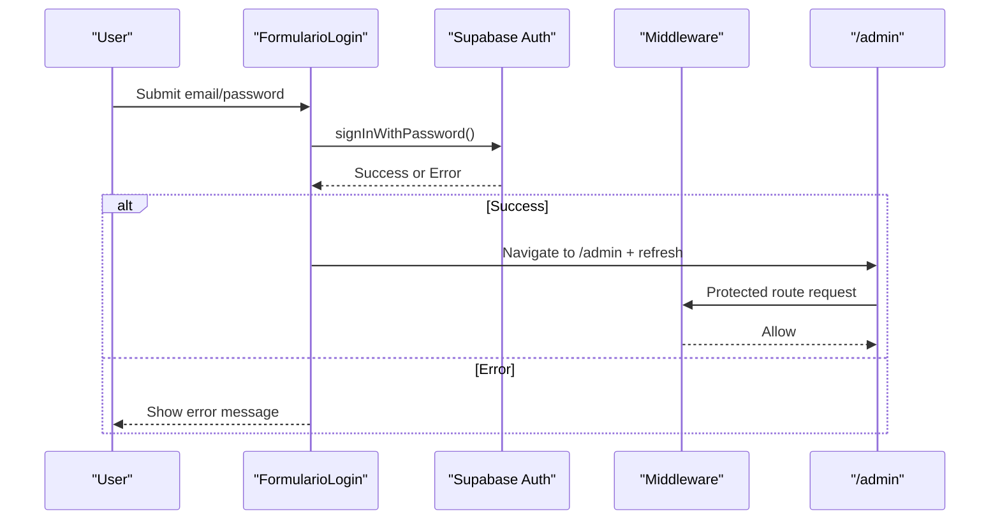
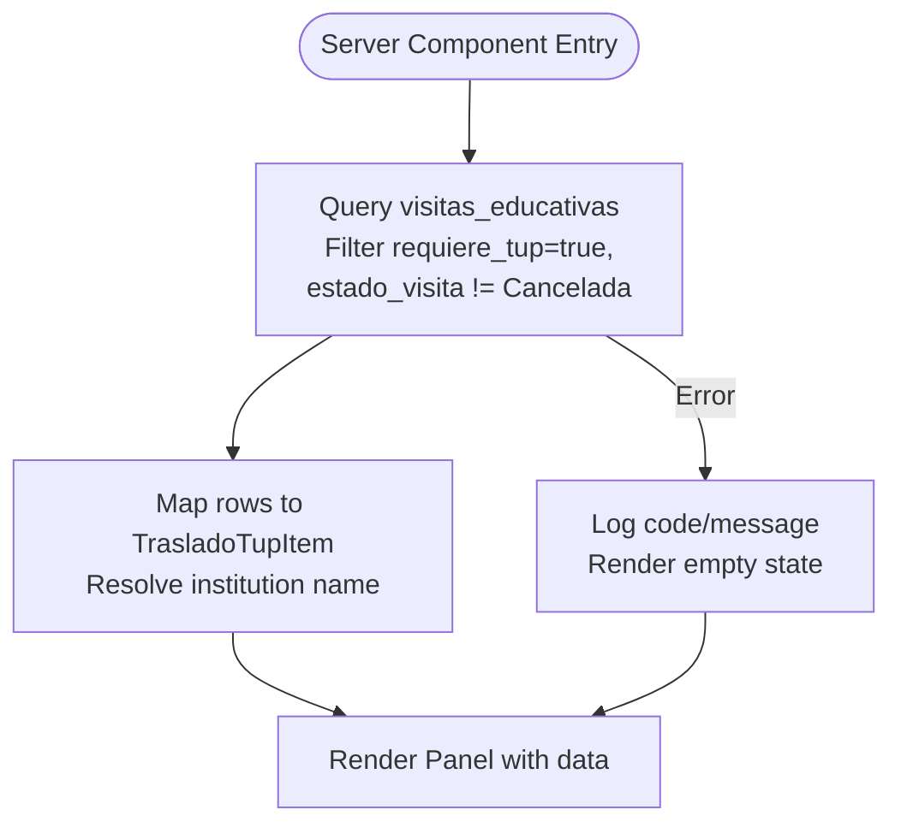
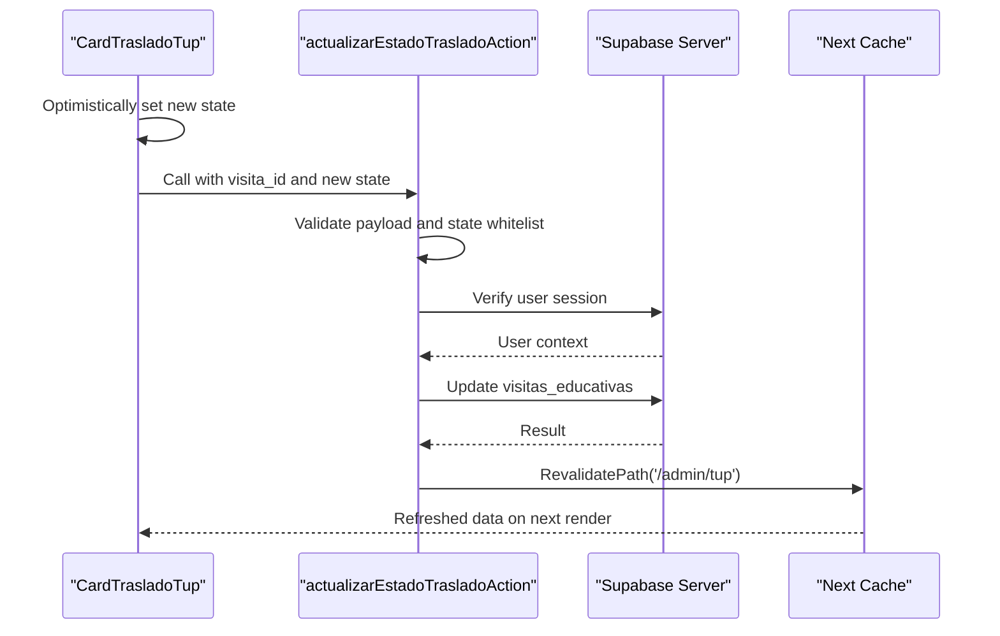
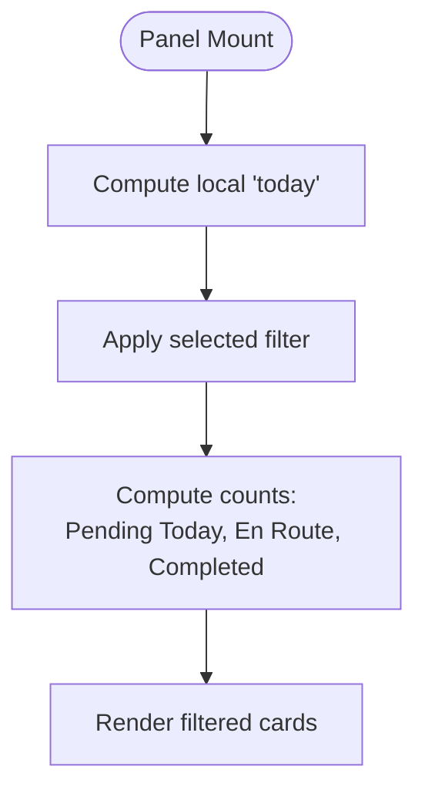
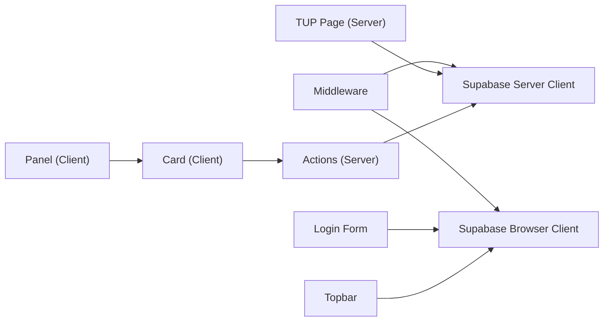

# TUP Logistics Management System

<cite>
**Referenced Files in This Document**
- [README.md](file://README.md)
- [package.json](file://package.json)
- [src/app/layout.tsx](file://src/app/layout.tsx)
- [src/middleware.ts](file://src/middleware.ts)
- [src/lib/supabase/client.ts](file://src/lib/supabase/client.ts)
- [src/lib/supabase/server.ts](file://src/lib/supabase/server.ts)
- [src/app/admin/layout.tsx](file://src/app/admin/layout.tsx)
- [src/app/admin/page.tsx](file://src/app/admin/page.tsx)
- [src/app/admin/tup/page.tsx](file://src/app/admin/tup/page.tsx)
- [src/app/admin/tup/actions.ts](file://src/app/admin/tup/actions.ts)
- [src/components/admin/Sidebar.tsx](file://src/components/admin/Sidebar.tsx)
- [src/components/admin/Topbar.tsx](file://src/components/admin/Topbar.tsx)
- [src/components/admin/tup/PanelLogisticaTup.tsx](file://src/components/admin/tup/PanelLogisticaTup.tsx)
- [src/components/admin/tup/CardTrasladoTup.tsx](file://src/components/admin/tup/CardTrasladoTup.tsx)
- [src/types/tup.ts](file://src/types/tup.ts)
- [src/app/login/page.tsx](file://src/app/login/page.tsx)
- [src/components/auth/FormularioLogin.tsx](file://src/components/auth/FormularioLogin.tsx)
</cite>

## Table of Contents
1. Introduction
2. Project Structure
3. Core Components
4. Architecture Overview
5. Detailed Component Analysis
6. Dependency Analysis
7. Performance Considerations
8. Troubleshooting Guide
9. Conclusion

## Introduction
This document describes the TUP Logistics Management System, a Next.js application that provides an administrative panel for managing municipal transport (TUP) for educational visits. It includes secure authentication, server-side data fetching from Supabase, and a mobile-friendly dispatch interface for drivers to update trip statuses with optimistic UI updates.

Key capabilities:
- Role-based access control via middleware protecting admin routes
- Server components that fetch and filter active trips requiring TUP
- Client components with touch-friendly controls and real-time status updates
- Robust error handling and graceful degradation when data is unavailable

[No sources needed since this section summarizes without analyzing specific files]

## Project Structure
The project follows a feature-oriented layout under src/app with shared components and utilities:
- Authentication and routing are handled by Next.js App Router and middleware
- Supabase clients are provided for browser and server contexts
- Admin module contains dashboard, navigation, and the TUP logistics features
- Types define domain models for TUP transfers

**Diagram sources**
- [src/app/layout.tsx:1-35](file://src/app/layout.tsx#L1-L35)
- [src/middleware.ts:1-100](file://src/middleware.ts#L1-L100)
- [src/app/login/page.tsx:1-31](file://src/app/login/page.tsx#L1-L31)
- [src/components/auth/FormularioLogin.tsx:1-107](file://src/components/auth/FormularioLogin.tsx#L1-L107)
- [src/app/admin/layout.tsx:1-26](file://src/app/admin/layout.tsx#L1-L26)
- [src/app/admin/page.tsx:1-38](file://src/app/admin/page.tsx#L1-L38)
- [src/components/admin/Sidebar.tsx:1-113](file://src/components/admin/Sidebar.tsx#L1-L113)
- [src/components/admin/Topbar.tsx:1-132](file://src/components/admin/Topbar.tsx#L1-L132)
- [src/app/admin/tup/page.tsx:1-145](file://src/app/admin/tup/page.tsx#L1-L145)
- [src/components/admin/tup/PanelLogisticaTup.tsx:1-175](file://src/components/admin/tup/PanelLogisticaTup.tsx#L1-L175)
- [src/components/admin/tup/CardTrasladoTup.tsx:1-319](file://src/components/admin/tup/CardTrasladoTup.tsx#L1-L319)
- [src/app/admin/tup/actions.ts:1-86](file://src/app/admin/tup/actions.ts#L1-L86)
- [src/lib/supabase/client.ts:1-34](file://src/lib/supabase/client.ts#L1-L34)
- [src/lib/supabase/server.ts:1-41](file://src/lib/supabase/server.ts#L1-L41)

**Section sources**
- [README.md:1-37](file://README.md#L1-L37)
- [package.json:1-32](file://package.json#L1-L32)

## Core Components
- Middleware enforces session checks and redirects for protected routes (/admin/*, /login), while allowing public read-only flows for other routes.
- Supabase clients provide typed, environment-validated instances for browser and server contexts.
- Admin layout composes Sidebar and Topbar, providing consistent navigation and session management across admin pages.
- TUP page fetches active transfers requiring TUP, normalizes institution names, and passes data to client panels.
- Panel and Card components implement filtering, optimistic updates, and touch-friendly interactions for trip status changes.

**Section sources**
- [src/middleware.ts:1-100](file://src/middleware.ts#L1-L100)
- [src/lib/supabase/client.ts:1-34](file://src/lib/supabase/client.ts#L1-L34)
- [src/lib/supabase/server.ts:1-41](file://src/lib/supabase/server.ts#L1-L41)
- [src/app/admin/layout.tsx:1-26](file://src/app/admin/layout.tsx#L1-L26)
- [src/app/admin/tup/page.tsx:1-145](file://src/app/admin/tup/page.tsx#L1-L145)
- [src/components/admin/tup/PanelLogisticaTup.tsx:1-175](file://src/components/admin/tup/PanelLogisticaTup.tsx#L1-L175)
- [src/components/admin/tup/CardTrasladoTup.tsx:1-319](file://src/components/admin/tup/CardTrasladoTup.tsx#L1-L319)

## Architecture Overview
The system uses Next.js App Router with server components for data fetching and client components for interactive UI. Authentication and authorization are enforced at the edge via middleware, while Supabase handles user sessions and database operations.

**Diagram sources**
- [src/middleware.ts:14-85](file://src/middleware.ts#L14-L85)
- [src/app/admin/tup/page.tsx:101-123](file://src/app/admin/tup/page.tsx#L101-L123)
- [src/components/admin/tup/PanelLogisticaTup.tsx:63-70](file://src/components/admin/tup/PanelLogisticaTup.tsx#L63-L70)
- [src/components/admin/Topbar.tsx:62-72](file://src/components/admin/Topbar.tsx#L62-L72)

## Detailed Component Analysis

### Authentication Flow
- Login form submits credentials to Supabase, then navigates to /admin and refreshes the route.
- Middleware protects /admin/* and /login, redirecting unauthenticated users to login and authenticated users away from login.

**Diagram sources**
- [src/components/auth/FormularioLogin.tsx:21-51](file://src/components/auth/FormularioLogin.tsx#L21-L51)
- [src/middleware.ts:14-85](file://src/middleware.ts#L14-L85)

**Section sources**
- [src/components/auth/FormularioLogin.tsx:1-107](file://src/components/auth/FormularioLogin.tsx#L1-L107)
- [src/middleware.ts:1-100](file://src/middleware.ts#L1-L100)

### TUP Data Fetching and Normalization
- Server component queries the database for active transfers requiring TUP, orders by date and time, and maps raw rows into a clean DTO used by client components.
- Institution name resolution prefers FK-linked school data, falling back to free-text fields.

**Diagram sources**
- [src/app/admin/tup/page.tsx:49-123](file://src/app/admin/tup/page.tsx#L49-L123)

**Section sources**
- [src/app/admin/tup/page.tsx:1-145](file://src/app/admin/tup/page.tsx#L1-L145)

### Trip Status Update Workflow
- Client card uses optimistic UI to immediately reflect status changes, then calls a server action to persist updates.
- Server action validates inputs against a whitelist of states, verifies authentication, updates the record, and revalidates the path to refresh the UI.

**Diagram sources**
- [src/components/admin/tup/CardTrasladoTup.tsx:117-146](file://src/components/admin/tup/CardTrasladoTup.tsx#L117-L146)
- [src/app/admin/tup/actions.ts:33-85](file://src/app/admin/tup/actions.ts#L33-L85)

**Section sources**
- [src/components/admin/tup/CardTrasladoTup.tsx:1-319](file://src/components/admin/tup/CardTrasladoTup.tsx#L1-L319)
- [src/app/admin/tup/actions.ts:1-86](file://src/app/admin/tup/actions.ts#L1-L86)

### Filtering and Dashboard Metrics
- The panel computes today’s local date and applies filters: Today, Upcoming, Completed, All.
- Operational metrics count pending today, en route, and completed transfers.

**Diagram sources**
- [src/components/admin/tup/PanelLogisticaTup.tsx:31-82](file://src/components/admin/tup/PanelLogisticaTup.tsx#L31-L82)

**Section sources**
- [src/components/admin/tup/PanelLogisticaTup.tsx:1-175](file://src/components/admin/tup/PanelLogisticaTup.tsx#L1-L175)

### Admin Navigation and Session Controls
- Sidebar defines centralized routes and highlights the active section.
- Topbar shows breadcrumb, live clock, and sign-out functionality using the browser Supabase client.

**Section sources**
- [src/components/admin/Sidebar.tsx:1-113](file://src/components/admin/Sidebar.tsx#L1-L113)
- [src/components/admin/Topbar.tsx:1-132](file://src/components/admin/Topbar.tsx#L1-L132)

## Dependency Analysis
- Middleware depends on Supabase SSR client and environment variables; it guards routes and manages session cookies.
- Server components depend on server Supabase client to query data safely.
- Client components depend on browser Supabase client for auth flows and UI interactions.
- Types centralize domain models ensuring consistency between server and client.

**Diagram sources**
- [src/middleware.ts:14-85](file://src/middleware.ts#L14-L85)
- [src/lib/supabase/client.ts:20-33](file://src/lib/supabase/client.ts#L20-L33)
- [src/lib/supabase/server.ts:11-40](file://src/lib/supabase/server.ts#L11-L40)
- [src/app/admin/tup/page.tsx:101-123](file://src/app/admin/tup/page.tsx#L101-L123)
- [src/app/admin/tup/actions.ts:46-85](file://src/app/admin/tup/actions.ts#L46-L85)
- [src/components/auth/FormularioLogin.tsx:28-45](file://src/components/auth/FormularioLogin.tsx#L28-L45)
- [src/components/admin/Topbar.tsx:62-72](file://src/components/admin/Topbar.tsx#L62-L72)
- [src/components/admin/tup/CardTrasladoTup.tsx:117-146](file://src/components/admin/tup/CardTrasladoTup.tsx#L117-L146)

**Section sources**
- [src/types/tup.ts:1-41](file://src/types/tup.ts#L1-L41)

## Performance Considerations
- Server-side data fetching reduces client bundle size and improves initial load performance for admin pages.
- Optimistic UI updates minimize perceived latency during status changes.
- Narrowed middleware matcher avoids unnecessary processing for static assets and non-route requests.
- Local date computation prevents timezone-related filtering errors.

[No sources needed since this section provides general guidance]

## Troubleshooting Guide
Common issues and resolutions:
- Missing environment variables: Both browser and server Supabase clients validate required environment variables and throw descriptive errors. Ensure NEXT_PUBLIC_SUPABASE_URL and NEXT_PUBLIC_SUPABASE_ANON_KEY are set.
- Unauthenticated access: Middleware redirects to /login for protected routes; verify session cookies and ensure the user is logged in.
- Data fetch failures: The TUP page logs errors and renders an empty state; retry by reloading the page.
- Invalid state updates: Server actions enforce a whitelist of valid states; ensure only allowed values are sent from the client.

**Section sources**
- [src/lib/supabase/client.ts:7-18](file://src/lib/supabase/client.ts#L7-L18)
- [src/lib/supabase/server.ts:11-19](file://src/lib/supabase/server.ts#L11-L19)
- [src/middleware.ts:20-32](file://src/middleware.ts#L20-L32)
- [src/app/admin/tup/page.tsx:113-121](file://src/app/admin/tup/page.tsx#L113-L121)
- [src/app/admin/tup/actions.ts:17-44](file://src/app/admin/tup/actions.ts#L17-L44)

## Conclusion
The TUP Logistics Management System combines secure authentication, server-side data retrieval, and responsive client interactions to streamline municipal transport coordination for educational visits. Its modular architecture, robust validation, and optimistic UI patterns deliver a reliable experience for operators and drivers.

[No sources needed since this section summarizes without analyzing specific files]