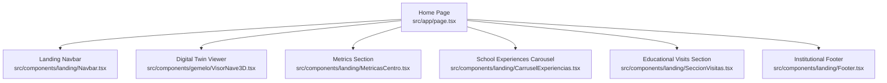
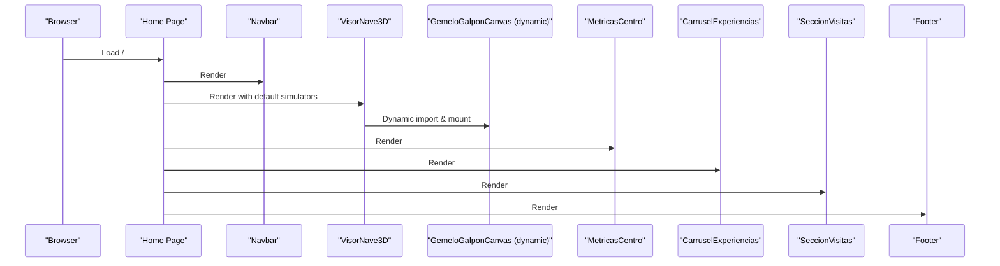
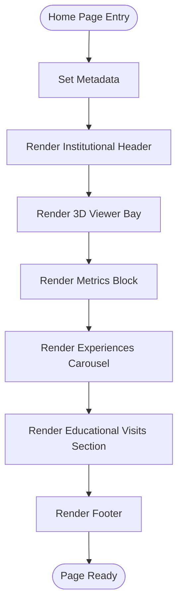
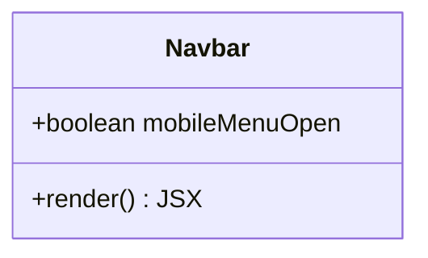
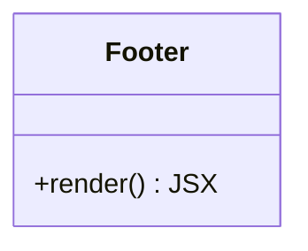
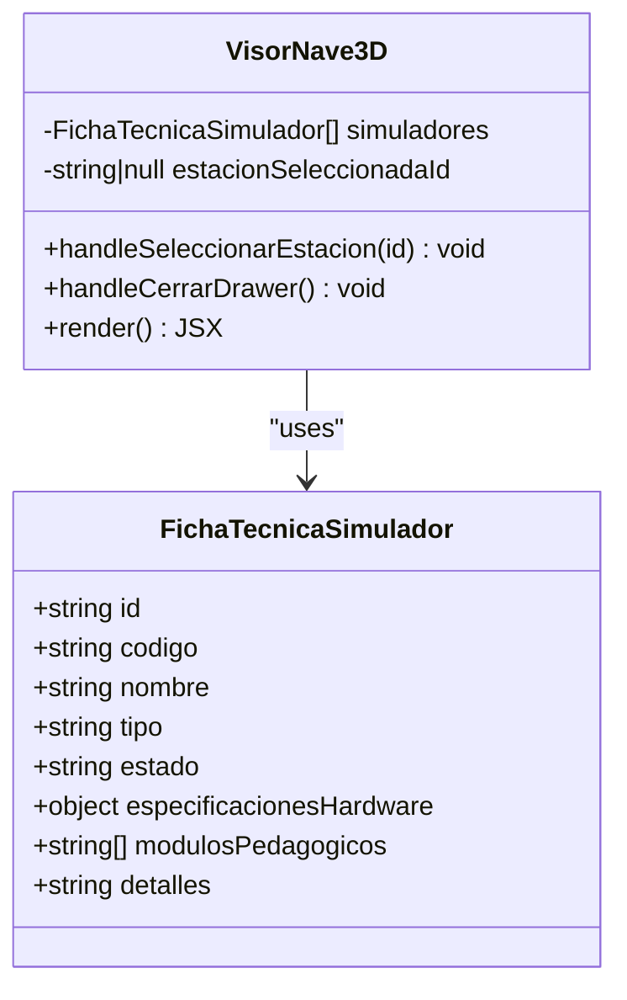
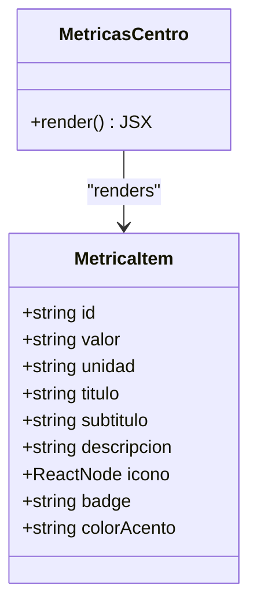
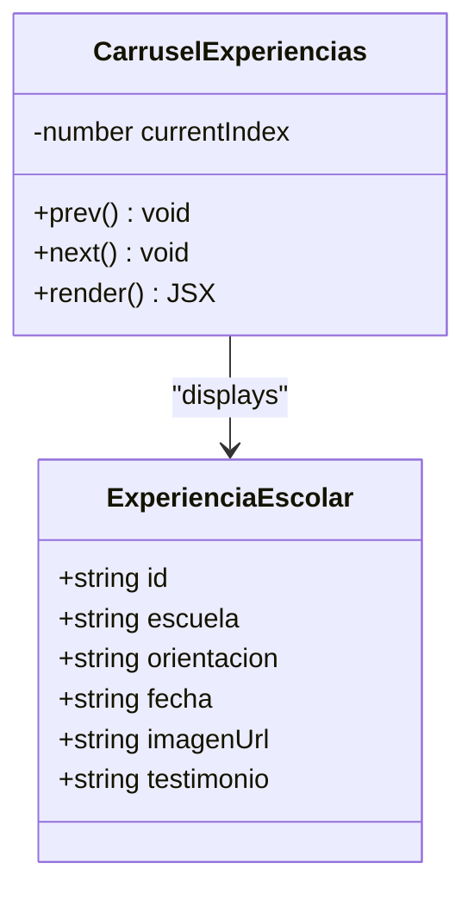
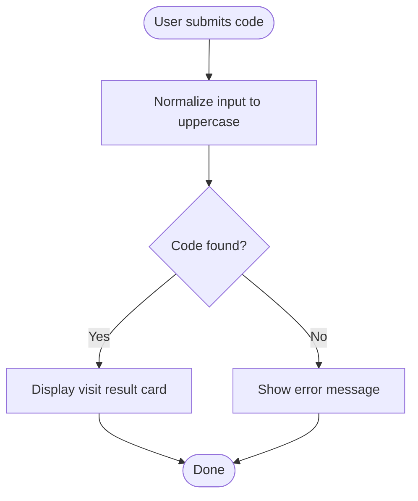
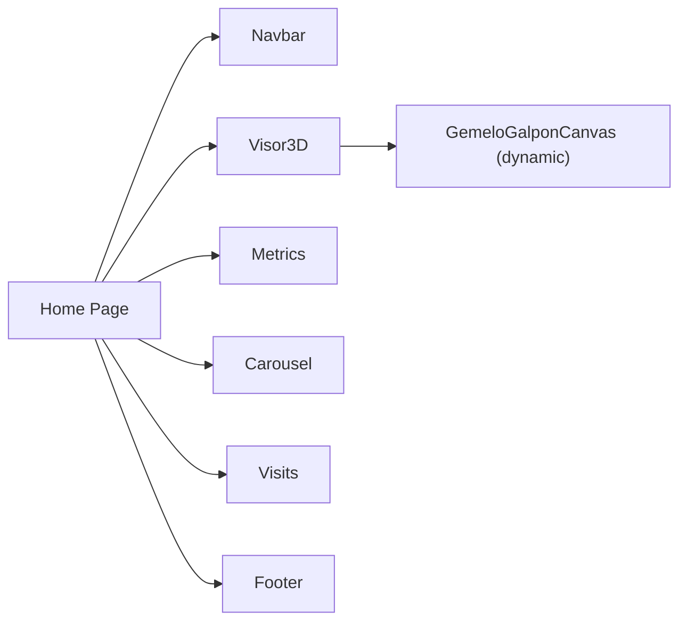

# Landing Page Infrastructure

<cite>
**Referenced Files in This Document**
- [page.tsx](file://src/app/page.tsx)
- [Navbar.tsx](file://src/components/landing/Navbar.tsx)
- [Footer.tsx](file://src/components/landing/Footer.tsx)
- [CarruselExperiencias.tsx](file://src/components/landing/CarruselExperiencias.tsx)
- [MetricasCentro.tsx](file://src/components/landing/MetricasCentro.tsx)
- [SeccionVisitas.tsx](file://src/components/landing/SeccionVisitas.tsx)
- [VisorNave3D.tsx](file://src/components/gemelo/VisorNave3D.tsx)
- [visitas.ts](file://src/types/visitas.ts)
- [visitasService.ts](file://src/services/visitasService.ts)
- [README.md](file://README.md)
</cite>

## Table of Contents
1. [Introduction](#introduction)
2. [Project Structure](#project-structure)
3. [Core Components](#core-components)
4. [Architecture Overview](#architecture-overview)
5. [Detailed Component Analysis](#detailed-component-analysis)
6. [Dependency Analysis](#dependency-analysis)
7. [Performance Considerations](#performance-considerations)
8. [Troubleshooting Guide](#troubleshooting-guide)
9. [Conclusion](#conclusion)

## Introduction
This document describes the landing page infrastructure for the municipal simulator training platform. It focuses on the public-facing home page, its layout, and the interactive sections that showcase the digital twin, operational metrics, school experiences, and educational visit coordination. The landing page is built with Next.js and React, styled with Tailwind CSS, and integrates a 3D viewer component for the digital twin.

The goal is to provide a clear, accessible guide for developers and stakeholders to understand how the landing page is structured, how components interact, and where data flows originate.

## Project Structure
The landing page is composed of:
- A root page that composes the main layout and sections.
- Reusable landing components for navigation, footer, metrics, experiences carousel, and educational visits section.
- A 3D viewer component that renders the digital twin and technical details of simulators.
- Types and services that define data models and Supabase interactions used by other parts of the application.

**Diagram sources**
- [page.tsx:15-66](file://src/app/page.tsx#L15-L66)
- [Navbar.tsx:8-130](file://src/components/landing/Navbar.tsx#L8-L130)
- [VisorNave3D.tsx:179-387](file://src/components/gemelo/VisorNave3D.tsx#L179-L387)
- [MetricasCentro.tsx:67-141](file://src/components/landing/MetricasCentro.tsx#L67-L141)
- [CarruselExperiencias.tsx:46-192](file://src/components/landing/CarruselExperiencias.tsx#L46-L192)
- [SeccionVisitas.tsx:59-320](file://src/components/landing/SeccionVisitas.tsx#L59-L320)
- [Footer.tsx:6-127](file://src/components/landing/Footer.tsx#L6-L127)

**Section sources**
- [page.tsx:1-69](file://src/app/page.tsx#L1-L69)
- [README.md:20-50](file://README.md#L20-L50)

## Core Components
- Home Page: Composes the landing sections and metadata.
- Navbar: Provides institutional branding, navigation anchors, and instructor access link.
- Footer: Institutional identity, location, contact, and links to official resources.
- Digital Twin Viewer: Renders the 3D environment and displays simulator technical sheets.
- Metrics Section: Displays key operational indicators.
- School Experiences Carousel: Showcases testimonials and photos from school visits.
- Educational Visits Section: Describes the day’s dynamics and provides a code-based status lookup.

**Section sources**
- [page.tsx:9-66](file://src/app/page.tsx#L9-L66)
- [Navbar.tsx:8-130](file://src/components/landing/Navbar.tsx#L8-L130)
- [Footer.tsx:6-127](file://src/components/landing/Footer.tsx#L6-L127)
- [VisorNave3D.tsx:39-173](file://src/components/gemelo/VisorNave3D.tsx#L39-L173)
- [MetricasCentro.tsx:19-65](file://src/components/landing/MetricasCentro.tsx#L19-L65)
- [CarruselExperiencias.tsx:16-44](file://src/components/landing/CarruselExperiencias.tsx#L16-L44)
- [SeccionVisitas.tsx:34-57](file://src/components/landing/SeccionVisitas.tsx#L34-L57)

## Architecture Overview
The landing page follows a composition architecture:
- The root page imports and renders each section as a child component.
- Each section encapsulates its own UI logic and state.
- The 3D viewer uses dynamic loading to render the Three.js canvas without blocking server-side rendering.
- Data types and services are centralized for consistency across modules.

**Diagram sources**
- [page.tsx:15-66](file://src/app/page.tsx#L15-L66)
- [VisorNave3D.tsx:18-37](file://src/components/gemelo/VisorNave3D.tsx#L18-L37)

## Detailed Component Analysis

### Home Page Composition
The home page sets up metadata and composes all landing sections in a single scrollable layout. It includes:
- Institutional header with government branding.
- 3D digital twin bay.
- Metrics block.
- School experiences carousel.
- Educational visits section.
- Institutional footer.

**Diagram sources**
- [page.tsx:9-66](file://src/app/page.tsx#L9-L66)

**Section sources**
- [page.tsx:9-66](file://src/app/page.tsx#L9-L66)

### Navbar
Responsibilities:
- Display institutional logo and title.
- Provide desktop and mobile navigation anchors to sections.
- Link to the instructor portal.

Key behaviors:
- Mobile menu toggle using local state.
- Anchor links to #galpon-3d, #metricas, #experiencias, #visitas.
- Instructor access link to /admin.

**Diagram sources**
- [Navbar.tsx:8-130](file://src/components/landing/Navbar.tsx#L8-L130)

**Section sources**
- [Navbar.tsx:8-130](file://src/components/landing/Navbar.tsx#L8-L130)

### Footer
Responsibilities:
- Present institutional identity and certification badge.
- Provide location, administrative hours, and contact information.
- Link to official municipal resources and instructor portal.

**Diagram sources**
- [Footer.tsx:6-127](file://src/components/landing/Footer.tsx#L6-L127)

**Section sources**
- [Footer.tsx:6-127](file://src/components/landing/Footer.tsx#L6-L127)

### Digital Twin Viewer (VisorNave3D)
Responsibilities:
- Manage simulator list and selection state.
- Map simulator states for the 3D canvas.
- Render HUD showing active stations.
- Open/close technical sheet drawer for selected simulator.

Data model:
- Simulator ficha with id, codigo, nombre, tipo, estado, especificacionesHardware, modulosPedagogicos, detalles.

**Diagram sources**
- [VisorNave3D.tsx:39-173](file://src/components/gemelo/VisorNave3D.tsx#L39-L173)
- [VisorNave3D.tsx:179-387](file://src/components/gemelo/VisorNave3D.tsx#L179-L387)

**Section sources**
- [VisorNave3D.tsx:39-173](file://src/components/gemelo/VisorNave3D.tsx#L39-L173)
- [VisorNave3D.tsx:179-387](file://src/components/gemelo/VisorNave3D.tsx#L179-L387)

### Metrics Section (MetricasCentro)
Responsibilities:
- Display four key metrics: simulation stations, practice hours, technical schools, and accidents.
- Use static data arrays to render cards with icons, badges, and descriptions.

**Diagram sources**
- [MetricasCentro.tsx:7-17](file://src/components/landing/MetricasCentro.tsx#L7-L17)
- [MetricasCentro.tsx:19-65](file://src/components/landing/MetricasCentro.tsx#L19-L65)
- [MetricasCentro.tsx:67-141](file://src/components/landing/MetricasCentro.tsx#L67-L141)

**Section sources**
- [MetricasCentro.tsx:19-65](file://src/components/landing/MetricasCentro.tsx#L19-L65)
- [MetricasCentro.tsx:67-141](file://src/components/landing/MetricasCentro.tsx#L67-L141)

### School Experiences Carousel (CarruselExperiencias)
Responsibilities:
- Showcase school experiences with images, testimonies, dates, and institution info.
- Provide previous/next controls and dot navigation.

Data model:
- ExperienciaEscolar with id, escuela, orientacion, fecha, imagenUrl, testimonio.

**Diagram sources**
- [CarruselExperiencias.tsx:7-14](file://src/components/landing/CarruselExperiencias.tsx#L7-L14)
- [CarruselExperiencias.tsx:16-44](file://src/components/landing/CarruselExperiencias.tsx#L16-L44)
- [CarruselExperiencias.tsx:46-192](file://src/components/landing/CarruselExperiencias.tsx#L46-L192)

**Section sources**
- [CarruselExperiencias.tsx:46-192](file://src/components/landing/CarruselExperiencias.tsx#L46-L192)

### Educational Visits Section (SeccionVisitas)
Responsibilities:
- Describe the day’s dynamics: TUP transport, simulation blocks, coaching workshops, break space.
- Provide a code-based lookup form to check visit status, date, schedule, and logistics.

Data model:
- VisitaResultado with fields for code, school, course, student count, date, time, safety status, TUP status, and visit status.

**Diagram sources**
- [SeccionVisitas.tsx:59-77](file://src/components/landing/SeccionVisitas.tsx#L59-L77)
- [SeccionVisitas.tsx:227-308](file://src/components/landing/SeccionVisitas.tsx#L227-L308)

**Section sources**
- [SeccionVisitas.tsx:59-77](file://src/components/landing/SeccionVisitas.tsx#L59-L77)
- [SeccionVisitas.tsx:227-308](file://src/components/landing/SeccionVisitas.tsx#L227-L308)

## Dependency Analysis
- The home page depends on all landing components and the 3D viewer.
- The 3D viewer dynamically loads the Three.js canvas component.
- Types and services are shared across modules but not directly imported by the landing page; they support broader application functionality.

**Diagram sources**
- [page.tsx:15-66](file://src/app/page.tsx#L15-L66)
- [VisorNave3D.tsx:18-37](file://src/components/gemelo/VisorNave3D.tsx#L18-L37)

**Section sources**
- [page.tsx:15-66](file://src/app/page.tsx#L15-L66)
- [VisorNave3D.tsx:18-37](file://src/components/gemelo/VisorNave3D.tsx#L18-L37)

## Performance Considerations
- Use dynamic imports for heavy 3D components to avoid blocking initial page load.
- Prefer static data for landing sections to minimize network requests on the homepage.
- Optimize images with appropriate sizes and lazy loading where possible.
- Keep anchor navigation lightweight; avoid unnecessary re-renders.

[No sources needed since this section provides general guidance]

## Troubleshooting Guide
Common issues and resolutions:
- 3D viewer does not load:
  - Ensure dynamic import is configured correctly and SSR is disabled for the canvas component.
  - Check browser WebGL support and console errors related to Three.js initialization.
- Navigation anchors do not scroll smoothly:
  - Verify that target section IDs match anchor hrefs (#galpon-3d, #metricas, #experiencias, #visitas).
- Visit lookup returns “code not found”:
  - Confirm the code format matches expected pattern and exists in demo data or backend.

**Section sources**
- [VisorNave3D.tsx:18-37](file://src/components/gemelo/VisorNave3D.tsx#L18-L37)
- [SeccionVisitas.tsx:250-258](file://src/components/landing/SeccionVisitas.tsx#L250-L258)

## Conclusion
The landing page infrastructure provides a cohesive, modular foundation for presenting the simulator training center’s capabilities. It combines institutional branding, an interactive 3D digital twin, operational metrics, school experience showcases, and educational visit coordination into a single, user-friendly interface. By leveraging dynamic imports and well-defined component responsibilities, the system balances performance and clarity while remaining extensible for future enhancements.

[No sources needed since this section summarizes without analyzing specific files]