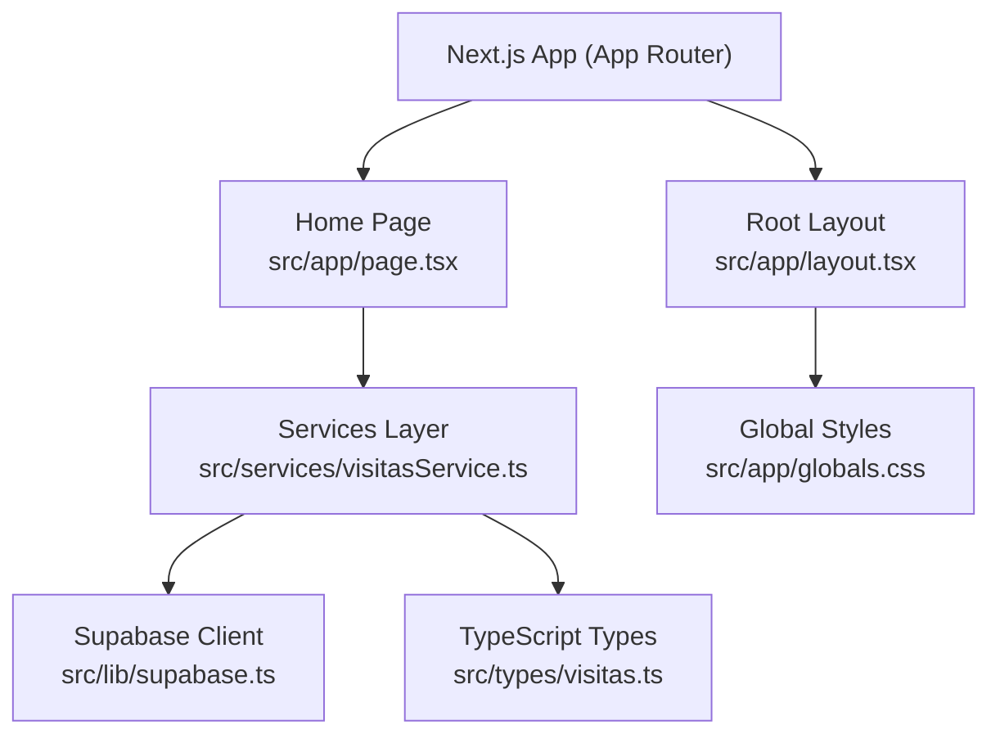
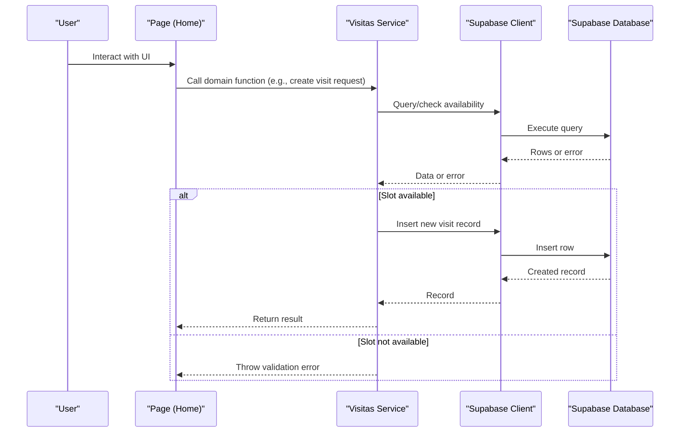
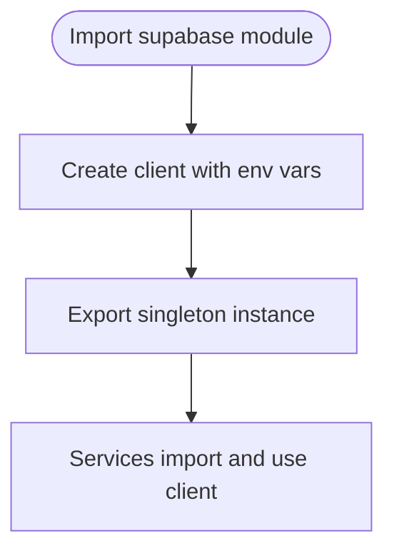
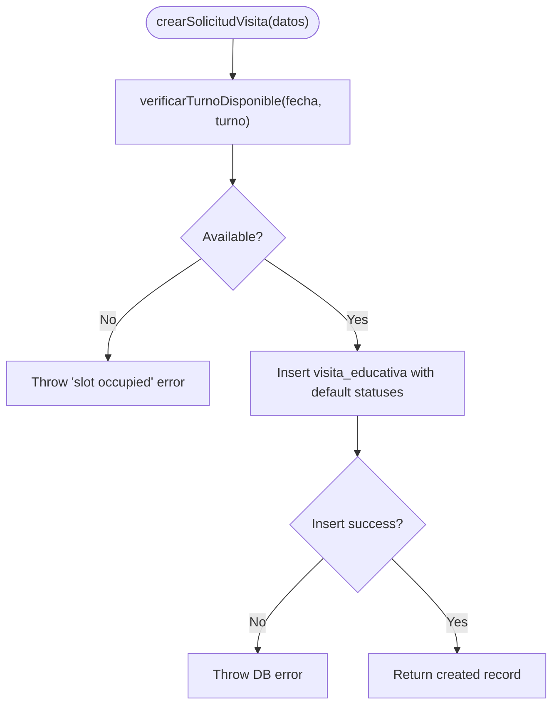
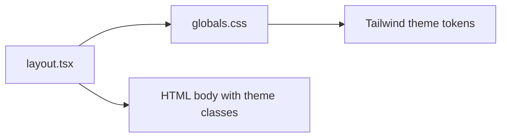
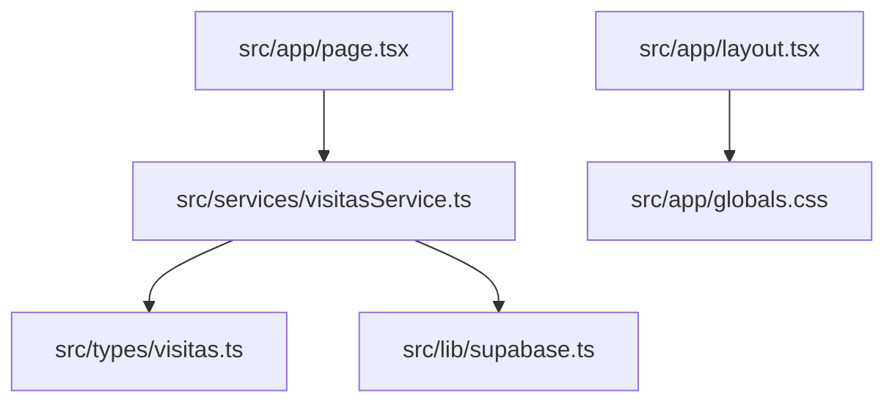

# Architecture & Technology Stack

<cite>
**Referenced Files in This Document**
- [package.json](file://package.json)
- [README.md](file://README.md)
- [next.config.ts](file://next.config.ts)
- [tsconfig.json](file://tsconfig.json)
- [src/app/layout.tsx](file://src/app/layout.tsx)
- [src/app/page.tsx](file://src/app/page.tsx)
- [src/app/globals.css](file://src/app/globals.css)
- [src/lib/supabase.ts](file://src/lib/supabase.ts)
- [src/services/visitasService.ts](file://src/services/visitasService.ts)
- [src/types/visitas.ts](file://src/types/visitas.ts)
</cite>

## Table of Contents
1. [Introduction](#introduction)
2. [Project Structure](#project-structure)
3. [Core Components](#core-components)
4. [Architecture Overview](#architecture-overview)
5. [Detailed Component Analysis](#detailed-component-analysis)
6. [Dependency Analysis](#dependency-analysis)
7. [Performance Considerations](#performance-considerations)
8. [Security and Environment Configuration](#security-and-environment-configuration)
9. [Deployment Topology](#deployment-topology)
10. [Troubleshooting Guide](#troubleshooting-guide)
11. [Conclusion](#conclusion)

## Introduction
This document describes the architecture and technology stack of the Simu-Twin-Web project, a modern Next.js 15 application using the App Router with React 19 and TypeScript for type safety. The frontend integrates with Supabase for database and authentication via a service-oriented architecture pattern. Styling is handled by Tailwind CSS v4. The project leverages Turbopack for fast development and builds, and follows best practices for environment-based configuration and maintainability through strict TypeScript usage.

## Project Structure
The project follows a clean separation of concerns:
- Application shell and pages under src/app
- Shared client library for Supabase under src/lib
- Domain services encapsulating data access logic under src/services
- Type definitions under src/types
- Global styles and theme variables under src/app/globals.css
- Build and runtime configuration at the repository root

**Diagram sources**
- [src/app/layout.tsx:1-35](file://src/app/layout.tsx#L1-L35)
- [src/app/page.tsx:1-104](file://src/app/page.tsx#L1-L104)
- [src/services/visitasService.ts:1-59](file://src/services/visitasService.ts#L1-L59)
- [src/lib/supabase.ts:1-7](file://src/lib/supabase.ts#L1-L7)
- [src/types/visitas.ts:1-28](file://src/types/visitas.ts#L1-L28)
- [src/app/globals.css:1-27](file://src/app/globals.css#L1-L27)

**Section sources**
- [package.json:1-29](file://package.json#L1-L29)
- [README.md:1-37](file://README.md#L1-L37)
- [next.config.ts:1-8](file://next.config.ts#L1-L8)
- [tsconfig.json:1-28](file://tsconfig.json#L1-L28)

## Core Components
- Root layout: Provides global metadata, fonts, and applies Tailwind theme variables to the HTML body.
- Home page: Renders the initial UI using Next.js Image optimization and Tailwind utility classes.
- Supabase client: Exposes a single configured client instance initialized from environment variables.
- Services layer: Encapsulates domain operations such as fetching schools, checking slot availability, and creating visit requests.
- Types: Define strongly-typed interfaces for entities and inputs to ensure compile-time safety across layers.

Key responsibilities:
- Presentation: src/app/page.tsx
- Shell and theming: src/app/layout.tsx, src/app/globals.css
- Data access: src/services/visitasService.ts
- Client initialization: src/lib/supabase.ts
- Contracts: src/types/visitas.ts

**Section sources**
- [src/app/layout.tsx:1-35](file://src/app/layout.tsx#L1-L35)
- [src/app/page.tsx:1-104](file://src/app/page.tsx#L1-L104)
- [src/app/globals.css:1-27](file://src/app/globals.css#L1-L27)
- [src/lib/supabase.ts:1-7](file://src/lib/supabase.ts#L1-L7)
- [src/services/visitasService.ts:1-59](file://src/services/visitasService.ts#L1-L59)
- [src/types/visitas.ts:1-28](file://src/types/visitas.ts#L1-L28)

## Architecture Overview
The application uses a service-oriented architecture on top of Next.js App Router. Pages import domain services that perform business rules and data operations. Services use a centralized Supabase client to interact with the database. TypeScript types define contracts between components and services, ensuring consistency and reducing runtime errors.

**Diagram sources**
- [src/services/visitasService.ts:20-58](file://src/services/visitasService.ts#L20-L58)
- [src/lib/supabase.ts:1-7](file://src/lib/supabase.ts#L1-L7)

## Detailed Component Analysis

### Supabase Client Configuration
- Centralized client creation using environment variables for URL and anonymous key.
- Exported singleton used by all services to ensure consistent configuration and connection handling.

**Diagram sources**
- [src/lib/supabase.ts:1-7](file://src/lib/supabase.ts#L1-L7)

**Section sources**
- [src/lib/supabase.ts:1-7](file://src/lib/supabase.ts#L1-L7)

### Visitas Service (Domain Logic)
Responsibilities:
- Fetch schools sorted by name
- Verify slot availability for a given date and shift
- Create a visit request after validating availability

Error handling:
- Throws errors returned from Supabase queries
- Validates business constraints before writing to the database

**Diagram sources**
- [src/services/visitasService.ts:36-58](file://src/services/visitasService.ts#L36-L58)
- [src/services/visitasService.ts:20-34](file://src/services/visitasService.ts#L20-L34)

**Section sources**
- [src/services/visitasService.ts:1-59](file://src/services/visitasService.ts#L1-L59)

### TypeScript Types (Contracts)
- Escuela: Represents school entity fields
- TurnoVisita: Union type for allowed shifts
- SolicitudVisitaInput: Input contract for creating visits
- VisitaEducativa: Extended entity including id and status fields

These types are imported by services to enforce shape and constraints at compile time.

**Section sources**
- [src/types/visitas.ts:1-28](file://src/types/visitas.ts#L1-L28)

### Root Layout and Global Styles
- Root layout sets up metadata and applies font variables to the body
- Global styles import Tailwind and define theme tokens for light/dark modes

**Diagram sources**
- [src/app/layout.tsx:1-35](file://src/app/layout.tsx#L1-L35)
- [src/app/globals.css:1-27](file://src/app/globals.css#L1-L27)

**Section sources**
- [src/app/layout.tsx:1-35](file://src/app/layout.tsx#L1-L35)
- [src/app/globals.css:1-27](file://src/app/globals.css#L1-L27)

### Home Page
- Uses Next.js Image component with priority for above-the-fold assets
- Styled with Tailwind utilities; demonstrates responsive design patterns

**Section sources**
- [src/app/page.tsx:1-104](file://src/app/page.tsx#L1-L104)

## Dependency Analysis
High-level dependencies and relationships:
- Pages depend on services for data operations
- Services depend on the Supabase client
- Services depend on TypeScript types for contracts
- Layout depends on global styles for theming

**Diagram sources**
- [src/app/page.tsx:1-104](file://src/app/page.tsx#L1-L104)
- [src/services/visitasService.ts:1-59](file://src/services/visitasService.ts#L1-L59)
- [src/types/visitas.ts:1-28](file://src/types/visitas.ts#L1-L28)
- [src/lib/supabase.ts:1-7](file://src/lib/supabase.ts#L1-L7)
- [src/app/layout.tsx:1-35](file://src/app/layout.tsx#L1-L35)
- [src/app/globals.css:1-27](file://src/app/globals.css#L1-L27)

**Section sources**
- [package.json:11-26](file://package.json#L11-L26)
- [tsconfig.json:21-23](file://tsconfig.json#L21-L23)

## Performance Considerations
- Development and build acceleration: Scripts use Turbopack for faster dev server and builds.
- Font optimization: Fonts are loaded via next/font with variable injection for efficient rendering.
- Image optimization: Next.js Image component is used with priority for critical images.
- Strict TypeScript: Enables incremental compilation and reduces runtime issues.

Recommendations:
- Keep services lean and focused on single responsibilities
- Prefer server-side data fetching where possible to reduce client bundle size
- Leverage Next.js caching strategies for repeated reads
- Monitor bundle size and tree-shake unused dependencies

[No sources needed since this section provides general guidance]

## Security and Environment Configuration
- Supabase client is initialized using environment variables for URL and anonymous key, preventing secrets from being embedded in code.
- Ensure environment variables are set in your deployment environment (e.g., NEXT_PUBLIC_SUPABASE_URL, NEXT_PUBLIC_SUPABASE_ANON_KEY).
- Avoid logging sensitive data in client-side code.
- Validate user inputs on both client and server sides when applicable.

Operational notes:
- The project does not include an .env file in version control; configure locally and in CI/CD securely.
- Use role-based access policies in Supabase to restrict data access.

**Section sources**
- [src/lib/supabase.ts:1-7](file://src/lib/supabase.ts#L1-L7)

## Deployment Topology
- Vercel: Recommended for seamless Next.js deployment with environment variables and edge capabilities.
- Self-hosted Node.js: Run the production build with next start behind a reverse proxy (e.g., Nginx) for TLS termination and load balancing.
- Containerization: Package the app into a container image and deploy to Kubernetes or managed container platforms.

Scalability considerations:
- Next.js App Router supports server components and streaming for improved performance at scale.
- Offload heavy computations to server functions or background jobs if needed.
- Use CDN for static assets and consider edge caching for read-heavy endpoints.

[No sources needed since this section provides general guidance]

## Troubleshooting Guide
Common issues and resolutions:
- Missing environment variables: Ensure NEXT_PUBLIC_SUPABASE_URL and NEXT_PUBLIC_SUPABASE_ANON_KEY are set in your environment.
- Supabase query errors: Services throw errors returned by Supabase; inspect network logs and database permissions.
- Slot conflicts: Creating a visit when the slot is already taken throws a validation error; handle this in the UI with user-friendly messages.
- Build failures: Confirm TypeScript strict mode and correct imports; verify path aliases are configured.

Debugging tips:
- Add console logs around service calls to trace data flow
- Inspect Supabase responses and errors in browser DevTools
- Use Next.js dev server logs to identify runtime issues

**Section sources**
- [src/services/visitasService.ts:9-17](file://src/services/visitasService.ts#L9-L17)
- [src/services/visitasService.ts:20-34](file://src/services/visitasService.ts#L20-L34)
- [src/services/visitasService.ts:36-58](file://src/services/visitasService.ts#L36-L58)

## Conclusion
Simu-Twin-Web adopts a modern, scalable architecture built on Next.js 15 App Router, React 19, and TypeScript. The service-oriented pattern cleanly separates presentation, domain logic, and data access, while Supabase provides robust backend capabilities. Tailwind CSS enables rapid styling with a consistent theme. With Turbopack-enabled scripts and strict typing, the project balances developer productivity with runtime reliability. Following the outlined security, performance, and deployment practices will help maintain a high-quality, scalable web application.