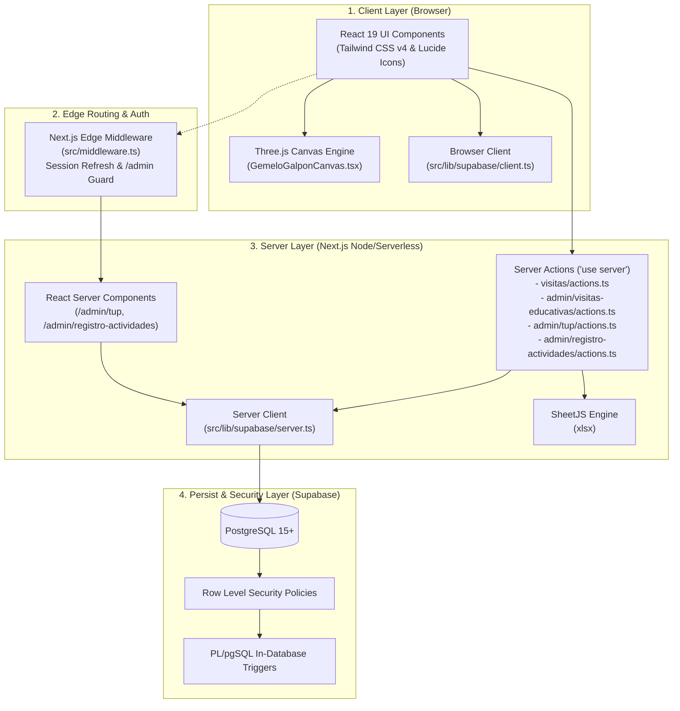

# Architecture & Technology Stack

<cite>
**Referenced Files in This Document**
- [package.json](file:///c:/Users/catra/Desktop/simu-twin-web/package.json)
- [README.md](file:///c:/Users/catra/Desktop/simu-twin-web/README.md)
- [next.config.ts](file:///c:/Users/catra/Desktop/simu-twin-web/next.config.ts)
- [tsconfig.json](file:///c:/Users/catra/Desktop/simu-twin-web/tsconfig.json)
- [src/middleware.ts](file:///c:/Users/catra/Desktop/simu-twin-web/src/middleware.ts)
- [src/app/layout.tsx](file:///c:/Users/catra/Desktop/simu-twin-web/src/app/layout.tsx)
- [src/app/page.tsx](file:///c:/Users/catra/Desktop/simu-twin-web/src/app/page.tsx)
- [src/app/globals.css](file:///c:/Users/catra/Desktop/simu-twin-web/src/app/globals.css)
- [src/lib/supabase/client.ts](file:///c:/Users/catra/Desktop/simu-twin-web/src/lib/supabase/client.ts)
- [src/lib/supabase/server.ts](file:///c:/Users/catra/Desktop/simu-twin-web/src/lib/supabase/server.ts)
- [src/services/visitasService.ts](file:///c:/Users/catra/Desktop/simu-twin-web/src/services/visitasService.ts)
- [src/components/gemelo/GemeloGalponCanvas.tsx](file:///c:/Users/catra/Desktop/simu-twin-web/src/components/gemelo/GemeloGalponCanvas.tsx)
- [src/components/gemelo/VisorNave3D.tsx](file:///c:/Users/catra/Desktop/simu-twin-web/src/components/gemelo/VisorNave3D.tsx)
- [src/app/visitas/actions.ts](file:///c:/Users/catra/Desktop/simu-twin-web/src/app/visitas/actions.ts)
- [src/app/admin/visitas-educativas/actions.ts](file:///c:/Users/catra/Desktop/simu-twin-web/src/app/admin/visitas-educativas/actions.ts)
- [src/app/admin/tup/actions.ts](file:///c:/Users/catra/Desktop/simu-twin-web/src/app/admin/tup/actions.ts)
- [src/app/admin/registro-actividades/actions.ts](file:///c:/Users/catra/Desktop/simu-twin-web/src/app/admin/registro-actividades/actions.ts)
</cite>

## Table of Contents
1. [Introduction](#introduction)
2. [Architectural Layers](#architectural-layers)
3. [Technology Stack](#technology-stack)
4. [Component & Service Interaction](#component--service-interaction)
5. [3D Simulation & WebGL Architecture](#3d-simulation--webgl-architecture)
6. [Supabase SSR & Authentication Flow](#supabase-ssr--authentication-flow)
7. [Server Actions Mutation Pattern](#server-actions-mutation-pattern)
8. [Security & Edge Middleware](#security--edge-middleware)
9. [Build and Runtime Configuration](#build-and-runtime-configuration)
10. [Conclusion](#conclusion)

---

## Introduction
Simu-Twin-Web is structured around a modern **Next.js 15 App Router** architecture utilizing **React 19** and **TypeScript 5**. The application integrates a procedural **Three.js WebGL 3D Digital Twin** directly into the frontend, coupled with a serverless **Supabase PostgreSQL** backend, **@supabase/ssr** session management, and **Server Actions** for secure mutations.

---

## Architectural Layers

---

## Technology Stack

### Core Framework & Runtime
- **Next.js 15.5.25**: Modern React framework utilizing the App Router, React Server Components (RSC), and Turbopack compiler.
- **React 19.1.0 & React DOM 19.1.0**: Core component model and concurrent rendering features.
- **TypeScript 5**: Strict type safety (`"strict": true` in `tsconfig.json`) across all domain models, props, and server actions.

### 3D Visualization & Graphics
- **Three.js ^0.186.1**: Procedural 3D scene creation, WebGL rendering, lighting, material shading, raycasting, and kinematic animations.
- **@types/three ^0.186.0**: Strong typing for Three.js objects, meshes, and materials.

### Styling & Design System
- **Tailwind CSS v4 (`@tailwindcss/postcss`)**: Modern utility-first CSS engine with zero-runtime overhead.
- **Custom Institutional Tokens**: Government of Venado Tuerto palette featuring institutional cyan (`#0091B3`), dark zinc backgrounds for the admin panel, and slate neutrals for public views.

### Backend, Database & Authentication
- **@supabase/ssr ^0.12.7**: Cookie-based authentication and database integration for Next.js App Router and Edge Middleware.
- **@supabase/supabase-js ^2.116.0**: Isomorphic PostgreSQL client.
- **PostgreSQL 15+**: Relational data store enforcing foreign keys, check constraints, RLS policies, and triggers.

### Data Processing & Utilities
- **xlsx ^0.18.5**: SheetJS library for generating and exporting Excel spreadsheets for school visits and attendee rosters.
- **lucide-react ^1.45.0**: Vector icons for UI navigation and status indicators.

---

## Component & Service Interaction

The application separates concerns cleanly:
- `src/types/`: Pure contracts and domain interfaces (`gemelo.ts`, `actividades.ts`, `visitas.ts`, `tup.ts`).
- `src/lib/supabase/`: Supabase client constructors tailored for browser and server environments.
- `src/services/`: Client-side query functions (`visitasService.ts`).
- `src/components/`: Modular React components grouped by functional domain (`admin`, `auth`, `gemelo`, `landing`, `visitas`).
- `src/app/**/actions.ts`: Encapsulated mutation logic executed on the server via Server Actions.

---

## 3D Simulation & WebGL Architecture

The digital twin is implemented via:
1. **Scene Creation (`GemeloGalponCanvas.tsx`)**:
   - Creates a `THREE.Scene`, `THREE.PerspectiveCamera`, and `THREE.WebGLRenderer`.
   - Procedurally builds the industrial warehouse (28m x 22m x 7.5m) including concrete flooring, steel columns, roof trusses, industrial lighting, and safety perimeters.
   - Instantiates 7 simulator models (Forklift, Front Loader, Backhoe, Telescopic Crane, Tractor, Truck, SimSpray).
   - Simulates animated human operators with direct kinematics (head, limbs, VR headset, hardhat) executing a state machine (`espera`, `caminando`, `sentandose`, `operando`, `levantandose`, `retornando`).
   - Implements raycaster interaction for station selection.
2. **State & HUD Integration (`VisorNave3D.tsx`)**:
   - Manages interactive states: selected station, camera modes (free orbit vs. follow operator).
   - Overlays a responsive SCADA HUD displaying real-time power consumption, ambient temperature, and active stations.
   - Displays a technical specifications drawer with hardware controls and learning modules.

---

## Supabase SSR & Authentication Flow

Unlike legacy single-page applications that store tokens in `localStorage`, Simu-Twin Web uses `@supabase/ssr` to store session tokens in secure `HTTP-only` cookies:
- **Browser Client (`src/lib/supabase/client.ts`)**: Created with `createBrowserClient(url, anonKey)` for client components.
- **Server Client (`src/lib/supabase/server.ts`)**: Created with `createServerClient(url, anonKey, { cookies: await cookies() })` for Server Components and Server Actions.
- **Edge Middleware (`src/middleware.ts`)**: Intercepts requests to `/admin/*` and `/login`, verifies the session token using `supabase.auth.getUser()`, and redirects unauthenticated users to `/login`.

---

## Server Actions Mutation Pattern

All database mutations use Next.js **Server Actions** marked with `'use server'`:
- **Strict Data Sanitization**: Inputs are sanitized and optional string fields are normalized to `null` (`normalizarTextoNullable`) to prevent inserting empty strings into PostgreSQL `date`, `time`, or `uuid` columns.
- **Defensive Defaulting**: Sensitive operational fields (e.g. `check_poliza`, `check_tup`) are forcibly set to `false` when created by public users.
- **Atomic Cache Invalidation**: Successful operations call `revalidatePath(...)` to refresh the corresponding admin or public route without manual cache expiration logic.

---

## Security & Edge Middleware

The application employs multiple security layers:
1. **Edge Middleware Guard**: Restricts `/admin/*` access at the network boundary before executing any page rendering logic.
2. **PostgreSQL Row Level Security (RLS)**: Denies unauthenticated access to personal identification records (`visita_asistentes`).
3. **Database Triggers**: The `trg_forzar_checks_no_autenticados` trigger guarantees that anonymous requests cannot update operational checklist columns even if the application code is bypassed.

---

## Build and Runtime Configuration
- **Development**: `npm run dev` executes Next.js in Turbopack mode for sub-second hot reloading.
- **Production**: `npm run build` runs `next build --turbopack` to create an optimized production bundle.
- **TypeScript & ESLint**: Continuous static type checks and ESLint flat config verification ensure production code quality.

---

## Conclusion
Simu-Twin-Web establishes an enterprise-grade, civic-oriented architecture combining WebGL 3D digital twins, robust Next.js 15 server infrastructure, and secure PostgreSQL persistence.