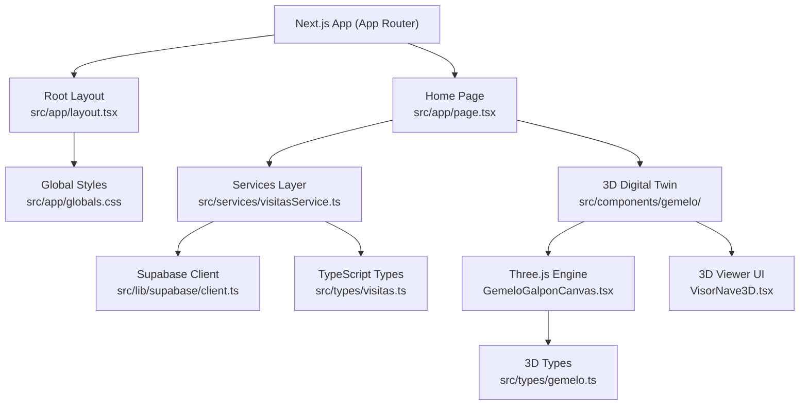
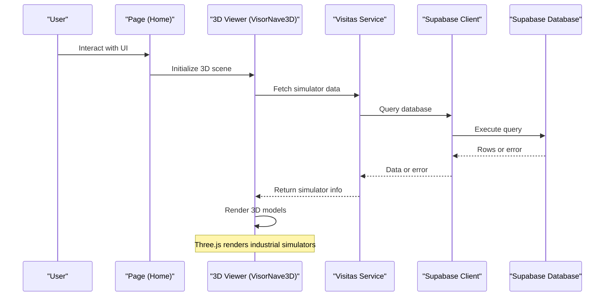
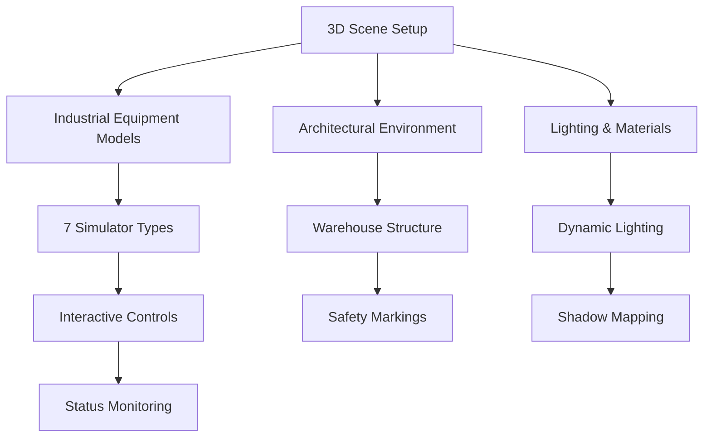
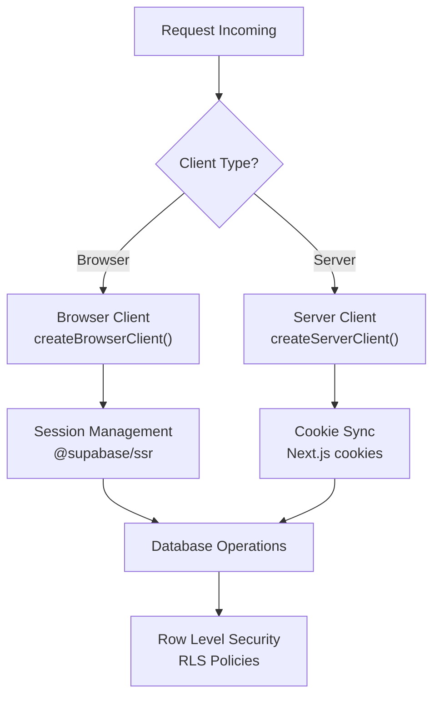
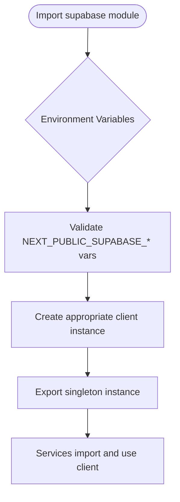
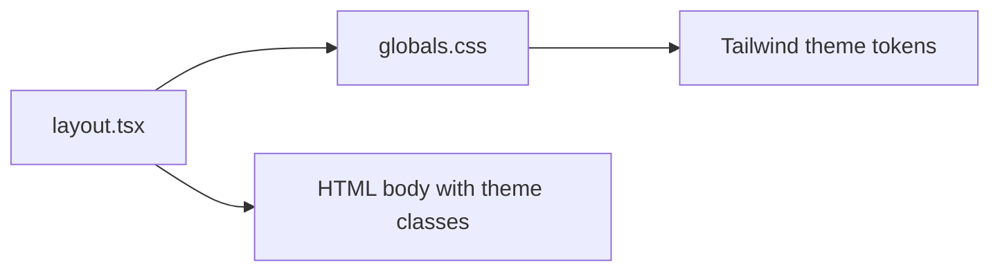
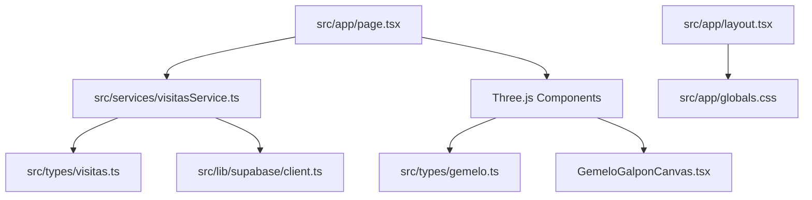

Based on my analysis of the codebase, I can now update the architecture documentation to reflect the significant changes including Three.js integration for 3D rendering, enhanced Supabase backend configuration, and the new digital twin simulation components. Here's the updated documentation:

# Architecture & Technology Stack

<cite>
**Referenced Files in This Document**
- [package.json](file://package.json)
- [README.md](file://README.md)
- [next.config.ts](file://next.config.ts)
- [tsconfig.json](file://tsconfig.json)
- [src/app/layout.tsx](file://src/app/layout.tsx)
- [src/app/page.tsx](file://src/app/page.tsx)
- [src/app/globals.css](file://src/app/globals.css)
- [src/lib/supabase/client.ts](file://src/lib/supabase/client.ts)
- [src/lib/supabase/server.ts](file://src/lib/supabase/server.ts)
- [src/middleware.ts](file://src/middleware.ts)
- [src/services/visitasService.ts](file://src/services/visitasService.ts)
- [src/types/visitas.ts](file://src/types/visitas.ts)
- [src/components/gemelo/GemeloGalponCanvas.tsx](file://src/components/gemelo/GemeloGalponCanvas.tsx)
- [src/components/gemelo/VisorNave3D.tsx](file://src/components/gemelo/VisorNave3D.tsx)
- [src/types/gemelo.ts](file://src/types/gemelo.ts)
- [supabase/migrations/0001_rls_visitas_educativas.sql](file://supabase/migrations/0001_rls_visitas_educativas.sql)
</cite>

## Update Summary
**Changes Made**
- Added comprehensive Three.js integration for 3D digital twin simulations
- Enhanced Supabase client architecture with separate browser and server clients
- Introduced new gemelo (digital twin) component system for industrial simulator visualization
- Updated dependency management with Three.js ecosystem and advanced 3D capabilities
- Expanded type definitions to support complex 3D scene management and simulator states

## Table of Contents
1. [Introduction](#introduction)
2. [Project Structure](#project-structure)
3. [Core Components](#core-components)
4. [Architecture Overview](#architecture-overview)
5. [Three.js Digital Twin Integration](#threejs-digital-twin-integration)
6. [Enhanced Supabase Backend](#enhanced-supabase-backend)
7. [Detailed Component Analysis](#detailed-component-analysis)
8. [Dependency Analysis](#dependency-analysis)
9. [Performance Considerations](#performance-considerations)
10. [Security and Environment Configuration](#security-and-environment-configuration)
11. [Deployment Topology](#deployment-topology)
12. [Troubleshooting Guide](#troubleshooting-guide)
13. [Conclusion](#conclusion)

## Introduction
This document describes the architecture and technology stack of the Simu-Twin-Web project, a modern Next.js 15 application using the App Router with React 19 and TypeScript for type safety. The frontend integrates with Supabase for database and authentication via a service-oriented architecture pattern, while featuring advanced Three.js integration for 3D digital twin simulations of industrial equipment. Styling is handled by Tailwind CSS v4. The project leverages Turbopack for fast development and builds, and follows best practices for environment-based configuration and maintainability through strict TypeScript usage.

## Project Structure
The project follows a clean separation of concerns with enhanced 3D capabilities:
- Application shell and pages under src/app
- Advanced 3D components for digital twin simulations under src/components/gemelo
- Shared client library for Supabase under src/lib
- Domain services encapsulating data access logic under src/services
- Type definitions under src/types
- Global styles and theme variables under src/app/globals.css
- Build and runtime configuration at the repository root

**Diagram sources**
- [src/app/layout.tsx:1-35](file://src/app/layout.tsx#L1-L35)
- [src/app/page.tsx:1-104](file://src/app/page.tsx#L1-L104)
- [src/services/visitasService.ts:1-105](file://src/services/visitasService.ts#L1-L105)
- [src/lib/supabase/client.ts:1-33](file://src/lib/supabase/client.ts#L1-L33)
- [src/types/visitas.ts:1-128](file://src/types/visitas.ts#L1-L128)
- [src/app/globals.css:1-27](file://src/app/globals.css#L1-L27)
- [src/components/gemelo/GemeloGalponCanvas.tsx:1-800](file://src/components/gemelo/GemeloGalponCanvas.tsx#L1-L800)
- [src/components/gemelo/VisorNave3D.tsx:1-388](file://src/components/gemelo/VisorNave3D.tsx#L1-L388)
- [src/types/gemelo.ts:1-92](file://src/types/gemelo.ts#L1-L92)

**Section sources**
- [package.json:1-34](file://package.json#L1-L34)
- [README.md:1-37](file://README.md#L1-L37)
- [next.config.ts:1-8](file://next.config.ts#L1-L8)
- [tsconfig.json:1-28](file://tsconfig.json#L1-L28)

## Core Components
- Root layout: Provides global metadata, fonts, and applies Tailwind theme variables to the HTML body.
- Home page: Renders the initial UI using Next.js Image optimization and Tailwind utility classes.
- **New**: 3D Digital Twin components: Advanced Three.js-based visualization system for industrial simulators
- Supabase client: Enhanced dual-client architecture for browser and server environments
- Services layer: Encapsulates domain operations such as fetching schools, checking slot availability, and creating visit requests.
- Types: Define strongly-typed interfaces for entities, inputs, and 3D scene objects to ensure compile-time safety across layers.

Key responsibilities:
- Presentation: src/app/page.tsx
- Shell and theming: src/app/layout.tsx, src/app/globals.css
- **3D Visualization**: src/components/gemelo/GemeloGalponCanvas.tsx, VisorNave3D.tsx
- Data access: src/services/visitasService.ts
- Client initialization: src/lib/supabase/client.ts, server.ts
- Contracts: src/types/visitas.ts, gemelo.ts

**Section sources**
- [src/app/layout.tsx:1-35](file://src/app/layout.tsx#L1-L35)
- [src/app/page.tsx:1-104](file://src/app/page.tsx#L1-L104)
- [src/app/globals.css:1-27](file://src/app/globals.css#L1-L27)
- [src/lib/supabase/client.ts:1-33](file://src/lib/supabase/client.ts#L1-L33)
- [src/lib/supabase/server.ts:1-40](file://src/lib/supabase/server.ts#L1-L40)
- [src/services/visitasService.ts:1-105](file://src/services/visitasService.ts#L1-L105)
- [src/types/visitas.ts:1-128](file://src/types/visitas.ts#L1-L128)
- [src/components/gemelo/GemeloGalponCanvas.tsx:1-800](file://src/components/gemelo/GemeloGalponCanvas.tsx#L1-L800)
- [src/components/gemelo/VisorNave3D.tsx:1-388](file://src/components/gemelo/VisorNave3D.tsx#L1-L388)
- [src/types/gemelo.ts:1-92](file://src/types/gemelo.ts#L1-L92)

## Architecture Overview
The application uses a service-oriented architecture on top of Next.js App Router with integrated 3D visualization capabilities. Pages import domain services that perform business rules and data operations, while 3D components provide immersive digital twin experiences. Services use a centralized Supabase client to interact with the database. TypeScript types define contracts between components and services, ensuring consistency and reducing runtime errors.

**Diagram sources**
- [src/components/gemelo/VisorNave3D.tsx:179-221](file://src/components/gemelo/VisorNave3D.tsx#L179-L221)
- [src/services/visitasService.ts:11-21](file://src/services/visitasService.ts#L11-L21)
- [src/lib/supabase/client.ts:26-33](file://src/lib/supabase/client.ts#L26-L33)

## Three.js Digital Twin Integration

### 3D Scene Architecture
The application features a sophisticated Three.js-based digital twin system that renders industrial simulators in an interactive 3D environment. The system includes:

- **Industrial Simulator Models**: Seven different types of industrial equipment (forklifts, front loaders, excavators, cranes, tractors, trucks, VR painting systems)
- **Architectural Environment**: Detailed warehouse structure with walls, columns, and safety markings
- **Interactive Controls**: Orbit controls for camera manipulation with automatic return functionality
- **Real-time Status Updates**: Live monitoring of simulator operational states

**Diagram sources**
- [src/components/gemelo/GemeloGalponCanvas.tsx:39-115](file://src/components/gemelo/GemeloGalponCanvas.tsx#L39-L115)
- [src/components/gemelo/GemeloGalponCanvas.tsx:469-655](file://src/components/gemelo/GemeloGalponCanvas.tsx#L469-L655)
- [src/components/gemelo/GemeloGalponCanvas.tsx:249-320](file://src/components/gemelo/GemeloGalponCanvas.tsx#L249-L320)

### 3D Component Structure
The 3D visualization is split into two main components:

1. **GemeloGalponCanvas**: Core Three.js rendering engine handling scene setup, model creation, lighting, and animation
2. **VisorNave3D**: React wrapper providing UI controls, status display, and interaction management

**Section sources**
- [src/components/gemelo/GemeloGalponCanvas.tsx:1-800](file://src/components/gemelo/GemeloGalponCanvas.tsx#L1-L800)
- [src/components/gemelo/VisorNave3D.tsx:1-388](file://src/components/gemelo/VisorNave3D.tsx#L1-L388)
- [src/types/gemelo.ts:1-92](file://src/types/gemelo.ts#L1-L92)

## Enhanced Supabase Backend

### Dual Client Architecture
The Supabase integration has been enhanced with separate client implementations for browser and server environments:

- **Browser Client**: Optimized for client-side components with session management
- **Server Client**: Designed for Server Components and API routes with cookie synchronization
- **Middleware Integration**: Centralized authentication and session management

**Diagram sources**
- [src/lib/supabase/client.ts:26-33](file://src/lib/supabase/client.ts#L26-L33)
- [src/lib/supabase/server.ts:11-40](file://src/lib/supabase/server.ts#L11-L40)
- [src/middleware.ts:36-51](file://src/middleware.ts#L36-L51)

### Security Enhancements
The backend includes comprehensive Row Level Security (RLS) policies and validation triggers to ensure data integrity and security across all operations.

**Section sources**
- [src/lib/supabase/client.ts:1-33](file://src/lib/supabase/client.ts#L1-L33)
- [src/lib/supabase/server.ts:1-40](file://src/lib/supabase/server.ts#L1-L40)
- [src/middleware.ts:1-73](file://src/middleware.ts#L1-L73)
- [supabase/migrations/0001_rls_visitas_educativas.sql:1-107](file://supabase/migrations/0001_rls_visitas_educativas.sql#L1-L107)

## Detailed Component Analysis

### Supabase Client Configuration
- **Enhanced**: Dual-client architecture with separate browser and server implementations
- Centralized client creation using environment variables for URL and anonymous key
- Browser client optimized for client-side components with @supabase/ssr integration
- Server client with cookie synchronization for Server Components and API routes
- Exported singleton instances used by all services to ensure consistent configuration

**Diagram sources**
- [src/lib/supabase/client.ts:7-18](file://src/lib/supabase/client.ts#L7-L18)
- [src/lib/supabase/server.ts:11-20](file://src/lib/supabase/server.ts#L11-L20)

**Section sources**
- [src/lib/supabase/client.ts:1-33](file://src/lib/supabase/client.ts#L1-L33)
- [src/lib/supabase/server.ts:1-40](file://src/lib/supabase/server.ts#L1-L40)

### Visitas Service (Domain Logic)
Responsibilities:
- Fetch schools sorted by name
- Verify slot availability for a given date and shift
- Create a visit request after validating availability
- Manage educational visit administration and assistant tracking

Error handling:
- Throws errors returned from Supabase queries
- Validates business constraints before writing to the database

**Diagram sources**
- [src/services/visitasService.ts:36-51](file://src/services/visitasService.ts#L36-L51)
- [src/services/visitasService.ts:11-21](file://src/services/visitasService.ts#L11-L21)

**Section sources**
- [src/services/visitasService.ts:1-105](file://src/services/visitasService.ts#L1-L105)

### Three.js Digital Twin Components

#### GemeloGalponCanvas - Core 3D Engine
The primary Three.js rendering component that manages the entire 3D scene:

- **Scene Management**: Initializes Three.js scene, camera, renderer, and lighting
- **Industrial Models**: Creates detailed 3D models of seven different industrial simulators
- **Architectural Environment**: Builds warehouse structure with walls, columns, and safety features
- **Interactive Controls**: Implements OrbitControls with automatic camera return functionality
- **Real-time Updates**: Handles dynamic state changes and visual feedback

#### VisorNave3D - User Interface Layer
React component providing the user interface for the 3D visualization:

- **Component Loading**: Dynamic loading of Three.js components to avoid SSR issues
- **State Management**: Manages simulator selection, operational states, and UI interactions
- **HUD Display**: Real-time status dashboard showing active simulators and system metrics
- **Technical Specifications**: Interactive drawer displaying detailed equipment information

**Section sources**
- [src/components/gemelo/GemeloGalponCanvas.tsx:1-800](file://src/components/gemelo/GemeloGalponCanvas.tsx#L1-L800)
- [src/components/gemelo/VisorNave3D.tsx:1-388](file://src/components/gemelo/VisorNave3D.tsx#L1-L388)

### TypeScript Types (Contracts)
- **Enhanced**: Comprehensive type definitions for both business entities and 3D scene objects
- Escuela: Represents school entity fields
- TurnoVisita: Union type for allowed shifts
- SolicitudVisitaInput: Input contract for creating visits
- VisitaEducativa: Extended entity including id and status fields
- **New**: ConfiguracionEstacion, OperarioState, FichaTecnicaSimulador for 3D scene management

These types are imported by services and 3D components to enforce shape and constraints at compile time.

**Section sources**
- [src/types/visitas.ts:1-128](file://src/types/visitas.ts#L1-L128)
- [src/types/gemelo.ts:1-92](file://src/types/gemelo.ts#L1-L92)

### Root Layout and Global Styles
- Root layout sets up metadata and applies font variables to the body
- Global styles import Tailwind and define theme tokens for light/dark modes

**Diagram sources**
- [src/app/layout.tsx:1-35](file://src/app/layout.tsx#L1-L35)
- [src/app/globals.css:1-27](file://src/app/globals.css#L1-L27)

**Section sources**
- [src/app/layout.tsx:1-35](file://src/app/layout.tsx#L1-L35)
- [src/app/globals.css:1-27](file://src/app/globals.css#L1-L27)

### Home Page
- Uses Next.js Image component with priority for above-the-fold assets
- Styled with Tailwind utilities; demonstrates responsive design patterns

**Section sources**
- [src/app/page.tsx:1-104](file://src/app/page.tsx#L1-L104)

## Dependency Analysis
High-level dependencies and relationships with enhanced 3D capabilities:
- Pages depend on services for data operations
- Services depend on the Supabase client
- Services depend on TypeScript types for contracts
- Layout depends on global styles for theming
- **New**: 3D components depend on Three.js ecosystem and specialized types

**Diagram sources**
- [src/app/page.tsx:1-104](file://src/app/page.tsx#L1-L104)
- [src/services/visitasService.ts:1-105](file://src/services/visitasService.ts#L1-L105)
- [src/types/visitas.ts:1-128](file://src/types/visitas.ts#L1-L128)
- [src/lib/supabase/client.ts:1-33](file://src/lib/supabase/client.ts#L1-L33)
- [src/app/layout.tsx:1-35](file://src/app/layout.tsx#L1-L35)
- [src/app/globals.css:1-27](file://src/app/globals.css#L1-L27)
- [src/components/gemelo/GemeloGalponCanvas.tsx:1-800](file://src/components/gemelo/GemeloGalponCanvas.tsx#L1-L800)
- [src/types/gemelo.ts:1-92](file://src/types/gemelo.ts#L1-L92)

**Section sources**
- [package.json:11-31](file://package.json#L11-L31)
- [tsconfig.json:21-23](file://tsconfig.json#L21-L23)

## Performance Considerations
- Development and build acceleration: Scripts use Turbopack for faster dev server and builds.
- Font optimization: Fonts are loaded via next/font with variable injection for efficient rendering.
- Image optimization: Next.js Image component is used with priority for critical images.
- **New**: Three.js performance optimizations including lazy loading, optimized geometry, and efficient material usage
- Strict TypeScript: Enables incremental compilation and reduces runtime issues.

Recommendations:
- Keep services lean and focused on single responsibilities
- Prefer server-side data fetching where possible to reduce client bundle size
- Leverage Next.js caching strategies for repeated reads
- Monitor bundle size and tree-shake unused dependencies
- **New**: Optimize Three.js scenes by limiting polygon count and using instanced meshes for repeated objects

[No sources needed since this section provides general guidance]

## Security and Environment Configuration
- Supabase client is initialized using environment variables for URL and anonymous key, preventing secrets from being embedded in code.
- **Enhanced**: Separate client configurations for browser and server environments with proper session management
- Ensure environment variables are set in your deployment environment (e.g., NEXT_PUBLIC_SUPABASE_URL, NEXT_PUBLIC_SUPABASE_ANON_KEY).
- Avoid logging sensitive data in client-side code.
- Validate user inputs on both client and server sides when applicable.
- **New**: Comprehensive Row Level Security policies and validation triggers in Supabase

Operational notes:
- The project does not include an .env file in version control; configure locally and in CI/CD securely.
- Use role-based access policies in Supabase to restrict data access.
- **New**: Middleware handles authentication flow and session synchronization across client and server.

**Section sources**
- [src/lib/supabase/client.ts:7-18](file://src/lib/supabase/client.ts#L7-L18)
- [src/lib/supabase/server.ts:11-20](file://src/lib/supabase/server.ts#L11-L20)
- [src/middleware.ts:36-51](file://src/middleware.ts#L36-L51)
- [supabase/migrations/0001_rls_visitas_educativas.sql:7-107](file://supabase/migrations/0001_rls_visitas_educativas.sql#L7-L107)

## Deployment Topology
- Vercel: Recommended for seamless Next.js deployment with environment variables and edge capabilities.
- Self-hosted Node.js: Run the production build with next start behind a reverse proxy (e.g., Nginx) for TLS termination and load balancing.
- Containerization: Package the app into a container image and deploy to Kubernetes or managed container platforms.

Scalability considerations:
- Next.js App Router supports server components and streaming for improved performance at scale.
- Offload heavy computations to server functions or background jobs if needed.
- Use CDN for static assets and consider edge caching for read-heavy endpoints.
- **New**: Three.js rendering should be offloaded to client-side only using dynamic imports to prevent SSR overhead.

[No sources needed since this section provides general guidance]

## Troubleshooting Guide
Common issues and resolutions:
- Missing environment variables: Ensure NEXT_PUBLIC_SUPABASE_URL and NEXT_PUBLIC_SUPABASE_ANON_KEY are set in your environment.
- Supabase query errors: Services throw errors returned by Supabase; inspect network logs and database permissions.
- Slot conflicts: Creating a visit when the slot is already taken throws a validation error; handle this in the UI with user-friendly messages.
- Build failures: Confirm TypeScript strict mode and correct imports; verify path aliases are configured.
- **New**: Three.js initialization errors: Ensure WebGL is supported and check for memory leaks in 3D scene cleanup.
- **New**: Session synchronization issues: Verify middleware configuration and cookie settings for proper auth flow.

Debugging tips:
- Add console logs around service calls to trace data flow
- Inspect Supabase responses and errors in browser DevTools
- Use Next.js dev server logs to identify runtime issues
- **New**: Use Three.js inspector tools to debug 3D scene performance and object hierarchy
- **New**: Monitor browser memory usage when working with large 3D models and textures

**Section sources**
- [src/services/visitasService.ts:11-21](file://src/services/visitasService.ts#L11-L21)
- [src/services/visitasService.ts:36-51](file://src/services/visitasService.ts#L36-L51)
- [src/lib/supabase/client.ts:11-15](file://src/lib/supabase/client.ts#L11-L15)
- [src/lib/supabase/server.ts:15-19](file://src/lib/supabase/server.ts#L15-L19)

## Conclusion
Simu-Twin-Web adopts a modern, scalable architecture built on Next.js 15 App Router, React 19, and TypeScript. The service-oriented pattern cleanly separates presentation, domain logic, and data access, while Supabase provides robust backend capabilities with enhanced security. The addition of Three.js integration enables sophisticated 3D digital twin simulations of industrial equipment, providing an immersive training and monitoring experience. Tailwind CSS enables rapid styling with a consistent theme. With Turbopack-enabled scripts and strict typing, the project balances developer productivity with runtime reliability. Following the outlined security, performance, and deployment practices will help maintain a high-quality, scalable web application with advanced 3D visualization capabilities.