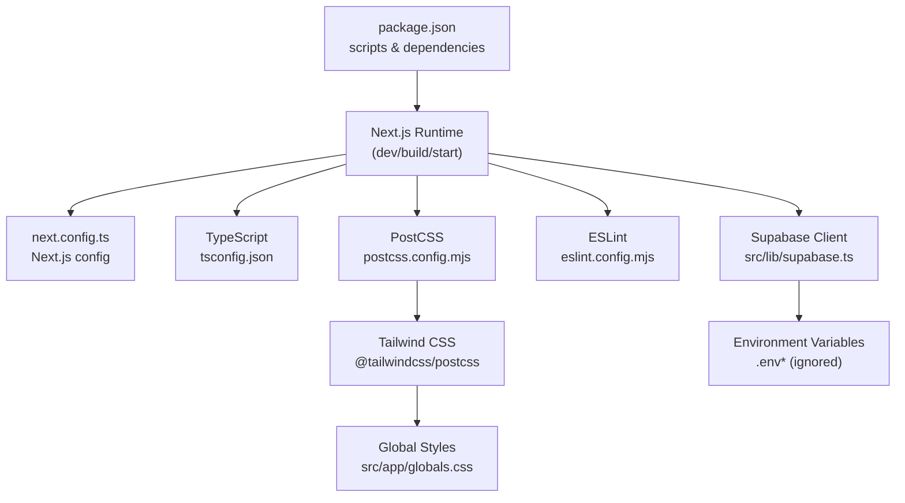
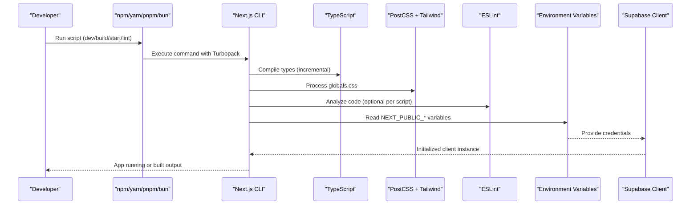
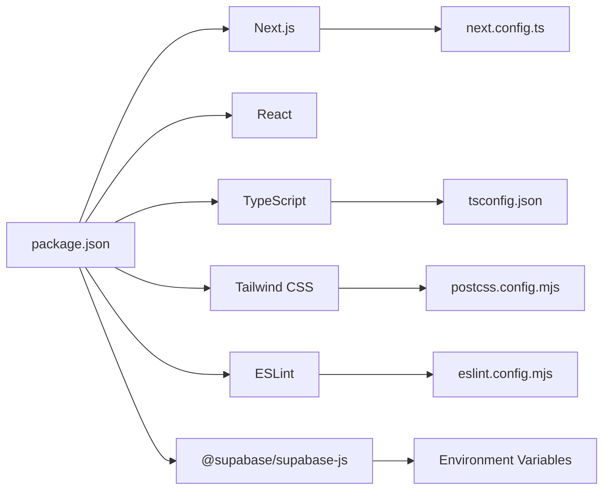

# Configuration & Environment Setup

<cite>
**Referenced Files in This Document**
- [next.config.ts](file://next.config.ts)
- [tsconfig.json](file://tsconfig.json)
- [postcss.config.mjs](file://postcss.config.mjs)
- [eslint.config.mjs](file://eslint.config.mjs)
- [package.json](file://package.json)
- [README.md](file://README.md)
- [supabase.ts](file://src/lib/supabase.ts)
- [globals.css](file://src/app/globals.css)
- [.gitignore](file://.gitignore)
</cite>

## Table of Contents
1. [Introduction](#introduction)
2. [Project Structure](#project-structure)
3. [Core Components](#core-components)
4. [Architecture Overview](#architecture-overview)
5. [Detailed Component Analysis](#detailed-component-analysis)
6. [Dependency Analysis](#dependency-analysis)
7. [Performance Considerations](#performance-considerations)
8. [Troubleshooting Guide](#troubleshooting-guide)
9. [Conclusion](#conclusion)
10. [Appendices](#appendices)

## Introduction
This document provides comprehensive configuration and environment setup guidance for the Simu-Twin-Web project. It covers Next.js configuration, TypeScript compiler settings, PostCSS with Tailwind CSS integration, ESLint setup, environment variable management (including Supabase credentials), development versus production differences, debugging with source maps, and performance monitoring considerations.

## Project Structure
The project is a Next.js application using modern tooling:
- Next.js App Router with TypeScript
- Turbopack-enabled development and builds
- Tailwind CSS v4 via PostCSS
- ESLint Flat Config with Next.js presets
- Supabase client initialized from environment variables

**Diagram sources**
- [package.json:5-9](file://package.json#L5-L9)
- [next.config.ts:1-8](file://next.config.ts#L1-L8)
- [tsconfig.json:1-28](file://tsconfig.json#L1-L28)
- [postcss.config.mjs:1-6](file://postcss.config.mjs#L1-L6)
- [eslint.config.mjs:1-26](file://eslint.config.mjs#L1-L26)
- [supabase.ts:1-7](file://src/lib/supabase.ts#L1-L7)
- [globals.css:1-27](file://src/app/globals.css#L1-L27)

**Section sources**
- [package.json:1-29](file://package.json#L1-L29)
- [README.md:1-37](file://README.md#L1-L37)

## Core Components
- Next.js configuration file defines runtime behavior and build options.
- TypeScript configuration sets strict mode, module resolution, path aliases, and incremental compilation.
- PostCSS configuration integrates Tailwind CSS v4 through its PostCSS plugin.
- ESLint uses Next.js recommended rules for core web vitals and TypeScript support.
- Environment variables are consumed by the Supabase client to initialize the database connection.

Key responsibilities:
- Build pipeline: scripts in package.json invoke Next.js with Turbopack for faster dev and builds.
- Styling pipeline: PostCSS processes global styles and applies Tailwind utilities.
- Code quality: ESLint enforces consistent code style and catches issues early.
- Data layer: Supabase client reads credentials from environment variables at runtime.

**Section sources**
- [package.json:5-9](file://package.json#L5-L9)
- [next.config.ts:1-8](file://next.config.ts#L1-L8)
- [tsconfig.json:1-28](file://tsconfig.json#L1-L28)
- [postcss.config.mjs:1-6](file://postcss.config.mjs#L1-L6)
- [eslint.config.mjs:1-26](file://eslint.config.mjs#L1-L26)
- [supabase.ts:1-7](file://src/lib/supabase.ts#L1-L7)

## Architecture Overview
The configuration architecture centers around Next.js as the orchestrator:
- Scripts trigger Next.js commands that use Turbopack for development and builds.
- TypeScript compiles types and enforces strict checks during development and build time.
- PostCSS transforms CSS with Tailwind directives into optimized styles.
- ESLint analyzes source files to maintain code quality.
- The Supabase client initializes using environment variables at runtime.

**Diagram sources**
- [package.json:5-9](file://package.json#L5-L9)
- [tsconfig.json:1-28](file://tsconfig.json#L1-L28)
- [postcss.config.mjs:1-6](file://postcss.config.mjs#L1-L6)
- [eslint.config.mjs:1-26](file://eslint.config.mjs#L1-L26)
- [supabase.ts:1-7](file://src/lib/supabase.ts#L1-L7)

## Detailed Component Analysis

### Next.js Configuration
- The configuration file exports a NextConfig object ready for customization.
- Development and build scripts enable Turbopack for improved performance.
- Deployment can target platforms supporting Next.js; environment variables must be configured on the host.

Recommendations:
- Enable Turbopack in development and builds for faster iteration and compilation.
- Add runtime-specific settings (e.g., headers, redirects, rewrites) as needed.
- Configure environment variables in your deployment platform’s dashboard or local .env files.

**Section sources**
- [next.config.ts:1-8](file://next.config.ts#L1-L8)
- [package.json:5-9](file://package.json#L5-L9)
- [README.md:32-37](file://README.md#L32-L37)

### TypeScript Compiler Settings
- Strict mode is enabled to enforce type safety across the codebase.
- Module resolution is set to bundler mode suitable for modern toolchains.
- Path alias @/* maps to src/* for cleaner imports.
- Incremental compilation improves rebuild speed.
- JSX is preserved for Next.js processing.

Best practices:
- Keep strict mode enabled to catch errors early.
- Use path aliases consistently to avoid relative import chains.
- Leverage incremental builds for faster feedback loops.

**Section sources**
- [tsconfig.json:1-28](file://tsconfig.json#L1-L28)

### PostCSS and Tailwind CSS Integration
- PostCSS is configured with the Tailwind CSS PostCSS plugin.
- Global styles import Tailwind directives and define theme variables.
- Dark mode is supported via media queries and CSS variables.

Guidelines:
- Ensure Tailwind directives are imported in global styles.
- Define design tokens (colors, fonts) in CSS variables for consistency.
- Use responsive and dark-mode utilities provided by Tailwind.

**Section sources**
- [postcss.config.mjs:1-6](file://postcss.config.mjs#L1-L6)
- [globals.css:1-27](file://src/app/globals.css#L1-L27)

### ESLint Setup
- Uses Next.js recommended configurations for core web vitals and TypeScript.
- Ignores generated and dependency directories to reduce noise.
- Flat config format aligns with modern ESLint standards.

Tips:
- Extend rules as needed for team conventions.
- Integrate ESLint into your editor for real-time feedback.
- Run linting in CI to enforce quality gates.

**Section sources**
- [eslint.config.mjs:1-26](file://eslint.config.mjs#L1-L26)

### Environment Variable Management
- Supabase client is initialized using NEXT_PUBLIC_SUPABASE_URL and NEXT_PUBLIC_SUPABASE_ANON_KEY.
- Environment files (.env*) are ignored by version control to prevent secrets leakage.
- Only variables prefixed with NEXT_PUBLIC_ are exposed to the browser.

Setup steps:
- Create a local .env.local file with required variables.
- Configure environment variables in your deployment platform’s settings.
- Restart the server after changing environment variables.

Security notes:
- Never commit .env files to version control.
- Use separate environments for development, staging, and production.
- Rotate keys regularly and limit access to sensitive values.

**Section sources**
- [supabase.ts:1-7](file://src/lib/supabase.ts#L1-L7)
- [.gitignore:33-35](file://.gitignore#L33-L35)

### Development vs Production Differences
- Development:
  - Scripts run with Turbopack for fast refresh and builds.
  - Source maps are typically enabled by default in development.
  - Hot reloading and detailed error overlays improve developer experience.
- Production:
  - Builds optimize assets and minify code.
  - Environment variables must be configured on the hosting platform.
  - Performance monitoring and logging should be integrated at the platform level.

Operational tips:
- Use different .env files per environment (e.g., .env.development, .env.production).
- Validate environment variables at startup to fail fast on misconfiguration.
- Monitor build times and bundle sizes in CI.

[No sources needed since this section provides general guidance]

### Debugging, Source Maps, and Performance Monitoring
- Source maps:
  - Enabled by default in development for better debugging.
  - Can be controlled via Next.js settings if customizing the build.
- Debugging:
  - Use browser developer tools and Next.js error overlays.
  - Log environment variables carefully to avoid exposing secrets.
- Performance monitoring:
  - Integrate analytics or RUM tools via environment variables.
  - Track key metrics like Time to First Byte and Largest Contentful Paint.
  - Use platform-native profiling where available.

[No sources needed since this section provides general guidance]

## Dependency Analysis
The project relies on Next.js, React, TypeScript, Tailwind CSS, ESLint, and Supabase. Scripts orchestrate the toolchain, while configuration files define behavior.

**Diagram sources**
- [package.json:11-27](file://package.json#L11-L27)
- [next.config.ts:1-8](file://next.config.ts#L1-L8)
- [tsconfig.json:1-28](file://tsconfig.json#L1-L28)
- [postcss.config.mjs:1-6](file://postcss.config.mjs#L1-L6)
- [eslint.config.mjs:1-26](file://eslint.config.mjs#L1-L26)
- [supabase.ts:1-7](file://src/lib/supabase.ts#L1-L7)

**Section sources**
- [package.json:1-29](file://package.json#L1-L29)

## Performance Considerations
- Turbopack:
  - Enabled in dev and build scripts for faster compilation and rebuilds.
  - Reduces cold start times and improves iterative development speed.
- TypeScript:
  - Incremental compilation speeds up repeated builds.
  - Strict mode prevents costly runtime errors.
- Styling:
  - Tailwind CSS generates only used utilities, minimizing CSS size.
- Bundling:
  - Next.js automatically optimizes code splitting and asset delivery.
- Monitoring:
  - Integrate performance monitoring to track real-world metrics.

[No sources needed since this section provides general guidance]

## Troubleshooting Guide
Common issues and resolutions:
- Missing environment variables:
  - Ensure NEXT_PUBLIC_SUPABASE_URL and NEXT_PUBLIC_SUPABASE_ANON_KEY are set locally and in production.
  - Verify they are not committed to version control.
- Tailwind not applying:
  - Confirm PostCSS plugin is installed and configured.
  - Check that Tailwind directives are imported in global styles.
- ESLint errors:
  - Review Next.js recommended rules and adjust ignores if necessary.
- Build failures:
  - Clear caches (.next, node_modules) and reinstall dependencies.
  - Check TypeScript errors and fix type mismatches.

**Section sources**
- [supabase.ts:1-7](file://src/lib/supabase.ts#L1-L7)
- [postcss.config.mjs:1-6](file://postcss.config.mjs#L1-L6)
- [eslint.config.mjs:1-26](file://eslint.config.mjs#L1-L26)
- [.gitignore:33-35](file://.gitignore#L33-L35)

## Conclusion
The Simu-Twin-Web project is configured with modern, high-performance tooling:
- Next.js with Turbopack for rapid development and efficient builds.
- TypeScript with strict mode and path aliases for robust type safety.
- Tailwind CSS via PostCSS for utility-first styling.
- ESLint with Next.js presets for consistent code quality.
- Secure environment variable management for Supabase integration.

Adhering to these configurations ensures a scalable, maintainable, and performant application across development and production environments.

[No sources needed since this section summarizes without analyzing specific files]

## Appendices

### Quick Start Commands
- Development: npm run dev
- Build: npm run build
- Start production server: npm run start
- Lint: npm run lint

**Section sources**
- [package.json:5-9](file://package.json#L5-L9)

### Environment Variables Reference
- NEXT_PUBLIC_SUPABASE_URL: Supabase project URL
- NEXT_PUBLIC_SUPABASE_ANON_KEY: Supabase anonymous key

**Section sources**
- [supabase.ts:1-7](file://src/lib/supabase.ts#L1-L7)