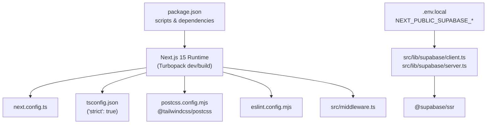

# Configuration & Environment Setup

<cite>
**Referenced Files in This Document**
- [next.config.ts](file:///c:/Users/catra/Desktop/simu-twin-web/next.config.ts)
- [tsconfig.json](file:///c:/Users/catra/Desktop/simu-twin-web/tsconfig.json)
- [postcss.config.mjs](file:///c:/Users/catra/Desktop/simu-twin-web/postcss.config.mjs)
- [eslint.config.mjs](file:///c:/Users/catra/Desktop/simu-twin-web/eslint.config.mjs)
- [package.json](file:///c:/Users/catra/Desktop/simu-twin-web/package.json)
- [README.md](file:///c:/Users/catra/Desktop/simu-twin-web/README.md)
- [src/lib/supabase/client.ts](file:///c:/Users/catra/Desktop/simu-twin-web/src/lib/supabase/client.ts)
- [src/lib/supabase/server.ts](file:///c:/Users/catra/Desktop/simu-twin-web/src/lib/supabase/server.ts)
- [src/middleware.ts](file:///c:/Users/catra/Desktop/simu-twin-web/src/middleware.ts)
- [src/app/globals.css](file:///c:/Users/catra/Desktop/simu-twin-web/src/app/globals.css)
- [.gitignore](file:///c:/Users/catra/Desktop/simu-twin-web/.gitignore)
</cite>

## Table of Contents
1. [Introduction](#introduction)
2. [Project Configuration Map](#project-configuration-map)
3. [Environment Variables](#environment-variables)
4. [Next.js & Turbopack Configuration](#nextjs--turbopack-configuration)
5. [TypeScript Settings](#typescript-settings)
6. [Tailwind CSS v4 & PostCSS](#tailwind-css-v4--postcss)
7. [Supabase SSR Setup](#supabase-ssr-setup)
8. [Edge Middleware Rules](#edge-middleware-rules)
9. [Conclusion](#conclusion)

---

## Introduction
This document details the configuration and environment setup for Simu-Twin Web. The project utilizes modern tooling: Next.js 15 App Router with Turbopack, Tailwind CSS v4, TypeScript 5, ESLint flat configuration, and Supabase SSR for session handling.

---

## Project Configuration Map



---

## Environment Variables

The project requires Supabase API credentials configured in `.env.local`:

```env
# URL of your Supabase project instance
NEXT_PUBLIC_SUPABASE_URL=https://<your-project-ref>.supabase.co

# Public anonymous key (used with RLS policies enabled)
NEXT_PUBLIC_SUPABASE_ANON_KEY=eyJhbGciOi...
```

> **Security Note**: These variables are prefixed with `NEXT_PUBLIC_`, meaning they are exposed to the client browser. Never place database service role keys (`SUPABASE_SERVICE_ROLE_KEY`) into `.env.local` without restricting their use strictly to server-only code. All data access is protected by PostgreSQL Row-Level Security (RLS).

---

## Next.js & Turbopack Configuration

[`next.config.ts`](file:///c:/Users/catra/Desktop/simu-twin-web/next.config.ts):
```typescript
import type { NextConfig } from "next";

const nextConfig: NextConfig = {
  /* config options here */
};

export default nextConfig;
```
Builds leverage Turbopack via `next build --turbopack` as defined in `package.json`.

---

## TypeScript Settings

[`tsconfig.json`](file:///c:/Users/catra/Desktop/simu-twin-web/tsconfig.json):
- `"strict": true`: Enforces strict null and undefined checks across all files.
- `"moduleResolution": "bundler"`: Compatible with modern bundlers and ES modules.
- Path aliases: `"@/*": ["./src/*"]` maps cleanly to internal modules.

---

## Tailwind CSS v4 & PostCSS

- [`postcss.config.mjs`](file:///c:/Users/catra/Desktop/simu-twin-web/postcss.config.mjs) delegates processing to `@tailwindcss/postcss`.
- [`src/app/globals.css`](file:///c:/Users/catra/Desktop/simu-twin-web/src/app/globals.css) imports `@import "tailwindcss";` and defines institutional color variables for the Government of Venado Tuerto.

---

## Supabase SSR Setup

Session handling is divided cleanly:
- [`src/lib/supabase/client.ts`](file:///c:/Users/catra/Desktop/simu-twin-web/src/lib/supabase/client.ts): Instantiates the browser client with `createBrowserClient`.
- [`src/lib/supabase/server.ts`](file:///c:/Users/catra/Desktop/simu-twin-web/src/lib/supabase/server.ts): Instantiates the server client with `createServerClient` and Next.js `cookies()` helper for Server Components and Server Actions.

---

## Edge Middleware Rules

[`src/middleware.ts`](file:///c:/Users/catra/Desktop/simu-twin-web/src/middleware.ts):
- Runs on the Edge runtime for zero latency.
- Protects `/admin/*` routes, redirecting unauthenticated traffic to `/login`.
- Redirects authenticated users from `/login` back to `/admin`.
- Excludes static files, 3D assets (`.glb`, `.gltf`), images, and fonts from running through the middleware.

---

## Conclusion
The configuration architecture establishes strict type safety, zero-bundle CSS processing, and secure SSR cookie authentication across the entire application lifecycle.