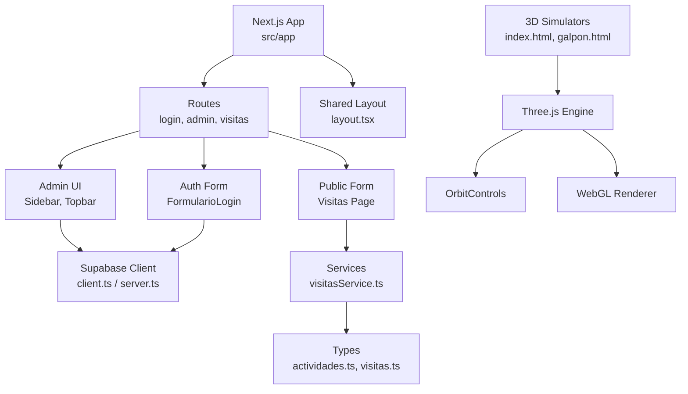
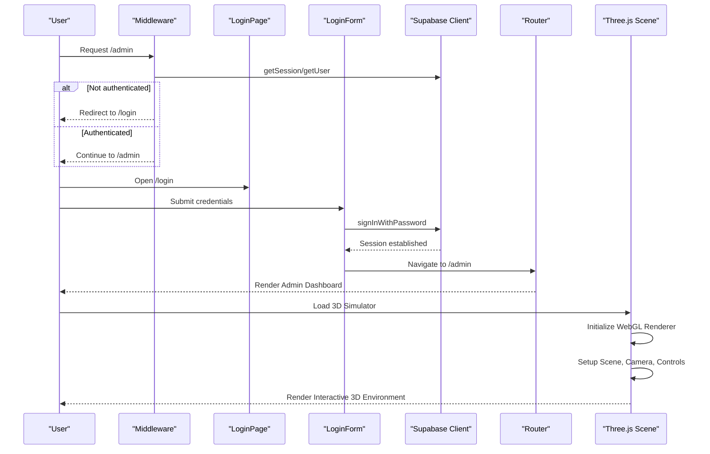
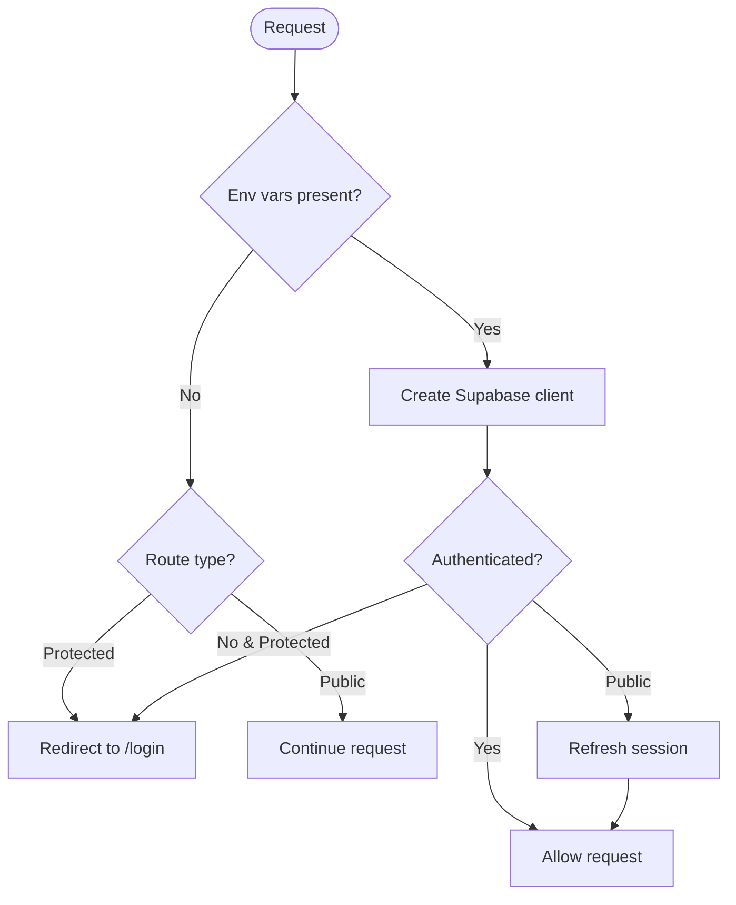
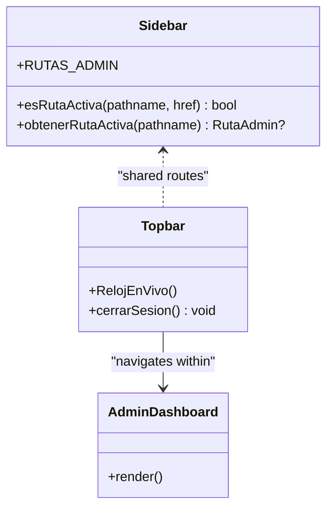
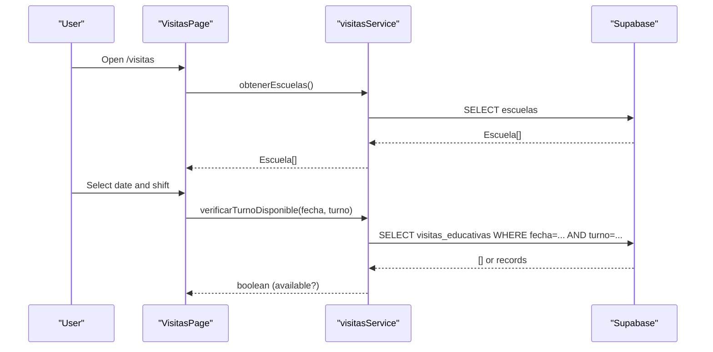
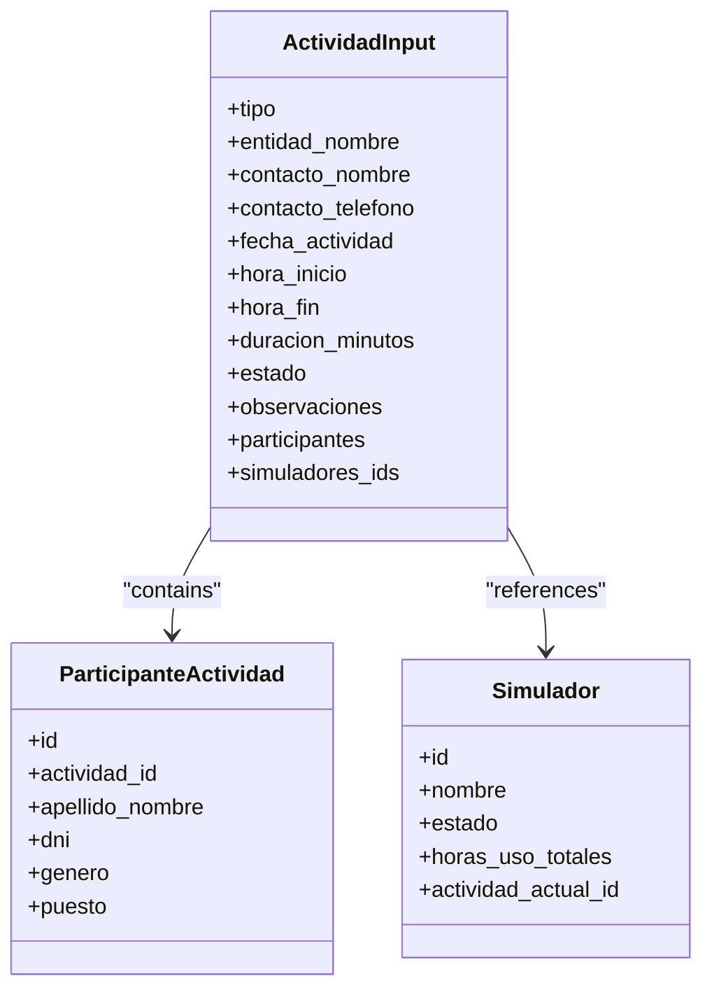
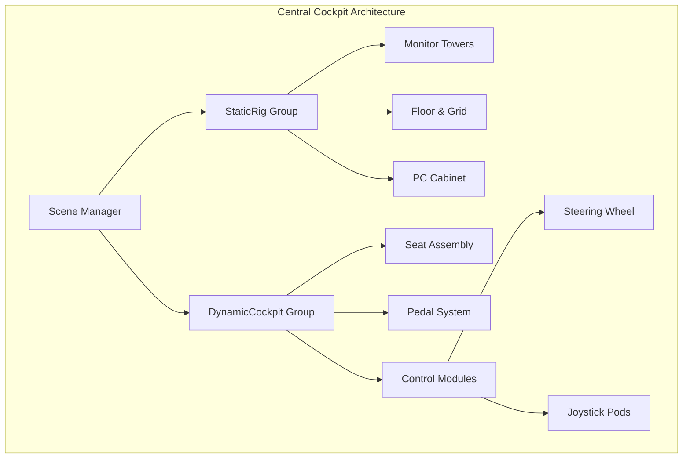
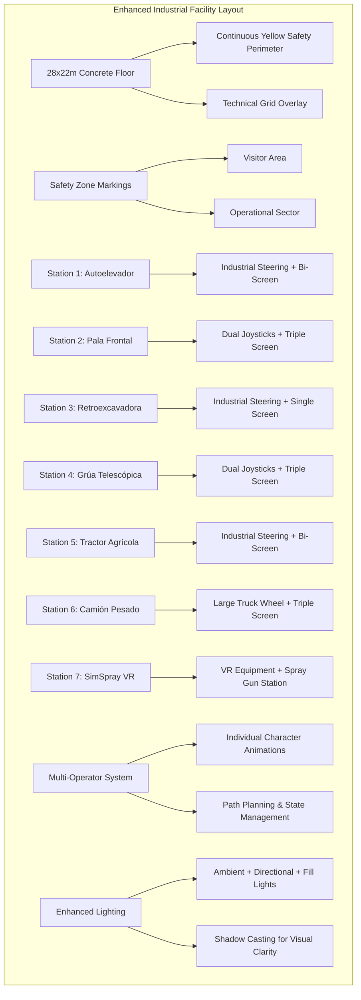
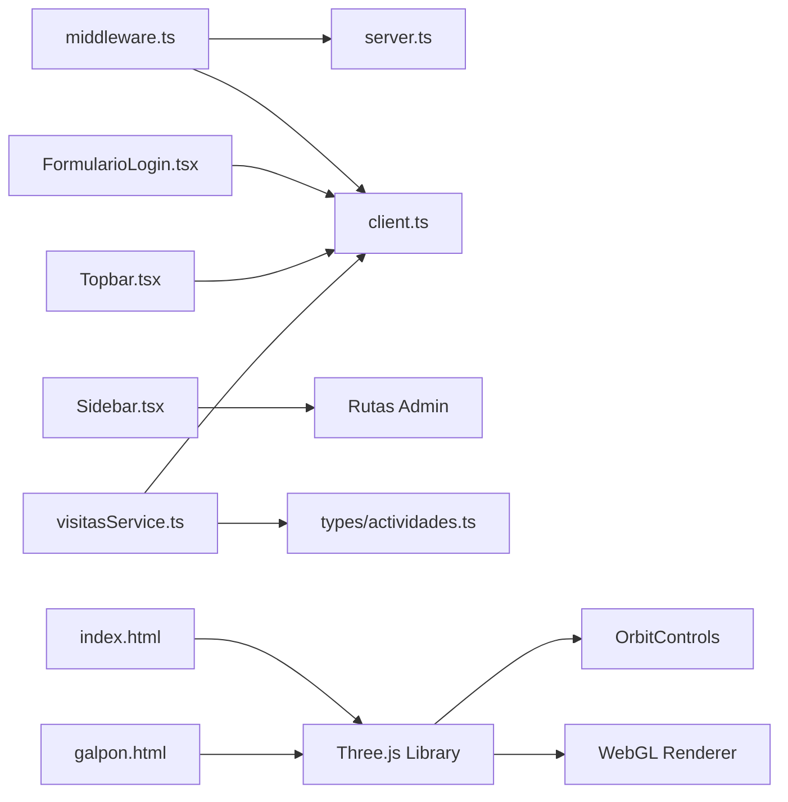

# 3D Cockpit Simulation

<cite>
**Referenced Files in This Document**
- [README.md](file://README.md)
- [package.json](file://package.json)
- [index.html](file://index.html)
- [galpon.html](file://galpon.html)
- [src/app/layout.tsx](file://src/app/layout.tsx)
- [src/app/page.tsx](file://src/app/page.tsx)
- [src/middleware.ts](file://src/middleware.ts)
- [src/app/login/page.tsx](file://src/app/login/page.tsx)
- [src/app/admin/page.tsx](file://src/app/admin/page.tsx)
- [src/app/visitas/page.tsx](file://src/app/visitas/page.tsx)
- [src/components/auth/FormularioLogin.tsx](file://src/components/auth/FormularioLogin.tsx)
- [src/components/admin/Sidebar.tsx](file://src/components/admin/Sidebar.tsx)
- [src/components/admin/Topbar.tsx](file://src/components/admin/Topbar.tsx)
- [src/lib/supabase/client.ts](file://src/lib/supabase/client.ts)
- [src/lib/supabase/server.ts](file://src/lib/supabase/server.ts)
- [src/services/visitasService.ts](file://src/services/visitasService.ts)
- [src/types/actividades.ts](file://src/types/actividades.ts)
</cite>

## Update Summary
**Changes Made**
- Updated galpon.html section to reflect complete safety boundary system redesign with continuous yellow perimeter
- Enhanced operator tracking functionality documentation with multi-operator system details
- Expanded facility dimensions documentation to 28x22m industrial space
- Updated lighting and visual clarity improvements in the industrial facility
- Added comprehensive 7-station simulator configuration details
- Removed references to legacy modular safety line segments
- Updated operator model system to reflect simplified animation architecture
- Enhanced UI structure documentation with modern SCADA interface elements

## Table of Contents
1. Introduction
2. Project Structure
3. Core Components
4. Architecture Overview
5. Detailed Component Analysis
6. 3D Simulator Center Implementation
7. Dependency Analysis
8. Performance Considerations
9. Troubleshooting Guide
10. Conclusion

## Introduction
This project is a Next.js application that provides an administrative hub and public booking portal for a simulation center. The repository now includes comprehensive 3D simulator center implementations using Three.js, featuring industrial simulator facilities with realistic environments, configurable cockpit simulations, and interactive control interfaces. While the core application focuses on administration and visit management through Supabase integration, it is structured to support future integration of the 3D simulation modules alongside existing assets like GLB/GLTF models referenced in middleware.

## Project Structure
The application follows a feature-oriented layout under src/app with shared UI components, Supabase client utilities, typed models, and services. Key areas include:
- App routes: login, admin dashboard, and public visitas form
- Admin UI: sidebar and topbar for navigation and session controls
- Supabase clients: browser and server variants for consistent session handling
- Services and types: domain logic for visits and activity modeling
- **New**: Standalone 3D simulator implementations in index.html and galpon.html

**Diagram sources**
- [src/app/layout.tsx:1-35](file://src/app/layout.tsx#L1-L35)
- [src/app/login/page.tsx:1-31](file://src/app/login/page.tsx#L1-L31)
- [src/app/admin/page.tsx:1-38](file://src/app/admin/page.tsx#L1-L38)
- [src/app/visitas/page.tsx:1-28](file://src/app/visitas/page.tsx#L1-L28)
- [src/components/admin/Sidebar.tsx:1-113](file://src/components/admin/Sidebar.tsx#L1-L113)
- [src/components/admin/Topbar.tsx:1-132](file://src/components/admin/Topbar.tsx#L1-L132)
- [src/components/auth/FormularioLogin.tsx:1-107](file://src/components/auth/FormularioLogin.tsx#L1-L107)
- [src/lib/supabase/client.ts:1-34](file://src/lib/supabase/client.ts#L1-L34)
- [src/lib/supabase/server.ts:1-41](file://src/lib/supabase/server.ts#L1-L41)
- [src/services/visitasService.ts:1-105](file://src/services/visitasService.ts#L1-L105)
- [src/types/actividades.ts:1-177](file://src/types/actividades.ts#L1-L177)
- [index.html:1-491](file://index.html#L1-L491)
- [galpon.html:1-1163](file://galpon.html#L1-L1163)

**Section sources**
- [README.md:1-37](file://README.md#L1-L37)
- [package.json:1-32](file://package.json#L1-L32)
- [src/app/layout.tsx:1-35](file://src/app/layout.tsx#L1-L35)

## Core Components
- Authentication flow: Login form interacts with Supabase auth; middleware protects admin routes and redirects appropriately.
- Admin panel: Sidebar defines navigation; Topbar shows current section, live clock, and logout action.
- Public visit booking: Visitas page renders a form backed by services that query and update Supabase tables.
- Data layer: Services encapsulate Supabase queries; types define contracts for activities and visits.
- **New**: 3D simulator center with Three.js rendering engine, orbit controls, and interactive UI elements.

Key responsibilities:
- Middleware enforces session state and route protection.
- Supabase clients provide authenticated sessions across client and server contexts.
- Services centralize database interactions and business rules (e.g., capacity checks).
- Types ensure consistency between UI and backend schemas.
- **New**: Three.js scenes manage 3D geometry, materials, lighting, and animation loops.

**Section sources**
- [src/middleware.ts:1-100](file://src/middleware.ts#L1-L100)
- [src/components/auth/FormularioLogin.tsx:1-107](file://src/components/auth/FormularioLogin.tsx#L1-L107)
- [src/components/admin/Sidebar.tsx:1-113](file://src/components/admin/Sidebar.tsx#L1-L113)
- [src/components/admin/Topbar.tsx:1-132](file://src/components/admin/Topbar.tsx#L1-L132)
- [src/services/visitasService.ts:1-105](file://src/services/visitasService.ts#L1-L105)
- [src/types/actividades.ts:1-177](file://src/types/actividades.ts#L1-L177)

## Architecture Overview
The system combines Next.js routing, Supabase authentication, service-layer data access, and Three.js 3D rendering. Middleware secures routes and refreshes sessions. Client and server Supabase clients share cookie-based sessions. Services abstract database operations and expose typed APIs to components. The 3D simulators operate as standalone HTML applications with their own rendering pipelines.

**Diagram sources**
- [src/middleware.ts:14-85](file://src/middleware.ts#L14-L85)
- [src/app/login/page.tsx:1-31](file://src/app/login/page.tsx#L1-L31)
- [src/components/auth/FormularioLogin.tsx:21-51](file://src/components/auth/FormularioLogin.tsx#L21-L51)
- [src/lib/supabase/client.ts:20-33](file://src/lib/supabase/client.ts#L20-L33)
- [index.html:92-113](file://index.html#L92-L113)
- [galpon.html:101-120](file://galpon.html#L101-L120)

## Detailed Component Analysis

### Authentication and Session Management
- Middleware validates protected routes (/admin/*, /login), refreshes sessions for public routes, and handles missing environment variables gracefully by redirecting or passing through.
- Server-side Supabase client synchronizes cookies for server components and actions.
- Browser-side Supabase client is singleton per tab and used by forms and interactive UI.

**Diagram sources**
- [src/middleware.ts:14-85](file://src/middleware.ts#L14-L85)
- [src/lib/supabase/server.ts:11-40](file://src/lib/supabase/server.ts#L11-L40)
- [src/lib/supabase/client.ts:7-33](file://src/lib/supabase/client.ts#L7-L33)

**Section sources**
- [src/middleware.ts:1-100](file://src/middleware.ts#L1-L100)
- [src/lib/supabase/server.ts:1-41](file://src/lib/supabase/server.ts#L1-L41)
- [src/lib/supabase/client.ts:1-34](file://src/lib/supabase/client.ts#L1-L34)

### Admin Navigation and Dashboard
- Sidebar defines a single source of truth for admin routes and active state detection.
- Topbar displays breadcrumb-like context, live clock, and logout functionality using the Supabase client.
- Admin dashboard placeholder indicates where digital twin and telemetry will connect.

**Diagram sources**
- [src/components/admin/Sidebar.tsx:16-45](file://src/components/admin/Sidebar.tsx#L16-L45)
- [src/components/admin/Topbar.tsx:56-72](file://src/components/admin/Topbar.tsx#L56-L72)
- [src/app/admin/page.tsx:5-35](file://src/app/admin/page.tsx#L5-L35)

**Section sources**
- [src/components/admin/Sidebar.tsx:1-113](file://src/components/admin/Sidebar.tsx#L1-L113)
- [src/components/admin/Topbar.tsx:1-132](file://src/components/admin/Topbar.tsx#L1-L132)
- [src/app/admin/page.tsx:1-38](file://src/app/admin/page.tsx#L1-L38)

### Public Visit Booking Flow
- Visitas page renders a form that leverages services to fetch schools, available dates, and check slot availability.
- Services interact with Supabase to enforce constraints such as maximum student capacity per shift.

**Diagram sources**
- [src/app/visitas/page.tsx:10-24](file://src/app/visitas/page.tsx#L10-L24)
- [src/services/visitasService.ts:11-51](file://src/services/visitasService.ts#L11-L51)

**Section sources**
- [src/app/visitas/page.tsx:1-28](file://src/app/visitas/page.tsx#L1-L28)
- [src/services/visitasService.ts:1-105](file://src/services/visitasService.ts#L1-L105)

### Activity Modeling and Types
- Types define enumerations and interfaces for activities, participants, and simulator states, aligning UI with database schema.
- Labels and enums standardize display values and validations across components.

**Diagram sources**
- [src/types/actividades.ts:32-104](file://src/types/actividades.ts#L32-L104)
- [src/types/actividades.ts:59-73](file://src/types/actividades.ts#L59-L73)

**Section sources**
- [src/types/actividades.ts:1-177](file://src/types/actividades.ts#L1-L177)

## 3D Simulator Center Implementation

### Central Cockpit Simulator (index.html)
The central cockpit simulator provides a detailed industrial control room environment with:

- **Scene Setup**: Professional lighting with ambient, directional key/fill lights, and interactive point lighting
- **Geometry System**: Modular construction using helper functions for boxes, cylinders, and hinge patterns
- **Cockpit Structure**: Dynamic platform with vibration simulation and static monitor towers
- **Control Configurations**: Switchable between industrial steering wheel and dual joystick modes
- **Interactive Elements**: Mode switching buttons, rotation controls, and grid visibility toggles

**Diagram sources**
- [index.html:158-175](file://index.html#L158-L175)
- [index.html:177-273](file://index.html#L177-L273)
- [index.html:274-423](file://index.html#L274-L423)

### Industrial Simulator Facility (galpon.html) - **UPDATED**
The industrial facility implements a complete simulator center with seven distinct stations, featuring a completely redesigned safety boundary system and enhanced operator tracking:

**Major Enhancements:**
- **Continuous Safety Perimeter**: Replaced modular safety line segments with a unified yellow boundary system that creates a continuous operational zone
- **Multi-Operator Tracking System**: Advanced operator movement system with individual character animations and state management
- **Expanded Facility Dimensions**: 28x22m industrial space with professional concrete flooring and technical grid overlay
- **Enhanced Lighting System**: Improved ambient and directional lighting with shadow casting for better visual clarity
- **Seven Complete Simulator Stations**: Each with unique configurations, control schemes, and specialized equipment

**Safety Boundary System Redesign:**
The new continuous yellow perimeter system replaces the previous modular approach:
- Single continuous boundary line with rounded corners and chamfered transitions
- Professional safety markings with stenciled text overlays
- Dedicated pedestrian access door with threshold markers
- Clear visitor vs. operator zone demarcation

**Advanced Operator Movement System:**
- Individual animated operators with articulated body parts (arms, legs, torso)
- Realistic walking animations with joint articulation
- State machine managing operator lifecycle (walking, climbing, operating, exiting)
- Path planning from entrance door through safety boundary to simulator positions
- Specialized VR operator for painting station with spray gun equipment

**Station Configuration Details:**
1. **Autoelevador** (Forklift): Industrial steering wheel, bi-screen setup at position [6.4, 0, -0.5]
2. **Pala Frontal** (Front Loader): Dual joysticks, triple screen configuration at 45° angle [5.5, 0, -4.8]
3. **Retroexcavadora** (Backhoe): Industrial steering wheel, single screen at [0.0, 0, -5.4]
4. **Grúa Telescópica** (Telescopic Crane): Dual joysticks, triple screen setup at 45° angle [-5.5, 0, -4.8]
5. **Tractor Agrícola** (Agricultural Tractor): Industrial steering wheel, bi-screen setup at [-6.4, 0, -0.5]
6. **Camión Pesado** (Heavy Truck): Large truck steering wheel, triple screen setup at [-6.0, 0, 3.8]
7. **SimSpray Pintura VR**: Specialized VR painting station with spray gun equipment at [-2.5, 0, 4.8]

**Diagram sources**
- [galpon.html:186-274](file://galpon.html#L186-L274)
- [galpon.html:608-626](file://galpon.html#L608-L626)
- [galpon.html:633-747](file://galpon.html#L633-L747)

### Advanced Features

#### Enhanced Geometry and Material System
Both implementations use sophisticated geometry creation systems with reusable helper functions:
- **mesh()**: Universal mesh creation with shadow casting/receiving capabilities
- **box()**: Box geometry wrapper for rectangular objects
- **cyl()**: Cylinder geometry wrapper for cylindrical components  
- **hinge()**: Hinge pattern implementation for articulated parts

**Updated Material Library:**
- Metallic surfaces with varying roughness and metalness properties
- Plastic and rubber components with realistic textures
- Safety equipment materials including reflective vests and helmets
- Display screen materials with emissive properties for operational feedback
- Concrete and floor materials optimized for industrial environments

#### Advanced Animation and Interaction Systems
- **Multi-Operator Animation**: Complex character rigging with articulated limbs and realistic movement patterns
- **State Machine Management**: Comprehensive operator lifecycle management with smooth transitions
- **Path Planning Algorithms**: Intelligent route calculation from entrance to simulator positions
- **Vibration Simulation**: Dynamic cockpit platforms with sinusoidal vibration effects
- **Camera Controls**: Orbit controls with damping and angle restrictions for optimal viewing angles
- **Responsive Design**: Automatic resize handling for different screen sizes and aspect ratios

#### SCADA Integration and Status Management
- **Real-time Status Indicators**: Visual feedback for operational states with color-coded indicators
- **Global Control Interface**: Unified on/off controls for all simulator stations
- **Operator Tracking Display**: Live status updates showing active operators and their locations
- **Interactive UI Elements**: Button-based controls with visual state feedback

**Section sources**
- [index.html:42-153](file://index.html#L42-L153)
- [index.html:155-491](file://index.html#L155-L491)
- [galpon.html:53-158](file://galpon.html#L53-L158)
- [galpon.html:159-652](file://galpon.html#L159-L652)
- [galpon.html:633-1163](file://galpon.html#L633-L1163)

## Dependency Analysis
- Routing and protection: Middleware depends on Supabase server client and environment variables; it matches specific paths and excludes static assets, including potential 3D model files.
- UI components depend on shared navigation definitions and Supabase client for session actions.
- Services depend on Supabase client and types to enforce contracts.
- **New**: 3D simulators depend on Three.js library loaded from CDN and OrbitControls for camera interaction.

**Diagram sources**
- [src/middleware.ts:1-100](file://src/middleware.ts#L1-L100)
- [src/lib/supabase/server.ts:1-41](file://src/lib/supabase/server.ts#L1-L41)
- [src/lib/supabase/client.ts:1-34](file://src/lib/supabase/client.ts#L1-L34)
- [src/components/auth/FormularioLogin.tsx:1-107](file://src/components/auth/FormularioLogin.tsx#L1-L107)
- [src/components/admin/Topbar.tsx:1-132](file://src/components/admin/Topbar.tsx#L1-L132)
- [src/components/admin/Sidebar.tsx:1-113](file://src/components/admin/Sidebar.tsx#L1-L113)
- [src/services/visitasService.ts:1-105](file://src/services/visitasService.ts#L1-L105)
- [src/types/actividades.ts:1-177](file://src/types/actividades.ts#L1-L177)
- [index.html:25-26](file://index.html#L25-L26)
- [galpon.html:51-52](file://galpon.html#L51-L52)

**Section sources**
- [src/middleware.ts:1-100](file://src/middleware.ts#L1-L100)
- [src/services/visitasService.ts:1-105](file://src/services/visitasService.ts#L1-L105)
- [src/components/admin/Sidebar.tsx:1-113](file://src/components/admin/Sidebar.tsx#L1-L113)

## Performance Considerations
- Use Next.js build optimizations and Turbopack for faster builds.
- Keep middleware matcher minimal to avoid unnecessary processing on static assets and API payloads.
- Prefer server components and server actions for data-heavy operations to reduce client bundle size.
- Cache frequently accessed data (e.g., schools, enabled dates) at the service layer or via caching strategies if needed.
- For future 3D assets (GLB/GLTF), consider lazy loading and asset optimization pipelines to minimize initial payload.
- **New**: 3D simulators use efficient geometry reuse and material sharing to optimize rendering performance.
- **New**: WebGL renderer configured with appropriate pixel ratios and shadow map settings for balanced quality/performance.
- **New**: Animation loops use requestAnimationFrame for smooth 60fps rendering with minimal CPU overhead.
- **Updated**: Multi-operator system optimized with individual state management to prevent unnecessary recalculations.
- **Updated**: Continuous safety perimeter system reduces geometric complexity compared to modular segment approach.

## Troubleshooting Guide
Common issues and resolutions:
- Missing Supabase environment variables: Both client and server clients throw explicit errors when NEXT_PUBLIC_SUPABASE_URL or NEXT_PUBLIC_SUPABASE_ANON_KEY are absent. Ensure .env.local is configured correctly.
- Middleware redirects: If environment variables are missing at the edge, protected routes redirect to login; verify env setup and redeploy.
- Authentication failures: The login form maps Supabase error messages to user-friendly text; check credentials and network connectivity.
- Session sync: Logout triggers sign-out and navigates back to login; ensure router refresh occurs to clear cached state.
- **New**: 3D simulator rendering issues: Verify WebGL support in browser console; check Three.js CDN availability; ensure proper canvas sizing and aspect ratio calculations.
- **New**: Orbit controls not responding: Verify mouse event listeners are properly attached; check for CSS z-index conflicts with UI overlays.
- **Updated**: Operator animation issues: Check path planning algorithms and state machine transitions; verify coordinate transformations for different station orientations.
- **Updated**: Safety boundary visualization problems: Ensure continuous perimeter geometry is properly calculated; check material opacity and polygon offset settings.

**Section sources**
- [src/lib/supabase/client.ts:7-18](file://src/lib/supabase/client.ts#L7-L18)
- [src/lib/supabase/server.ts:11-19](file://src/lib/supabase/server.ts#L11-L19)
- [src/middleware.ts:20-32](file://src/middleware.ts#L20-L32)
- [src/components/auth/FormularioLogin.tsx:21-51](file://src/components/auth/FormularioLogin.tsx#L21-L51)
- [src/components/admin/Topbar.tsx:62-72](file://src/components/admin/Topbar.tsx#L62-L72)

## Conclusion
The application provides a robust foundation for managing simulation center operations, including secure admin access, navigation, and public visit bookings. The addition of comprehensive 3D simulator center implementations significantly enhances the platform's capabilities, offering realistic industrial training environments with detailed cockpit simulations and interactive control systems. 

**Updated**: The recent enhancements to the industrial facility (galpon.html) represent a major architectural improvement with the complete redesign of the safety boundary system, advanced multi-operator tracking capabilities, and expanded facility dimensions. These changes provide a more professional and immersive simulation experience while maintaining clean separation of concerns across routing, authentication, UI, data layers, and 3D rendering. The architecture remains straightforward to extend with additional modules such as real-time telemetry integration and immersive VR experiences while leveraging the existing session and data infrastructure.