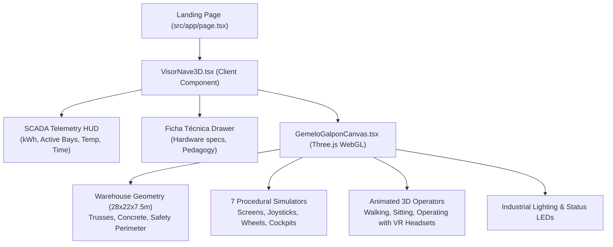

# 3D Digital Twin & Industrial Simulation Engine

<cite>
**Referenced Files in This Document**
- [src/components/gemelo/GemeloGalponCanvas.tsx](file:///c:/Users/catra/Desktop/simu-twin-web/src/components/gemelo/GemeloGalponCanvas.tsx)
- [src/components/gemelo/VisorNave3D.tsx](file:///c:/Users/catra/Desktop/simu-twin-web/src/components/gemelo/VisorNave3D.tsx)
- [src/types/gemelo.ts](file:///c:/Users/catra/Desktop/simu-twin-web/src/types/gemelo.ts)
- [src/app/page.tsx](file:///c:/Users/catra/Desktop/simu-twin-web/src/app/page.tsx)
- [galpon.html](file:///c:/Users/catra/Desktop/simu-twin-web/galpon.html)
- [index.html](file:///c:/Users/catra/Desktop/simu-twin-web/index.html)
</cite>

## Table of Contents
1. [Introduction](#introduction)
2. [React Component Architecture](#react-component-architecture)
3. [Warehouse Procedural Scene Generation](#warehouse-procedural-scene-generation)
4. [Simulator Fleet & Station Modeling](#simulator-fleet--station-modeling)
5. [3D Animated Operators & Kinematics](#3d-animated-operators--kinematics)
6. [SCADA Telemetry HUD & State Management](#scada-telemetry-hud--state-management)
7. [Camera Controls & Raycasting Interaction](#camera-controls--raycasting-interaction)
8. [Standalone Prototypes (galpon.html & index.html)](#standalone-prototypes-galponhtml--indexhtml)
9. [Performance & WebGL Optimizations](#performance--webgl-optimizations)
10. [Conclusion](#conclusion)

---

## Introduction
The 3D Digital Twin (Gemelo Digital) in Simu-Twin Web is an interactive Three.js WebGL simulation representing the physical training warehouse of the **Centro Municipal de Entrenamiento en Simuladores de Venado Tuerto**.

It is fully embedded into the modern Next.js frontend via [`src/components/gemelo/VisorNave3D.tsx`](file:///c:/Users/catra/Desktop/simu-twin-web/src/components/gemelo/VisorNave3D.tsx) and [`src/components/gemelo/GemeloGalponCanvas.tsx`](file:///c:/Users/catra/Desktop/simu-twin-web/src/components/gemelo/GemeloGalponCanvas.tsx), displayed prominently on the institutional landing page [`src/app/page.tsx`](file:///c:/Users/catra/Desktop/simu-twin-web/src/app/page.tsx).

---

## React Component Architecture



---

## Warehouse Procedural Scene Generation
Built inside [`GemeloGalponCanvas.tsx`](file:///c:/Users/catra/Desktop/simu-twin-web/src/components/gemelo/GemeloGalponCanvas.tsx):
- **Dimensions**: Real-scale industrial building measuring 28 meters in length, 22 meters in width, and 7.5 meters in ridge height.
- **Structural Elements**:
  - Polished industrial concrete floor with ambient occlusion shading.
  - Metallic perimeter walls with corrugated sheet metal textures.
  - Steel columns and Pratt roof trusses supporting skylights.
  - Overhead industrial travelling crane (puente grúa) with runway beams and hoist trolley.
- **Safety Markings**:
  - Continuous epoxy yellow floor lines delimiting safe pedestrian pathways and machine work zones.
  - Fire extinguishers (matafuegos ABC), safety signage, main electrical distribution panel, and first aid stations.

---

## Simulator Fleet & Station Modeling
The scene instantiates 7 dedicated stations representing the center's machinery:
1. **Autoelevador (Forklift)**: Vertical mast, counterweight, forks, overhead guard, and steering wheel.
2. **Pala Frontal (Front Loader)**: Articulated chassis, hydraulic lift arms, and front loader bucket.
3. **Retroexcavadora (Backhoe)**: Dual backhoe boom, stabilizer legs, and front loader combination.
4. **Grúa Telescópica (Telescopic Crane)**: Extendable crane boom, outriggers, and operator cabin.
5. **Tractor**: Oversized agricultural rear tires, front axle, exhaust stack, and hood.
6. **Camión Articulado (Heavy Truck)**: Articulated cab, commercial truck steering wheel, and dual dashboards.
7. **SimSpray (Painting & Welding)**: Industrial booth simulator for electrostatic spraying and virtual welding practice.

Each station includes a triple-screen curved array (multimonitor), gaming/racing bucket seat, pedals, hydraulic joysticks, and a two-state LED beacon showing operational readiness (green = active, red/amber = idle).

---

## 3D Animated Operators & Kinematics
Each active simulator features a procedural 3D human operator:
- **Appearance**: Blue industrial overalls, high-visibility yellow safety hardhat, and virtual reality (VR) goggles.
- **Kinematic State Machine** (`OperarioFase` in [`src/types/gemelo.ts`](file:///c:/Users/catra/Desktop/simu-twin-web/src/types/gemelo.ts)):
  ```
  espera ➔ caminando ➔ sentandose ➔ operando ➔ levantandose ➔ retornando
  ```
- **Procedural Gait**: Harmonic sinusoidal limb oscillations (arms and legs) calculate natural walking gait between the pedestrian pathway and the simulator seat.
- **Sitting & Operating**: The operator smoothly lowers their torso, bends knees, grips the steering wheel or joysticks, and turns their head as if observing a virtual job site through the VR headset.

---

## SCADA Telemetry HUD & State Management
Mounted above the canvas by [`VisorNave3D.tsx`](file:///c:/Users/catra/Desktop/simu-twin-web/src/components/gemelo/VisorNave3D.tsx):
- **Total Stations**: 7 bays configured.
- **Active Bays**: Real-time count of stations currently running a training session.
- **Simulated Energy Consumption**: Dynamic calculation in kWh reflecting the electrical load of active multi-screen cockpits and motion bases.
- **Ambient & Cabin Temperature**: Monitored thermal metrics.
- **Session Clock**: Total elapsed operating time.

---

## Camera Controls & Raycasting Interaction
- **OrbitControls**: Users can click-and-drag to orbit the warehouse, scroll to zoom, and right-click to pan.
- **Raycasting Selection**: Clicking any simulator bay selects that station, smoothly interpolating the camera target and opening the **Ficha Técnica (Technical Specifications)** drawer with detailed pedagogical modules and hardware specs.
- **Operator Follow Mode**: Optional tracking mode locking the camera onto an active operator as they move across the warehouse floor.

---

## Standalone Prototypes (`galpon.html` & `index.html`)
The repository retains the original standalone prototypes in the root directory:
- [`galpon.html`](file:///c:/Users/catra/Desktop/simu-twin-web/galpon.html): The original pure-HTML/JS prototype that validated the full-warehouse layout, yellow safety perimeter, and operator navigation.
- [`index.html`](file:///c:/Users/catra/Desktop/simu-twin-web/index.html): The initial single-cockpit prototype focusing on high-detail truck and excavator steering consoles.

These serve as standalone testbenches for isolated WebGL experiments prior to integrating features into the React components.

---

## Performance & WebGL Optimizations
- **Geometry & Material Sharing**: Shared PBR materials (`MeshStandardMaterial`, `MeshLambertMaterial`) minimize GPU draw calls.
- **Canvas Resize Handling**: Responsive observer adjusts canvas aspect ratios and pixel ratios (`window.devicePixelRatio` capped at 2) to maintain high framerates on lower-powered devices.
- **Clean Teardown**: Component unmounting disposes geometries, textures, and requestAnimationFrame loops to prevent WebGL memory leaks.

---

## Conclusion
The 3D Digital Twin provides an immersive, educational, and operational centerpiece for Simu-Twin Web, bridging digital telematics with physical vocational training.