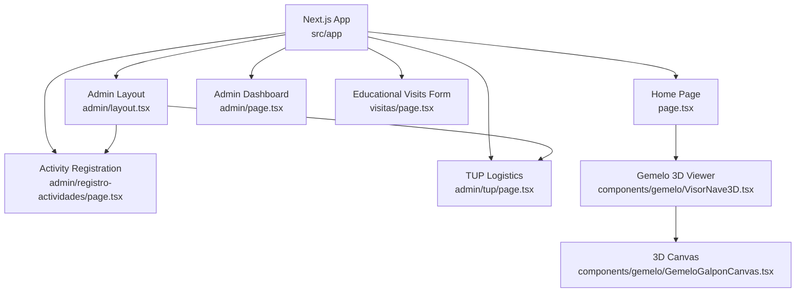
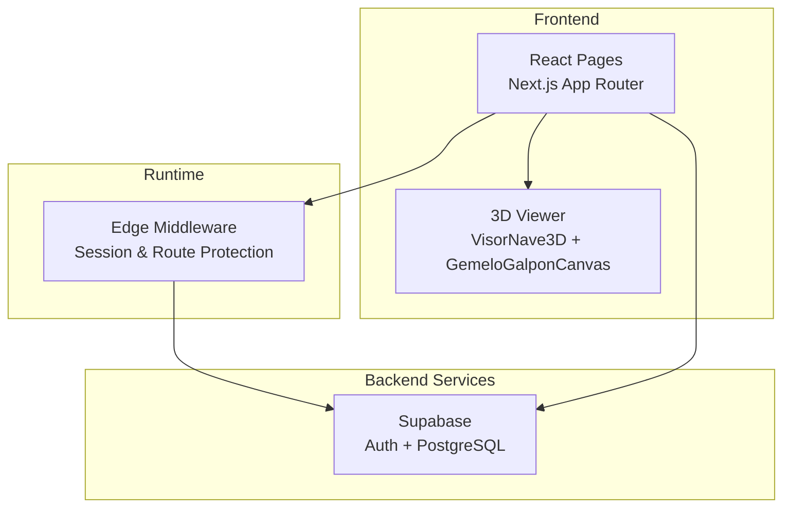
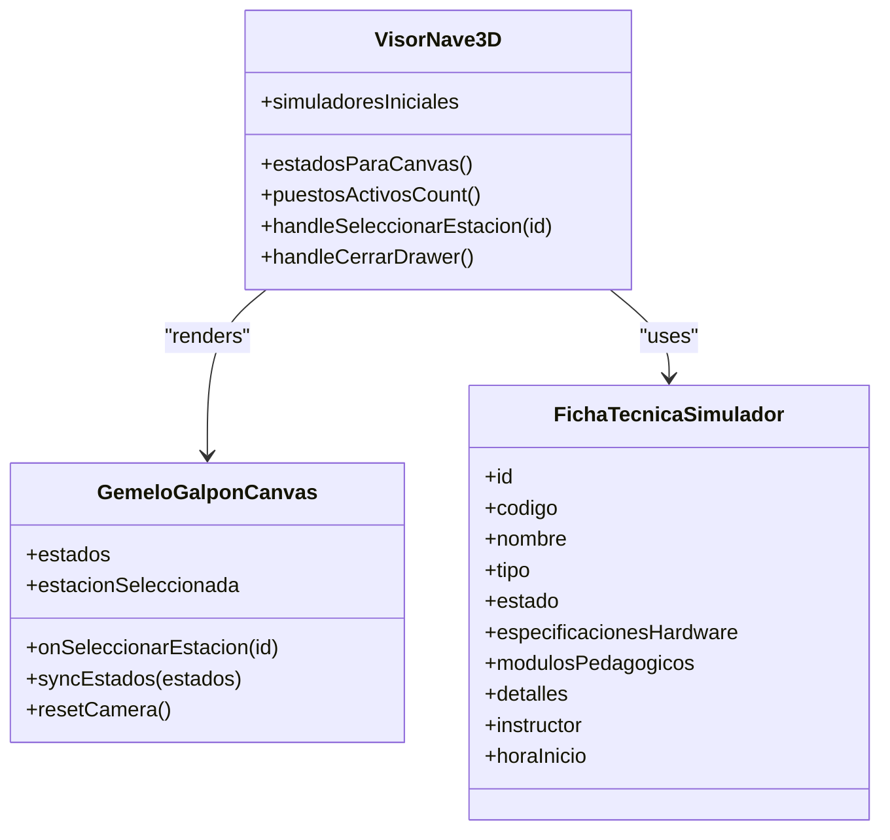
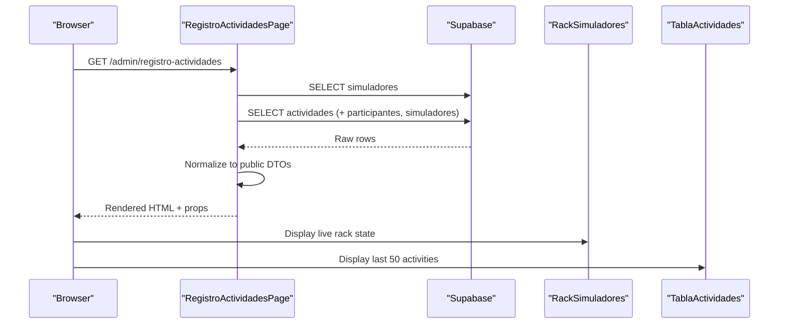
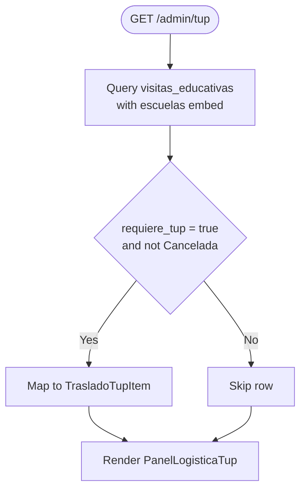
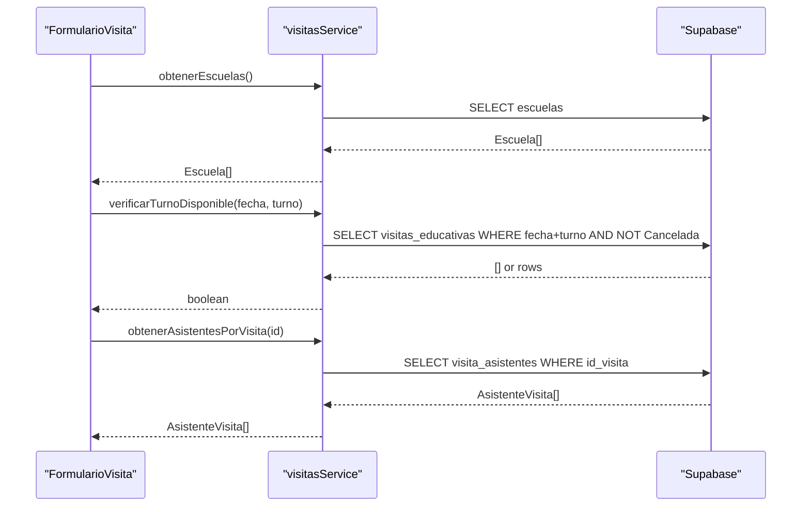
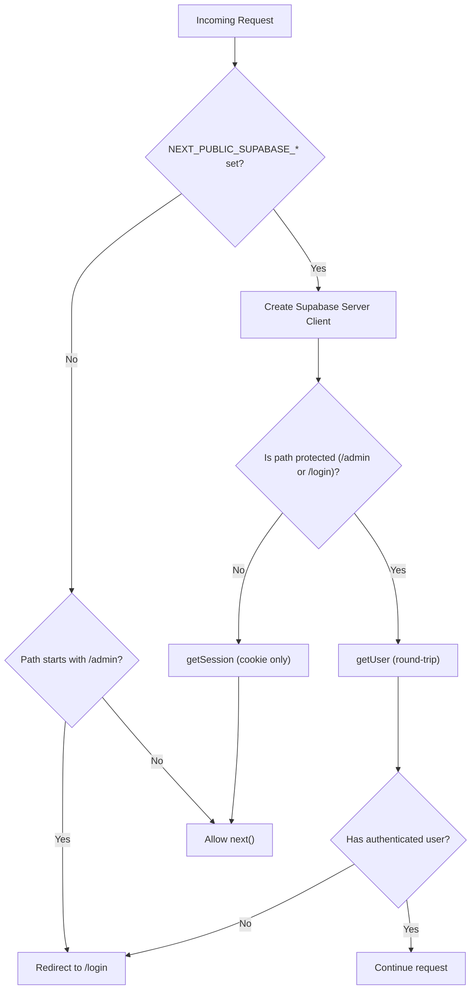
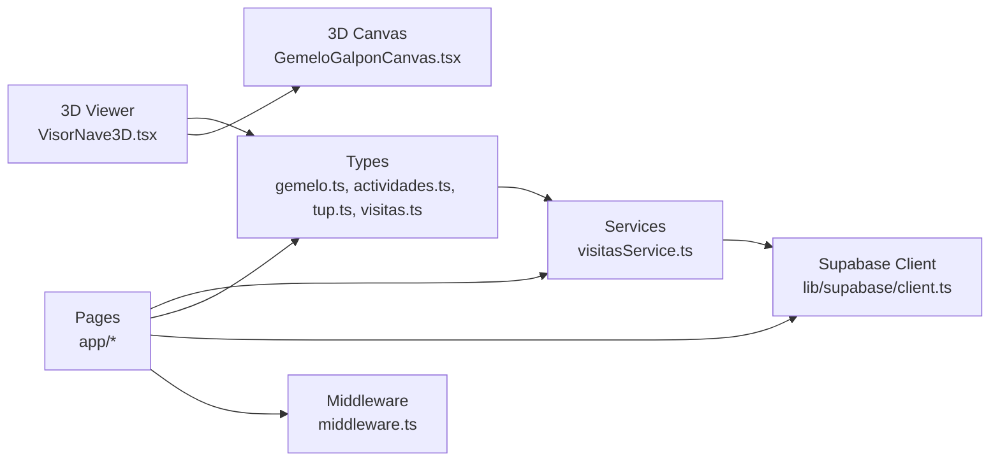

# 3D Digital Twin Simulation System

<cite>
**Referenced Files in This Document**
- [README.md](file://README.md)
- [package.json](file://package.json)
- [src/app/layout.tsx](file://src/app/layout.tsx)
- [src/app/page.tsx](file://src/app/page.tsx)
- [src/components/gemelo/VisorNave3D.tsx](file://src/components/gemelo/VisorNave3D.tsx)
- [src/components/gemelo/GemeloGalponCanvas.tsx](file://src/components/gemelo/GemeloGalponCanvas.tsx)
- [src/types/gemelo.ts](file://src/types/gemelo.ts)
- [src/types/actividades.ts](file://src/types/actividades.ts)
- [src/types/tup.ts](file://src/types/tup.ts)
- [src/types/visitas.ts](file://src/types/visitas.ts)
- [src/services/visitasService.ts](file://src/services/visitasService.ts)
- [src/lib/supabase/client.ts](file://src/lib/supabase/client.ts)
- [src/middleware.ts](file://src/middleware.ts)
- [src/app/admin/layout.tsx](file://src/app/admin/layout.tsx)
- [src/app/admin/page.tsx](file://src/app/admin/page.tsx)
- [src/app/admin/registro-actividades/page.tsx](file://src/app/admin/registro-actividades/page.tsx)
- [src/app/admin/tup/page.tsx](file://src/app/admin/tup/page.tsx)
- [src/app/visitas/page.tsx](file://src/app/visitas/page.tsx)
</cite>

## Table of Contents
1. [Introduction](#introduction)
2. [Project Structure](#project-structure)
3. [Core Components](#core-components)
4. [Architecture Overview](#architecture-overview)
5. [Detailed Component Analysis](#detailed-component-analysis)
6. [Dependency Analysis](#dependency-analysis)
7. [Performance Considerations](#performance-considerations)
8. [Troubleshooting Guide](#troubleshooting-guide)
9. [Conclusion](#conclusion)

## Introduction
This project is a Next.js-based web platform for the Municipal Simulator Training Center of Venado Tuerto. It integrates:
- An interactive 3D digital twin of the simulator hall with SCADA-like telemetry and animated operators.
- Educational visit reservation and administration.
- Municipal transportation logistics (TUP) management.
- Live rack control of physical simulators, session recording, and inclusion metrics.

The system uses Three.js for 3D rendering, Supabase for data and authentication, and Tailwind CSS for styling. The landing page exposes the 3D viewer, while administrative routes manage operations under protected access.

**Section sources**
- [README.md:1-50](file://README.md#L1-L50)

## Project Structure
The application follows a feature-oriented layout within Next.js App Router:
- Public pages: home, educational visits form.
- Admin area: dashboard, activity registration, TUP logistics.
- Shared types and services for domain models and Supabase client usage.
- 3D components encapsulated under gemelo.

**Diagram sources**
- [src/app/page.tsx:1-69](file://src/app/page.tsx#L1-L69)
- [src/app/admin/layout.tsx:1-26](file://src/app/admin/layout.tsx#L1-L26)
- [src/app/admin/page.tsx:1-38](file://src/app/admin/page.tsx#L1-L38)
- [src/app/admin/registro-actividades/page.tsx:1-261](file://src/app/admin/registro-actividades/page.tsx#L1-L261)
- [src/app/admin/tup/page.tsx:1-145](file://src/app/admin/tup/page.tsx#L1-L145)
- [src/app/visitas/page.tsx:1-28](file://src/app/visitas/page.tsx#L1-L28)
- [src/components/gemelo/VisorNave3D.tsx:1-388](file://src/components/gemelo/VisorNave3D.tsx#L1-L388)
- [src/components/gemelo/GemeloGalponCanvas.tsx:1-800](file://src/components/gemelo/GemeloGalponCanvas.tsx#L1-L800)

**Section sources**
- [src/app/layout.tsx:1-35](file://src/app/layout.tsx#L1-L35)
- [package.json:1-34](file://package.json#L1-L34)

## Core Components
- Gemelo 3D Viewer: Provides an isometric view of the industrial hall, seven simulator stations, animated operators, and a SCADA-style HUD.
- Activity Registration: Server-side data fetching for live rack status and historical activities; client components render the rack and tables.
- TUP Logistics: Server component queries municipal transport assignments and renders a mobile-friendly dispatch panel.
- Educational Visits: Public form backed by Supabase services for availability checks and participant lists.

Key responsibilities:
- Data modeling via TypeScript interfaces.
- Supabase client initialization and environment validation.
- Middleware-driven route protection and session handling.

**Section sources**
- [src/components/gemelo/VisorNave3D.tsx:1-388](file://src/components/gemelo/VisorNave3D.tsx#L1-L388)
- [src/app/admin/registro-actividades/page.tsx:1-261](file://src/app/admin/registro-actividades/page.tsx#L1-L261)
- [src/app/admin/tup/page.tsx:1-145](file://src/app/admin/tup/page.tsx#L1-L145)
- [src/services/visitasService.ts:1-105](file://src/services/visitasService.ts#L1-L105)
- [src/lib/supabase/client.ts:1-34](file://src/lib/supabase/client.ts#L1-L34)
- [src/middleware.ts:1-100](file://src/middleware.ts#L1-L100)

## Architecture Overview
The system combines a React frontend with a Three.js 3D scene, server-rendered admin pages, and Supabase-backed data services. Authentication and authorization are enforced at the edge via middleware.

**Diagram sources**
- [src/middleware.ts:1-100](file://src/middleware.ts#L1-L100)
- [src/app/page.tsx:1-69](file://src/app/page.tsx#L1-L69)
- [src/components/gemelo/VisorNave3D.tsx:1-388](file://src/components/gemelo/VisorNave3D.tsx#L1-L388)
- [src/components/gemelo/GemeloGalponCanvas.tsx:1-800](file://src/components/gemelo/GemeloGalponCanvas.tsx#L1-L800)
- [src/lib/supabase/client.ts:1-34](file://src/lib/supabase/client.ts#L1-L34)

## Detailed Component Analysis

### 3D Digital Twin Viewer
The viewer composes a static isometric camera, a procedural industrial hall, seven simulator stations, and animated operators. It exposes a SCADA-like HUD and a technical drawer for each machine.

**Diagram sources**
- [src/components/gemelo/VisorNave3D.tsx:1-388](file://src/components/gemelo/VisorNave3D.tsx#L1-L388)
- [src/components/gemelo/GemeloGalponCanvas.tsx:1-800](file://src/components/gemelo/GemeloGalponCanvas.tsx#L1-L800)
- [src/types/gemelo.ts:1-92](file://src/types/gemelo.ts#L1-L92)

Key behaviors:
- Dynamic import of the heavy 3D canvas to avoid SSR overhead.
- Mapping of simulator states to Two-State values for the renderer.
- Selection drawer showing hardware specs, pedagogical modules, and operator info when available.

**Section sources**
- [src/components/gemelo/VisorNave3D.tsx:18-37](file://src/components/gemelo/VisorNave3D.tsx#L18-L37)
- [src/components/gemelo/VisorNave3D.tsx:175-221](file://src/components/gemelo/VisorNave3D.tsx#L175-L221)
- [src/components/gemelo/VisorNave3D.tsx:257-384](file://src/components/gemelo/VisorNave3D.tsx#L257-L384)
- [src/types/gemelo.ts:68-92](file://src/types/gemelo.ts#L68-L92)

### Activity Registration Module
Server component fetches simulator fleet and recent activities, normalizes nested relations, and passes data to client components for live rack control and history table.

**Diagram sources**
- [src/app/admin/registro-actividades/page.tsx:151-188](file://src/app/admin/registro-actividades/page.tsx#L151-L188)
- [src/app/admin/registro-actividades/page.tsx:194-257](file://src/app/admin/registro-actividades/page.tsx#L194-L257)

Data normalization highlights:
- Simulador mapping ensures consistent numeric hours and null-safe fields.
- Actividad mapping resolves nested participants and simulator associations, including ambiguous one-to-many relation shapes.

**Section sources**
- [src/app/admin/registro-actividades/page.tsx:84-145](file://src/app/admin/registro-actividades/page.tsx#L84-L145)
- [src/types/actividades.ts:1-177](file://src/types/actividades.ts#L1-L177)

### TUP Logistics Module
Server component queries educational visits requiring municipal transport, embeds school information, and maps to a minimal DTO for the mobile panel.

**Diagram sources**
- [src/app/admin/tup/page.tsx:49-99](file://src/app/admin/tup/page.tsx#L49-L99)
- [src/app/admin/tup/page.tsx:101-141](file://src/app/admin/tup/page.tsx#L101-L141)

Institution name resolution:
- Prefers FK-resolved institution name; falls back to free-text institution name if no FK exists.

**Section sources**
- [src/app/admin/tup/page.tsx:70-99](file://src/app/admin/tup/page.tsx#L70-L99)
- [src/types/tup.ts:1-41](file://src/types/tup.ts#L1-L41)

### Educational Visits Service
Public-facing service functions interact with Supabase to retrieve schools, enabled dates, check turn availability, list visits for admin, toggle operational checks, and load attendee rosters.

**Diagram sources**
- [src/services/visitasService.ts:11-51](file://src/services/visitasService.ts#L11-L51)
- [src/services/visitasService.ts:90-104](file://src/services/visitasService.ts#L90-L104)

**Section sources**
- [src/services/visitasService.ts:1-105](file://src/services/visitasService.ts#L1-L105)
- [src/types/visitas.ts:1-128](file://src/types/visitas.ts#L1-L128)

### Authentication and Access Control
Middleware protects admin routes and login, refreshes sessions for public routes, and redirects appropriately based on user presence.

**Diagram sources**
- [src/middleware.ts:14-80](file://src/middleware.ts#L14-L80)

Environment safety:
- Missing environment variables do not crash the site; they trigger controlled redirects for protected routes.

**Section sources**
- [src/middleware.ts:1-100](file://src/middleware.ts#L1-L100)

## Dependency Analysis
High-level dependencies across layers:

**Diagram sources**
- [src/types/gemelo.ts:1-92](file://src/types/gemelo.ts#L1-L92)
- [src/types/actividades.ts:1-177](file://src/types/actividades.ts#L1-L177)
- [src/types/tup.ts:1-41](file://src/types/tup.ts#L1-L41)
- [src/types/visitas.ts:1-128](file://src/types/visitas.ts#L1-L128)
- [src/services/visitasService.ts:1-105](file://src/services/visitasService.ts#L1-L105)
- [src/lib/supabase/client.ts:1-34](file://src/lib/supabase/client.ts#L1-L34)
- [src/components/gemelo/VisorNave3D.tsx:1-388](file://src/components/gemelo/VisorNave3D.tsx#L1-L388)
- [src/components/gemelo/GemeloGalponCanvas.tsx:1-800](file://src/components/gemelo/GemeloGalponCanvas.tsx#L1-L800)
- [src/middleware.ts:1-100](file://src/middleware.ts#L1-L100)

Coupling and cohesion:
- Types are cohesive and reused across services and pages.
- Services encapsulate Supabase interactions, keeping pages focused on presentation and orchestration.
- 3D components are self-contained and communicate via props and callbacks.

Potential circular dependencies:
- None observed; imports flow from pages to services/types and from viewer to types.

External integrations:
- Supabase Auth and Database.
- Three.js for 3D rendering.
- Tailwind CSS for styling.

**Section sources**
- [package.json:11-21](file://package.json#L11-L21)

## Performance Considerations
- Defer heavy 3D loading: The 3D canvas is dynamically imported and disabled during SSR to reduce initial bundle and render cost.
- Camera controls: OrbitControls damping and constrained angles prevent excessive re-renders and improve UX.
- Shadow quality: PCFSoft shadow map with capped pixel ratio balances visual fidelity and performance.
- Data fetching: Server components fetch and normalize data once, reducing client-side processing.
- Environment validation: Centralized env checks prevent runtime errors that could degrade performance.

[No sources needed since this section provides general guidance]

## Troubleshooting Guide
Common issues and resolutions:
- Missing Supabase environment variables:
  - Symptom: Runtime error indicating missing NEXT_PUBLIC_SUPABASE_URL or NEXT_PUBLIC_SUPABASE_ANON_KEY.
  - Resolution: Ensure .env.local contains both variables.
- Admin route redirect loop or unauthorized access:
  - Symptom: Redirected to /login even when logged in.
  - Resolution: Verify Supabase session cookies and that middleware matcher includes your routes.
- 3D viewer not loading:
  - Symptom: Loading spinner persists.
  - Resolution: Check browser console for WebGL errors; ensure device supports WebGL and GPU acceleration.
- Activity/TUP pages show empty data:
  - Symptom: Tables/racks render without data.
  - Resolution: Confirm database migrations applied and RLS policies allow reads for the current role.

**Section sources**
- [src/lib/supabase/client.ts:7-18](file://src/lib/supabase/client.ts#L7-L18)
- [src/middleware.ts:20-32](file://src/middleware.ts#L20-L32)
- [src/app/admin/registro-actividades/page.tsx:168-181](file://src/app/admin/registro-actividades/page.tsx#L168-L181)
- [src/app/admin/tup/page.tsx:113-121](file://src/app/admin/tup/page.tsx#L113-L121)

## Conclusion
The 3D Digital Twin Simulation System delivers a robust, secure, and visually rich training platform. Its architecture cleanly separates concerns between 3D visualization, administrative workflows, and data services. With strong typing, server-side data normalization, and edge middleware for security, it scales well for operational use and future enhancements such as real-time telemetry integration and expanded analytics.

[No sources needed since this section summarizes without analyzing specific files]