# Admission & Cohort Management System

<cite>
**Referenced Files in This Document**
- [README.md](file://README.md)
- [WIKI.md](file://docs/WIKI.md)
- [package.json](file://package.json)
- [0004_modulo_admision_cohortes_evaluacion.sql](file://supabase/migrations/0004_modulo_admision_cohortes_evaluacion.sql)
- [0005_gestion_empleo_sheets.sql](file://supabase/migrations/0005_gestion_empleo_sheets.sql)
- [0007_cupo_dinamico_titulares.sql](file://supabase/migrations/0007_cupo_dinamico_titulares.sql)
- [20261008_modulo_admision_v1.sql](file://supabase/migrations/20261008_modulo_admision_v1.sql)
- [actividades.ts](file://src/types/actividades.ts)
- [empleo.ts](file://src/types/empleo.ts)
- [calculo-cohorte.ts](file://src/lib/calculo-cohorte.ts)
- [admin_layout.tsx](file://src/app/admin/layout.tsx)
- [admin_dashboard_page.tsx](file://src/app/admin/page.tsx)
- [visitas_admin_page.tsx](file://src/app/admin/visitas-educativas/page.tsx)
- [cohortes_page.tsx](file://src/app/gestion/cohortes/page.tsx)
- [CabeceraConfiguracion.tsx](file://src/components/empleo/CabeceraConfiguracion.tsx)
- [empleo_service.ts](file://src/services/empleo.ts)
</cite>

## Update Summary
**Changes Made**
- Added new section on Dynamic Capacity Management System
- Updated database schema documentation to include max_titulares column and projection fields
- Enhanced trigger validation logic documentation for configurable cohort limits
- Added frontend integration details for dynamic cohort configuration
- Updated architecture diagrams to reflect the new dynamic capacity management flow

## Table of Contents
1. [Introduction](#introduction)
2. [Project Structure](#project-structure)
3. [Core Components](#core-components)
4. [Dynamic Capacity Management System](#dynamic-capacity-management-system)
5. [Architecture Overview](#architecture-overview)
6. [Detailed Component Analysis](#detailed-component-analysis)
7. [Dependency Analysis](#dependency-analysis)
8. [Performance Considerations](#performance-considerations)
9. [Troubleshooting Guide](#troubleshooting-guide)
10. [Conclusion](#conclusion)

## Introduction
This document describes the Admission and Cohort Management System for the Municipal Simulator Training Center in Venado Tuerto. The system models a complete training lifecycle: candidate admission, diagnostic scheduling, cabin evaluation, formal simulator sessions, real-machine practice, cohort management, and role-based access control. It is implemented as part of a Next.js application backed by Supabase PostgreSQL with Row Level Security (RLS), triggers, and generated columns to enforce business rules at the database layer.

The repository also includes other modules such as the 3D digital twin, educational visits portal, and TUP logistics panel; this document focuses specifically on the admission and cohort subsystem while referencing shared infrastructure where relevant.

**Section sources**
- [README.md:1-88](file://README.md#L1-L88)
- [WIKI.md:24-33](file://docs/WIKI.md#L24-L33)

## Project Structure
The admission and cohort module is primarily defined in the database schema migrations and supported by TypeScript types used across the administrative interface. The frontend currently exposes an admin shell and existing administrative pages; the admission/cohort UI routes are not yet present in the codebase but can be added under `src/app/admin` following the same patterns.

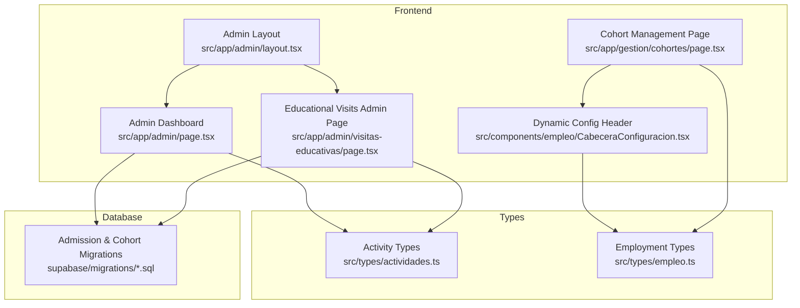

**Diagram sources**
- [admin_layout.tsx:1-26](file://src/app/admin/layout.tsx#L1-L26)
- [admin_dashboard_page.tsx:1-38](file://src/app/admin/page.tsx#L1-L38)
- [visitas_admin_page.tsx:1-25](file://src/app/admin/visitas-educativas/page.tsx#L1-L25)
- [cohortes_page.tsx:1-208](file://src/app/gestion/cohortes/page.tsx#L1-L208)
- [CabeceraConfiguracion.tsx:1-210](file://src/components/empleo/CabeceraConfiguracion.tsx#L1-L210)
- [actividades.ts:1-177](file://src/types/actividades.ts#L1-L177)
- [empleo.ts:1-177](file://src/types/empleo.ts#L1-L177)
- [0004_modulo_admision_cohortes_evaluacion.sql:1-444](file://supabase/migrations/0004_modulo_admision_cohortes_evaluacion.sql#L1-L444)

**Section sources**
- [admin_layout.tsx:1-26](file://src/app/admin/layout.tsx#L1-L26)
- [admin_dashboard_page.tsx:1-38](file://src/app/admin/page.tsx#L1-L38)
- [visitas_admin_page.tsx:1-25](file://src/app/admin/visitas-educativas/page.tsx#L1-L25)
- [actividades.ts:1-177](file://src/types/actividades.ts#L1-L177)
- [0004_modulo_admision_cohortes_evaluacion.sql:1-444](file://supabase/migrations/0004_modulo_admision_cohortes_evaluacion.sql#L1-L444)

## Core Components
The core of the Admission and Cohort Management System is the data model and its enforcement logic:

- User profiles and RBAC roles linked to authentication users.
- Operational configuration for shifts, capacity, and required simulator days.
- Student registry with lifecycle states.
- Cohorts and diagnostic scheduling with capacity validation.
- Cabin evaluation rubric with computed scores and hard-fail constraints.
- Formal training groups ("ternas") and six simulator sessions per student.
- Real-machine practice records and private storage bucket.
- Row Level Security policies protecting all tables.

These components are defined in the migration files and complemented by TypeScript type contracts used by the admin UI.

**Section sources**
- [0004_modulo_admision_cohortes_evaluacion.sql:17-25](file://supabase/migrations/0004_modulo_admision_cohortes_evaluacion.sql#L17-L25)
- [0004_modulo_admision_cohortes_evaluacion.sql:73-101](file://supabase/migrations/0004_modulo_admision_cohortes_evaluacion.sql#L73-L101)
- [0004_modulo_admision_cohortes_evaluacion.sql:115-138](file://supabase/migrations/0004_modulo_admision_cohortes_evaluacion.sql#L115-L138)
- [0004_modulo_admision_cohortes_evaluacion.sql:143-187](file://supabase/migrations/0004_modulo_admision_cohortes_evaluacion.sql#L143-L187)
- [0004_modulo_admision_cohortes_evaluacion.sql:190-238](file://supabase/migrations/0004_modulo_admision_cohortes_evaluacion.sql#L190-L238)
- [0004_modulo_admision_cohortes_evaluacion.sql:243-292](file://supabase/migrations/0004_modulo_admision_cohortes_evaluacion.sql#L243-L292)
- [0004_modulo_admision_cohortes_evaluacion.sql:297-330](file://supabase/migrations/0004_modulo_admision_cohortes_evaluacion.sql#L297-L330)
- [0004_modulo_admision_cohortes_evaluacion.sql:335-346](file://supabase/migrations/0004_modulo_admision_cohortes_evaluacion.sql#L335-L346)
- [0004_modulo_admision_cohortes_evaluacion.sql:365-443](file://supabase/migrations/0004_modulo_admision_cohortes_evaluacion.sql#L365-L443)

## Dynamic Capacity Management System

**Updated** The system now features a fully dynamic capacity management system that replaces hardcoded limits with configurable cohort capacities through the `max_titulares` column and advanced projection fields.

### Database Schema Enhancements
The cohort management system has been enhanced with dynamic capacity configuration:

- **Configurable Capacity**: The `max_titulares` column in the `cohortes` table provides flexible cohort sizing with a default of 22 students (operational standard for employment cohorts).
- **Projection Fields**: New date fields (`fecha_fin_sim`, `fecha_pase_planta`) enable automatic calendar projection based on cohort capacity.
- **NOT NULL Constraint**: Ensures every cohort has a resolvable capacity limit, eliminating fallback hardcoded values.

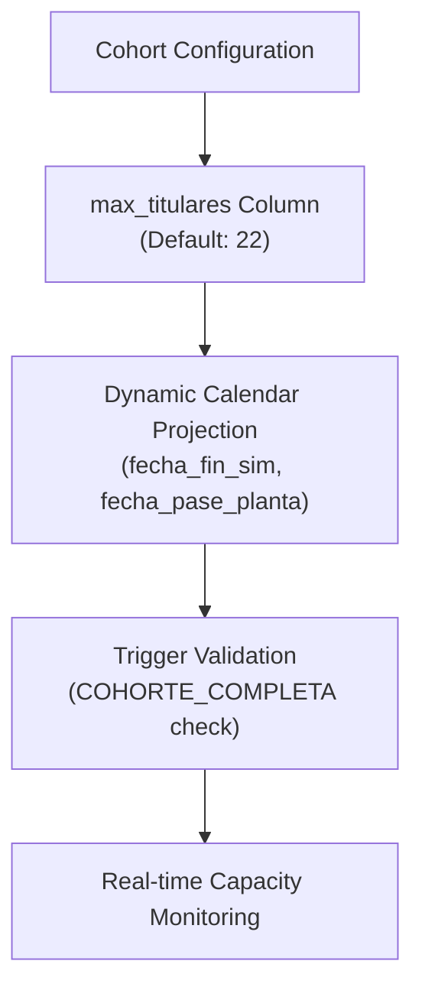

**Diagram sources**
- [0007_cupo_dinamico_titulares.sql:16-27](file://supabase/migrations/0007_cupo_dinamico_titulares.sql#L16-L27)
- [calculo-cohorte.ts:69-120](file://src/lib/calculo-cohorte.ts#L69-L120)

### Advanced Trigger Logic
The new trigger function `trg_validar_tope_titulares_fn()` implements sophisticated capacity validation:

- **Row-level Locking**: Uses `FOR UPDATE` to serialize concurrent confirmations within the same cohort.
- **Configurable Limits**: Reads capacity directly from `public.cohortes.max_titulares` instead of hardcoded values.
- **Exception Handling**: Raises specific exceptions (`COHORTE_SIN_CUPO_CONFIGURADO`, `COHORTE_COMPLETA`) for clear error reporting.
- **State-aware Validation**: Only validates when enrollment state changes to 'CONFIRMADO'.

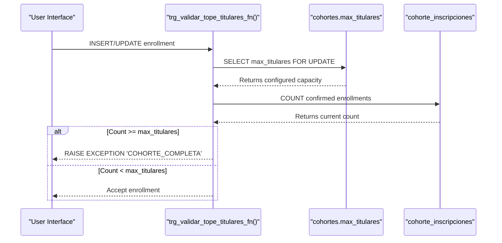

**Diagram sources**
- [0007_cupo_dinamico_titulares.sql:37-76](file://supabase/migrations/0007_cupo_dinamico_titulares.sql#L37-L76)

**Section sources**
- [0007_cupo_dinamico_titulares.sql:11-88](file://supabase/migrations/0007_cupo_dinamico_titulares.sql#L11-L88)

### Frontend Integration
The dynamic capacity system integrates seamlessly with the user interface:

- **Interactive Capacity Selection**: Users can select from preset options (10, 20, 22, 30) or enter custom values (1-200).
- **Real-time Calendar Projection**: Live calculation of simulation dates based on selected capacity using the pure calculation engine.
- **Visual Feedback**: Badge display showing projected simulation duration, start/end dates, and plant transition dates.
- **Validation Integration**: Server-side validation ensures capacity limits are respected during configuration updates.

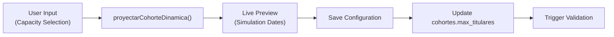

**Diagram sources**
- [CabeceraConfiguracion.tsx:50-72](file://src/components/empleo/CabeceraConfiguracion.tsx#L50-L72)
- [calculo-cohorte.ts:69-120](file://src/lib/calculo-cohorte.ts#L69-L120)

**Section sources**
- [CabeceraConfiguracion.tsx:1-210](file://src/components/empleo/CabeceraConfiguracion.tsx#L1-L210)
- [calculo-cohorte.ts:1-121](file://src/lib/calculo-cohorte.ts#L1-L121)

## Architecture Overview
The admission and cohort system follows a server-enforced architecture with enhanced dynamic capacity management:

- Frontend admin pages render state and trigger Server Actions or API calls.
- Server-side logic interacts with Supabase using authenticated clients.
- Database-level triggers, constraints, and RLS enforce business rules regardless of client behavior.
- Generated columns compute derived values like total evaluation scores.
- Dynamic capacity validation ensures cohort limits are enforced at the database level.

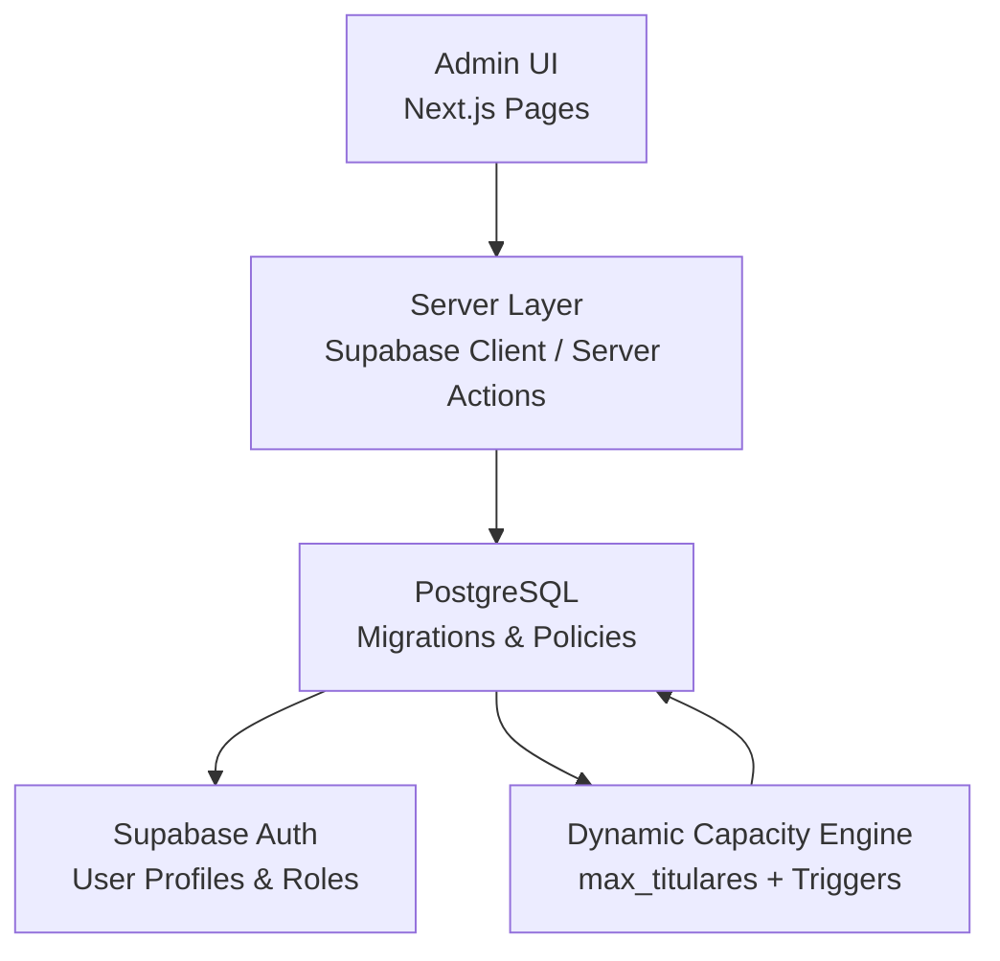

**Diagram sources**
- [0004_modulo_admision_cohortes_evaluacion.sql:365-443](file://supabase/migrations/0004_modulo_admision_cohortes_evaluacion.sql#L365-L443)
- [0007_cupo_dinamico_titulares.sql:37-88](file://supabase/migrations/0007_cupo_dinamico_titulares.sql#L37-L88)
- [20261008_modulo_admision_v1.sql:364-416](file://supabase/migrations/20261008_modulo_admision_v1.sql#L364-L416)

## Detailed Component Analysis

### Data Model and Relationships
The admission and cohort system defines entities that model the full training pipeline with enhanced dynamic capacity support:

- `perfiles_usuarios`: user profile and role mapping tied to `auth.users`.
- `config_centro`: operational configuration including morning/afternoon shifts, shift duration, simultaneous capacity, Friday morning blocking, and required simulator days.
- `feriados_municipales`: municipal holidays disabling scheduling.
- `alumnos`: central student record with unique DNI and lifecycle state.
- `cohortes`: training cohorts with phases, date ranges, and **dynamic capacity configuration** (`max_titulares`).
- `turnos_diagnostico`: diagnostic slots with capacity and blocking controls.
- `postulantes_diagnostico`: candidate-to-slot assignments with attendance tracking.
- `evaluaciones_diagnostico`: cabin evaluation rubric with criteria, second attempt evolution, bonus, computed score, preliminary and definitive judgments, and hard-fail constraint.
- `ternas_capacitacion` and `terna_miembros`: formal training groups and membership.
- `sesiones_simulador`: six scheduled simulator sessions per student with uniqueness constraints.
- `practica_real`: real-machine practice outcomes and PDF storage path.
- Storage bucket `expedientes-practica-real` for private PDFs.

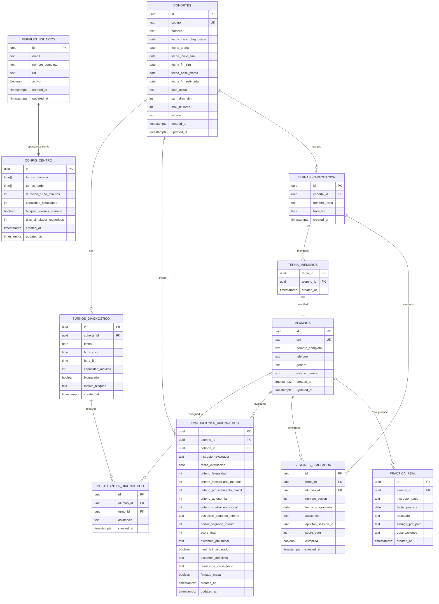

**Diagram sources**
- [0004_modulo_admision_cohortes_evaluacion.sql:17-25](file://supabase/migrations/0004_modulo_admision_cohortes_evaluacion.sql#L17-L25)
- [0004_modulo_admision_cohortes_evaluacion.sql:73-101](file://supabase/migrations/0004_modulo_admision_cohortes_evaluacion.sql#L73-L101)
- [0004_modulo_admision_cohortes_evaluacion.sql:115-138](file://supabase/migrations/0004_modulo_admision_cohortes_evaluacion.sql#L115-L138)
- [0004_modulo_admision_cohortes_evaluacion.sql:143-187](file://supabase/migrations/0004_modulo_admision_cohortes_evaluacion.sql#L143-L187)
- [0004_modulo_admision_cohortes_evaluacion.sql:243-330](file://supabase/migrations/0004_modulo_admision_cohortes_evaluacion.sql#L243-L330)
- [0004_modulo_admision_cohortes_evaluacion.sql:335-346](file://supabase/migrations/0004_modulo_admision_cohortes_evaluacion.sql#L335-L346)
- [0005_gestion_empleo_sheets.sql:34-39](file://supabase/migrations/0005_gestion_empleo_sheets.sql#L34-L39)
- [0007_cupo_dinamico_titulares.sql:16-27](file://supabase/migrations/0007_cupo_dinamico_titulares.sql#L16-L27)

**Section sources**
- [0004_modulo_admision_cohortes_evaluacion.sql:17-346](file://supabase/migrations/0004_modulo_admision_cohortes_evaluacion.sql#L17-L346)
- [0005_gestion_empleo_sheets.sql:34-39](file://supabase/migrations/0005_gestion_empleo_sheets.sql#L34-L39)
- [0007_cupo_dinamico_titulares.sql:16-27](file://supabase/migrations/0007_cupo_dinamico_titulares.sql#L16-L27)

### Diagnostic Slot Capacity Validation
Assignment of candidates to diagnostic slots is enforced by a database trigger that:

- Skips capacity checks when no slot is assigned.
- Validates the existence of the diagnostic slot.
- Prevents assignment to blocked slots.
- Counts current assignments and rejects over-capacity inserts/updates.

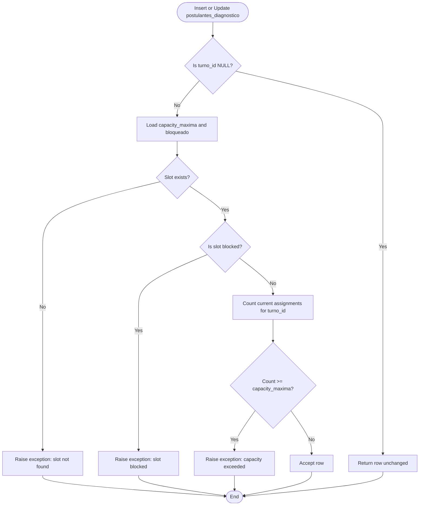

**Diagram sources**
- [0004_modulo_admision_cohortes_evaluacion.sql:190-238](file://supabase/migrations/0004_modulo_admision_cohortes_evaluacion.sql#L190-L238)

**Section sources**
- [0004_modulo_admision_cohortes_evaluacion.sql:190-238](file://supabase/migrations/0004_modulo_admision_cohortes_evaluacion.sql#L190-L238)

### Evaluation Rubric and Hard-Fail Constraint
The diagnostic evaluation table enforces:

- Enumerated criteria with fixed point values.
- Optional second attempt evolution and bonus.
- A stored generated column computing total score.
- Preliminary judgment constrained by hard-fail flag.
- Definitive judgment and mesa technical resolution fields.

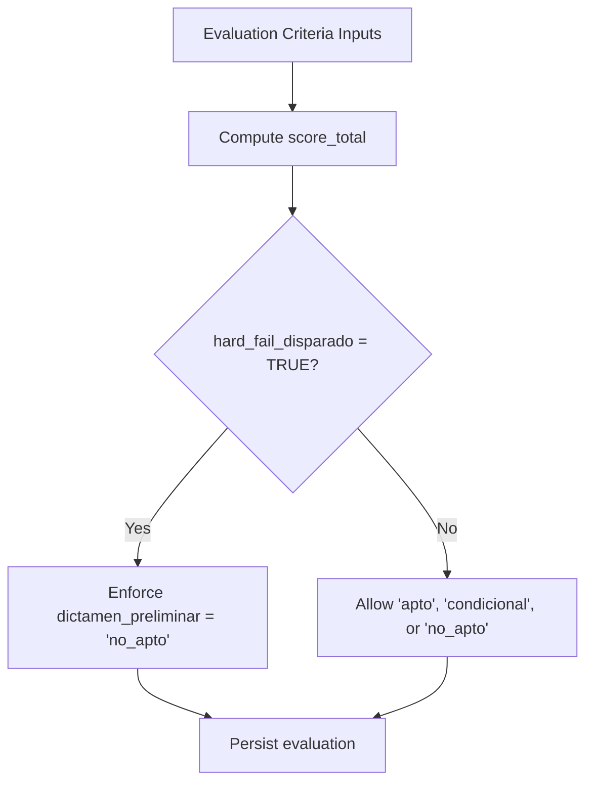

**Diagram sources**
- [0004_modulo_admision_cohortes_evaluacion.sql:243-292](file://supabase/migrations/0004_modulo_admision_cohortes_evaluacion.sql#L243-L292)

**Section sources**
- [0004_modulo_admision_cohortes_evaluacion.sql:243-292](file://supabase/migrations/0004_modulo_admision_cohortes_evaluacion.sql#L243-L292)

### Formal Training Groups and Simulator Sessions
Formal training uses "ternas" (groups) with fixed times and members:

- Each group belongs to a cohort.
- Memberships link students to groups.
- Six simulator sessions per student are modeled with uniqueness constraints ensuring one session number and one scheduled date per student.

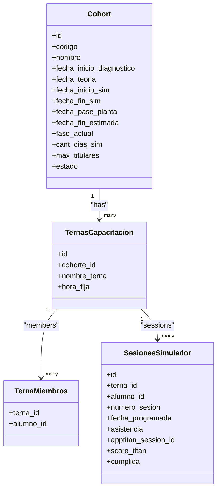

**Diagram sources**
- [0004_modulo_admision_cohortes_evaluacion.sql:297-330](file://supabase/migrations/0004_modulo_admision_cohortes_evaluacion.sql#L297-L330)
- [0005_gestion_empleo_sheets.sql:34-39](file://supabase/migrations/0005_gestion_empleo_sheets.sql#L34-L39)

**Section sources**
- [0004_modulo_admision_cohortes_evaluacion.sql:297-330](file://supabase/migrations/0004_modulo_admision_cohortes_evaluacion.sql#L297-L330)

### Role-Based Access Control and User Profiles
User profiles are automatically synchronized with authentication users:

- A trigger creates or updates `perfiles_usuarios` on new auth users.
- Roles are validated against allowed values.
- Names are normalized from metadata or email prefix.
- RLS policies enable authenticated access to all admission-related tables.

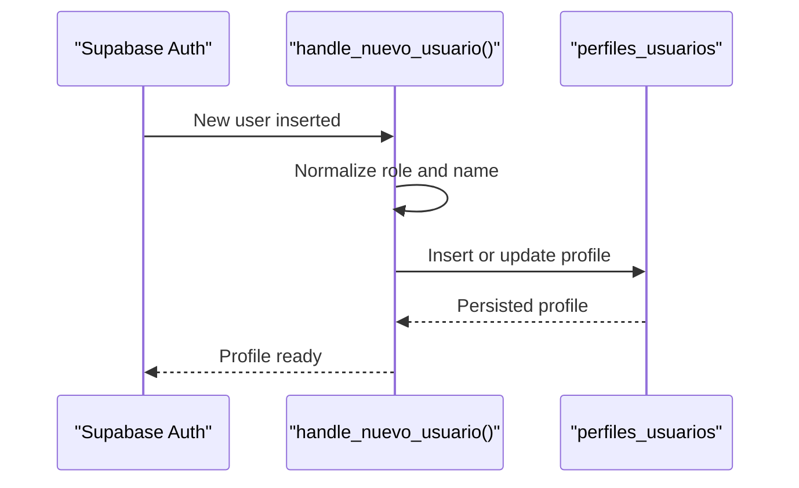

**Diagram sources**
- [0004_modulo_admision_cohortes_evaluacion.sql:32-68](file://supabase/migrations/0004_modulo_admision_cohortes_evaluacion.sql#L32-L68)
- [0004_modulo_admision_cohortes_evaluacion.sql:365-443](file://supabase/migrations/0004_modulo_admision_cohortes_evaluacion.sql#L365-L443)

**Section sources**
- [0004_modulo_admision_cohortes_evaluacion.sql:32-68](file://supabase/migrations/0004_modulo_admision_cohortes_evaluacion.sql#L32-L68)
- [0004_modulo_admision_cohortes_evaluacion.sql:365-443](file://supabase/migrations/0004_modulo_admision_cohortes_evaluacion.sql#L365-L443)

### Administrative UI Integration Points
The admin layout provides the shell for protected routes, and the dashboard page is a placeholder for live telemetry and statistics. Existing administrative pages demonstrate how to structure content and metadata. The cohort management page now includes dynamic capacity configuration capabilities.

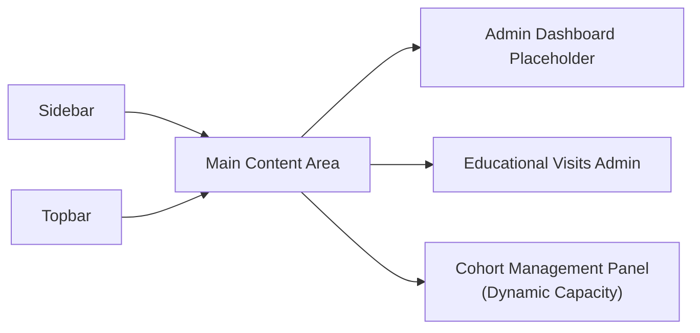

**Diagram sources**
- [admin_layout.tsx:11-25](file://src/app/admin/layout.tsx#L11-L25)
- [admin_dashboard_page.tsx:5-35](file://src/app/admin/page.tsx#L5-L35)
- [visitas_admin_page.tsx:10-23](file://src/app/admin/visitas-educativas/page.tsx#L10-L23)
- [cohortes_page.tsx:93-101](file://src/app/gestion/cohortes/page.tsx#L93-L101)

**Section sources**
- [admin_layout.tsx:1-26](file://src/app/admin/layout.tsx#L1-L26)
- [admin_dashboard_page.tsx:1-38](file://src/app/admin/page.tsx#L1-L38)
- [visitas_admin_page.tsx:1-25](file://src/app/admin/visitas-educativas/page.tsx#L1-L25)
- [cohortes_page.tsx:93-101](file://src/app/gestion/cohortes/page.tsx#L93-L101)

## Dependency Analysis
The admission and cohort module depends on:

- Supabase Auth for identity and profile synchronization.
- PostgreSQL extensions (`uuid-ossp`, `pgcrypto`) for identifiers and cryptographic functions.
- RLS policies to restrict access to authenticated users.
- Triggers and constraints to enforce business rules.
- TypeScript types for consistent data contracts in the admin UI.
- Dynamic capacity calculation engine for cohort scheduling.

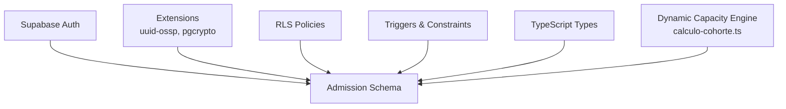

**Diagram sources**
- [0004_modulo_admision_cohortes_evaluacion.sql:11-12](file://supabase/migrations/0004_modulo_admision_cohortes_evaluacion.sql#L11-L12)
- [0004_modulo_admision_cohortes_evaluacion.sql:365-443](file://supabase/migrations/0004_modulo_admision_cohortes_evaluacion.sql#L365-L443)
- [actividades.ts:1-177](file://src/types/actividades.ts#L1-L177)
- [calculo-cohorte.ts:1-121](file://src/lib/calculo-cohorte.ts#L1-L121)

**Section sources**
- [0004_modulo_admision_cohortes_evaluacion.sql:11-12](file://supabase/migrations/0004_modulo_admision_cohortes_evaluacion.sql#L11-L12)
- [0004_modulo_admision_cohortes_evaluacion.sql:365-443](file://supabase/migrations/0004_modulo_admision_cohortes_evaluacion.sql#L365-L443)
- [actividades.ts:1-177](file://src/types/actividades.ts#L1-L177)
- [calculo-cohorte.ts:1-121](file://src/lib/calculo-cohorte.ts#L1-L121)

## Performance Considerations
- Use indexes already defined on key columns (e.g., DNI, status, cohort-date combinations) to optimize queries for admissions dashboards and reporting.
- Prefer server-side filtering and pagination when building admission lists to reduce payload size.
- Avoid unnecessary re-renders in React components by memoizing stable objects and leveraging Next.js caching strategies.
- Keep database triggers focused on integrity checks; move heavy computations to server actions if needed.
- **Dynamic Capacity Optimization**: The new trigger uses `FOR UPDATE` locking to prevent race conditions during concurrent cohort capacity validation, which may impact performance under high concurrency but ensures data consistency.

## Troubleshooting Guide
Common issues and resolutions:

- **Capacity exceeded during diagnostic assignment**: The trigger raises an exception when the number of assigned candidates reaches the maximum capacity for a slot. Verify slot capacity and unblock or remove conflicting assignments.
- **Hard-fail evaluation constraint violation**: If `hard_fail_disparado` is true, the preliminary judgment must be set to the disapproved value. Adjust the rubric accordingly.
- **Duplicate session scheduling**: Uniqueness constraints prevent assigning the same session number or date to a student. Ensure each student has distinct session numbers and dates.
- **RLS policy errors**: All admission tables require authenticated access. Confirm the user session is active and that policies are enabled.
- **COHORTE_COMPLETA error**: The cohort has reached its maximum capacity (`max_titulares`). Either increase the cohort capacity or wait for existing confirmations to be released.
- **COHORTE_SIN_CUPO_CONFIGURADO error**: The cohort lacks a configured capacity limit. Set a valid `max_titulares` value in the cohort configuration.

**Section sources**
- [0004_modulo_admision_cohortes_evaluacion.sql:190-238](file://supabase/migrations/0004_modulo_admision_cohortes_evaluacion.sql#L190-L238)
- [0004_modulo_admision_cohortes_evaluacion.sql:243-292](file://supabase/migrations/0004_modulo_admision_cohortes_evaluacion.sql#L243-L292)
- [0004_modulo_admision_cohortes_evaluacion.sql:300-330](file://supabase/migrations/0004_modulo_admision_cohortes_evaluacion.sql#L300-L330)
- [0004_modulo_admision_cohortes_evaluacion.sql:365-443](file://supabase/migrations/0004_modulo_admision_cohortes_evaluacion.sql#L365-L443)
- [0007_cupo_dinamico_titulares.sql:59-71](file://supabase/migrations/0007_cupo_dinamico_titulares.sql#L59-L71)

## Conclusion
The Admission and Cohort Management System provides a robust, database-enforced foundation for managing the full training lifecycle of simulator trainees. Its design emphasizes security through RLS, integrity via triggers and constraints, and clarity through well-defined schemas and TypeScript contracts. The recent enhancement with dynamic capacity management adds significant flexibility, allowing administrators to configure cohort sizes dynamically while maintaining strict data integrity through sophisticated trigger logic. Future frontend development should extend the admin shell with dedicated admission and cohort pages, integrating these data models into interactive workflows for scheduling, evaluation, and reporting.