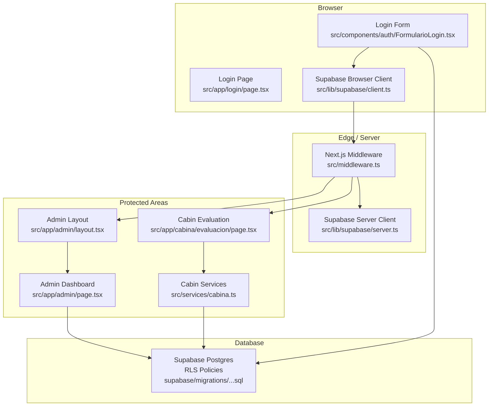
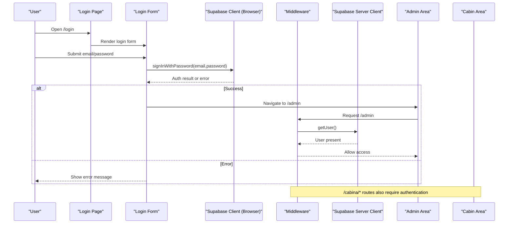
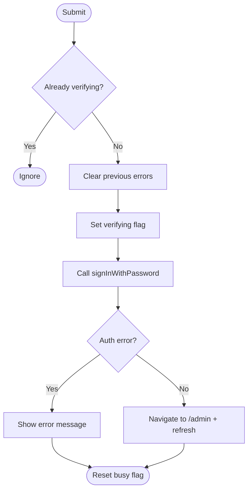
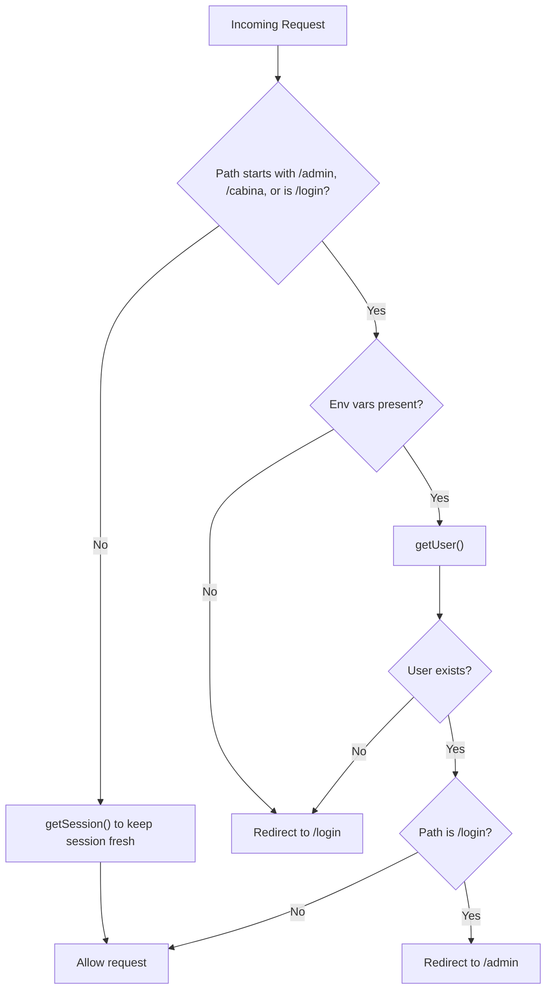
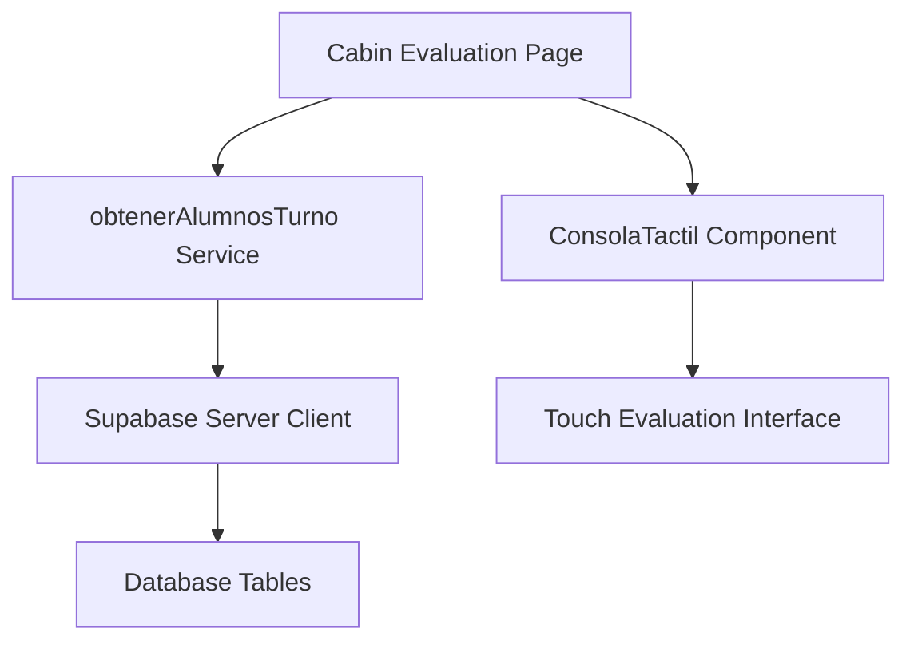
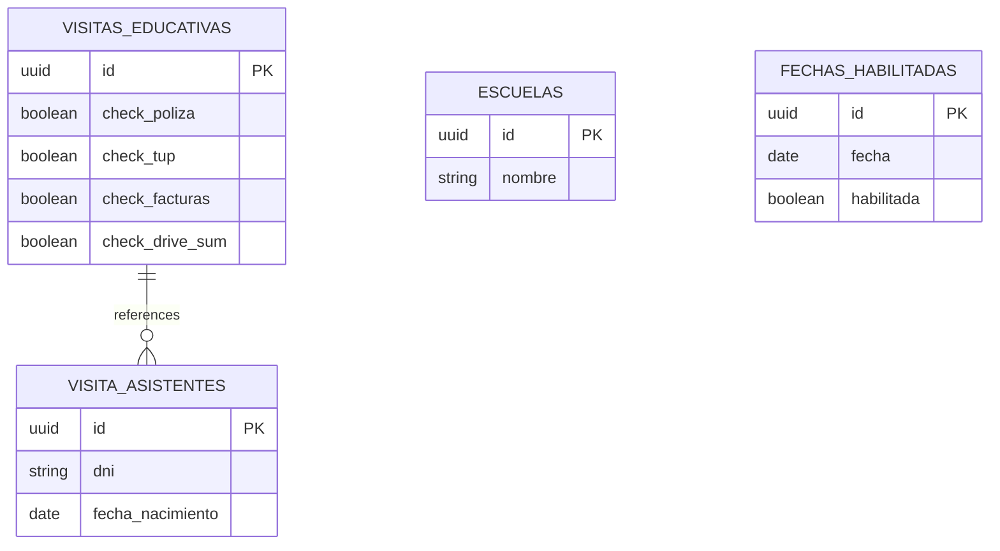
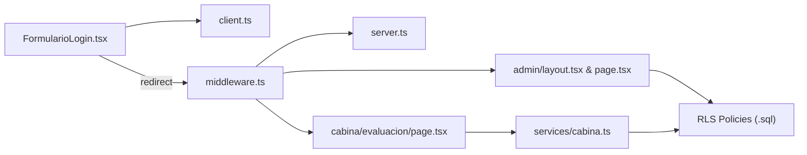

# Authentication System

<cite>
**Referenced Files in This Document**
- [page.tsx](file://src/app/login/page.tsx)
- [FormularioLogin.tsx](file://src/components/auth/FormularioLogin.tsx)
- [client.ts](file://src/lib/supabase/client.ts)
- [server.ts](file://src/lib/supabase/server.ts)
- [middleware.ts](file://src/middleware.ts)
- [layout.tsx](file://src/app/admin/layout.tsx)
- [page.tsx](file://src/app/admin/page.tsx)
- [page.tsx](file://src/app/cabina/evaluacion/page.tsx)
- [cabina.ts](file://src/services/cabina.ts)
- [0001_rls_visitas_educativas.sql](file://supabase/migrations/0001_rls_visitas_educativas.sql)
</cite>

## Update Summary
**Changes Made**
- Updated middleware section to reflect extended protection for `/cabina/*` routes
- Added new Cabin Area section documenting the protected cabina routes
- Updated architecture diagrams to include cabina route protection
- Enhanced route protection flow to show both admin and cabina routes requiring authentication

## Table of Contents
1. [Introduction](#introduction)
2. [Project Structure](#project-structure)
3. [Core Components](#core-components)
4. [Architecture Overview](#architecture-overview)
5. [Detailed Component Analysis](#detailed-component-analysis)
6. [Dependency Analysis](#dependency-analysis)
7. [Performance Considerations](#performance-considerations)
8. [Troubleshooting Guide](#troubleshooting-guide)
9. [Conclusion](#conclusion)

## Introduction
This document explains the authentication system implemented in the Next.js application. It covers how users log in, how protected routes are enforced, and how Supabase is integrated for session management on both client and server sides. The system uses:
- A login page with a form that authenticates via Supabase
- Middleware that protects admin routes, cabina routes, and redirects unauthenticated users
- Supabase clients configured for browser and server contexts
- Row Level Security policies to enforce data access rules at the database layer

## Project Structure
The authentication-related code is organized into clear layers:
- UI layer: Login page and login form component
- Client-side integration: Supabase browser client
- Server-side integration: Supabase server client and middleware
- Protected areas: Admin dashboard and cabin evaluation console (both protected by middleware)
- Database security policies (Row Level Security)



**Diagram sources**
- [page.tsx:1-31](file://src/app/login/page.tsx#L1-L31)
- [FormularioLogin.tsx:1-107](file://src/components/auth/FormularioLogin.tsx#L1-L107)
- [client.ts:1-34](file://src/lib/supabase/client.ts#L1-L34)
- [server.ts:1-41](file://src/lib/supabase/server.ts#L1-L41)
- [middleware.ts:1-103](file://src/middleware.ts#L1-L103)
- [layout.tsx:1-26](file://src/app/admin/layout.tsx#L1-L26)
- [page.tsx:1-38](file://src/app/admin/page.tsx#L1-L38)
- [page.tsx:1-48](file://src/app/cabina/evaluacion/page.tsx#L1-L48)
- [cabina.ts:1-266](file://src/services/cabina.ts#L1-L266)
- [0001_rls_visitas_educativas.sql:1-107](file://supabase/migrations/0001_rls_visitas_educativas.sql#L1-L107)

**Section sources**
- [page.tsx:1-31](file://src/app/login/page.tsx#L1-L31)
- [FormularioLogin.tsx:1-107](file://src/components/auth/FormularioLogin.tsx#L1-L107)
- [client.ts:1-34](file://src/lib/supabase/client.ts#L1-L34)
- [server.ts:1-41](file://src/lib/supabase/server.ts#L1-L41)
- [middleware.ts:1-103](file://src/middleware.ts#L1-L103)
- [layout.tsx:1-26](file://src/app/admin/layout.tsx#L1-L26)
- [page.tsx:1-38](file://src/app/admin/page.tsx#L1-L38)
- [page.tsx:1-48](file://src/app/cabina/evaluacion/page.tsx#L1-L48)
- [cabina.ts:1-266](file://src/services/cabina.ts#L1-L266)
- [0001_rls_visitas_educativas.sql:1-107](file://supabase/migrations/0001_rls_visitas_educativas.sql#L1-L107)

## Core Components
- Login page: Renders a minimal login interface and delegates to the login form component.
- Login form: Collects email/password, calls Supabase sign-in, handles errors, and navigates to the admin area on success.
- Supabase clients:
  - Browser client: Singleton instance created from environment variables; used in client components.
  - Server client: Creates a server-side client bound to cookies for server components and route handlers.
- Middleware: Protects routes under /admin, /cabina, and /login, enforces authentication, and redirects appropriately. Also refreshes sessions for public routes within its matcher.
- Admin layout/dashboard: Protected area rendered only when authenticated (enforced by middleware).
- Cabin evaluation console: Protected tablet interface for instructor evaluations, also secured by middleware.
- RLS policies: Define who can read/write data at the database level, complementing middleware protection.

**Section sources**
- [page.tsx:1-31](file://src/app/login/page.tsx#L1-L31)
- [FormularioLogin.tsx:1-107](file://src/components/auth/FormularioLogin.tsx#L1-L107)
- [client.ts:1-34](file://src/lib/supabase/client.ts#L1-L34)
- [server.ts:1-41](file://src/lib/supabase/server.ts#L1-L41)
- [middleware.ts:1-103](file://src/middleware.ts#L1-L103)
- [layout.tsx:1-26](file://src/app/admin/layout.tsx#L1-L26)
- [page.tsx:1-38](file://src/app/admin/page.tsx#L1-L38)
- [page.tsx:1-48](file://src/app/cabina/evaluacion/page.tsx#L1-L48)
- [0001_rls_visitas_educativas.sql:1-107](file://supabase/migrations/0001_rls_visitas_educativas.sql#L1-L107)

## Architecture Overview
The authentication flow combines client-side sign-in with server-side enforcement across multiple protected areas:



**Diagram sources**
- [FormularioLogin.tsx:21-51](file://src/components/auth/FormularioLogin.tsx#L21-L51)
- [client.ts:20-33](file://src/lib/supabase/client.ts#L20-L33)
- [middleware.ts:14-85](file://src/middleware.ts#L14-L85)
- [server.ts:11-40](file://src/lib/supabase/server.ts#L11-L40)

## Detailed Component Analysis

### Login Page
- Purpose: Provides metadata and renders the login form within a styled container.
- Behavior: Delegates all interaction to the login form component.

**Section sources**
- [page.tsx:1-31](file://src/app/login/page.tsx#L1-L31)

### Login Form
- Purpose: Handles user input, validates state, and performs authentication.
- Key behaviors:
  - Prevents duplicate submissions while verifying credentials
  - Calls Supabase sign-in with email and password
  - Displays localized error messages based on auth errors
  - Navigates to /admin on success and refreshes routing state
  - Disables inputs during verification to prevent race conditions



**Diagram sources**
- [FormularioLogin.tsx:21-51](file://src/components/auth/FormularioLogin.tsx#L21-L51)

**Section sources**
- [FormularioLogin.tsx:1-107](file://src/components/auth/FormularioLogin.tsx#L1-L107)

### Supabase Clients
- Browser client:
  - Validates required environment variables and throws a descriptive error if missing
  - Returns a singleton browser client instance to share session state across components
- Server client:
  - Reads environment variables and constructs a server client bound to cookies
  - Uses Next's cookie store to synchronize session cookies between requests

```mermaid
classDiagram
class BrowserClient {
+createClient() SupabaseClient
-obtenerVariablesEntorno() {url, anonKey}
}
class ServerClient {
+createClient() Promise~SupabaseServerClient~
}
BrowserClient --> ServerClient : "complementary roles"
```

**Diagram sources**
- [client.ts:1-34](file://src/lib/supabase/client.ts#L1-L34)
- [server.ts:1-41](file://src/lib/supabase/server.ts#L1-L41)

**Section sources**
- [client.ts:1-34](file://src/lib/supabase/client.ts#L1-L34)
- [server.ts:1-41](file://src/lib/supabase/server.ts#L1-L41)

### Middleware (Route Protection)
- Purpose: Enforce authentication for protected routes (/admin/*, /cabina/*, /login) and maintain session freshness.
- Logic:
  - Identifies protected paths (/admin/*, /cabina/*, and /login)
  - If environment variables are missing, redirects /admin and /cabina to /login and allows other routes
  - For non-protected routes, refreshes session without network round-trip where possible
  - For protected routes:
    - Checks current user via getUser()
    - Redirects unauthenticated users to /login
    - Redirects authenticated users away from /login to /admin
  - Applies a precise matcher to avoid unnecessary processing for static assets and internal Next.js routes

**Updated** Extended protection now includes /cabina/* routes with the same authentication requirements as /admin/* routes



**Diagram sources**
- [middleware.ts:14-85](file://src/middleware.ts#L14-L85)

**Section sources**
- [middleware.ts:1-103](file://src/middleware.ts#L1-L103)

### Admin Area
- Layout: Wraps children with sidebar and topbar, providing a consistent admin shell.
- Dashboard: Placeholder page indicating where digital twin and statistics will be connected.
- Access control: Enforced by middleware; only authenticated users can reach these routes.

**Section sources**
- [layout.tsx:1-26](file://src/app/admin/layout.tsx#L1-L26)
- [page.tsx:1-38](file://src/app/admin/page.tsx#L1-L38)

### Cabin Area
- Purpose: Tablet-based evaluation console for instructors conducting live assessments.
- Features:
  - Full-screen interface optimized for one-handed thumb operation
  - Real-time student list from active cohorts
  - Touch-optimized evaluation interface
- Access control: Protected by middleware requiring authentication, same as admin routes
- Data services: Uses specialized cabin services for cohort and student data management



**Diagram sources**
- [page.tsx:1-48](file://src/app/cabina/evaluacion/page.tsx#L1-L48)
- [cabina.ts:41-103](file://src/services/cabina.ts#L41-L103)

**Section sources**
- [page.tsx:1-48](file://src/app/cabina/evaluacion/page.tsx#L1-L48)
- [cabina.ts:1-266](file://src/services/cabina.ts#L1-L266)

### Database Security (Row Level Security)
- Enables RLS on key tables and defines policies:
  - Public read-only access to certain catalog tables
  - Insert permissions for anonymous and authenticated users on specific forms
  - Read/update/delete restricted to authenticated users for sensitive tables
- Adds a trigger to force operational flags to false for non-authenticated writes as defense-in-depth



**Diagram sources**
- [0001_rls_visitas_educativas.sql:1-107](file://supabase/migrations/0001_rls_visitas_educativas.sql#L1-L107)

**Section sources**
- [0001_rls_visitas_educativas.sql:1-107](file://supabase/migrations/0001_rls_visitas_educativas.sql#L1-L107)

## Dependency Analysis
- Login Form depends on:
  - Supabase browser client for authentication
  - Next navigation for redirection
- Middleware depends on:
  - Supabase server client to read user context
  - Environment configuration for Supabase connection
- Admin pages depend on:
  - Middleware-enforced authentication
  - Optional server-side data fetching (not shown here)
- Cabin pages depend on:
  - Middleware-enforced authentication (same as admin)
  - Specialized cabin services for cohort and student data



**Diagram sources**
- [FormularioLogin.tsx:1-107](file://src/components/auth/FormularioLogin.tsx#L1-L107)
- [client.ts:1-34](file://src/lib/supabase/client.ts#L1-L34)
- [middleware.ts:1-103](file://src/middleware.ts#L1-L103)
- [server.ts:1-41](file://src/lib/supabase/server.ts#L1-L41)
- [layout.tsx:1-26](file://src/app/admin/layout.tsx#L1-L26)
- [page.tsx:1-38](file://src/app/admin/page.tsx#L1-L38)
- [page.tsx:1-48](file://src/app/cabina/evaluacion/page.tsx#L1-L48)
- [cabina.ts:1-266](file://src/services/cabina.ts#L1-L266)
- [0001_rls_visitas_educativas.sql:1-107](file://supabase/migrations/0001_rls_visitas_educativas.sql#L1-L107)

**Section sources**
- [FormularioLogin.tsx:1-107](file://src/components/auth/FormularioLogin.tsx#L1-L107)
- [client.ts:1-34](file://src/lib/supabase/client.ts#L1-L34)
- [middleware.ts:1-103](file://src/middleware.ts#L1-L103)
- [server.ts:1-41](file://src/lib/supabase/server.ts#L1-L41)
- [layout.tsx:1-26](file://src/app/admin/layout.tsx#L1-L26)
- [page.tsx:1-38](file://src/app/admin/page.tsx#L1-L38)
- [page.tsx:1-48](file://src/app/cabina/evaluacion/page.tsx#L1-L48)
- [cabina.ts:1-266](file://src/services/cabina.ts#L1-L266)
- [0001_rls_visitas_educativas.sql:1-107](file://supabase/migrations/0001_rls_visitas_educativas.sql#L1-L107)

## Performance Considerations
- Session refresh strategy:
  - Non-protected routes use getSession() to keep sessions fresh without full round-trips where possible
  - Protected routes perform getUser() to validate identity before rendering
- Minimal middleware scope:
  - Matcher excludes static assets and internal Next.js routes to reduce overhead
  - Precise path matching prevents over-matching similar route names (e.g., /cabinaX vs /cabina)
- Client-side validation:
  - Disabling inputs during verification prevents redundant requests and improves UX

## Troubleshooting Guide
- Missing environment variables:
  - Both browser and server clients validate required environment variables and throw clear errors if absent
  - Middleware gracefully handles missing env by redirecting protected routes to login instead of crashing
- Authentication failures:
  - Login form maps specific Supabase errors to user-friendly messages
  - On failure, the form resets the verifying state and displays an alert
- Unexpected redirects:
  - Ensure you are not already authenticated when accessing /login (middleware redirects to /admin)
  - Verify that your session cookies are being set correctly by the Supabase client
- Cabin route access issues:
  - /cabina/* routes now require the same authentication as /admin/* routes
  - Unauthenticated attempts to access cabin routes will be redirected to /login

**Section sources**
- [client.ts:7-18](file://src/lib/supabase/client.ts#L7-L18)
- [server.ts:11-19](file://src/lib/supabase/server.ts#L11-L19)
- [middleware.ts:20-32](file://src/middleware.ts#L20-L32)
- [FormularioLogin.tsx:21-51](file://src/components/auth/FormularioLogin.tsx#L21-L51)

## Conclusion
The authentication system combines a straightforward login experience with robust server-side protection across multiple protected areas. The middleware ensures that only authenticated users can access both admin and cabin routes, while Supabase clients manage sessions consistently across client and server. Row Level Security policies provide an additional layer of data protection at the database level. Together, these components deliver a secure, maintainable authentication flow suitable for protecting sensitive administrative features and specialized evaluation interfaces.