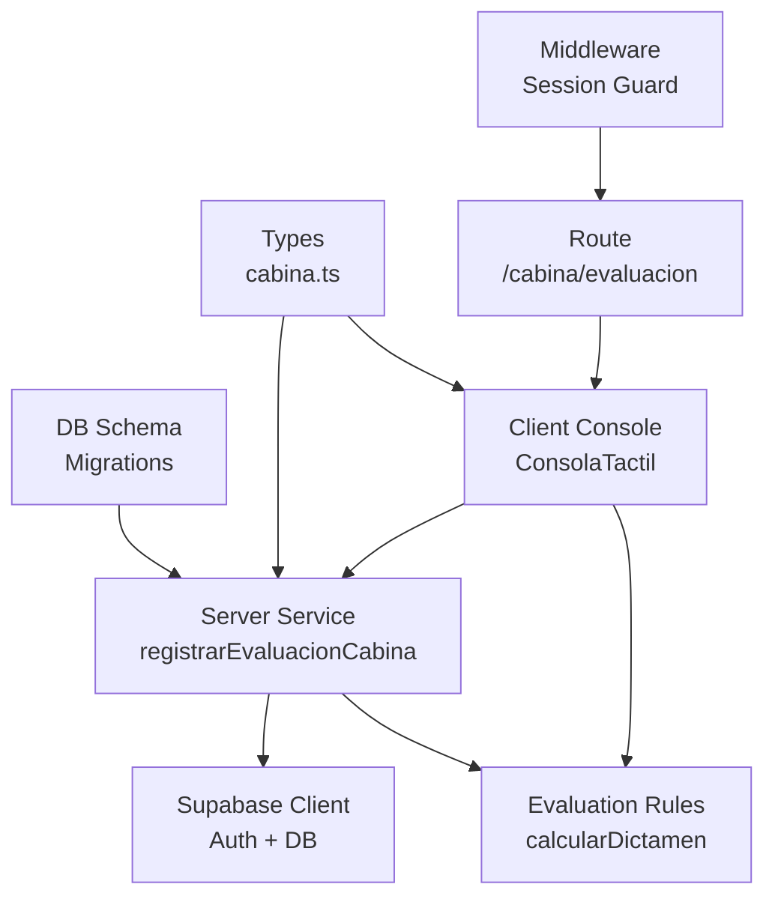
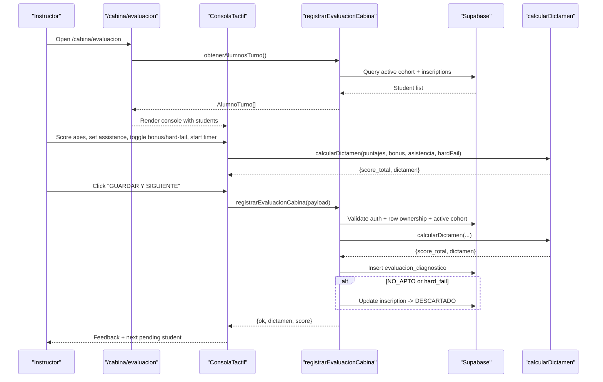
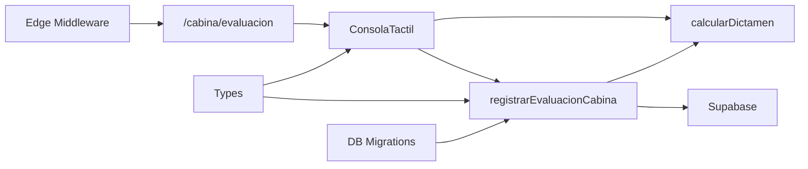

# Cabina Evaluation System

<cite>
**Referenced Files in This Document**
- [README.md](file://README.md)
- [page.tsx](file://src/app/cabina/evaluacion/page.tsx)
- [ConsolaTactil.tsx](file://src/components/cabina/ConsolaTactil.tsx)
- [cabina.ts](file://src/services/cabina.ts)
- [dictamen.ts](file://src/lib/cabina/dictamen.ts)
- [cabina.ts](file://src/types/cabina.ts)
- [middleware.ts](file://src/middleware.ts)
- [layout.tsx](file://src/app/layout.tsx)
- [0006_extender_evaluacion_cabina.sql](file://supabase/migrations/0006_extender_evaluacion_cabina.sql)
- [20261008_modulo_admision_v1.sql](file://supabase/migrations/20261008_modulo_admision_v1.sql)
</cite>

## Table of Contents
1. [Introduction](#introduction)
2. [Project Structure](#project-structure)
3. [Core Components](#core-components)
4. [Architecture Overview](#architecture-overview)
5. [Detailed Component Analysis](#detailed-component-analysis)
6. [Dependency Analysis](#dependency-analysis)
7. [Performance Considerations](#performance-considerations)
8. [Troubleshooting Guide](#troubleshooting-guide)
9. [Conclusion](#conclusion)

## Introduction
The Cabina Evaluation System is the instructor-facing tablet interface used to evaluate candidates during simulator cabin sessions. It provides a full-screen, touch-first workflow for scoring four evaluation axes, recording assistance level, optional hard-fail flags, bonus points, and lap time, then persisting results and computing a final dictamen (decision). The system integrates with Supabase for authentication, cohort management, and persistence, and it shares a pure evaluation rule engine between frontend preview and backend validation.

This documentation explains how the route, interactive console, server service, types, middleware, and database schema collaborate to deliver a secure, deterministic, and auditable evaluation flow.

## Project Structure
The relevant parts of the project are organized around Next.js App Router routes, client components, server services, shared logic, type definitions, and Supabase migrations:

- Route entry point: `/cabina/evaluacion`
- Interactive console component for instructors
- Server-side service for data access and persistence
- Pure evaluation rule module
- Shared TypeScript types
- Authentication and authorization middleware
- Database schema extensions for evaluation fields

**Diagram sources**
- [page.tsx:1-48](file://src/app/cabina/evaluacion/page.tsx#L1-L48)
- [ConsolaTactil.tsx:1-697](file://src/components/cabina/ConsolaTactil.tsx#L1-L697)
- [cabina.ts:1-266](file://src/services/cabina.ts#L1-L266)
- [dictamen.ts:1-59](file://src/lib/cabina/dictamen.ts#L1-L59)
- [cabina.ts:1-55](file://src/types/cabina.ts#L1-L55)
- [middleware.ts:1-103](file://src/middleware.ts#L1-L103)
- [0006_extender_evaluacion_cabina.sql:1-52](file://supabase/migrations/0006_extender_evaluacion_cabina.sql#L1-L52)
- [20261008_modulo_admision_v1.sql:137-277](file://supabase/migrations/20261008_modulo_admision_v1.sql#L137-L277)

**Section sources**
- [README.md:20-50](file://README.md#L20-L50)
- [page.tsx:1-48](file://src/app/cabina/evaluacion/page.tsx#L1-L48)
- [layout.tsx:1-35](file://src/app/layout.tsx#L1-L35)

## Core Components
- Route page: Loads active cohort students and renders either an empty state or the interactive console.
- Interactive console: Touch-friendly UI for selecting candidates, scoring axes, toggling bonus, marking assistance, handling hard-fail, timing laps, previewing score and dictamen, and saving evaluations.
- Server service: Validates inputs, authorizes row-level access, computes dictamen, persists evaluation records, updates candidate status when needed, and refreshes the route cache.
- Evaluation rules: Pure function that calculates total score and dictamen based on axis scores, bonus, assistance, and hard-fail flag.
- Types: Strongly typed models for student projection, input payload, result shape, and enum-like values.
- Middleware: Protects protected routes and enforces session checks at the edge.

**Section sources**
- [page.tsx:1-48](file://src/app/cabina/evaluacion/page.tsx#L1-L48)
- [ConsolaTactil.tsx:1-697](file://src/components/cabina/ConsolaTactil.tsx#L1-L697)
- [cabina.ts:1-266](file://src/services/cabina.ts#L1-L266)
- [dictamen.ts:1-59](file://src/lib/cabina/dictamen.ts#L1-L59)
- [cabina.ts:1-55](file://src/types/cabina.ts#L1-L55)
- [middleware.ts:1-103](file://src/middleware.ts#L1-L103)

## Architecture Overview
The evaluation flow starts at the protected route, which fetches the active cohort’s eligible students and renders the console. The instructor interacts with the console, which previews the dictamen using the same rule engine as the server. When saved, the server validates and authorizes the operation, computes the dictamen again, persists the record, optionally marks the candidate as discarded, and revalidates the route so the UI reflects changes.

**Diagram sources**
- [page.tsx:20-44](file://src/app/cabina/evaluacion/page.tsx#L20-L44)
- [ConsolaTactil.tsx:132-312](file://src/components/cabina/ConsolaTactil.tsx#L132-L312)
- [cabina.ts:41-103](file://src/services/cabina.ts#L41-L103)
- [cabina.ts:110-264](file://src/services/cabina.ts#L110-L264)
- [dictamen.ts:23-58](file://src/lib/cabina/dictamen.ts#L23-L58)

## Detailed Component Analysis

### Route Page: /cabina/evaluacion
Responsibilities:
- Define dynamic rendering and metadata for the tablet console.
- Fetch the active cohort’s students via the server service.
- Render an empty state if no active cohort or students are available.
- Render the interactive console when students exist.

Key behaviors:
- Uses `force-dynamic` to ensure live data per request.
- Delegates data fetching to `obtenerAlumnosTurno`.
- Provides clear guidance when no active cohort exists.

**Section sources**
- [page.tsx:1-48](file://src/app/cabina/evaluacion/page.tsx#L1-L48)

### Interactive Console: ConsolaTactil
Responsibilities:
- Provide a full-screen, touch-optimized interface for evaluating candidates.
- Manage selection by unique ID, not index, to remain stable after list changes.
- Track evaluated candidates to avoid duplicate submissions and auto-advance to the next pending candidate.
- Implement a stopwatch for lap timing.
- Present four evaluation axes with discrete options (0, 10, 20).
- Toggle bonus points for second attempt improvement.
- Select assistance level (minimal autonomous, medium verbal guidance, high continuous intervention).
- Handle hard-fail critical failures with optional reason text.
- Preview score and dictamen in real-time using the shared rule engine.
- Submit evaluation with robust locking to prevent double submission.

State and UX highlights:
- Selection synchronization with the student list.
- Live preview only when all axes and assistance are selected; avoids misleading “NO_APTO” before completion.
- Transition guard (`useTransition`) plus synchronous lock to prevent rapid double taps from submitting twice.
- End-of-session screen with option to reset the session locally.

Data flow:
- On save, constructs a strongly typed payload and calls the server service.
- On success, resets local state, marks the candidate as evaluated, and selects the next pending candidate.

**Section sources**
- [ConsolaTactil.tsx:1-697](file://src/components/cabina/ConsolaTactil.tsx#L1-L697)

### Server Service: cabina.ts
Responsibilities:
- Retrieve active cohort students for the current authenticated user.
- Persist evaluation records with strict validation and authorization.
- Compute dictamen using the shared rule engine.
- Apply business rules to update candidate status when necessary.
- Revalidate the route to reflect changes immediately.

Key validations and safeguards:
- Auth check before any operation.
- Whitelisted valid values for axis scores, bonus, and assistance.
- Row-level authorization ensuring the inscription belongs to the declared candidate and active cohort.
- Time bounds for lap duration.
- Observations normalization and limits.
- Hard-fail reason persisted only when hard-fail is active.

Business logic:
- If dictamen is `NO_APTO` or hard-fail is true, mark the inscription as `DESCARTADO` and clear assigned shift.
- Always insert into `evaluacion_diagnostico` with computed score and dictamen.
- Revalidate `/cabina/evaluacion` to refresh the UI.

**Section sources**
- [cabina.ts:41-103](file://src/services/cabina.ts#L41-L103)
- [cabina.ts:110-264](file://src/services/cabina.ts#L110-L264)

### Evaluation Rules: dictamen.ts
Responsibilities:
- Provide a pure, isomorphic function to compute total score and dictamen.
- Ensure consistency between frontend preview and backend computation.

Scoring algorithm:
- Total score = sum of four axes (each 0/10/20) + bonus (0/10).
- Hard-fail forces `NO_APTO`.
- Any axis equal to zero or total below 40 results in `NO_APTO`.
- Total ≥ 60 with minimal autonomous assistance yields `APTO_DIRECTO`.
- Total ≥ 60 with other assistance levels yields `APTO_OBSERVACION`.
- Total ≥ 40 yields `CONDICIONAL`.
- Otherwise `NO_APTO`.

Complexity:
- O(1) time and space; constant number of operations.

**Section sources**
- [dictamen.ts:1-59](file://src/lib/cabina/dictamen.ts#L1-L59)

### Types: cabina.ts
Responsibilities:
- Define strongly typed models for the console and server payloads.
- Enumerate allowed values for axis scores, assistance, and dictamen.

Key types:
- Axis score type: discrete values 0, 10, 20.
- Assistance type: minimal autonomous, medium, high.
- Dictamen type: direct apt, observation apt, conditional, not apt.
- Student projection for the turn.
- Input payload for evaluation submission.
- Result shape for save operations.

**Section sources**
- [cabina.ts:1-55](file://src/types/cabina.ts#L1-L55)

### Middleware: Session Protection
Responsibilities:
- Protect `/admin/*`, `/cabina/*`, and `/login` routes.
- Refresh or validate sessions at the edge without breaking public routes.
- Redirect unauthenticated users to login for protected routes.
- Avoid runtime errors when environment variables are missing at the edge.

Behavior:
- Exact match for `/cabina` and prefix match for `/cabina/...`.
- Safe fallback when Supabase URL or anon key are missing.
- Narrow matcher to exclude static assets and internal Next.js paths.

**Section sources**
- [middleware.ts:1-103](file://src/middleware.ts#L1-L103)

### Root Layout
Responsibilities:
- Configure global fonts and base styles.
- Provide the root HTML structure for the application.

Note: The evaluation route inherits this layout but does not include admin-specific chrome like sidebar or topbar.

**Section sources**
- [layout.tsx:1-35](file://src/app/layout.tsx#L1-L35)

## Dependency Analysis
The evaluation system has clear layering and minimal coupling:

- Route depends on the server service for data and the client component for UI.
- Client component depends on the server service for persistence and the pure rule module for live preview.
- Server service depends on Supabase client, the pure rule module, and types.
- Middleware protects routes independently of the evaluation logic.
- Database schema defines constraints and relationships that enforce data integrity.

**Diagram sources**
- [page.tsx:1-48](file://src/app/cabina/evaluacion/page.tsx#L1-L48)
- [ConsolaTactil.tsx:1-697](file://src/components/cabina/ConsolaTactil.tsx#L1-L697)
- [cabina.ts:1-266](file://src/services/cabina.ts#L1-L266)
- [dictamen.ts:1-59](file://src/lib/cabina/dictamen.ts#L1-L59)
- [cabina.ts:1-55](file://src/types/cabina.ts#L1-L55)
- [middleware.ts:1-103](file://src/middleware.ts#L1-L103)
- [0006_extender_evaluacion_cabina.sql:1-52](file://supabase/migrations/0006_extender_evaluacion_cabina.sql#L1-L52)

**Section sources**
- [page.tsx:1-48](file://src/app/cabina/evaluacion/page.tsx#L1-L48)
- [ConsolaTactil.tsx:1-697](file://src/components/cabina/ConsolaTactil.tsx#L1-L697)
- [cabina.ts:1-266](file://src/services/cabina.ts#L1-L266)
- [dictamen.ts:1-59](file://src/lib/cabina/dictamen.ts#L1-L59)
- [cabina.ts:1-55](file://src/types/cabina.ts#L1-L55)
- [middleware.ts:1-103](file://src/middleware.ts#L1-L103)
- [0006_extender_evaluacion_cabina.sql:1-52](file://supabase/migrations/0006_extender_evaluacion_cabina.sql#L1-L52)

## Performance Considerations
- Client-side preview uses memoization to avoid unnecessary recalculations when inputs do not change.
- Timer interval is created only while running and cleared on stop or cleanup.
- Server-side operations perform minimal queries: one active cohort lookup, one inscription validation, one insert, and an optional update.
- Route revalidation ensures UI freshness without full-page reloads.
- Middleware matcher excludes static assets to reduce overhead.

[No sources needed since this section provides general guidance]

## Troubleshooting Guide
Common issues and resolutions:

- No active cohort or students:
  - Symptom: Empty state message instructing to verify an active cohort with available registrations.
  - Action: Ensure a cohort exists with state `activa` and eligible inscriptions.

- Missing axis scores or assistance:
  - Symptom: Validation feedback indicating missing axis scores or assistance selection.
  - Action: Complete all four axes and select an assistance level before saving.

- Double submission prevention:
  - Symptom: Rapid taps may cause duplicate saves.
  - Action: The console uses a transition plus synchronous lock to prevent duplicates; wait for the saving indicator.

- Hard-fail reason not persisted:
  - Symptom: Reason text disappears when hard-fail is toggled off.
  - Action: Keep hard-fail enabled while entering the reason; it is only sent when hard-fail is active.

- Unauthorized or invalid data:
  - Symptom: Save fails with invalid data or session error.
  - Action: Verify authentication and that the inscription belongs to the active cohort and declared candidate.

- Time out of bounds:
  - Symptom: Lap time ignored or nullified.
  - Action: Ensure lap time is within acceptable bounds; the server clamps to a safe range.

**Section sources**
- [page.tsx:25-41](file://src/app/cabina/evaluacion/page.tsx#L25-L41)
- [ConsolaTactil.tsx:247-312](file://src/components/cabina/ConsolaTactil.tsx#L247-L312)
- [cabina.ts:110-264](file://src/services/cabina.ts#L110-L264)

## Conclusion
The Cabina Evaluation System delivers a robust, secure, and user-friendly evaluation workflow for simulator cabin assessments. It combines a touch-first interface, deterministic scoring rules, strong typing, server-side validation, and database constraints to ensure consistent outcomes. The architecture separates concerns clearly, enabling maintainability and reliability in operational environments.

[No sources needed since this section summarizes without analyzing specific files]