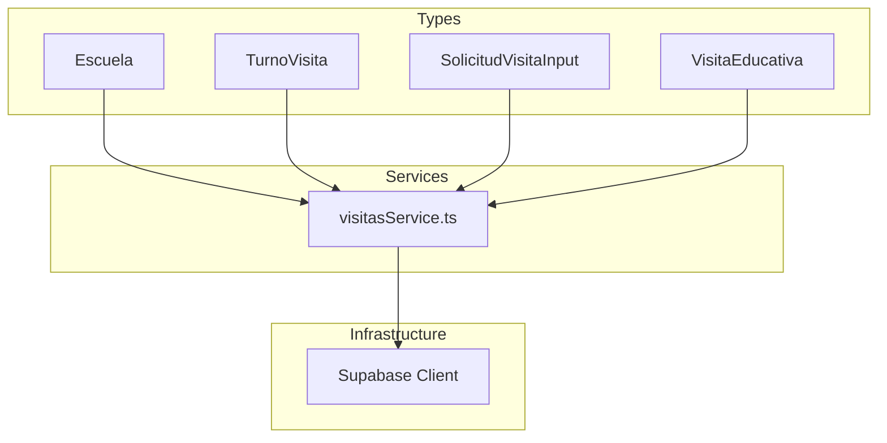
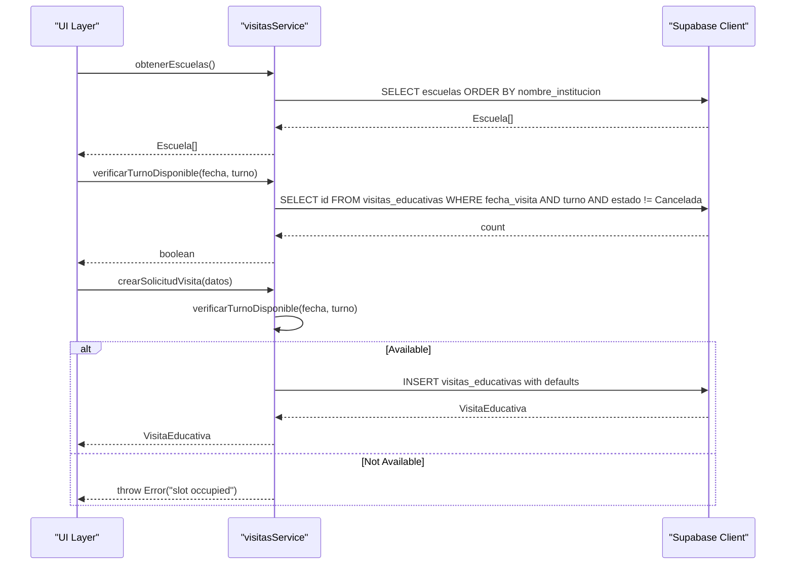
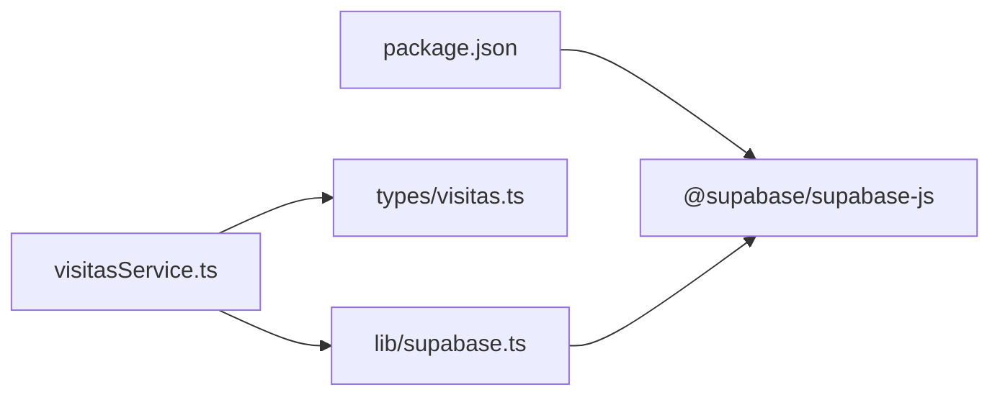

# Core Services & Business Logic

<cite>
**Referenced Files in This Document**
- [visitasService.ts](file://src/services/visitasService.ts)
- [visitas.ts](file://src/types/visitas.ts)
- [supabase.ts](file://src/lib/supabase.ts)
- [package.json](file://package.json)
</cite>

## Table of Contents
1. [Introduction](#introduction)
2. [Project Structure](#project-structure)
3. [Core Components](#core-components)
4. [Architecture Overview](#architecture-overview)
5. [Detailed Component Analysis](#detailed-component-analysis)
6. [Dependency Analysis](#dependency-analysis)
7. [Performance Considerations](#performance-considerations)
8. [Troubleshooting Guide](#troubleshooting-guide)
9. [Conclusion](#conclusion)

## Introduction
This document explains the business logic layer for the educational visit management system, centered on the visitas service. It covers how to fetch schools, check time slot availability, and create new visit requests while enforcing key business rules such as preventing double bookings and validating schedules. The service is designed to separate business logic from UI components by encapsulating data access and validation in a dedicated module that communicates with Supabase.

## Project Structure
The project follows a clean separation between types, services, and infrastructure:
- Types define the domain models used across the application.
- The service module implements business operations and interacts with the database via a shared Supabase client.
- The Supabase client is configured once and reused throughout the service.



**Diagram sources**
- [visitas.ts:1-28](file://src/types/visitas.ts#L1-L28)
- [visitasService.ts:1-59](file://src/services/visitasService.ts#L1-L59)
- [supabase.ts:1-7](file://src/lib/supabase.ts#L1-L7)

**Section sources**
- [visitas.ts:1-28](file://src/types/visitas.ts#L1-L28)
- [visitasService.ts:1-59](file://src/services/visitasService.ts#L1-L59)
- [supabase.ts:1-7](file://src/lib/supabase.ts#L1-L7)

## Core Components
- Escuela: Represents a school entity with identification and contact details.
- TurnoVisita: A type alias for allowed visit shifts (morning or afternoon).
- SolicitudVisitaInput: Input shape for creating a new visit request.
- VisitaEducativa: Full visit record including status fields.

These types ensure consistent contracts between UI and service layers and enable compile-time safety.

**Section sources**
- [visitas.ts:1-28](file://src/types/visitas.ts#L1-L28)

## Architecture Overview
The service layer provides pure functions that encapsulate business rules and database interactions:
- obtenerEscuelas: Fetches all schools sorted by institution name.
- verificarTurnoDisponible: Checks if a specific date and shift are available, excluding canceled visits.
- crearSolicitudVisita: Creates a new visit after verifying availability and setting default statuses.

The architecture separates concerns:
- UI components call service functions without needing to know database specifics.
- The service handles validation, error propagation, and data transformation.
- The Supabase client is centralized to avoid duplication and configuration drift.



**Diagram sources**
- [visitasService.ts:9-58](file://src/services/visitasService.ts#L9-L58)
- [supabase.ts:1-7](file://src/lib/supabase.ts#L1-L7)

## Detailed Component Analysis

### Service Functions

#### obtenerEscuelas
- Purpose: Retrieve all schools ordered alphabetically by institution name.
- Behavior: Queries the escuelas table and returns an array of Escuela objects. Errors from the database are thrown to the caller.
- Complexity: O(n) where n is the number of schools returned; sorting is handled by the database.
- Usage example: Call this function to populate a dropdown of schools when creating a visit request.

**Section sources**
- [visitasService.ts:9-18](file://src/services/visitasService.ts#L9-L18)

#### verificarTurnoDisponible
- Purpose: Determine whether a given date and shift are free for scheduling.
- Behavior: Counts existing non-canceled visits for the specified date and shift. Returns true if none exist.
- Business rule: Prevents double bookings by ensuring at most one active visit per date-shift pair.
- Complexity: O(1) query with indexed filters on date and shift; result depends on index usage by the database.
- Usage example: Validate user selection before allowing submission of a new visit form.

**Section sources**
- [visitasService.ts:20-34](file://src/services/visitasService.ts#L20-L34)

#### crearSolicitudVisita
- Purpose: Create a new educational visit request with validated inputs and default statuses.
- Behavior:
  - Checks availability using verificarTurnoDisponible.
  - If unavailable, throws an error indicating the slot is already booked.
  - Inserts a new visit record with default statuses for visit and insurance policy.
  - Returns the created visit record.
- Business rules:
  - Enforces single booking per date-shift.
  - Sets initial statuses to guide downstream workflows.
- Complexity: One availability check plus one insert; overall dominated by database operations.
- Usage example: Submit a completed visit form after confirming availability.

**Section sources**
- [visitasService.ts:36-58](file://src/services/visitasService.ts#L36-L58)

### Data Models

```mermaid
classDiagram
class Escuela {
+string id
+string nombre_institucion
+string nombre_corto
+string direccion
}
class TurnoVisita {
<<enum>>
"Mañana"
"Tarde"
}
class SolicitudVisitaInput {
+string id_escuela
+string fecha_visita
+TurnoVisita turno
+string division
+number cant_alumnos
+string nombre_director
+string cel_director
+string nombre_docente
+string cel_docente
+string drive_nomina_url?
}
class VisitaEducativa {
+string id
+string estado_visita
+string estado_poliza
}
VisitaEducativa --|> SolicitudVisitaInput : "extends"
```

**Diagram sources**
- [visitas.ts:1-28](file://src/types/visitas.ts#L1-L28)

**Section sources**
- [visitas.ts:1-28](file://src/types/visitas.ts#L1-L28)

### Database Integration and Error Handling
- Supabase client: Centralized configuration using environment variables for URL and anonymous key.
- Error handling: Each service function propagates errors by throwing them when the Supabase operation fails. Callers should handle these errors appropriately (e.g., show user-friendly messages).
- Idempotency: Availability checks occur before inserts to prevent duplicates; however, consider adding database-level constraints for stronger guarantees.

**Section sources**
- [supabase.ts:1-7](file://src/lib/supabase.ts#L1-L7)
- [visitasService.ts:9-58](file://src/services/visitasService.ts#L9-L58)

## Dependency Analysis
- External dependency: @supabase/supabase-js for database operations.
- Internal dependencies:
  - visitasService.ts depends on types from visitas.ts and the supabase client.
  - No circular dependencies detected.



**Diagram sources**
- [package.json:11-15](file://package.json#L11-L15)
- [visitasService.ts:1-7](file://src/services/visitasService.ts#L1-L7)
- [supabase.ts:1-7](file://src/lib/supabase.ts#L1-L7)

**Section sources**
- [package.json:11-15](file://package.json#L11-L15)
- [visitasService.ts:1-7](file://src/services/visitasService.ts#L1-L7)
- [supabase.ts:1-7](file://src/lib/supabase.ts#L1-L7)

## Performance Considerations
- Query efficiency: Ensure indexes on frequently filtered columns like fecha_visita and turno to optimize availability checks.
- Sorting: Schools are sorted server-side; keep result sets small by selecting only needed fields.
- Concurrency: For high concurrency, add database-level unique constraints on (fecha_visita, turno) to enforce uniqueness even under race conditions.

[No sources needed since this section provides general guidance]

## Troubleshooting Guide
Common issues and strategies:
- Slot already booked: When creating a visit, if the selected date-shift is taken, the service throws an error. Handle this in the UI by informing the user to choose another slot.
- Network or permission errors: Supabase errors are thrown directly; catch and display meaningful messages to users.
- Missing environment variables: Ensure NEXT_PUBLIC_SUPABASE_URL and NEXT_PUBLIC_SUPABASE_ANON_KEY are set; otherwise, the client initialization will fail.

Operational tips:
- Log errors at the boundary where they are caught to aid debugging.
- Add retry logic for transient network failures if appropriate.
- Validate inputs on both client and server sides to reduce invalid requests.

**Section sources**
- [visitasService.ts:20-58](file://src/services/visitasService.ts#L20-L58)
- [supabase.ts:1-7](file://src/lib/supabase.ts#L1-L7)

## Conclusion
The visitas service cleanly encapsulates the core business logic for managing educational visits. It enforces critical rules such as preventing double bookings and standardizes data shapes through TypeScript interfaces. By centralizing database access and error handling, it enables UI components to remain focused on presentation while relying on a robust, testable service layer. Extending the system—such as adding validations, notifications, or additional statuses—can be done within this service without impacting the UI.