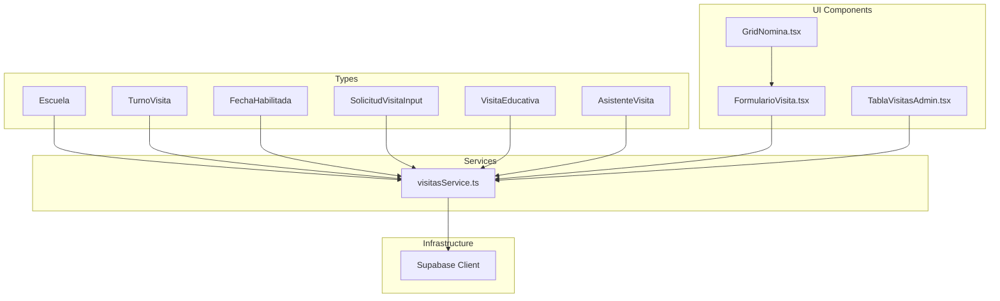
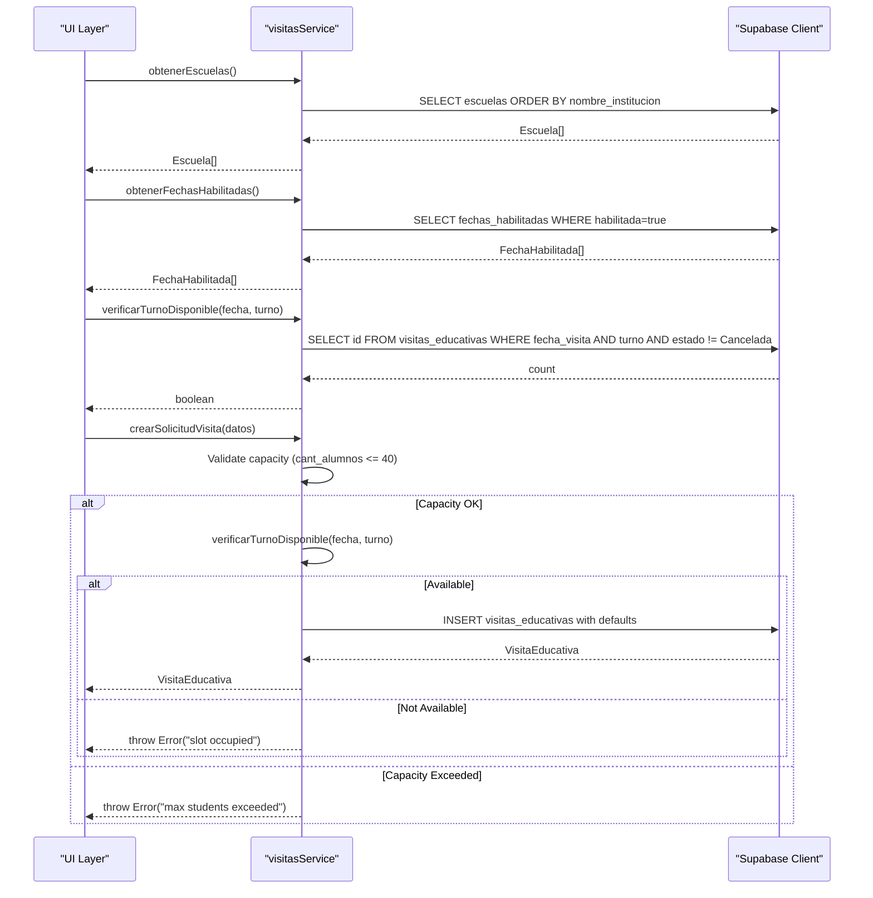
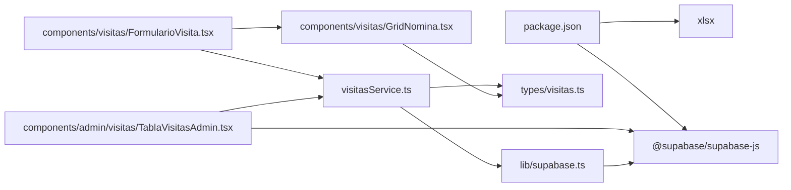

# Core Services & Business Logic

<cite>
**Referenced Files in This Document**
- [visitasService.ts](file://src/services/visitasService.ts)
- [visitas.ts](file://src/types/visitas.ts)
- [supabase.ts](file://src/lib/supabase.ts)
- [FormularioVisita.tsx](file://src/components/visitas/FormularioVisita.tsx)
- [GridNomina.tsx](file://src/components/visitas/GridNomina.tsx)
- [TablaVisitasAdmin.tsx](file://src/components/admin/visitas/TablaVisitasAdmin.tsx)
- [package.json](file://package.json)
</cite>

## Update Summary
**Changes Made**
- Enhanced form validation with comprehensive input sanitization and real-time feedback
- Added date normalization functionality for Excel integration with flexible format support
- Implemented WhatsApp contact system with phone number normalization and direct messaging capabilities
- Improved capacity management with stricter validation and user guidance
- Enhanced error handling with more descriptive messages and recovery options
- Added administrative tools for managing visits and exporting data

## Table of Contents
1. [Introduction](#introduction)
2. [Project Structure](#project-structure)
3. [Core Components](#core-components)
4. [Architecture Overview](#architecture-overview)
5. [Detailed Component Analysis](#detailed-component-analysis)
6. [Enhanced Date Availability System](#enhanced-date-availability-system)
7. [Capacity Management Features](#capacity-management-features)
8. [WhatsApp Contact Integration](#whatsapp-contact-integration)
9. [Excel Data Import and Normalization](#excel-data-import-and-normalization)
10. [Dependency Analysis](#dependency-analysis)
11. [Performance Considerations](#performance-considerations)
12. [Troubleshooting Guide](#troubleshooting-guide)
13. [Conclusion](#conclusion)

## Introduction
This document explains the enhanced business logic layer for the educational visit management system, centered on the visitas service. The system now includes sophisticated date availability checking capabilities, improved form validation, Excel integration with date normalization, and comprehensive WhatsApp contact functionality. It covers how to fetch schools, check time slot availability against authorized dates, validate student capacity limits, create new visit requests while enforcing key business rules such as preventing double bookings and validating schedules. The service is designed to separate business logic from UI components by encapsulating data access and validation in a dedicated module that communicates with Supabase.

## Project Structure
The project follows a clean separation between types, services, and infrastructure with enhanced capabilities:
- Types define the domain models used across the application, including new date availability structures and WhatsApp integration types.
- The service module implements business operations with enhanced date checking, capacity management, and validation.
- The Supabase client is configured once and reused throughout the service.
- UI components integrate seamlessly with the enhanced service layer and include advanced features like Excel import and WhatsApp integration.



**Diagram sources**
- [visitas.ts:1-84](file://src/types/visitas.ts#L1-L84)
- [visitasService.ts:1-169](file://src/services/visitasService.ts#L1-L169)
- [supabase.ts:1-7](file://src/lib/supabase.ts#L1-L7)
- [FormularioVisita.tsx:1-723](file://src/components/visitas/FormularioVisita.tsx#L1-L723)
- [GridNomina.tsx:1-277](file://src/components/visitas/GridNomina.tsx#L1-L277)
- [TablaVisitasAdmin.tsx:1-324](file://src/components/admin/visitas/TablaVisitasAdmin.tsx#L1-L324)

**Section sources**
- [visitas.ts:1-84](file://src/types/visitas.ts#L1-L84)
- [visitasService.ts:1-169](file://src/services/visitasService.ts#L1-L169)
- [supabase.ts:1-7](file://src/lib/supabase.ts#L1-L7)

## Core Components
- Escuela: Represents a school entity with identification and contact details.
- TurnoVisita: A type alias for allowed visit shifts (morning or afternoon).
- FechaHabilitada: New type representing authorized dates for visits with optional observations.
- SolicitudVisitaInput: Enhanced input shape for creating new visit requests with additional fields.
- VisitaEducativa: Full visit record including status fields and scheduling information.
- AsistenteVisita: Represents attendees associated with educational visits.

These types ensure consistent contracts between UI and service layers and enable compile-time safety with enhanced validation capabilities.

**Section sources**
- [visitas.ts:1-84](file://src/types/visitas.ts#L1-L84)

## Architecture Overview
The enhanced service layer provides pure functions that encapsulate business rules and database interactions with improved date and capacity management:
- obtenerEscuelas: Fetches all schools sorted by institution name.
- obtenerFechasHabilitadas: Retrieves authorized dates for visits with filtering and sorting.
- verificarTurnoDisponible: Checks if a specific date and shift are available, excluding canceled visits.
- crearSolicitudVisita: Creates a new visit after verifying availability, capacity limits, and setting default statuses.
- obtenerVisitasAdmin: Retrieves all visits for administrative panel with latest first.
- actualizarCheckOperativo: Updates operational checklist items for individual visits.
- obtenerAsistentesPorVisita: Retrieves attendee lists for specific visits.

The architecture separates concerns with enhanced validation:
- UI components call service functions without needing to know database specifics.
- The service handles validation, capacity checks, error propagation, and data transformation.
- The Supabase client is centralized to avoid duplication and configuration drift.



**Diagram sources**
- [visitasService.ts:12-169](file://src/services/visitasService.ts#L12-L169)
- [supabase.ts:1-7](file://src/lib/supabase.ts#L1-L7)

## Detailed Component Analysis

### Service Functions

#### obtenerEscuelas
- Purpose: Retrieve all schools ordered alphabetically by institution name.
- Behavior: Queries the escuelas table and returns an array of Escuela objects. Errors from the database are thrown to the caller.
- Complexity: O(n) where n is the number of schools returned; sorting is handled by the database.
- Usage example: Call this function to populate a dropdown of schools when creating a visit request.

**Section sources**
- [visitasService.ts:12-21](file://src/services/visitasService.ts#L12-L21)

#### obtenerFechasHabilitadas
- Purpose: Retrieve all authorized dates for educational visits that are currently enabled.
- Behavior: Queries the fechas_habilitadas table, filters only enabled dates, and returns them sorted chronologically.
- Business rule: Ensures visitors can only select from pre-approved dates managed by administrators.
- Complexity: O(n) where n is the number of authorized dates; filtering and sorting handled by database.
- Usage example: Populate date selection dropdown with only valid, authorized dates for visit scheduling.

**Section sources**
- [visitasService.ts:23-33](file://src/services/visitasService.ts#L23-L33)

#### verificarTurnoDisponible
- Purpose: Determine whether a given date and shift are free for scheduling.
- Behavior: Counts existing non-canceled visits for the specified date and shift. Returns true if none exist.
- Business rule: Prevents double bookings by ensuring at most one active visit per date-shift pair.
- Complexity: O(1) query with indexed filters on date and shift; result depends on index usage by the database.
- Usage example: Validate user selection before allowing submission of a new visit form.

**Section sources**
- [visitasService.ts:35-49](file://src/services/visitasService.ts#L35-L49)

#### crearSolicitudVisita
- Purpose: Create a new educational visit request with enhanced validation for capacity and availability.
- Behavior:
  - Validates legal agreements acceptance (images and judicial measures).
  - Validates student capacity against maximum limit (40 students).
  - Validates that attendee list is not empty.
  - Checks availability using verificarTurnoDisponible.
  - If unavailable or over capacity, throws appropriate errors.
  - Inserts a new visit record with default statuses and generated reservation codes.
  - Handles attendee registration separately for better data organization.
  - Returns the created visit record.
- Business rules:
  - Enforces single booking per date-shift.
  - Enforces maximum student capacity of 40 per visit.
  - Sets initial statuses to guide downstream workflows.
  - Generates unique reservation codes for tracking.
- Complexity: Multiple validation checks plus insert operations; overall dominated by database operations.
- Usage example: Submit a completed visit form after confirming availability and capacity compliance.

**Section sources**
- [visitasService.ts:58-121](file://src/services/visitasService.ts#L58-L121)

#### Administrative Functions

##### obtenerVisitasAdmin
- Purpose: Retrieve all visits for the administrative panel, ordered by most recent first.
- Behavior: Queries the visitas_educativas table and returns all records sorted by fecha_visita in descending order.
- Usage example: Display comprehensive visit information in the admin dashboard.

**Section sources**
- [visitasService.ts:127-136](file://src/services/visitasService.ts#L127-L136)

##### actualizarCheckOperativo
- Purpose: Update operational checklist items (insurance, transportation, invoices, Drive upload) for individual visits.
- Behavior: Updates a specific boolean field in the visitas_educativas table based on the provided field name and value.
- Usage example: Allow administrators to mark operational tasks as complete for each visit.

**Section sources**
- [visitasService.ts:142-153](file://src/services/visitasService.ts#L142-L153)

##### obtenerAsistentesPorVisita
- Purpose: Retrieve the complete attendee list for a specific visit.
- Behavior: Queries the visita_asistentes table for all attendees associated with a given visit ID, sorted by name.
- Usage example: Display attendee information in admin panels or export reports.

**Section sources**
- [visitasService.ts:156-168](file://src/services/visitasService.ts#L156-L168)

### Data Models

```mermaid
classDiagram
class Escuela {
+string id
+string nombre_institucion
+string nombre_corto
+string direccion
}
class FechaHabilitada {
+string id
+string fecha
+boolean habilitada
+string observaciones?
}
class TurnoVisita {
<<enum>>
"Mañana"
"Tarde"
}
class AnioEscolar {
<<enum>>
"5°"
"6°"
}
class RolAsistente {
<<enum>>
"Alumno"
"Docente"
}
class AsistenteInput {
+string apellido_nombre
+string dni
+string fecha_nacimiento?
+RolAsistente rol
}
class SolicitudVisitaInput {
+string id_escuela?
+string otra_institucion_nombre?
+string fecha_visita
+TurnoVisita turno?
+AnioEscolar anio
+string division
+number cant_alumnos
+boolean requiere_tup
+string nombre_director
+string cel_director
+string nombre_docente
+string cel_docente
+string email_contacto
+boolean acepta_imagenes
+boolean acepta_medidas_judiciales
+AsistenteInput[] asistentes
}
class VisitaEducativa {
+string id
+string codigo_reserva
+string estado_visita
+string estado_poliza
+string tup_horario_ida_desde
+string tup_horario_ida_hasta
+string tup_horario_vuelta_desde
+string tup_horario_vuelta_hasta
+string created_at
+boolean check_poliza?
+boolean check_tup?
+boolean check_facturas?
+boolean check_drive_sum?
}
class AsistenteVisita {
+string id
+string id_visita
+string apellido_nombre
+string dni
+string fecha_nacimiento
+RolAsistente rol
}
VisitaEducativa --|> SolicitudVisitaInput : "extends"
```

**Diagram sources**
- [visitas.ts:1-84](file://src/types/visitas.ts#L1-L84)

**Section sources**
- [visitas.ts:1-84](file://src/types/visitas.ts#L1-L84)

### Database Integration and Error Handling
- Supabase client: Centralized configuration using environment variables for URL and anonymous key.
- Error handling: Each service function propagates errors by throwing them when the Supabase operation fails. Callers should handle these errors appropriately (e.g., show user-friendly messages).
- Idempotency: Availability checks occur before inserts to prevent duplicates; however, consider adding database-level constraints for stronger guarantees.
- Enhanced Validation: Capacity limits, legal agreement validation, and attendee list requirements provide multiple layers of protection against invalid submissions.

**Section sources**
- [supabase.ts:1-7](file://src/lib/supabase.ts#L1-L7)
- [visitasService.ts:12-169](file://src/services/visitasService.ts#L12-L169)

## Enhanced Date Availability System

The system includes a comprehensive date availability management feature that allows administrators to control which dates are open for educational visits.

### Key Features
- **Authorized Dates Management**: Only pre-approved dates appear in the visitor interface
- **Flexible Observations**: Administrators can add notes or restrictions for specific dates
- **Chronological Sorting**: Dates are automatically sorted for easy navigation
- **Real-time Filtering**: Only enabled dates are shown to users

### Implementation Details
The `obtenerFechasHabilitadas` function queries the `fechas_habilitadas` table with automatic filtering for enabled dates and chronological ordering. This ensures that visitors can only select from dates that have been explicitly approved by administrators.

### UI Integration
The form component integrates seamlessly with this system by:
- Loading authorized dates alongside school information
- Displaying relevant observations for each date
- Providing clear feedback when no dates are available
- Maintaining responsive loading states during data retrieval

**Section sources**
- [visitasService.ts:23-33](file://src/services/visitasService.ts#L23-L33)
- [FormularioVisita.tsx:97-112](file://src/components/visitas/FormularioVisita.tsx#L97-L112)
- [FormularioVisita.tsx:480-501](file://src/components/visitas/FormularioVisita.tsx#L480-L501)

## Capacity Management Features

The system includes robust capacity management to prevent overcrowding and ensure quality educational experiences.

### Capacity Limits
- **Maximum Students**: 40 students per visit session
- **Real-time Validation**: Immediate feedback when capacity limits are exceeded
- **Clear Error Messages**: User-friendly guidance when limits are breached
- **Administrative Control**: Centralized capacity management through constants

### Validation Flow
1. **Client-side Validation**: Immediate feedback in the form interface
2. **Server-side Validation**: Backend verification prevents overflow scenarios
3. **Error Propagation**: Consistent error handling across the application
4. **User Guidance**: Clear instructions for alternative solutions

### Integration Points
- Form validation prevents submission when capacity is exceeded
- Service layer enforces hard limits before database operations
- UI provides visual feedback and helpful messaging
- Error handling ensures graceful degradation when limits are reached

**Section sources**
- [visitasService.ts:67-69](file://src/services/visitasService.ts#L67-L69)
- [FormularioVisita.tsx:118-125](file://src/components/visitas/FormularioVisita.tsx#L118-L125)
- [FormularioVisita.tsx:146-151](file://src/components/visitas/FormularioVisita.tsx#L146-L151)
- [FormularioVisita.tsx:569-575](file://src/components/visitas/FormularioVisita.tsx#L569-L575)

## WhatsApp Contact Integration

The system now includes comprehensive WhatsApp contact functionality for seamless communication between administrators and visiting institutions.

### Phone Number Normalization
- **Format Support**: Handles various Argentine phone number formats including international prefixes, local numbers, and mobile prefixes
- **Automatic Conversion**: Converts phone numbers to WhatsApp-compatible format (549 + number without leading zeros)
- **Validation**: Ensures phone numbers meet minimum length requirements before processing

### Contact Management
- **Direct Messaging**: Provides clickable WhatsApp links for direct communication with teachers
- **Contact Display**: Shows normalized phone numbers in admin interfaces
- **Error Handling**: Gracefully handles missing or invalid phone numbers

### Implementation Details
The `normalizarWhatsApp` function processes phone numbers through multiple transformation steps:
1. Removes all non-digit characters
2. Strips international country codes (54, 549)
3. Removes leading zeros and mobile prefixes (15)
4. Formats as WhatsApp-ready string (549 + cleaned number)

### UI Integration
- Admin panel displays clickable WhatsApp buttons for each visit
- Form confirms WhatsApp contact will be used for follow-up communication
- Error messages guide users to contact via WhatsApp when capacity issues arise

**Section sources**
- [TablaVisitasAdmin.tsx:48-67](file://src/components/admin/visitas/TablaVisitasAdmin.tsx#L48-L67)
- [FormularioVisita.tsx:39](file://src/components/visitas/FormularioVisita.tsx#L39)
- [FormularioVisita.tsx:304-316](file://src/components/visitas/FormularioVisita.tsx#L304-L316)
- [FormularioVisita.tsx:381-385](file://src/components/visitas/FormularioVisita.tsx#L381-L385)

## Excel Data Import and Normalization

The system includes advanced Excel data import capabilities with intelligent date normalization for seamless attendance list management.

### Excel Import Features
- **Tab-Delimited Parsing**: Automatically parses tab-separated values from Excel clipboard
- **Column Mapping**: Maps Excel columns to system fields (Name, DNI, Birth Date, Role)
- **Batch Processing**: Adds multiple attendees simultaneously from copied Excel data
- **Validation**: Filters out incomplete entries and validates required fields

### Date Normalization System
- **Multiple Format Support**: Handles DD/MM/YYYY, DD-MM-YYYY, and ISO format (YYYY-MM-DD)
- **Intelligent Parsing**: Detects date format automatically and converts to standard ISO format
- **Year Handling**: Supports both 2-digit and 4-digit years, automatically prepending century for 2-digit years
- **Validation**: Ensures parsed dates are valid before insertion

### Role Detection
- **Automatic Classification**: Intelligently detects whether attendees are students or teachers based on names
- **Pattern Matching**: Recognizes common teacher name patterns (teacher, professor, master)
- **Manual Override**: Allows manual role assignment when automatic detection is incorrect

### User Interface
- **Modal Dialog**: Provides intuitive interface for pasting Excel data
- **Live Preview**: Shows parsed results before finalizing import
- **Error Feedback**: Highlights formatting issues and provides guidance
- **Bulk Operations**: Supports adding large groups of attendees efficiently

**Section sources**
- [GridNomina.tsx:33-48](file://src/components/visitas/GridNomina.tsx#L33-L48)
- [GridNomina.tsx:55-70](file://src/components/visitas/GridNomina.tsx#L55-L70)
- [GridNomina.tsx:21-27](file://src/components/visitas/GridNomina.tsx#L21-L27)
- [GridNomina.tsx:92-104](file://src/components/visitas/GridNomina.tsx#L92-L104)

## Dependency Analysis
- External dependencies: @supabase/supabase-js for database operations, xlsx for Excel export functionality
- Internal dependencies:
  - visitasService.ts depends on types from visitas.ts and the supabase client.
  - FormularioVisita.tsx depends on the enhanced service functions and GridNomina component.
  - GridNomina.tsx provides Excel import functionality used by the main form.
  - TablaVisitasAdmin.tsx uses WhatsApp normalization and administrative service functions.
  - No circular dependencies detected.



**Diagram sources**
- [package.json:11-15](file://package.json#L11-L15)
- [visitasService.ts:1-10](file://src/services/visitasService.ts#L1-L10)
- [supabase.ts:1-7](file://src/lib/supabase.ts#L1-L7)
- [FormularioVisita.tsx:1-17](file://src/components/visitas/FormularioVisita.tsx#L1-L17)
- [GridNomina.tsx:1-4](file://src/components/visitas/GridNomina.tsx#L1-L4)
- [TablaVisitasAdmin.tsx:1-40](file://src/components/admin/visitas/TablaVisitasAdmin.tsx#L1-L40)

**Section sources**
- [package.json:11-15](file://package.json#L11-L15)
- [visitasService.ts:1-10](file://src/services/visitasService.ts#L1-L10)
- [supabase.ts:1-7](file://src/lib/supabase.ts#L1-L7)
- [FormularioVisita.tsx:1-17](file://src/components/visitas/FormularioVisita.tsx#L1-L17)

## Performance Considerations
- Query efficiency: Ensure indexes on frequently filtered columns like fecha_visita, turno, and habilitada to optimize availability checks.
- Sorting: Schools and dates are sorted server-side; keep result sets small by selecting only needed fields.
- Concurrency: For high concurrency, add database-level unique constraints on (fecha_visita, turno) to enforce uniqueness even under race conditions.
- Date availability queries benefit from proper indexing on the habilitada column for faster filtering.
- Capacity validation: Client-side validation reduces unnecessary server requests when capacity limits are exceeded.
- Excel import optimization: Batch processing of large attendee lists minimizes re-renders and improves user experience.
- WhatsApp normalization: Efficient phone number processing with minimal computational overhead.

## Troubleshooting Guide
Common issues and strategies:
- **Slot already booked**: When creating a visit, if the selected date-shift is taken, the service throws an error. Handle this in the UI by informing the user to choose another slot.
- **Capacity exceeded**: When student count exceeds 40, both client and server validation prevent submission. Provide clear guidance to reduce numbers or split into multiple sessions.
- **No authorized dates**: When no dates are available, inform users that administrators need to enable dates first.
- **Excel import errors**: If Excel data doesn't parse correctly, guide users to verify column format and try manual entry.
- **WhatsApp contact issues**: Phone number normalization may fail for invalid formats; provide fallback contact methods.
- Network or permission errors: Supabase errors are thrown directly; catch and display meaningful messages to users.
- Missing environment variables: Ensure NEXT_PUBLIC_SUPABASE_URL and NEXT_PUBLIC_SUPABASE_ANON_KEY are set; otherwise, the client initialization will fail.

Operational tips:
- Log errors at the boundary where they are caught to aid debugging.
- Add retry logic for transient network failures if appropriate.
- Validate inputs on both client and server sides to reduce invalid requests.
- Monitor capacity utilization to identify trends and plan for additional sessions.
- Test Excel import with various date formats to ensure compatibility.
- Verify WhatsApp number formatting across different regional formats.

**Section sources**
- [visitasService.ts:35-169](file://src/services/visitasService.ts#L35-L169)
- [supabase.ts:1-7](file://src/lib/supabase.ts#L1-L7)
- [FormularioVisita.tsx:146-151](file://src/components/visitas/FormularioVisita.tsx#L146-L151)
- [FormularioVisita.tsx:469-482](file://src/components/visitas/FormularioVisita.tsx#L469-L482)
- [GridNomina.tsx:97-104](file://src/components/visitas/GridNomina.tsx#L97-L104)

## Conclusion
The enhanced visitas service provides a robust foundation for managing educational visits with sophisticated date availability checking, capacity management, Excel integration, and WhatsApp contact capabilities. The system successfully enforces critical business rules such as preventing double bookings, maintaining student capacity limits, and ensuring visits occur only on authorized dates. By centralizing database access, validation logic, and error handling, it enables UI components to remain focused on presentation while relying on a comprehensive, testable service layer. The modular architecture makes it straightforward to extend the system with additional validations, notifications, or administrative features without impacting the user interface.

The enhanced features include:
- **Date Authorization System**: Administrators can control which dates are available for visits
- **Capacity Management**: Robust validation prevents overcrowding with clear user feedback
- **Excel Integration**: Advanced data import with intelligent date normalization and batch processing
- **WhatsApp Communication**: Seamless contact management with phone number normalization
- **Improved Error Handling**: Comprehensive error messages guide users toward successful completion
- **Better User Experience**: Real-time validation and clear messaging improve form completion rates

These enhancements make the system more reliable, user-friendly, and maintainable while preserving the clean separation between business logic and presentation layers. The addition of Excel import capabilities and WhatsApp integration significantly improves the workflow for both administrators and visiting institutions, making the educational visit management process more efficient and accessible.