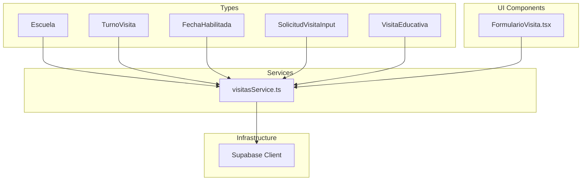
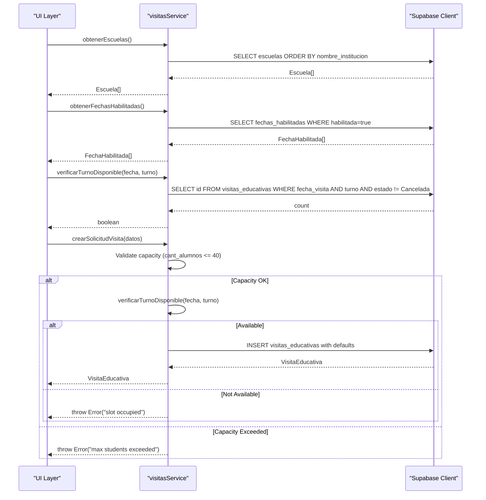
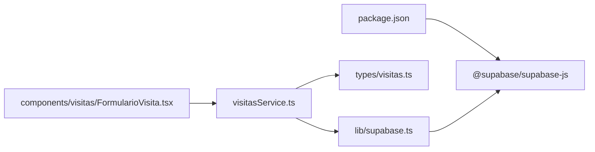

# Core Services & Business Logic

<cite>
**Referenced Files in This Document**
- [visitasService.ts](file://src/services/visitasService.ts)
- [visitas.ts](file://src/types/visitas.ts)
- [supabase.ts](file://src/lib/supabase.ts)
- [FormularioVisita.tsx](file://src/components/visitas/FormularioVisita.tsx)
- [package.json](file://package.json)
</cite>

## Update Summary
**Changes Made**
- Added new date availability checking capabilities with `obtenerFechasHabilitadas` function
- Enhanced capacity management features with maximum student limits and validation
- Improved form integration with real-time availability checking
- Added comprehensive error handling for capacity constraints
- Enhanced business rules for preventing double bookings and validating schedules

## Table of Contents
1. [Introduction](#introduction)
2. [Project Structure](#project-structure)
3. [Core Components](#core-components)
4. [Architecture Overview](#architecture-overview)
5. [Detailed Component Analysis](#detailed-component-analysis)
6. [Enhanced Date Availability System](#enhanced-date-availability-system)
7. [Capacity Management Features](#capacity-management-features)
8. [Dependency Analysis](#dependency-analysis)
9. [Performance Considerations](#performance-considerations)
10. [Troubleshooting Guide](#troubleshooting-guide)
11. [Conclusion](#conclusion)

## Introduction
This document explains the enhanced business logic layer for the educational visit management system, centered on the visitas service. The system now includes sophisticated date availability checking capabilities and improved capacity management features. It covers how to fetch schools, check time slot availability against authorized dates, validate student capacity limits, and create new visit requests while enforcing key business rules such as preventing double bookings and validating schedules. The service is designed to separate business logic from UI components by encapsulating data access and validation in a dedicated module that communicates with Supabase.

## Project Structure
The project follows a clean separation between types, services, and infrastructure with enhanced capabilities:
- Types define the domain models used across the application, including new date availability structures.
- The service module implements business operations with enhanced date checking and capacity management.
- The Supabase client is configured once and reused throughout the service.
- UI components integrate seamlessly with the enhanced service layer.



**Diagram sources**
- [visitas.ts:1-60](file://src/types/visitas.ts#L1-L60)
- [visitasService.ts:1-115](file://src/services/visitasService.ts#L1-L115)
- [supabase.ts:1-7](file://src/lib/supabase.ts#L1-L7)
- [FormularioVisita.tsx:1-749](file://src/components/visitas/FormularioVisita.tsx#L1-L749)

**Section sources**
- [visitas.ts:1-60](file://src/types/visitas.ts#L1-L60)
- [visitasService.ts:1-115](file://src/services/visitasService.ts#L1-L115)
- [supabase.ts:1-7](file://src/lib/supabase.ts#L1-L7)

## Core Components
- Escuela: Represents a school entity with identification and contact details.
- TurnoVisita: A type alias for allowed visit shifts (morning or afternoon).
- FechaHabilitada: New type representing authorized dates for visits with optional observations.
- SolicitudVisitaInput: Enhanced input shape for creating new visit requests with additional fields.
- VisitaEducativa: Full visit record including status fields and scheduling information.

These types ensure consistent contracts between UI and service layers and enable compile-time safety with enhanced validation capabilities.

**Section sources**
- [visitas.ts:1-60](file://src/types/visitas.ts#L1-L60)

## Architecture Overview
The enhanced service layer provides pure functions that encapsulate business rules and database interactions with improved date and capacity management:
- obtenerEscuelas: Fetches all schools sorted by institution name.
- obtenerFechasHabilitadas: **NEW** - Retrieves authorized dates for visits with filtering and sorting.
- verificarTurnoDisponible: Checks if a specific date and shift are available, excluding canceled visits.
- crearSolicitudVisita: Creates a new visit after verifying availability, capacity limits, and setting default statuses.

The architecture separates concerns with enhanced validation:
- UI components call service functions without needing to know database specifics.
- The service handles validation, capacity checks, error propagation, and data transformation.
- The Supabase client is centralized to avoid duplication and configuration drift.



**Diagram sources**
- [visitasService.ts:10-115](file://src/services/visitasService.ts#L10-L115)
- [supabase.ts:1-7](file://src/lib/supabase.ts#L1-L7)

## Detailed Component Analysis

### Service Functions

#### obtenerEscuelas
- Purpose: Retrieve all schools ordered alphabetically by institution name.
- Behavior: Queries the escuelas table and returns an array of Escuela objects. Errors from the database are thrown to the caller.
- Complexity: O(n) where n is the number of schools returned; sorting is handled by the database.
- Usage example: Call this function to populate a dropdown of schools when creating a visit request.

**Section sources**
- [visitasService.ts:10-19](file://src/services/visitasService.ts#L10-L19)

#### obtenerFechasHabilitadas
- Purpose: **NEW** - Retrieve all authorized dates for educational visits that are currently enabled.
- Behavior: Queries the fechas_habilitadas table, filters only enabled dates, and returns them sorted chronologically.
- Business rule: Ensures visitors can only select from pre-approved dates managed by administrators.
- Complexity: O(n) where n is the number of authorized dates; filtering and sorting handled by database.
- Usage example: Populate date selection dropdown with only valid, authorized dates for visit scheduling.

**Section sources**
- [visitasService.ts:21-31](file://src/services/visitasService.ts#L21-L31)

#### verificarTurnoDisponible
- Purpose: Determine whether a given date and shift are free for scheduling.
- Behavior: Counts existing non-canceled visits for the specified date and shift. Returns true if none exist.
- Business rule: Prevents double bookings by ensuring at most one active visit per date-shift pair.
- Complexity: O(1) query with indexed filters on date and shift; result depends on index usage by the database.
- Usage example: Validate user selection before allowing submission of a new visit form.

**Section sources**
- [visitasService.ts:33-47](file://src/services/visitasService.ts#L33-L47)

#### crearSolicitudVisita
- Purpose: Create a new educational visit request with enhanced validation for capacity and availability.
- Behavior:
  - Validates legal agreements acceptance (images and judicial measures).
  - **ENHANCED** - Validates student capacity against maximum limit (40 students).
  - Checks availability using verificarTurnoDisponible.
  - If unavailable or over capacity, throws appropriate errors.
  - Inserts a new visit record with default statuses and generated reservation codes.
  - Handles attendee registration separately for better data organization.
  - Returns the created visit record.
- Business rules:
  - Enforces single booking per date-shift.
  - **NEW** - Enforces maximum student capacity of 40 per visit.
  - Sets initial statuses to guide downstream workflows.
  - Generates unique reservation codes for tracking.
- Complexity: Multiple validation checks plus insert operations; overall dominated by database operations.
- Usage example: Submit a completed visit form after confirming availability and capacity compliance.

**Section sources**
- [visitasService.ts:49-115](file://src/services/visitasService.ts#L49-L115)

### Data Models

```mermaid
classDiagram
class Escuela {
+string id
+string nombre_institucion
+string nombre_corto
+string direccion
}
class FechaHabilitada {
+string id
+string fecha
+boolean habilitada
+string observaciones?
}
class TurnoVisita {
<<enum>>
"Mañana"
"Tarde"
}
class AnioEscolar {
<<enum>>
"5°"
"6°"
}
class RolAsistente {
<<enum>>
"Alumno"
"Docente"
}
class AsistenteInput {
+string apellido_nombre
+string dni
+string fecha_nacimiento?
+RolAsistente rol
}
class SolicitudVisitaInput {
+string id_escuela?
+string otra_institucion_nombre?
+string fecha_visita
+TurnoVisita turno
+AnioEscolar anio
+string division
+number cant_alumnos
+boolean requiere_tup
+string nombre_director
+string cel_director
+string nombre_docente
+string cel_docente
+string email_contacto
+string drive_nomina_url?
+boolean acepta_imagenes
+boolean acepta_medidas_judiciales
+AsistenteInput[] asistentes
}
class VisitaEducativa {
+string id
+string codigo_reserva
+string estado_visita
+string estado_poliza
+string tup_horario_ida_desde
+string tup_horario_ida_hasta
+string tup_horario_vuelta_desde
+string tup_horario_vuelta_hasta
+string created_at
}
VisitaEducativa --|> SolicitudVisitaInput : "extends"
```

**Diagram sources**
- [visitas.ts:1-60](file://src/types/visitas.ts#L1-L60)

**Section sources**
- [visitas.ts:1-60](file://src/types/visitas.ts#L1-L60)

### Database Integration and Error Handling
- Supabase client: Centralized configuration using environment variables for URL and anonymous key.
- Error handling: Each service function propagates errors by throwing them when the Supabase operation fails. Callers should handle these errors appropriately (e.g., show user-friendly messages).
- Idempotency: Availability checks occur before inserts to prevent duplicates; however, consider adding database-level constraints for stronger guarantees.
- **Enhanced Validation**: Capacity limits and legal agreement validation provide multiple layers of protection against invalid submissions.

**Section sources**
- [supabase.ts:1-7](file://src/lib/supabase.ts#L1-L7)
- [visitasService.ts:10-115](file://src/services/visitasService.ts#L10-L115)

## Enhanced Date Availability System

The system now includes a comprehensive date availability management feature that allows administrators to control which dates are open for educational visits.

### Key Features
- **Authorized Dates Management**: Only pre-approved dates appear in the visitor interface
- **Flexible Observations**: Administrators can add notes or restrictions for specific dates
- **Chronological Sorting**: Dates are automatically sorted for easy navigation
- **Real-time Filtering**: Only enabled dates are shown to users

### Implementation Details
The `obtenerFechasHabilitadas` function queries the `fechas_habilitadas` table with automatic filtering for enabled dates and chronological ordering. This ensures that visitors can only select from dates that have been explicitly approved by administrators.

### UI Integration
The form component integrates seamlessly with this system by:
- Loading authorized dates alongside school information
- Displaying relevant observations for each date
- Providing clear feedback when no dates are available
- Maintaining responsive loading states during data retrieval

**Section sources**
- [visitasService.ts:21-31](file://src/services/visitasService.ts#L21-L31)
- [FormularioVisita.tsx:88-107](file://src/components/visitas/FormularioVisita.tsx#L88-L107)
- [FormularioVisita.tsx:457-483](file://src/components/visitas/FormularioVisita.tsx#L457-L483)

## Capacity Management Features

The enhanced system includes robust capacity management to prevent overcrowding and ensure quality educational experiences.

### Capacity Limits
- **Maximum Students**: 40 students per visit session
- **Real-time Validation**: Immediate feedback when capacity limits are exceeded
- **Clear Error Messages**: User-friendly guidance when limits are breached
- **Administrative Control**: Centralized capacity management through constants

### Validation Flow
1. **Client-side Validation**: Immediate feedback in the form interface
2. **Server-side Validation**: Backend verification prevents overflow scenarios
3. **Error Propagation**: Consistent error handling across the application
4. **User Guidance**: Clear instructions for alternative solutions

### Integration Points
- Form validation prevents submission when capacity is exceeded
- Service layer enforces hard limits before database operations
- UI provides visual feedback and helpful messaging
- Error handling ensures graceful degradation when limits are reached

**Section sources**
- [visitasService.ts:54-67](file://src/services/visitasService.ts#L54-L67)
- [FormularioVisita.tsx:113-120](file://src/components/visitas/FormularioVisita.tsx#L113-L120)
- [FormularioVisita.tsx:132-140](file://src/components/visitas/FormularioVisita.tsx#L132-L140)
- [FormularioVisita.tsx:550-578](file://src/components/visitas/FormularioVisita.tsx#L550-L578)

## Dependency Analysis
- External dependency: @supabase/supabase-js for database operations.
- Internal dependencies:
  - visitasService.ts depends on types from visitas.ts and the supabase client.
  - FormularioVisita.tsx depends on the enhanced service functions.
  - No circular dependencies detected.



**Diagram sources**
- [package.json:11-15](file://package.json#L11-L15)
- [visitasService.ts:1-8](file://src/services/visitasService.ts#L1-L8)
- [supabase.ts:1-7](file://src/lib/supabase.ts#L1-L7)
- [FormularioVisita.tsx:1-18](file://src/components/visitas/FormularioVisita.tsx#L1-L18)

**Section sources**
- [package.json:11-15](file://package.json#L11-L15)
- [visitasService.ts:1-8](file://src/services/visitasService.ts#L1-L8)
- [supabase.ts:1-7](file://src/lib/supabase.ts#L1-L7)
- [FormularioVisita.tsx:1-18](file://src/components/visitas/FormularioVisita.tsx#L1-L18)

## Performance Considerations
- Query efficiency: Ensure indexes on frequently filtered columns like fecha_visita, turno, and habilitada to optimize availability checks.
- Sorting: Schools and dates are sorted server-side; keep result sets small by selecting only needed fields.
- Concurrency: For high concurrency, add database-level unique constraints on (fecha_visita, turno) to enforce uniqueness even under race conditions.
- **Enhanced Optimization**: Date availability queries benefit from proper indexing on the habilitada column for faster filtering.
- **Capacity Validation**: Client-side validation reduces unnecessary server requests when capacity limits are exceeded.

## Troubleshooting Guide
Common issues and strategies:
- **Slot already booked**: When creating a visit, if the selected date-shift is taken, the service throws an error. Handle this in the UI by informing the user to choose another slot.
- **Capacity exceeded**: When student count exceeds 40, both client and server validation prevent submission. Provide clear guidance to reduce numbers or split into multiple sessions.
- **No authorized dates**: When no dates are available, inform users that administrators need to enable dates first.
- Network or permission errors: Supabase errors are thrown directly; catch and display meaningful messages to users.
- Missing environment variables: Ensure NEXT_PUBLIC_SUPABASE_URL and NEXT_PUBLIC_SUPABASE_ANON_KEY are set; otherwise, the client initialization will fail.

Operational tips:
- Log errors at the boundary where they are caught to aid debugging.
- Add retry logic for transient network failures if appropriate.
- Validate inputs on both client and server sides to reduce invalid requests.
- Monitor capacity utilization to identify trends and plan for additional sessions.

**Section sources**
- [visitasService.ts:33-115](file://src/services/visitasService.ts#L33-L115)
- [supabase.ts:1-7](file://src/lib/supabase.ts#L1-L7)
- [FormularioVisita.tsx:132-140](file://src/components/visitas/FormularioVisita.tsx#L132-L140)
- [FormularioVisita.tsx:469-482](file://src/components/visitas/FormularioVisita.tsx#L469-L482)

## Conclusion
The enhanced visitas service provides a robust foundation for managing educational visits with sophisticated date availability checking and capacity management capabilities. The system successfully enforces critical business rules such as preventing double bookings, maintaining student capacity limits, and ensuring visits occur only on authorized dates. By centralizing database access, validation logic, and error handling, it enables UI components to remain focused on presentation while relying on a comprehensive, testable service layer. The modular architecture makes it straightforward to extend the system with additional validations, notifications, or administrative features without impacting the user interface.

The enhanced features include:
- **Date Authorization System**: Administrators can control which dates are available for visits
- **Capacity Management**: Robust validation prevents overcrowding with clear user feedback
- **Improved Error Handling**: Comprehensive error messages guide users toward successful completion
- **Better User Experience**: Real-time validation and clear messaging improve form completion rates

These enhancements make the system more reliable, user-friendly, and maintainable while preserving the clean separation between business logic and presentation layers.