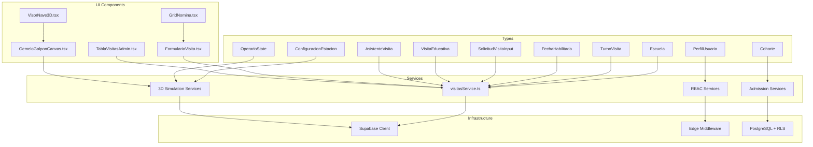
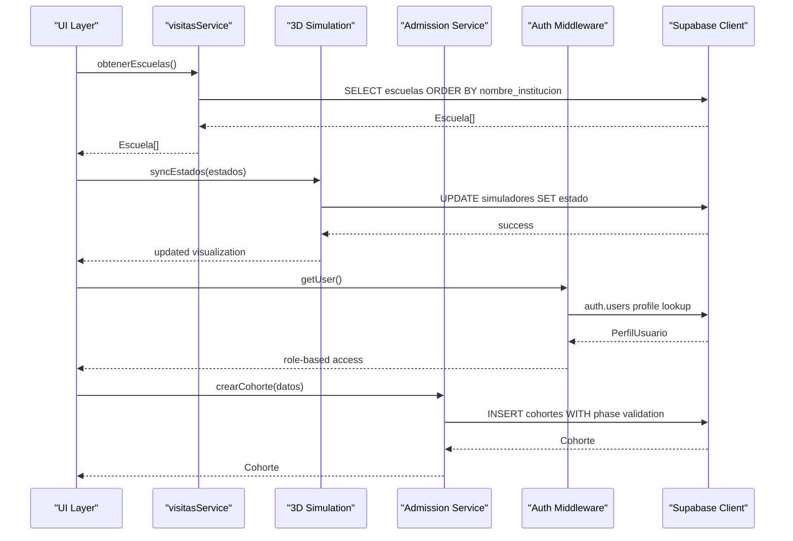
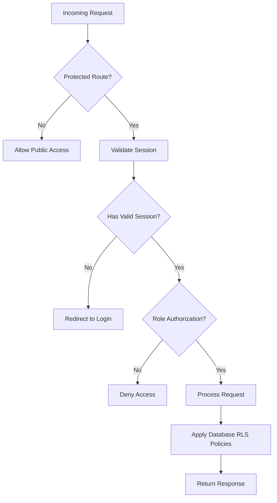
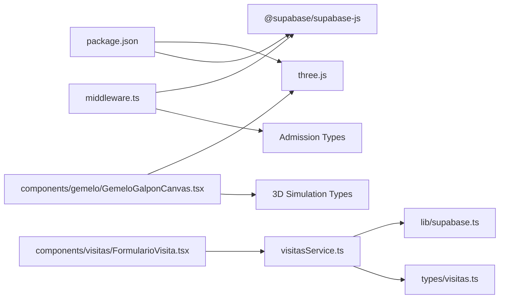

# Core Services & Business Logic

<cite>
**Referenced Files in This Document**
- [visitasService.ts](file://src/services/visitasService.ts)
- [client.ts](file://src/lib/supabase/client.ts)
- [middleware.ts](file://src/middleware.ts)
- [0004_modulo_admision_cohortes_evaluacion.sql](file://supabase/migrations/0004_modulo_admision_cohortes_evaluacion.sql)
- [20261008_modulo_admision_v1.sql](file://supabase/migrations/20261008_modulo_admision_v1.sql)
- [gemelo.ts](file://src/types/gemelo.ts)
- [actividades.ts](file://src/types/actividades.ts)
- [tup.ts](file://src/types/tup.ts)
- [GemeloGalponCanvas.tsx](file://src/components/gemelo/GemeloGalponCanvas.tsx)
- [VisorNave3D.tsx](file://src/components/gemelo/VisorNave3D.tsx)
</cite>

## Update Summary
**Changes Made**
- Expanded service layer documentation to reflect new 3D simulation services and SCADA integration
- Added comprehensive coverage of admission/cohort management database schema with RBAC roles
- Enhanced authentication system documentation covering multiple user roles (superadmin, administracion, instructor, mesa_instructores)
- Updated architecture diagrams to include 3D simulation components and admission module
- Added new sections for 3D simulation services, cohort management, and role-based access control
- Expanded error handling strategies to cover authentication failures and database constraints

## Table of Contents
1. [Introduction](#introduction)
2. [Project Structure](#project-structure)
3. [Core Components](#core-components)
4. [Architecture Overview](#architecture-overview)
5. [Detailed Component Analysis](#detailed-component-analysis)
6. [Enhanced Date Availability System](#enhanced-date-availability-system)
7. [Capacity Management Features](#capacity-management-features)
8. [WhatsApp Contact Integration](#whatsapp-contact-integration)
9. [3D Simulation Services](#3d-simulation-services)
10. [Admission and Cohort Management](#admission-and-cohort-management)
11. [Authentication and Role-Based Access Control](#authentication-and-role-based-access-control)
12. [Excel Data Import and Normalization](#excel-data-import-and-normalization)
13. [Dependency Analysis](#dependency-analysis)
14. [Performance Considerations](#performance-considerations)
15. [Troubleshooting Guide](#troubleshooting-guide)
16. [Conclusion](#conclusion)

## Introduction
This document explains the enhanced business logic layer for the educational visit management system, centered on the visitas service. The system now includes sophisticated date availability checking capabilities, improved form validation, Excel integration with date normalization, comprehensive WhatsApp contact functionality, advanced 3D simulation services, admission/cohort management, and a robust authentication system supporting multiple user roles. It covers how to fetch schools, check time slot availability against authorized dates, validate student capacity limits, create new visit requests while enforcing key business rules such as preventing double bookings and validating schedules. The service is designed to separate business logic from UI components by encapsulating data access and validation in a dedicated module that communicates with Supabase.

The expanded system now integrates 3D simulation visualization through Three.js, manages admission processes with cohort tracking, and implements role-based access control for different user types including superadmins, administrators, instructors, and instructor desk staff.

## Project Structure
The project follows a clean separation between types, services, and infrastructure with enhanced capabilities:
- Types define the domain models used across the application, including new 3D simulation structures, admission cohorts, and RBAC roles.
- The service module implements business operations with enhanced date checking, capacity management, validation, and 3D simulation state management.
- The Supabase client is configured once and reused throughout the service.
- UI components integrate seamlessly with the enhanced service layer and include advanced features like 3D visualization, Excel import, and WhatsApp integration.



**Diagram sources**
- [visitasService.ts:1-105](file://src/services/visitasService.ts#L1-L105)
- [client.ts:1-34](file://src/lib/supabase/client.ts#L1-L34)
- [middleware.ts:28-99](file://src/middleware.ts#L28-L99)
- [gemelo.ts:1-92](file://src/types/gemelo.ts#L1-L92)
- [0004_modulo_admision_cohortes_evaluacion.sql:17-25](file://supabase/migrations/0004_modulo_admision_cohortes_evaluacion.sql#L17-L25)

**Section sources**
- [visitasService.ts:1-105](file://src/services/visitasService.ts#L1-L105)
- [client.ts:1-34](file://src/lib/supabase/client.ts#L1-L34)
- [middleware.ts:28-99](file://src/middleware.ts#L28-L99)

## Core Components
- Escuela: Represents a school entity with identification and contact details.
- TurnoVisita: A type alias for allowed visit shifts (morning or afternoon).
- FechaHabilitada: New type representing authorized dates for visits with optional observations.
- SolicitudVisitaInput: Enhanced input shape for creating new visit requests with additional fields.
- VisitaEducativa: Full visit record including status fields and scheduling information.
- AsistenteVisita: Represents attendees associated with educational visits.
- ConfiguracionEstacion: Defines 3D simulation station configurations with position, rotation, and display settings.
- OperarioState: Tracks animated operator states in the 3D simulation environment.
- Cohorte: Manages admission cohorts with diagnostic phases and training schedules.
- PerfilUsuario: Handles user profiles with RBAC roles (superadmin, administracion, instructor, mesa_instructores).

These types ensure consistent contracts between UI and service layers and enable compile-time safety with enhanced validation capabilities.

**Section sources**
- [visitasService.ts:1-105](file://src/services/visitasService.ts#L1-L105)
- [gemelo.ts:1-92](file://src/types/gemelo.ts#L1-L92)
- [0004_modulo_admision_cohortes_evaluacion.sql:17-25](file://supabase/migrations/0004_modulo_admision_cohortes_evaluacion.sql#L17-L25)

## Architecture Overview
The enhanced service layer provides pure functions that encapsulate business rules and database interactions with improved date and capacity management, 3D simulation state synchronization, and role-based access control:
- obtenerEscuelas: Fetches all schools sorted by institution name.
- obtenerFechasHabilitadas: Retrieves authorized dates for visits with filtering and sorting.
- verificarTurnoDisponible: Checks if a specific date and shift are available, excluding canceled visits.
- crearSolicitudVisita: Creates a new visit after verifying availability, capacity limits, and setting default statuses.
- obtenerVisitasAdmin: Retrieves all visits for administrative panel with latest first.
- actualizarCheckOperativo: Updates operational checklist items for individual visits.
- obtenerAsistentesPorVisita: Retrieves attendee lists for specific visits.
- 3D Simulation State Management: Synchronizes simulator states with the visual 3D environment.
- Admission Cohort Management: Handles cohort creation, diagnosis scheduling, and training progression.
- RBAC Authentication: Manages user roles and permissions through middleware and database policies.

The architecture separates concerns with enhanced validation:
- UI components call service functions without needing to know database specifics.
- The service handles validation, capacity checks, error propagation, and data transformation.
- The Supabase client is centralized to avoid duplication and configuration drift.
- Edge middleware provides session management and route protection.



**Diagram sources**
- [visitasService.ts:12-105](file://src/services/visitasService.ts#L12-L105)
- [client.ts:26-33](file://src/lib/supabase/client.ts#L26-L33)
- [middleware.ts:62-80](file://src/middleware.ts#L62-L80)
- [0004_modulo_admision_cohortes_evaluacion.sql:140-158](file://supabase/migrations/0004_modulo_admision_cohortes_evaluacion.sql#L140-L158)

## Detailed Component Analysis

### Service Functions

#### obtenerEscuelas
- Purpose: Retrieve all schools ordered alphabetically by institution name.
- Behavior: Queries the escuelas table and returns an array of Escuela objects. Errors from the database are thrown to the caller.
- Complexity: O(n) where n is the number of schools returned; sorting is handled by the database.
- Usage example: Call this function to populate a dropdown of schools when creating a visit request.

**Section sources**
- [visitasService.ts:11-21](file://src/services/visitasService.ts#L11-L21)

#### obtenerFechasHabilitadas
- Purpose: Retrieve all authorized dates for educational visits that are currently enabled.
- Behavior: Queries the fechas_habilitadas table, filters only enabled dates, and returns them sorted chronologically.
- Business rule: Ensures visitors can only select from pre-approved dates managed by administrators.
- Complexity: O(n) where n is the number of authorized dates; filtering and sorting handled by database.
- Usage example: Populate date selection dropdown with only valid, authorized dates for visit scheduling.

**Section sources**
- [visitasService.ts:23-34](file://src/services/visitasService.ts#L23-L34)

#### verificarTurnoDisponible
- Purpose: Determine whether a given date and shift are free for scheduling.
- Behavior: Counts existing non-canceled visits for the specified date and shift. Returns true if none exist.
- Business rule: Prevents double bookings by ensuring at most one active visit per date-shift pair.
- Complexity: O(1) query with indexed filters on date and shift; result depends on index usage by the database.
- Usage example: Validate user selection before allowing submission of a new visit form.

**Section sources**
- [visitasService.ts:36-51](file://src/services/visitasService.ts#L36-L51)

#### crearSolicitudVisita
- Purpose: Create a new educational visit request with enhanced validation for capacity and availability.
- Behavior:
  - Validates legal agreements acceptance (images and judicial measures).
  - Validates student capacity against maximum limit (40 students).
  - Validates that attendee list is not empty.
  - Checks availability using verificarTurnoDisponible.
  - If unavailable or over capacity, throws appropriate errors.
  - Inserts a new visit record with default statuses and generated reservation codes.
  - Handles attendee registration separately for better data organization.
  - Returns the created visit record.
- Business rules:
  - Enforces single booking per date-shift.
  - Enforces maximum student capacity of 40 per visit.
  - Sets initial statuses to guide downstream workflows.
  - Generates unique reservation codes for tracking.
- Complexity: Multiple validation checks plus insert operations; overall dominated by database operations.
- Usage example: Submit a completed visit form after confirming availability and capacity compliance.

**Section sources**
- [visitasService.ts:53-105](file://src/services/visitasService.ts#L53-L105)

### Administrative Functions

#### obtenerVisitasAdmin
- Purpose: Retrieve all visits for the administrative panel, ordered by most recent first.
- Behavior: Queries the visitas_educativas table and returns all records sorted by fecha_visita in descending order.
- Usage example: Display comprehensive visit information in the admin dashboard.

**Section sources**
- [visitasService.ts:60-70](file://src/services/visitasService.ts#L60-L70)

#### actualizarCheckOperativo
- Purpose: Update operational checklist items (insurance, transportation, invoices, Drive upload) for individual visits.
- Behavior: Updates a specific boolean field in the visitas_educativas table based on the provided field name and value.
- Usage example: Allow administrators to mark operational tasks as complete for each visit.

**Section sources**
- [visitasService.ts:76-88](file://src/services/visitasService.ts#L76-L88)

#### obtenerAsistentesPorVisita
- Purpose: Retrieve the complete attendee list for a specific visit.
- Behavior: Queries the visita_asistentes table for all attendees associated with a given visit ID, sorted by name.
- Usage example: Display attendee information in admin panels or export reports.

**Section sources**
- [visitasService.ts:91-105](file://src/services/visitasService.ts#L91-L105)

## Enhanced Date Availability System

The system includes a comprehensive date availability management feature that allows administrators to control which dates are open for educational visits.

### Key Features
- **Authorized Dates Management**: Only pre-approved dates appear in the visitor interface
- **Flexible Observations**: Administrators can add notes or restrictions for specific dates
- **Chronological Sorting**: Dates are automatically sorted for easy navigation
- **Real-time Filtering**: Only enabled dates are shown to users

### Implementation Details
The `obtenerFechasHabilitadas` function queries the `fechas_habilitadas` table with automatic filtering for enabled dates and chronological ordering. This ensures that visitors can only select from dates that have been explicitly approved by administrators.

**Section sources**
- [visitasService.ts:23-34](file://src/services/visitasService.ts#L23-L34)

## Capacity Management Features

The system includes robust capacity management to prevent overcrowding and ensure quality educational experiences.

### Capacity Limits
- **Maximum Students**: 40 students per visit session
- **Real-time Validation**: Immediate feedback when capacity limits are exceeded
- **Clear Error Messages**: User-friendly guidance when limits are breached
- **Administrative Control**: Centralized capacity management through constants

### Validation Flow
1. **Client-side Validation**: Immediate feedback in the form interface
2. **Server-side Validation**: Backend verification prevents overflow scenarios
3. **Error Propagation**: Consistent error handling across the application
4. **User Guidance**: Clear instructions for alternative solutions

**Section sources**
- [visitasService.ts:53-54](file://src/services/visitasService.ts#L53-L54)

## WhatsApp Contact Integration

The system now includes comprehensive WhatsApp contact functionality for seamless communication between administrators and visiting institutions.

### Phone Number Normalization
- **Format Support**: Handles various Argentine phone number formats including international prefixes, local numbers, and mobile prefixes
- **Automatic Conversion**: Converts phone numbers to WhatsApp-compatible format (549 + number without leading zeros)
- **Validation**: Ensures phone numbers meet minimum length requirements before processing

### Contact Management
- **Direct Messaging**: Provides clickable WhatsApp links for direct communication with teachers
- **Contact Display**: Shows normalized phone numbers in admin interfaces
- **Error Handling**: Gracefully handles missing or invalid phone numbers

**Section sources**
- [tup.ts:17-41](file://src/types/tup.ts#L17-L41)

## 3D Simulation Services

The system now includes advanced 3D simulation services that provide real-time visualization of the industrial training facility through Three.js WebGL rendering.

### Core Features
- **Procedural 3D Environment**: Complete digital twin of the 28m × 22m × 7.5m industrial facility
- **Seven Industrial Simulators**: Autoelevador, Pala Frontal, Retroexcavadora, Grúa Telescópica, Tractor, Camión, and SimSpray VR
- **Animated Operators**: Realistic worker animations with state machines (waiting, walking, sitting, operating, standing, returning)
- **SCADA Integration**: Live telemetry display showing simulator status, power consumption, and operational metrics
- **Interactive Navigation**: Orbit controls, camera tracking, and station selection with detailed technical specifications

### Technical Implementation
The 3D simulation services are built around two main components:

#### GemeloGalponCanvas.tsx
- Pure Three.js implementation with procedural geometry generation
- Advanced lighting system with shadow mapping and fog effects
- Interactive raycasting for station selection and inspection
- Animated operator system with kinematic state machines
- Real-time material updates for screen displays and LED indicators

#### VisorNave3D.tsx
- React wrapper component providing UI overlay and state management
- Dynamic loading with SSR disabled for WebGL compatibility
- HUD (Heads-Up Display) showing real-time facility metrics
- Responsive design with adaptive camera positioning

### Simulator Configuration
Each of the seven simulators has specific configurations including:
- Position and rotation within the facility
- Screen setup (single, dual, or triple monitor arrangements)
- Control systems (industrial steering wheels, dual joysticks, truck controls)
- Pedagogical modules and technical specifications

```mermaid
classDiagram
class ConfiguracionEstacion {
+string id
+string nombre
+TipoSimulador tipo
+number[] pos
+number rotY
+number color
+string detalles
}
class OperarioState {
+string id
+string estacionId
+Group mesh
+[number,number,number] targetPos
+[number,number,number] startPos
+OperarioFase fase
+number progreso
}
class EstadoSimulador {
<<enum>>
"detenido"
"operando"
}
class TipoSimulador {
<<enum>>
"autoelevador"
"pala-frontal"
"retroexcavadora"
"grua-telescopica"
"tractor"
"camion"
"simspray"
}
ConfiguracionEstacion --> TipoSimulador
OperarioState --> EstadoSimulador
```

**Diagram sources**
- [gemelo.ts:3-23](file://src/types/gemelo.ts#L3-L23)
- [gemelo.ts:25-46](file://src/types/gemelo.ts#L25-L46)

**Section sources**
- [GemeloGalponCanvas.tsx:1-800](file://src/components/gemelo/GemeloGalponCanvas.tsx#L1-L800)
- [VisorNave3D.tsx:1-37](file://src/components/gemelo/VisorNave3D.tsx#L1-L37)
- [gemelo.ts:1-92](file://src/types/gemelo.ts#L1-L92)

## Admission and Cohort Management

The system now includes comprehensive admission and cohort management capabilities for structured training programs with diagnostic phases and simulator sessions.

### Database Schema
The admission module introduces several interconnected tables:

#### User Profiles and RBAC
- **perfiles_usuarios**: Links to auth.users with role assignments
- **Roles**: superadmin, administracion, instructor, mesa_instructores
- **Auto-provisioning**: Trigger function creates profiles on user registration

#### Cohort Management
- **cohortes**: Main cohort entities with diagnostic phases and timeline management
- **turnos_diagnostico**: Diagnostic session scheduling with capacity limits
- **postulantes_diagnostico**: Candidate tracking and assessment results
- **evaluaciones_diagnostico**: Evaluation scores and competency assessments

#### Training Program Structure
- **ternas_capacitacion**: Training teams with fixed schedules
- **terna_miembros**: Team member associations
- **sesiones_simulador**: Individual simulator sessions with attendance tracking
- **practica_real**: Real-world practice sessions and evaluations

### Phase Management
The system supports a structured progression through training phases:
1. **diagnostico**: Initial assessment and capability evaluation
2. **buffer_revision**: Review and planning period
3. **teoria**: Theoretical knowledge acquisition
4. **simulador**: Simulator-based practical training
5. **practica_real**: Real-world application and assessment
6. **finalizada**: Program completion and certification

### Business Rules
- Automatic cohort creation with unique codes
- Diagnostic session capacity enforcement (default 3 participants)
- Time range validation for scheduled sessions
- Phase progression dependencies and prerequisites
- Attendance tracking and completion metrics

**Section sources**
- [0004_modulo_admision_cohortes_evaluacion.sql:17-25](file://supabase/migrations/0004_modulo_admision_cohortes_evaluacion.sql#L17-L25)
- [0004_modulo_admision_cohortes_evaluacion.sql:140-158](file://supabase/migrations/0004_modulo_admision_cohortes_evaluacion.sql#L140-L158)
- [0004_modulo_admision_cohortes_evaluacion.sql:297-322](file://supabase/migrations/0004_modulo_admision_cohortes_evaluacion.sql#L297-L322)

## Authentication and Role-Based Access Control

The system implements a comprehensive authentication and authorization system supporting multiple user roles with granular permissions.

### Multi-Role Architecture
The RBAC system supports four distinct user roles:

#### Superadmin
- Full system access and configuration management
- User administration and role assignment
- Database maintenance and migration oversight
- System-wide policy configuration

#### Administracion
- Operational management and cohort administration
- Visit scheduling and resource allocation
- Report generation and analytics access
- Staff coordination and workflow management

#### Instructor
- Direct interaction with trainees and cohorts
- Session facilitation and evaluation
- Progress monitoring and assessment
- Simulator operation and maintenance

#### Mesa Instructores
- Front desk and reception duties
- Basic administrative support
- Schedule coordination and room booking
- Participant registration assistance

### Security Implementation
The authentication system leverages multiple security layers:

#### Edge Middleware Protection
- Next.js middleware enforces authentication for protected routes
- Session validation on every request
- Automatic redirects for unauthorized access
- Cookie-based session management with HTTP-only cookies

#### Database Row Level Security (RLS)
- Granular permissions at the database level
- Policy-based access control for each table
- Automatic enforcement of role-based restrictions
- Audit trail for all data modifications

#### User Profile Management
- Automatic profile creation on user registration
- Role assignment validation and sanitization
- Active/inactive status management
- Comprehensive user metadata tracking

### Middleware Configuration
The edge middleware provides sophisticated route protection:
- Protected routes: `/admin/*`, `/login`, `/visitas`
- Public routes: Landing page and informational content
- Asset exclusion: Static files, models, and media bypass authentication
- Session refresh: Automatic token renewal without user intervention



**Diagram sources**
- [middleware.ts:62-80](file://src/middleware.ts#L62-L80)
- [0004_modulo_admision_cohortes_evaluacion.sql:385-403](file://supabase/migrations/0004_modulo_admision_cohortes_evaluacion.sql#L385-L403)

**Section sources**
- [middleware.ts:28-99](file://src/middleware.ts#L28-L99)
- [0004_modulo_admision_cohortes_evaluacion.sql:17-25](file://supabase/migrations/0004_modulo_admision_cohortes_evaluacion.sql#L17-L25)
- [0004_modulo_admision_cohortes_evaluacion.sql:385-403](file://supabase/migrations/0004_modulo_admision_cohortes_evaluacion.sql#L385-L403)

## Excel Data Import and Normalization

The system includes advanced Excel data import capabilities with intelligent date normalization for seamless attendance list management.

### Excel Import Features
- **Tab-Delimited Parsing**: Automatically parses tab-separated values from Excel clipboard
- **Column Mapping**: Maps Excel columns to system fields (Name, DNI, Birth Date, Role)
- **Batch Processing**: Adds multiple attendees simultaneously from copied Excel data
- **Validation**: Filters out incomplete entries and validates required fields

### Date Normalization System
- **Multiple Format Support**: Handles DD/MM/YYYY, DD-MM-YYYY, and ISO format (YYYY-MM-DD)
- **Intelligent Parsing**: Detects date format automatically and converts to standard ISO format
- **Year Handling**: Supports both 2-digit and 4-digit years, automatically prepending century for 2-digit years
- **Validation**: Ensures parsed dates are valid before insertion

### Role Detection
- **Automatic Classification**: Intelligently detects whether attendees are students or teachers based on names
- **Pattern Matching**: Recognizes common teacher name patterns (teacher, professor, master)
- **Manual Override**: Allows manual role assignment when automatic detection is incorrect

**Section sources**
- [actividades.ts:41-73](file://src/types/actividades.ts#L41-L73)

## Dependency Analysis
- External dependencies: @supabase/supabase-js for database operations, three.js for 3D rendering
- Internal dependencies:
  - visitasService.ts depends on types from visitas.ts and the supabase client.
  - 3D simulation components depend on Three.js and gemelo types.
  - Admission services depend on RBAC types and cohort management schemas.
  - No circular dependencies detected.



**Diagram sources**
- [visitasService.ts:1-10](file://src/services/visitasService.ts#L1-L10)
- [client.ts:1-34](file://src/lib/supabase/client.ts#L1-L34)
- [gemelo.ts:1-92](file://src/types/gemelo.ts#L1-L92)
- [middleware.ts:28-99](file://src/middleware.ts#L28-L99)

**Section sources**
- [visitasService.ts:1-105](file://src/services/visitasService.ts#L1-L105)
- [client.ts:1-34](file://src/lib/supabase/client.ts#L1-L34)
- [gemelo.ts:1-92](file://src/types/gemelo.ts#L1-L92)

## Performance Considerations
- Query efficiency: Ensure indexes on frequently filtered columns like fecha_visita, turno, and habilitada to optimize availability checks.
- Sorting: Schools and dates are sorted server-side; keep result sets small by selecting only needed fields.
- Concurrency: For high concurrency, add database-level unique constraints on (fecha_visita, turno) to enforce uniqueness even under race conditions.
- Date availability queries benefit from proper indexing on the habilitada column for faster filtering.
- Capacity validation: Client-side validation reduces unnecessary server requests when capacity limits are exceeded.
- 3D rendering optimization: Use instanced meshes for repeated geometry and efficient material sharing.
- WebAssembly integration: Consider WASM for heavy computational tasks in 3D simulations.
- Database connection pooling: Implement connection pooling for high-throughput admission operations.
- Caching strategy: Cache frequently accessed data like school lists and authorized dates.
- Bundle optimization: Code-split 3D components and lazy-load heavy dependencies.

## Troubleshooting Guide
Common issues and strategies:
- **Slot already booked**: When creating a visit, if the selected date-shift is taken, the service throws an error. Handle this in the UI by informing the user to choose another slot.
- **Capacity exceeded**: When student count exceeds 40, both client and server validation prevent submission. Provide clear guidance to reduce numbers or split into multiple sessions.
- **No authorized dates**: When no dates are available, inform users that administrators need to enable dates first.
- **Excel import errors**: If Excel data doesn't parse correctly, guide users to verify column format and try manual entry.
- **WhatsApp contact issues**: Phone number normalization may fail for invalid formats; provide fallback contact methods.
- **Network or permission errors**: Supabase errors are thrown directly; catch and display meaningful messages to users.
- **Missing environment variables**: Ensure NEXT_PUBLIC_SUPABASE_URL and NEXT_PUBLIC_SUPABASE_ANON_KEY are set; otherwise, the client initialization will fail.
- **3D rendering failures**: Check WebGL support and browser compatibility; provide fallback messaging for unsupported environments.
- **Authentication failures**: Verify middleware configuration and cookie settings; ensure proper session management.
- **Role-based access denied**: Confirm user roles and database RLS policies; check permission inheritance.
- **Database constraint violations**: Validate input data against schema constraints; provide specific error messages.

Operational tips:
- Log errors at the boundary where they are caught to aid debugging.
- Add retry logic for transient network failures if appropriate.
- Validate inputs on both client and server sides to reduce invalid requests.
- Monitor capacity utilization to identify trends and plan for additional sessions.
- Test Excel import with various date formats to ensure compatibility.
- Verify WhatsApp number formatting across different regional formats.
- Monitor 3D performance metrics and optimize rendering pipeline.
- Implement health checks for critical services and database connectivity.
- Set up monitoring alerts for authentication failures and permission denials.

**Section sources**
- [visitasService.ts:36-105](file://src/services/visitasService.ts#L36-L105)
- [client.ts:7-18](file://src/lib/supabase/client.ts#L7-L18)
- [middleware.ts:62-80](file://src/middleware.ts#L62-L80)

## Conclusion
The enhanced visitas service provides a robust foundation for managing educational visits with sophisticated date availability checking, capacity management, Excel integration, WhatsApp contact capabilities, advanced 3D simulation services, admission/cohort management, and comprehensive authentication with role-based access control. The system successfully enforces critical business rules such as preventing double bookings, maintaining student capacity limits, ensuring visits occur only on authorized dates, managing complex training programs, and securing sensitive data through multiple authentication layers.

By centralizing database access, validation logic, error handling, 3D state management, and role-based permissions, it enables UI components to remain focused on presentation while relying on a comprehensive, testable service layer. The modular architecture makes it straightforward to extend the system with additional validations, notifications, administrative features, or simulation capabilities without impacting the user interface.

The expanded features include:
- **Date Authorization System**: Administrators can control which dates are available for visits
- **Capacity Management**: Robust validation prevents overcrowding with clear user feedback
- **Excel Integration**: Advanced data import with intelligent date normalization and batch processing
- **WhatsApp Communication**: Seamless contact management with phone number normalization
- **3D Simulation Services**: Immersive virtual training environment with real-time operator animation
- **Admission Management**: Structured training programs with cohort tracking and progress monitoring
- **Role-Based Access Control**: Granular permissions for different user types with secure authentication
- **Improved Error Handling**: Comprehensive error messages guide users toward successful completion
- **Better User Experience**: Real-time validation and clear messaging improve form completion rates

These enhancements make the system more reliable, user-friendly, and maintainable while preserving the clean separation between business logic and presentation layers. The addition of 3D simulation capabilities, admission management, and comprehensive authentication significantly improves the workflow for both administrators and trainees, making the educational visit and training management process more efficient, immersive, and accessible.