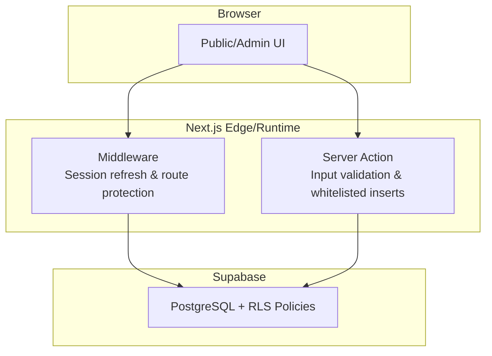
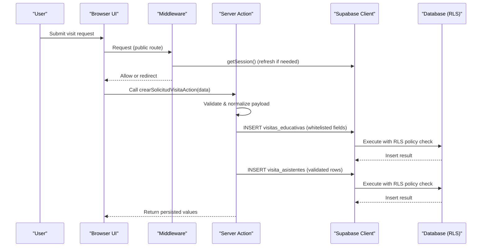
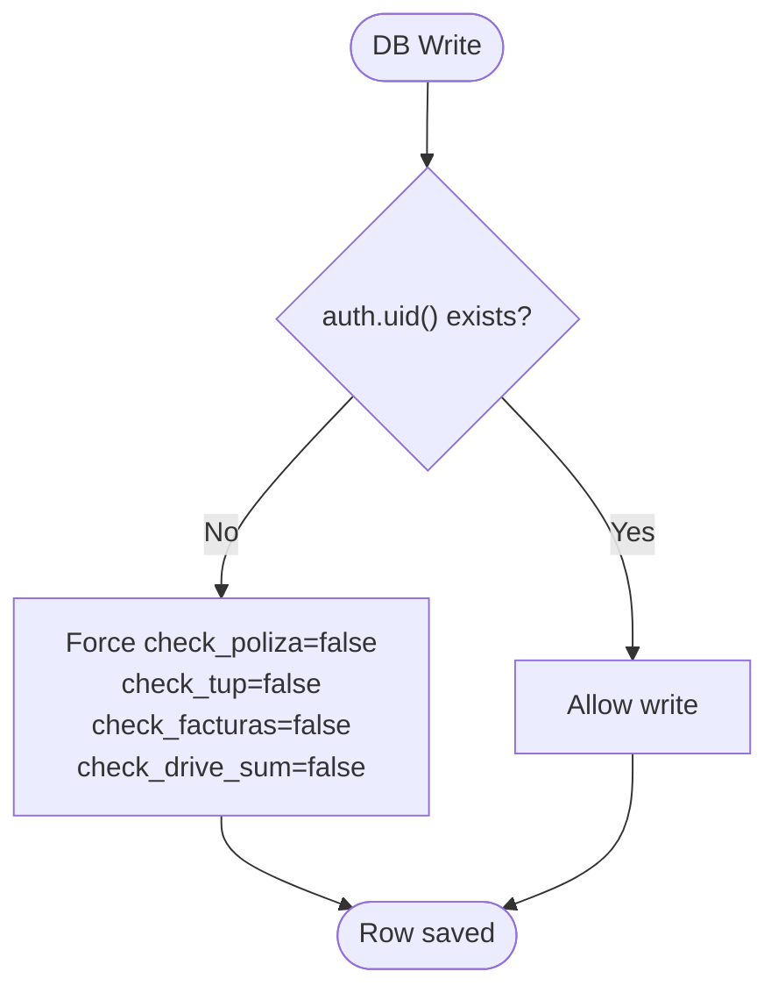
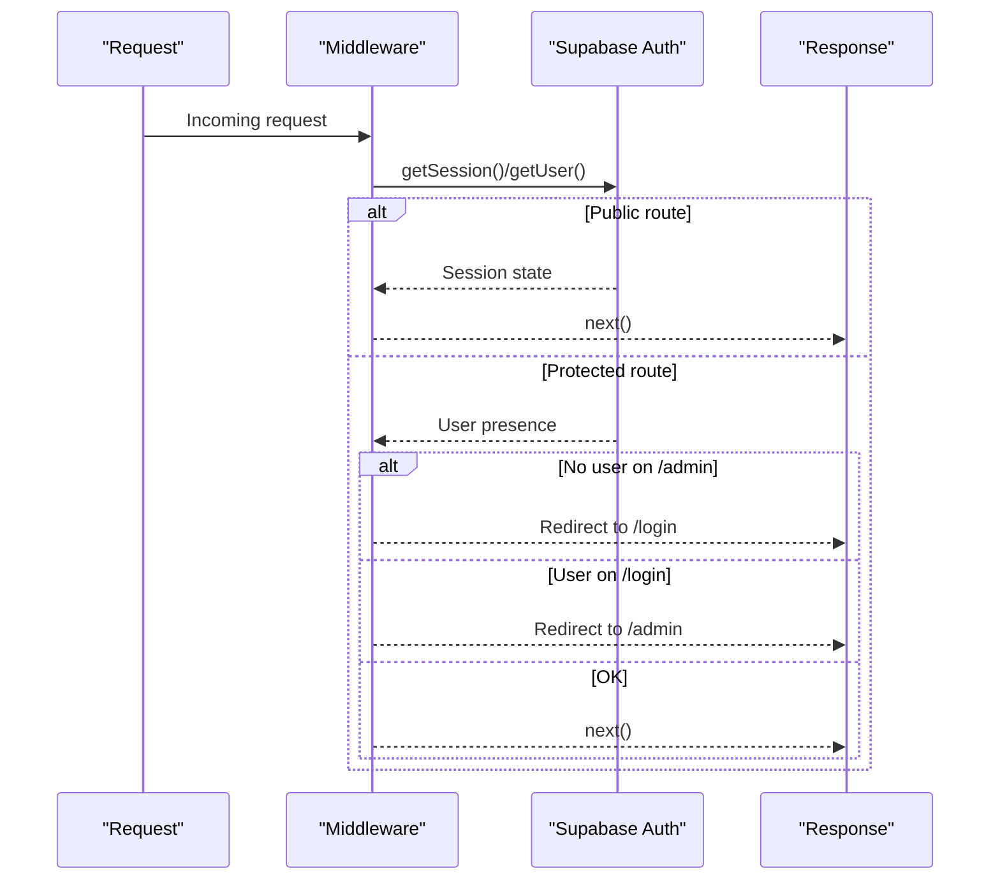
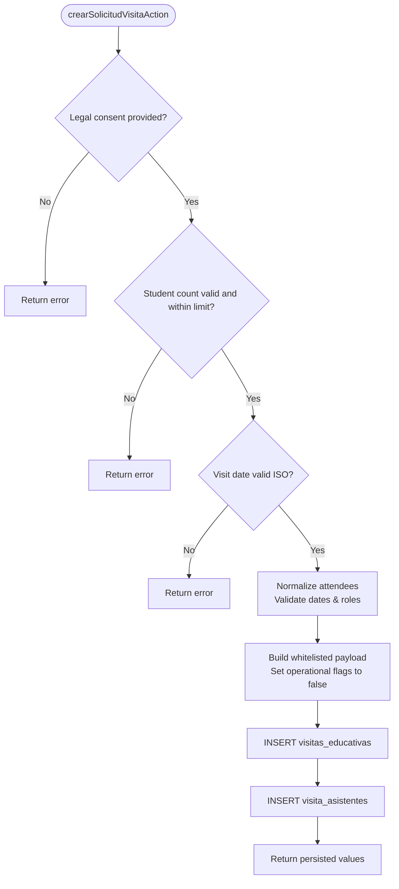
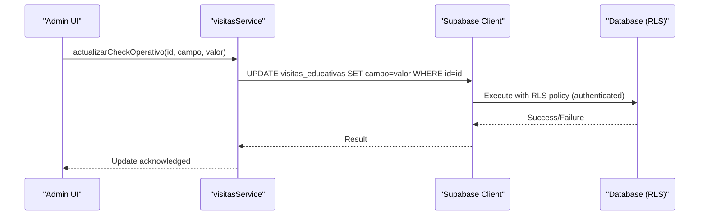
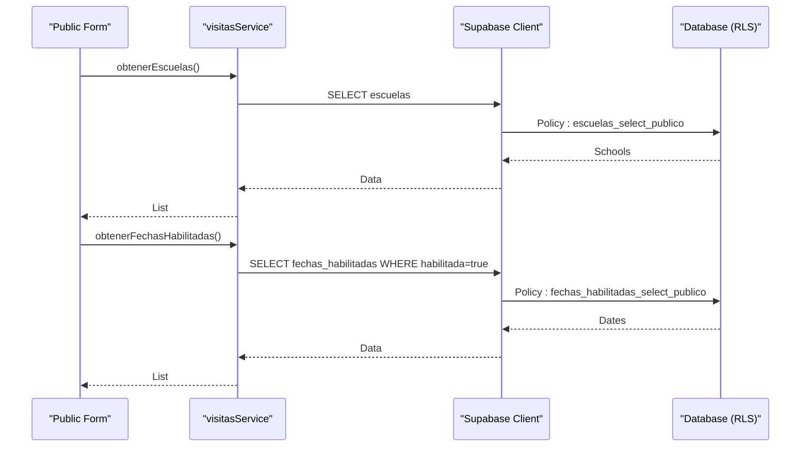
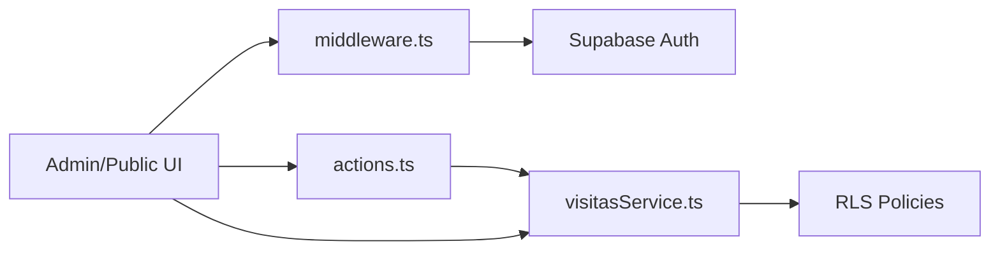

# Database Security & RLS Policies

<cite>
**Referenced Files in This Document**
- [0001_rls_visitas_educativas.sql](file://supabase/migrations/0001_rls_visitas_educativas.sql)
- [client.ts](file://src/lib/supabase/client.ts)
- [server.ts](file://src/lib/supabase/server.ts)
- [middleware.ts](file://src/middleware.ts)
- [actions.ts](file://src/app/visitas/actions.ts)
- [visitasService.ts](file://src/services/visitasService.ts)
- [visitas.ts](file://src/types/visitas.ts)
- [TablaVisitasAdmin.tsx](file://src/components/admin/visitas/TablaVisitasAdmin.tsx)
- [admin/layout.tsx](file://src/app/admin/layout.tsx)
- [login/page.tsx](file://src/app/login/page.tsx)
</cite>

## Table of Contents
1. [Introduction](#introduction)
2. [Project Structure](#project-structure)
3. [Core Components](#core-components)
4. [Architecture Overview](#architecture-overview)
5. [Detailed Component Analysis](#detailed-component-analysis)
6. [Dependency Analysis](#dependency-analysis)
7. [Performance Considerations](#performance-considerations)
8. [Troubleshooting Guide](#troubleshooting-guide)
9. [Conclusion](#conclusion)

## Introduction
This document explains how database security and Row Level Security (RLS) policies are implemented for the Educational Visits module. It covers:
- How Supabase RLS is enabled and configured per table and role
- How public and authenticated flows interact with the database safely
- How server-side validation and whitelisting prevent unauthorized writes
- How middleware protects routes and maintains sessions
- How admin operations update sensitive operational flags securely

The goal is to provide a clear, layered understanding of data access controls from the browser to the database, including defense-in-depth mechanisms that protect sensitive fields and enforce business rules.

## Project Structure
The security-relevant parts of the project are organized as follows:
- Database schema and RLS policies are defined in a migration file
- Client and server Supabase clients are created in dedicated modules
- Middleware enforces session checks and redirects for protected routes
- Server Actions validate and sanitize inputs before writing to the database
- Services encapsulate read/write operations against specific tables
- Admin UI components perform updates only through controlled service methods

**Diagram sources**
- [middleware.ts:14-85](file://src/middleware.ts#L14-L85)
- [actions.ts:170-321](file://src/app/visitas/actions.ts#L170-L321)
- [0001_rls_visitas_educativas.sql:7-101](file://supabase/migrations/0001_rls_visitas_educativas.sql#L7-L101)

**Section sources**
- [0001_rls_visitas_educativas.sql:7-101](file://supabase/migrations/0001_rls_visitas_educativas.sql#L7-L101)
- [middleware.ts:14-85](file://src/middleware.ts#L14-L85)
- [actions.ts:170-321](file://src/app/visitas/actions.ts#L170-L321)

## Core Components
- RLS policies enable fine-grained access control per table and role (anonymous vs authenticated).
- Public catalog tables allow read-only access for anonymous users; sensitive tables require authentication.
- Server Actions build whitelisted payloads and set operational flags to safe defaults.
- A database trigger enforces operational flag safety even if requests bypass application logic.
- Middleware ensures protected routes require authentication and keeps sessions fresh.

Key responsibilities:
- Migration: define RLS policies and triggers
- Client/Server: create Supabase clients with proper cookie/session handling
- Middleware: protect /admin and /login, refresh sessions on public routes
- Server Action: validate input, normalize data, insert visits and attendees safely
- Service layer: encapsulate reads and controlled updates for admin workflows

**Section sources**
- [0001_rls_visitas_educativas.sql:7-101](file://supabase/migrations/0001_rls_visitas_educativas.sql#L7-L101)
- [client.ts:1-34](file://src/lib/supabase/client.ts#L1-L34)
- [server.ts:1-41](file://src/lib/supabase/server.ts#L1-L41)
- [middleware.ts:14-85](file://src/middleware.ts#L14-L85)
- [actions.ts:170-321](file://src/app/visitas/actions.ts#L170-L321)
- [visitasService.ts:11-104](file://src/services/visitasService.ts#L11-L104)

## Architecture Overview
The system uses multiple layers to secure data:
- Application-level validation and whitelisting in Server Actions
- Role-based access via Supabase RLS policies
- Database-level enforcement via triggers for critical fields
- Route-level protection via Next.js middleware

**Diagram sources**
- [middleware.ts:14-85](file://src/middleware.ts#L14-L85)
- [actions.ts:170-321](file://src/app/visitas/actions.ts#L170-L321)
- [0001_rls_visitas_educativas.sql:7-101](file://supabase/migrations/0001_rls_visitas_educativas.sql#L7-L101)

## Detailed Component Analysis

### Database RLS Policies and Trigger
- RLS is enabled on key tables: visitas_educativas, visita_asistentes, escuelas, fechas_habilitadas.
- Public read policies:
  - escuelas: select allowed for anon and authenticated
  - fechas_habilitadas: select allowed for anon and authenticated when habilitada = true
- Sensitive tables:
  - visita_asistentes: select allowed for authenticated only; insert allowed for anon and authenticated (used by public form submission)
  - visitas_educativas: insert allowed for anon and authenticated; select/update/delete restricted to authenticated
- Defense-in-depth trigger:
  - Ensures operational check fields are forced to false when no user is authenticated, preventing misuse of the anon key

**Diagram sources**
- [0001_rls_visitas_educativas.sql:79-101](file://supabase/migrations/0001_rls_visitas_educativas.sql#L79-L101)

**Section sources**
- [0001_rls_visitas_educativas.sql:7-101](file://supabase/migrations/0001_rls_visitas_educativas.sql#L7-L101)

### Session Management and Route Protection
- Middleware refreshes sessions on public routes without network round-trips where possible
- Protected routes (/admin, /login) enforce authentication:
  - Unauthenticated users accessing /admin are redirected to /login
  - Authenticated users at /login are redirected to /admin
- Environment variables are validated gracefully at the edge to avoid site-wide failures

**Diagram sources**
- [middleware.ts:14-85](file://src/middleware.ts#L14-L85)

**Section sources**
- [middleware.ts:14-85](file://src/middleware.ts#L14-L85)
- [login/page.tsx:1-31](file://src/app/login/page.tsx#L1-L31)
- [admin/layout.tsx:1-26](file://src/app/admin/layout.tsx#L1-L26)

### Server Action: Safe Visit Submission
- Validates business rules (legal consent, student count limits, valid date)
- Normalizes attendee list and enforces allowed roles
- Builds a whitelisted payload for insertion, setting operational flags to safe defaults
- Inserts visit record and then attendees, returning only persisted values to the client

**Diagram sources**
- [actions.ts:170-321](file://src/app/visitas/actions.ts#L170-L321)

**Section sources**
- [actions.ts:170-321](file://src/app/visitas/actions.ts#L170-L321)
- [visitas.ts:21-50](file://src/types/visitas.ts#L21-L50)

### Admin Operations: Controlled Updates
- Admin UI reads all visits and schools, displays operational checkboxes
- Each checkbox toggles a single operational field via a service method
- The service performs an update limited to one field per call, reducing risk surface
- RLS ensures only authenticated users can update these records

**Diagram sources**
- [visitasService.ts:76-88](file://src/services/visitasService.ts#L76-L88)
- [0001_rls_visitas_educativas.sql:55-72](file://supabase/migrations/0001_rls_visitas_educativas.sql#L55-L72)

**Section sources**
- [visitasService.ts:76-88](file://src/services/visitasService.ts#L76-L88)
- [TablaVisitasAdmin.tsx:98-125](file://src/components/admin/visitas/TablaVisitasAdmin.tsx#L98-L125)
- [0001_rls_visitas_educativas.sql:55-72](file://supabase/migrations/0001_rls_visitas_educativas.sql#L55-L72)

### Public Read Access to Catalogs
- Public forms need catalogs (schools and available dates)
- RLS allows anonymous SELECT on escuelas and filtered SELECT on fechas_habilitadas (only habilitated dates)
- Service functions query these tables with appropriate filters

**Diagram sources**
- [visitasService.ts:11-34](file://src/services/visitasService.ts#L11-L34)
- [0001_rls_visitas_educativas.sql:11-27](file://supabase/migrations/0001_rls_visitas_educativas.sql#L11-L27)

**Section sources**
- [visitasService.ts:11-34](file://src/services/visitasService.ts#L11-L34)
- [0001_rls_visitas_educativas.sql:11-27](file://supabase/migrations/0001_rls_visitas_educativas.sql#L11-L27)

## Dependency Analysis
- Client/Server clients depend on environment variables and cookie handling to maintain sessions
- Middleware depends on Supabase auth to protect routes and refresh sessions
- Server Action depends on services constants and types to enforce domain rules
- Admin UI depends on service methods to perform controlled updates
- All database interactions are gated by RLS policies defined in the migration

**Diagram sources**
- [middleware.ts:14-85](file://src/middleware.ts#L14-L85)
- [actions.ts:170-321](file://src/app/visitas/actions.ts#L170-L321)
- [visitasService.ts:11-104](file://src/services/visitasService.ts#L11-L104)
- [0001_rls_visitas_educativas.sql:7-101](file://supabase/migrations/0001_rls_visitas_educativas.sql#L7-L101)

**Section sources**
- [client.ts:1-34](file://src/lib/supabase/client.ts#L1-L34)
- [server.ts:1-41](file://src/lib/supabase/server.ts#L1-L41)
- [middleware.ts:14-85](file://src/middleware.ts#L14-L85)
- [actions.ts:170-321](file://src/app/visitas/actions.ts#L170-L321)
- [visitasService.ts:11-104](file://src/services/visitasService.ts#L11-L104)
- [0001_rls_visitas_educativas.sql:7-101](file://supabase/migrations/0001_rls_visitas_educativas.sql#L7-L101)

## Performance Considerations
- Middleware minimizes network calls on public routes by using getSession() without forcing a full round-trip when possible
- Admin queries batch load visits and schools concurrently to reduce latency
- RLS policies are evaluated per row; ensure indexes exist on frequently filtered columns (e.g., fecha_visita, turno, estado_visita) to keep queries efficient
- Avoid unnecessary updates; the admin UI toggles one field at a time, which is already minimal

[No sources needed since this section provides general guidance]

## Troubleshooting Guide
Common issues and resolutions:
- Missing environment variables:
  - Client and server clients throw explicit errors if NEXT_PUBLIC_SUPABASE_URL or NEXT_PUBLIC_SUPABASE_ANON_KEY are missing
  - Middleware handles missing env gracefully at the edge to avoid site-wide failures
- Authentication redirects:
  - If /admin is accessed without a session, middleware redirects to /login
  - If /login is accessed with a session, middleware redirects to /admin
- Validation errors in Server Action:
  - Invalid dates, missing consent, or exceeding student capacity return user-friendly errors
  - Unique constraint violations on visit dates produce actionable messages
- RLS denials:
  - Anonymous users cannot read sensitive tables or update operational fields; ensure requests use authenticated sessions for admin operations
  - If unexpected denials occur, verify RLS policies and roles match expectations

**Section sources**
- [client.ts:7-18](file://src/lib/supabase/client.ts#L7-L18)
- [server.ts:11-19](file://src/lib/supabase/server.ts#L11-L19)
- [middleware.ts:20-32](file://src/middleware.ts#L20-L32)
- [middleware.ts:62-78](file://src/middleware.ts#L62-L78)
- [actions.ts:170-321](file://src/app/visitas/actions.ts#L170-L321)
- [0001_rls_visitas_educativas.sql:29-72](file://supabase/migrations/0001_rls_visitas_educativas.sql#L29-L72)

## Conclusion
The system implements robust database security through layered controls:
- RLS policies restrict data access based on user roles
- Server Actions enforce strict validation and whitelisting before any writes
- A database trigger adds a final safeguard for sensitive operational fields
- Middleware protects routes and maintains sessions efficiently
Together, these measures ensure that public submissions are safe, admin operations are controlled, and sensitive data remains protected across all access paths.

[No sources needed since this section summarizes without analyzing specific files]