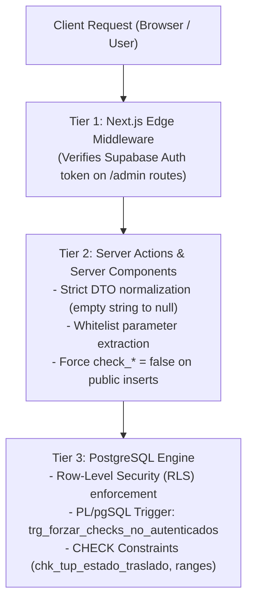

# Database Security & RLS Policies

<cite>
**Referenced Files in This Document**
- [supabase/migrations/0001_rls_visitas_educativas.sql](file:///c:/Users/catra/Desktop/simu-twin-web/supabase/migrations/0001_rls_visitas_educativas.sql)
- [supabase/migrations/0003_agregar_columnas_tup.sql](file:///c:/Users/catra/Desktop/simu-twin-web/supabase/migrations/0003_agregar_columnas_tup.sql)
- [src/lib/supabase/client.ts](file:///c:/Users/catra/Desktop/simu-twin-web/src/lib/supabase/client.ts)
- [src/lib/supabase/server.ts](file:///c:/Users/catra/Desktop/simu-twin-web/src/lib/supabase/server.ts)
- [src/middleware.ts](file:///c:/Users/catra/Desktop/simu-twin-web/src/middleware.ts)
- [src/app/visitas/actions.ts](file:///c:/Users/catra/Desktop/simu-twin-web/src/app/visitas/actions.ts)
- [src/app/admin/visitas-educativas/actions.ts](file:///c:/Users/catra/Desktop/simu-twin-web/src/app/admin/visitas-educativas/actions.ts)
- [src/app/admin/tup/actions.ts](file:///c:/Users/catra/Desktop/simu-twin-web/src/app/admin/tup/actions.ts)
- [src/app/admin/registro-actividades/actions.ts](file:///c:/Users/catra/Desktop/simu-twin-web/src/app/admin/registro-actividades/actions.ts)
</cite>

## Table of Contents
1. [Introduction](#introduction)
2. [Multi-Tier Security Architecture](#multi-tier-security-architecture)
3. [Row Level Security (RLS) Policies Breakdown](#row-level-security-rls-policies-breakdown)
4. [Minor PII Data Shielding](#minor-pii-data-shielding)
5. [In-Database Triggers & Defense-in-Depth](#in-database-triggers--defense-in-depth)
6. [TUP Constraints & Partial Indexes](#tup-constraints--partial-indexes)
7. [Edge Middleware & Route Protection](#edge-middleware--route-protection)
8. [Conclusion](#conclusion)

---

## Introduction
Security in Simu-Twin Web adheres to the **zero-trust client principle** and **defense-in-depth**. Critical student personally identifiable information (PII) and operational administration controls are strictly safeguarded at the database engine level (PostgreSQL) rather than relying solely on client-side or route-level UI checks.

---

## Multi-Tier Security Architecture



---

## Row Level Security (RLS) Policies Breakdown

From [`supabase/migrations/0001_rls_visitas_educativas.sql`](file:///c:/Users/catra/Desktop/simu-twin-web/supabase/migrations/0001_rls_visitas_educativas.sql):

### 1. Catalog Tables: `escuelas` & `fechas_habilitadas`
- **Read Access (`SELECT`)**: Granted to both `anon` and `authenticated` roles.
  - `escuelas`: All schools are publicly queryable so the public form dropdown works without requiring a user login.
  - `fechas_habilitadas`: Only rows with `habilitada = true` are readable by public visitors.
- **Write Access (`INSERT`, `UPDATE`, `DELETE`)**: Completely denied to `anon`.

### 2. Booking Requests: `visitas_educativas`
- **Creation (`INSERT`)**: Permitted for `anon` and `authenticated` to allow public school visit submissions.
- **Read / Update / Delete (`SELECT`, `UPDATE`, `DELETE`)**: Granted **exclusively** to the `authenticated` role.
  - Public visitors cannot read previously registered visits or inspect other schools' reservations.
  - Operational checks (`check_poliza`, `check_tup`, `check_facturas`, `check_drive_sum`) cannot be mutated by unauthenticated clients.

---

## Minor PII Data Shielding

Under Argentine privacy standards and municipal governance, rosters of secondary school students (`visita_asistentes`) contain sensitive personal data (full name, National Identity Number / DNI, and birthdate).
- **`SELECT` on `visita_asistentes`**:
  ```sql
  create policy "asistentes_select_authenticated"
    on public.visita_asistentes for select
    to authenticated
    using (true);
  ```
  Unauthenticated clients have **zero read access** (`SELECT` policy omitted for `anon`).
- **`INSERT` on `visita_asistentes`**: Handled through Server Actions under whitelisted properties.

---

## In-Database Triggers & Defense-in-Depth

Even if an attacker bypassed the Server Action and invoked the Supabase REST endpoint directly using the public `anon` API key, the in-database trigger guarantees operational flag integrity:

```sql
create or replace function public.forzar_checks_no_autenticados()
returns trigger
language plpgsql
as $$
begin
  if auth.uid() is null then
    new.check_poliza    := false;
    new.check_tup       := false;
    new.check_facturas  := false;
    new.check_drive_sum := false;
  end if;
  return new;
end;
$$;

create trigger trg_forzar_checks_no_autenticados
  before insert or update on public.visitas_educativas
  for each row
  execute function public.forzar_checks_no_autenticados();
```

---

## TUP Constraints & Partial Indexes

From [`supabase/migrations/0003_agregar_columnas_tup.sql`](file:///c:/Users/catra/Desktop/simu-twin-web/supabase/migrations/0003_agregar_columnas_tup.sql):
- **Closed State Domain**:
  ```sql
  check (tup_estado_traslado in ('pendiente', 'en_camino', 'en_destino', 'completado', 'cancelado'))
  ```
- **Schedule Coherence**:
  ```sql
  check (tup_horario_ida_desde is null or tup_horario_ida_hasta is null or tup_horario_ida_desde <= tup_horario_ida_hasta)
  check (tup_horario_vuelta_desde is null or tup_horario_vuelta_hasta is null or tup_horario_vuelta_desde <= tup_horario_vuelta_hasta)
  ```
- **Partial Index Optimization**:
  ```sql
  create index if not exists idx_visitas_tup_panel
    on public.visitas_educativas (fecha_visita, tup_horario_ida_desde)
    where requiere_tup = true;
  ```
  Accelerates queries on `/admin/tup` by indexing only records that require municipal transit.

---

## Edge Middleware & Route Protection

[`src/middleware.ts`](file:///c:/Users/catra/Desktop/simu-twin-web/src/middleware.ts) runs on Next.js Edge Runtime:
1. Intercepts incoming requests matching `/admin/*` and `/login`.
2. Validates session cookies via `supabase.auth.getUser()`.
3. Redirects unauthenticated requests targeting `/admin/*` to `/login`.
4. Redirects authenticated users visiting `/login` to `/admin`.
5. Excludes static assets (Three.js models, images, fonts, manifests) from middleware execution to prevent unnecessary latency.

---

## Conclusion
Through PostgreSQL RLS, PL/pgSQL triggers, Edge Middleware guards, and strict Server Action sanitization, Simu-Twin Web guarantees production-grade data protection and audit compliance.