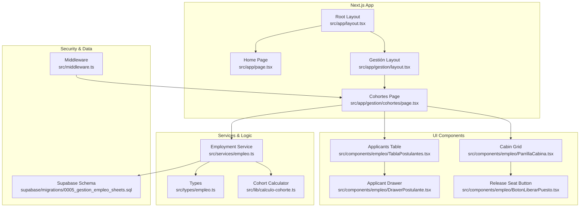
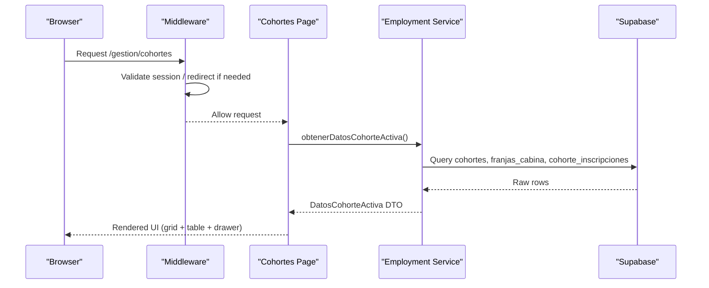
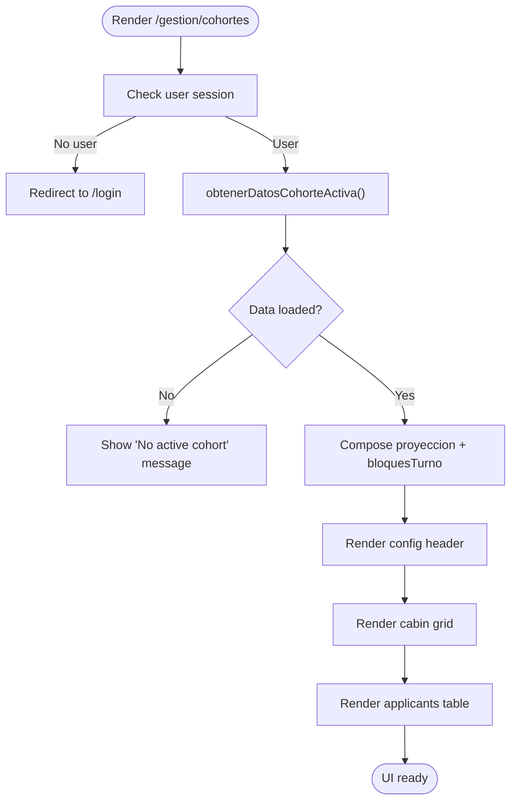
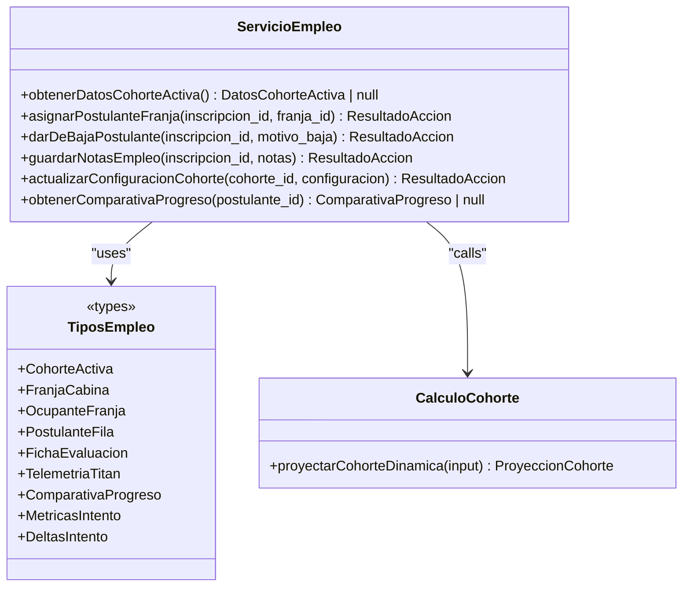
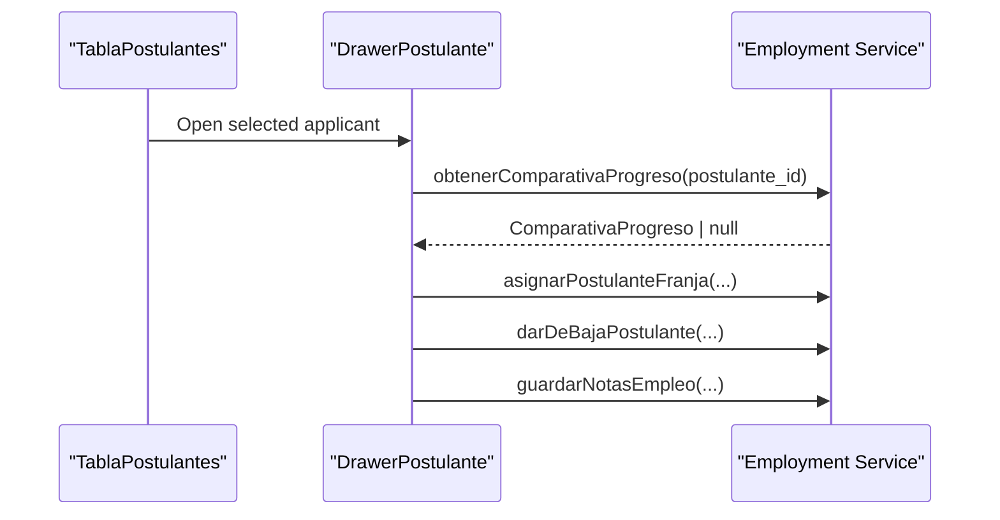
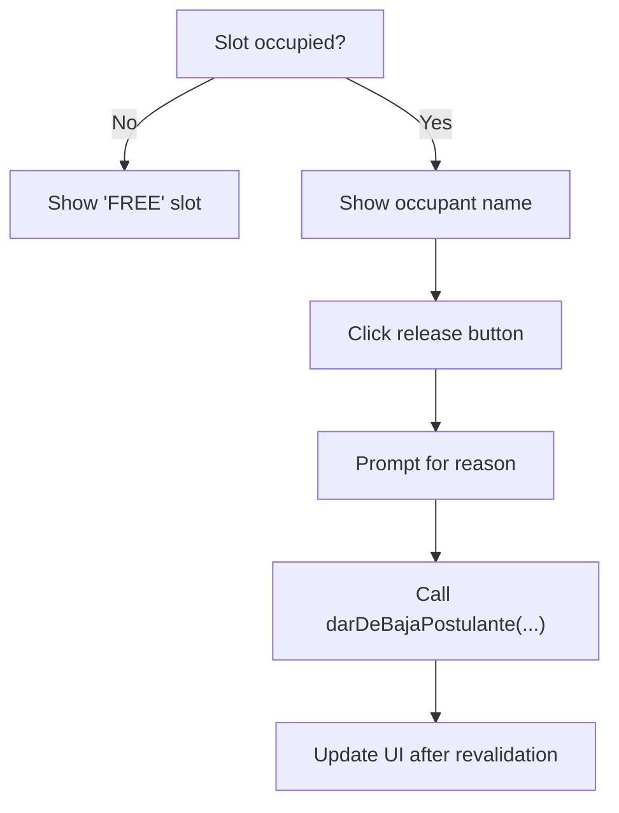
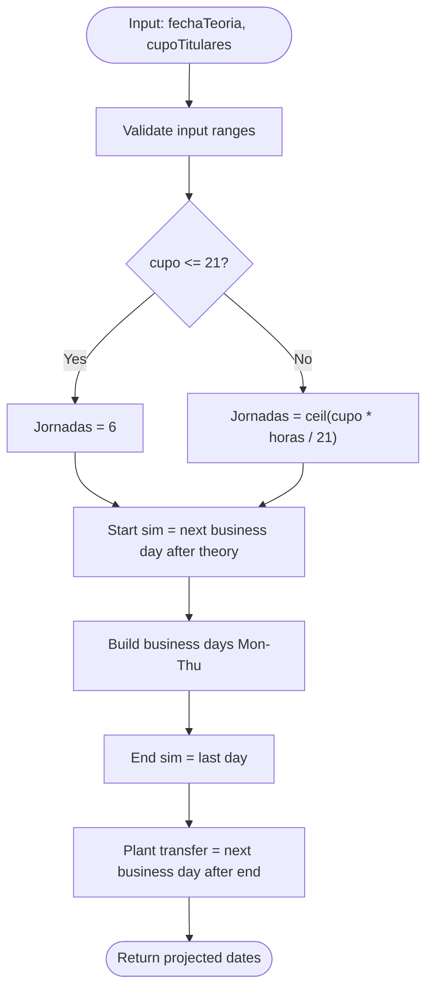
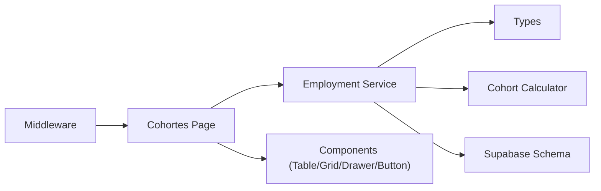

# Employment Management System

<cite>
**Referenced Files in This Document**
- [README.md](file://README.md)
- [package.json](file://package.json)
- [src/app/layout.tsx](file://src/app/layout.tsx)
- [src/app/page.tsx](file://src/app/page.tsx)
- [src/middleware.ts](file://src/middleware.ts)
- [src/app/gestion/layout.tsx](file://src/app/gestion/layout.tsx)
- [src/app/gestion/cohortes/page.tsx](file://src/app/gestion/cohortes/page.tsx)
- [src/services/empleo.ts](file://src/services/empleo.ts)
- [src/types/empleo.ts](file://src/types/empleo.ts)
- [src/components/empleo/TablaPostulantes.tsx](file://src/components/empleo/TablaPostulantes.tsx)
- [src/components/empleo/ParrillaCabina.tsx](file://src/components/empleo/ParrillaCabina.tsx)
- [src/components/empleo/DrawerPostulante.tsx](file://src/components/empleo/DrawerPostulante.tsx)
- [src/components/empleo/BotonLiberarPuesto.tsx](file://src/components/empleo/BotonLiberarPuesto.tsx)
- [src/lib/calculo-cohorte.ts](file://src/lib/calculo-cohorte.ts)
- [supabase/migrations/0005_gestion_empleo_sheets.sql](file://supabase/migrations/0005_gestion_empleo_sheets.sql)
</cite>

## Table of Contents
1. [Introduction](#introduction)
2. [Project Structure](#project-structure)
3. [Core Components](#core-components)
4. [Architecture Overview](#architecture-overview)
5. [Detailed Component Analysis](#detailed-component-analysis)
6. [Dependency Analysis](#dependency-analysis)
7. [Performance Considerations](#performance-considerations)
8. [Troubleshooting Guide](#troubleshooting-guide)
9. [Conclusion](#conclusion)

## Introduction
This document explains the Employment Management System module within the Simu Twin Web platform. It covers how cohorts, cabin time slots, applicants, and evaluations are modeled and managed through a Next.js application backed by Supabase. The system supports dynamic cohort scheduling, applicant ranking, cabin slot assignment with capacity enforcement, multi-attempt diagnostic comparisons, and printable schedule generation.

The repository also includes other modules (digital twin 3D, educational visits, TUP logistics), but this document focuses on the employment management features under /gestion.

**Section sources**
- [README.md:20-50](file://README.md#L20-L50)

## Project Structure
The employment management feature is centered around:
- App routes for the management layout and cohort page
- Server-side service functions for data access and mutations
- Client components for tables, grids, drawers, and actions
- Pure logic for cohort calendar projection
- Database schema and constraints via migrations

**Diagram sources**
- [src/app/layout.tsx:20-34](file://src/app/layout.tsx#L20-L34)
- [src/app/page.tsx:15-68](file://src/app/page.tsx#L15-L68)
- [src/app/gestion/layout.tsx:9-19](file://src/app/gestion/layout.tsx#L9-L19)
- [src/app/gestion/cohortes/page.tsx:25-124](file://src/app/gestion/cohortes/page.tsx#L25-L124)
- [src/services/empleo.ts:204-334](file://src/services/empleo.ts#L204-L334)
- [src/types/empleo.ts:7-92](file://src/types/empleo.ts#L7-L92)
- [src/lib/calculo-cohorte.ts:69-120](file://src/lib/calculo-cohorte.ts#L69-L120)
- [src/components/empleo/TablaPostulantes.tsx:45-166](file://src/components/empleo/TablaPostulantes.tsx#L45-L166)
- [src/components/empleo/ParrillaCabina.tsx:116-136](file://src/components/empleo/ParrillaCabina.tsx#L116-L136)
- [src/components/empleo/DrawerPostulante.tsx:119-163](file://src/components/empleo/DrawerPostulante.tsx#L119-L163)
- [src/components/empleo/BotonLiberarPuesto.tsx:12-54](file://src/components/empleo/BotonLiberarPuesto.tsx#L12-L54)
- [src/middleware.ts:15-89](file://src/middleware.ts#L15-L89)
- [supabase/migrations/0005_gestion_empleo_sheets.sql:13-100](file://supabase/migrations/0005_gestion_empleo_sheets.sql#L13-L100)

**Section sources**
- [src/app/layout.tsx:20-34](file://src/app/layout.tsx#L20-L34)
- [src/app/page.tsx:15-68](file://src/app/page.tsx#L15-L68)
- [src/app/gestion/layout.tsx:9-19](file://src/app/gestion/layout.tsx#L9-L19)
- [src/app/gestion/cohortes/page.tsx:25-124](file://src/app/gestion/cohortes/page.tsx#L25-L124)

## Core Components
- Cohort page (/gestion/cohortes): Loads active cohort, cabin time slots, and ranked applicants; renders configuration header, cabin grid, and applicant table with drawer.
- Employment service: Server-only functions to read cohort data, assign applicants to time slots, dismiss applicants, save notes, update cohort configuration, and compute multi-attempt progress.
- UI components: Applicant table, cabin grid, applicant drawer, and release-seat button.
- Cohort calculator: Pure function to project training days based on theory date and titular capacity.
- Database schema: Tables for applicants, cohorts, cabin time slots, enrollments, and diagnostics with integrity triggers and RLS policies.

Key responsibilities:
- Data loading and mapping from Supabase to typed DTOs
- Capacity enforcement at both client and database layers
- Multi-attempt diagnostic comparison and radar visualization payload
- Printable schedule generation using projected dates and confirmed assignments

**Section sources**
- [src/app/gestion/cohortes/page.tsx:25-124](file://src/app/gestion/cohortes/page.tsx#L25-L124)
- [src/services/empleo.ts:204-334](file://src/services/empleo.ts#L204-L334)
- [src/types/empleo.ts:7-92](file://src/types/empleo.ts#L7-L92)
- [src/lib/calculo-cohorte.ts:69-120](file://src/lib/calculo-cohorte.ts#L69-L120)
- [supabase/migrations/0005_gestion_empleo_sheets.sql:13-100](file://supabase/migrations/0005_gestion_empleo_sheets.sql#L13-L100)

## Architecture Overview
The employment management flow combines server-side data fetching, strict validation, and client-driven interactions. Middleware protects protected routes, while the cohort page orchestrates data retrieval and rendering.

**Diagram sources**
- [src/middleware.ts:15-89](file://src/middleware.ts#L15-L89)
- [src/app/gestion/cohortes/page.tsx:25-40](file://src/app/gestion/cohortes/page.tsx#L25-L40)
- [src/services/empleo.ts:204-334](file://src/services/empleo.ts#L204-L334)

## Detailed Component Analysis

### Cohort Page (/gestion/cohortes)
Responsibilities:
- Enforce authentication and redirect unauthenticated users
- Load active cohort data via service
- Compose print-ready schedule metadata and turn blocks
- Render configuration header, cabin grid, and applicant table

**Diagram sources**
- [src/app/gestion/cohortes/page.tsx:25-124](file://src/app/gestion/cohortes/page.tsx#L25-L124)

**Section sources**
- [src/app/gestion/cohortes/page.tsx:25-124](file://src/app/gestion/cohortes/page.tsx#L25-L124)

### Employment Service (Server Actions)
Responsibilities:
- Read active cohort, cabin slots, and ranked applicants with latest evaluation
- Map raw PostgREST rows into typed DTOs
- Assign applicant to cabin slot with capacity checks
- Dismiss applicant and free slot
- Save socio-labor notes
- Update cohort configuration with validated inputs and projected calendar
- Compute multi-attempt progress payload (V1/V2/FINAL)

**Diagram sources**
- [src/services/empleo.ts:204-334](file://src/services/empleo.ts#L204-L334)
- [src/services/empleo.ts:349-440](file://src/services/empleo.ts#L349-L440)
- [src/services/empleo.ts:446-496](file://src/services/empleo.ts#L446-L496)
- [src/services/empleo.ts:502-535](file://src/services/empleo.ts#L502-L535)
- [src/services/empleo.ts:542-611](file://src/services/empleo.ts#L542-L611)
- [src/services/empleo.ts:720-800](file://src/services/empleo.ts#L720-L800)
- [src/types/empleo.ts:7-92](file://src/types/empleo.ts#L7-L92)
- [src/types/empleo.ts:104-174](file://src/types/empleo.ts#L104-L174)
- [src/lib/calculo-cohorte.ts:69-120](file://src/lib/calculo-cohorte.ts#L69-L120)

**Section sources**
- [src/services/empleo.ts:204-334](file://src/services/empleo.ts#L204-L334)
- [src/services/empleo.ts:349-440](file://src/services/empleo.ts#L349-L440)
- [src/services/empleo.ts:446-496](file://src/services/empleo.ts#L446-L496)
- [src/services/empleo.ts:502-535](file://src/services/empleo.ts#L502-L535)
- [src/services/empleo.ts:542-611](file://src/services/empleo.ts#L542-L611)
- [src/services/empleo.ts:720-800](file://src/services/empleo.ts#L720-L800)
- [src/types/empleo.ts:7-92](file://src/types/empleo.ts#L7-L92)
- [src/types/empleo.ts:104-174](file://src/types/empleo.ts#L104-L174)
- [src/lib/calculo-cohorte.ts:69-120](file://src/lib/calculo-cohorte.ts#L69-L120)

### Applicant Table and Drawer
- Table displays ranked applicants with state badges, score preview, assigned slot label, and opens the drawer on selection.
- Drawer shows technical axes, telemetry, multi-attempt progress, final exam status, socio-labor notes, and actions to assign or dismiss.

**Diagram sources**
- [src/components/empleo/TablaPostulantes.tsx:45-166](file://src/components/empleo/TablaPostulantes.tsx#L45-L166)
- [src/components/empleo/DrawerPostulante.tsx:119-163](file://src/components/empleo/DrawerPostulante.tsx#L119-L163)
- [src/components/empleo/DrawerPostulante.tsx:190-209](file://src/components/empleo/DrawerPostulante.tsx#L190-L209)
- [src/components/empleo/DrawerPostulante.tsx:496-508](file://src/components/empleo/DrawerPostulante.tsx#L496-L508)
- [src/services/empleo.ts:349-440](file://src/services/empleo.ts#L349-L440)
- [src/services/empleo.ts:446-496](file://src/services/empleo.ts#L446-L496)
- [src/services/empleo.ts:502-535](file://src/services/empleo.ts#L502-L535)
- [src/services/empleo.ts:720-800](file://src/services/empleo.ts#L720-L800)

**Section sources**
- [src/components/empleo/TablaPostulantes.tsx:45-166](file://src/components/empleo/TablaPostulantes.tsx#L45-L166)
- [src/components/empleo/DrawerPostulante.tsx:119-163](file://src/components/empleo/DrawerPostulante.tsx#L119-L163)
- [src/components/empleo/DrawerPostulante.tsx:190-209](file://src/components/empleo/DrawerPostulante.tsx#L190-L209)
- [src/components/empleo/DrawerPostulante.tsx:496-508](file://src/components/empleo/DrawerPostulante.tsx#L496-L508)

### Cabin Grid and Release Seat Button
- Grid visualizes morning and afternoon shifts with three slots each, showing occupancy and fullness.
- Release seat button prompts for dismissal reason and calls the server action to free the slot.

**Diagram sources**
- [src/components/empleo/ParrillaCabina.tsx:16-48](file://src/components/empleo/ParrillaCabina.tsx#L16-L48)
- [src/components/empleo/ParrillaCabina.tsx:50-82](file://src/components/empleo/ParrillaCabina.tsx#L50-L82)
- [src/components/empleo/BotonLiberarPuesto.tsx:12-54](file://src/components/empleo/BotonLiberarPuesto.tsx#L12-L54)
- [src/services/empleo.ts:446-496](file://src/services/empleo.ts#L446-L496)

**Section sources**
- [src/components/empleo/ParrillaCabina.tsx:16-48](file://src/components/empleo/ParrillaCabina.tsx#L16-L48)
- [src/components/empleo/ParrillaCabina.tsx:50-82](file://src/components/empleo/ParrillaCabina.tsx#L50-L82)
- [src/components/empleo/BotonLiberarPuesto.tsx:12-54](file://src/components/empleo/BotonLiberarPuesto.tsx#L12-L54)

### Cohort Calendar Projection
Pure logic that computes:
- Minimum six business days when capacity ≤ 21
- Days = ceil((capacity × required hours) / 21) otherwise
- Business days Monday–Thursday only
- Start date after theory day, end date after last day, plant transfer date after end

**Diagram sources**
- [src/lib/calculo-cohorte.ts:69-120](file://src/lib/calculo-cohorte.ts#L69-L120)

**Section sources**
- [src/lib/calculo-cohorte.ts:69-120](file://src/lib/calculo-cohorte.ts#L69-L120)

## Dependency Analysis
- The cohort page depends on the employment service for data and mutations.
- The service depends on Supabase client and uses typed models from types/empleo.
- The service calls the pure cohort calculator for schedule projection.
- UI components depend on service functions exposed as server actions.
- Middleware protects protected routes before they reach the cohort page.
- Database schema enforces operational integrity via triggers and RLS policies.

**Diagram sources**
- [src/app/gestion/cohortes/page.tsx:25-40](file://src/app/gestion/cohortes/page.tsx#L25-L40)
- [src/services/empleo.ts:204-334](file://src/services/empleo.ts#L204-L334)
- [src/types/empleo.ts:7-92](file://src/types/empleo.ts#L7-L92)
- [src/lib/calculo-cohorte.ts:69-120](file://src/lib/calculo-cohorte.ts#L69-L120)
- [src/components/empleo/TablaPostulantes.tsx:45-166](file://src/components/empleo/TablaPostulantes.tsx#L45-L166)
- [src/components/empleo/ParrillaCabina.tsx:116-136](file://src/components/empleo/ParrillaCabina.tsx#L116-L136)
- [src/components/empleo/DrawerPostulante.tsx:119-163](file://src/components/empleo/DrawerPostulante.tsx#L119-L163)
- [src/components/empleo/BotonLiberarPuesto.tsx:12-54](file://src/components/empleo/BotonLiberarPuesto.tsx#L12-L54)
- [src/middleware.ts:15-89](file://src/middleware.ts#L15-L89)
- [supabase/migrations/0005_gestion_empleo_sheets.sql:13-100](file://supabase/migrations/0005_gestion_empleo_sheets.sql#L13-L100)

**Section sources**
- [src/app/gestion/cohortes/page.tsx:25-40](file://src/app/gestion/cohortes/page.tsx#L25-L40)
- [src/services/empleo.ts:204-334](file://src/services/empleo.ts#L204-L334)
- [src/types/empleo.ts:7-92](file://src/types/empleo.ts#L7-L92)
- [src/lib/calculo-cohorte.ts:69-120](file://src/lib/calculo-cohorte.ts#L69-L120)
- [src/components/empleo/TablaPostulantes.tsx:45-166](file://src/components/empleo/TablaPostulantes.tsx#L45-L166)
- [src/components/empleo/ParrillaCabina.tsx:116-136](file://src/components/empleo/ParrillaCabina.tsx#L116-L136)
- [src/components/empleo/DrawerPostulante.tsx:119-163](file://src/components/empleo/DrawerPostulante.tsx#L119-L163)
- [src/components/empleo/BotonLiberarPuesto.tsx:12-54](file://src/components/empleo/BotonLiberarPuesto.tsx#L12-L54)
- [src/middleware.ts:15-89](file://src/middleware.ts#L15-L89)
- [supabase/migrations/0005_gestion_empleo_sheets.sql:13-100](file://supabase/migrations/0005_gestion_empleo_sheets.sql#L13-L100)

## Performance Considerations
- Use force-dynamic rendering for the cohort page to ensure fresh data per request.
- Prefer server-side data fetching to minimize client-side queries and keep sensitive operations secure.
- Revalidate paths after mutations to refresh UI efficiently.
- Avoid unnecessary re-renders in client components by keeping state minimal and leveraging transitions for pending states.
- Leverage database indexes defined in the migration for faster lookups on cohort_id, estado, and franja_id.

[No sources needed since this section provides general guidance]

## Troubleshooting Guide
Common issues and resolutions:
- Unauthenticated access to /gestion/*: Ensure environment variables are set and middleware can create a Supabase client; unauthenticated users are redirected to /login.
- No active cohort displayed: Verify that a cohort exists with estado='activa' and that migrations 0005 and 0007 are applied.
- Assignment fails due to capacity: Check the cabin slot’s cupo_maximo and existing CONFIRMADO count; database trigger enforces limits and returns specific error messages.
- Dismissal requires a reason: The UI prompts for a mandatory reason; empty or invalid reasons will be rejected.
- Notes not saving: Ensure the text length is within the allowed limit and the user session is valid.

Operational safeguards:
- Anti-IDOR checks validate that cabin slots belong to the same cohort as the enrollment.
- Database triggers serialize concurrent updates and raise explicit errors for over-capacity scenarios.
- RLS policies allow authenticated users and service role to access employment tables.

**Section sources**
- [src/middleware.ts:24-36](file://src/middleware.ts#L24-L36)
- [src/middleware.ts:66-84](file://src/middleware.ts#L66-L84)
- [src/app/gestion/cohortes/page.tsx:80-90](file://src/app/gestion/cohortes/page.tsx#L80-L90)
- [src/services/empleo.ts:391-413](file://src/services/empleo.ts#L391-L413)
- [src/services/empleo.ts:446-496](file://src/services/empleo.ts#L446-L496)
- [src/services/empleo.ts:502-535](file://src/services/empleo.ts#L502-L535)
- [supabase/migrations/0005_gestion_empleo_sheets.sql:115-201](file://supabase/migrations/0005_gestion_empleo_sheets.sql#L115-L201)
- [supabase/migrations/0005_gestion_empleo_sheets.sql:207-243](file://supabase/migrations/0005_gestion_empleo_sheets.sql#L207-L243)

## Conclusion
The Employment Management System integrates robust server-side logic, typed data models, and clear UI flows to manage cohorts, cabin schedules, and applicant progression. It enforces capacity and cohort-level limits both in application code and database triggers, supports multi-attempt diagnostic comparisons, and provides printable official schedules. The architecture emphasizes security via middleware and RLS, performance via server-side data fetching and path revalidation, and maintainability through modular services and pure calculation logic.

[No sources needed since this section summarizes without analyzing specific files]