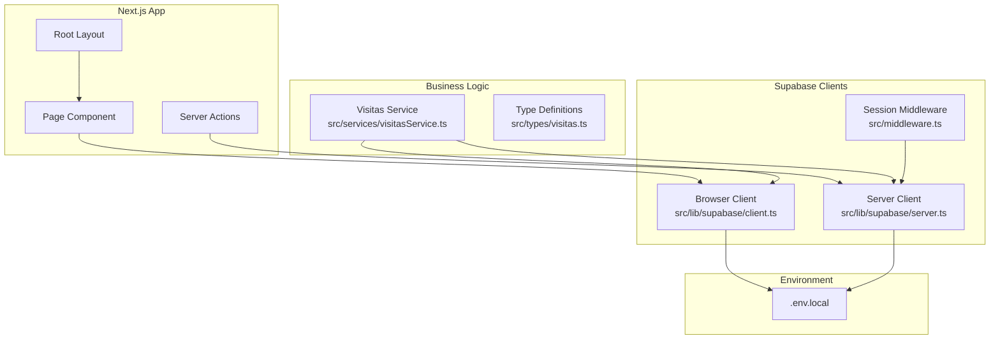
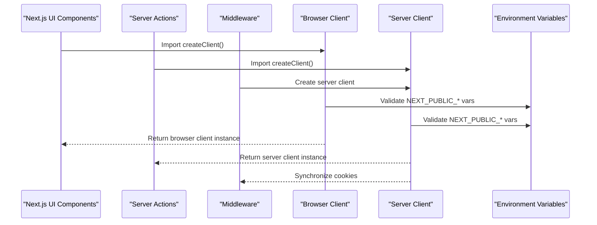
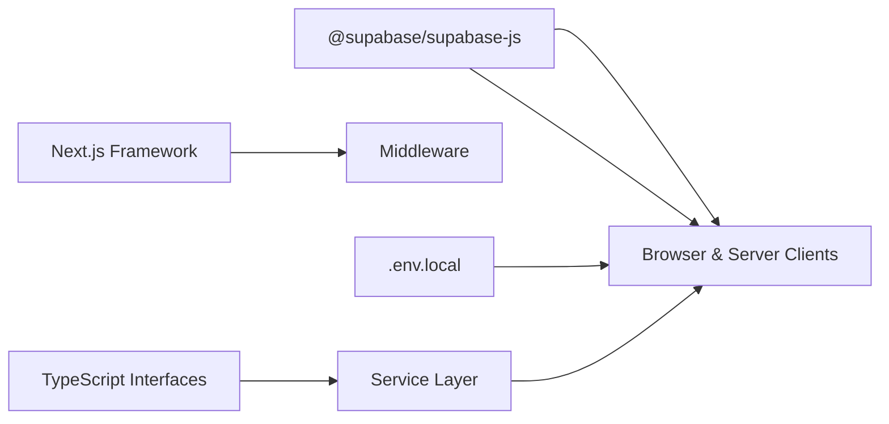

# Supabase Client Configuration

<cite>
**Referenced Files in This Document**
- [client.ts](file://src/lib/supabase/client.ts)
- [server.ts](file://src/lib/supabase/server.ts)
- [visitasService.ts](file://src/services/visitasService.ts)
- [actions.ts](file://src/app/visitas/actions.ts)
- [middleware.ts](file://src/middleware.ts)
- [visitas.ts](file://src/types/visitas.ts)
- [package.json](file://package.json)
</cite>

## Update Summary
**Changes Made**
- Updated architecture overview to reflect separation of client and server implementations
- Added detailed sections for browser client and server client components
- Enhanced security considerations with environment variable validation
- Updated usage patterns to show proper client selection based on execution context
- Added middleware integration details for session management

## Table of Contents
1. [Introduction](#introduction)
2. [Project Structure](#project-structure)
3. [Core Components](#core-components)
4. [Architecture Overview](#architecture-overview)
5. [Detailed Component Analysis](#detailed-component-analysis)
6. [Dependency Analysis](#dependency-analysis)
7. [Performance Considerations](#performance-considerations)
8. [Security and Environment Management](#security-and-environment-management)
9. [Troubleshooting Guide](#troubleshooting-guide)
10. [Conclusion](#conclusion)

## Introduction
This document explains the Supabase client configuration that acts as the database connection layer for this Next.js application. The architecture has been refactored to provide separate client implementations for browser and server contexts, enhancing security through proper environment variable validation and session management. It covers how each client instance is created, validated, and used within their appropriate execution contexts, along with best practices for secure database operations.

## Project Structure
The Supabase integration is organized into focused modules with clear separation between browser and server contexts:
- **Browser Client**: Specialized client for client-side components using `@supabase/ssr` for session sharing
- **Server Client**: Specialized client for Server Components, Server Actions, and Route Handlers with cookie synchronization
- **Service Layer**: Business logic functions that use the appropriate client based on execution context
- **Middleware**: Session management and authentication routing
- **Type Definitions**: Shared TypeScript interfaces ensuring type safety across the application



**Diagram sources**
- [client.ts:1-34](file://src/lib/supabase/client.ts#L1-L34)
- [server.ts:1-41](file://src/lib/supabase/server.ts#L1-L41)
- [visitasService.ts:1-105](file://src/services/visitasService.ts#L1-L105)
- [actions.ts:1-322](file://src/app/visitas/actions.ts#L1-L322)
- [middleware.ts:1-100](file://src/middleware.ts#L1-L100)

**Section sources**
- [client.ts:1-34](file://src/lib/supabase/client.ts#L1-L34)
- [server.ts:1-41](file://src/lib/supabase/server.ts#L1-L41)
- [visitasService.ts:1-105](file://src/services/visitasService.ts#L1-L105)
- [actions.ts:1-322](file://src/app/visitas/actions.ts#L1-L322)
- [middleware.ts:1-100](file://src/middleware.ts#L1-L100)

## Core Components
The architecture now provides two specialized client implementations:

### Browser Client (`createBrowserClient`)
- Purpose: Provides a singleton Supabase client for browser components with session sharing via `@supabase/ssr`
- Features: Environment variable validation, singleton pattern, browser-specific optimizations
- Usage: Imported by client components, services running in browser context, and UI interactions

### Server Client (`createServerClient`)
- Purpose: Provides a Supabase client for Server Components, Server Actions, and Route Handlers with cookie synchronization
- Features: Async initialization, cookie store integration, enhanced error handling
- Usage: Imported by Server Actions, server-side service functions, and middleware

### Service Layer Integration
- Context-aware client selection: Services import the appropriate client based on execution context
- Type-safe operations: All database operations maintain TypeScript integrity
- Error propagation: Consistent error handling across both client types

Key implementation references:
- Browser client creation and validation: [client.ts:1-34](file://src/lib/supabase/client.ts#L1-L34)
- Server client with cookie synchronization: [server.ts:1-41](file://src/lib/supabase/server.ts#L1-L41)
- Service layer using browser client: [visitasService.ts:1-105](file://src/services/visitasService.ts#L1-L105)
- Server actions using server client: [actions.ts:1-322](file://src/app/visitas/actions.ts#L1-L322)

**Section sources**
- [client.ts:1-34](file://src/lib/supabase/client.ts#L1-L34)
- [server.ts:1-41](file://src/lib/supabase/server.ts#L1-L41)
- [visitasService.ts:1-105](file://src/services/visitasService.ts#L1-L105)
- [actions.ts:1-322](file://src/app/visitas/actions.ts#L1-L322)

## Architecture Overview
The application follows a context-aware architecture with separate client implementations:



**Diagram sources**
- [client.ts:26-33](file://src/lib/supabase/client.ts#L26-L33)
- [server.ts:11-40](file://src/lib/supabase/server.ts#L11-L40)
- [middleware.ts:14-85](file://src/middleware.ts#L14-L85)

The architecture ensures:
- **Context Separation**: Browser and server clients are never mixed
- **Enhanced Security**: Environment variables are validated before client creation
- **Session Management**: Middleware handles authentication state across requests
- **Type Safety**: Both clients maintain full TypeScript support

## Detailed Component Analysis

### Browser Client Implementation
The browser client provides a singleton instance optimized for client-side operations:

**Key Features:**
- Singleton pattern prevents multiple client instances
- Environment variable validation with descriptive Spanish error messages
- Integration with `@supabase/ssr` for session sharing with middleware
- Lazy initialization to avoid unnecessary setup overhead

**Implementation Details:**
- Uses `createBrowserClient` from `@supabase/ssr`
- Validates `NEXT_PUBLIC_SUPABASE_URL` and `NEXT_PUBLIC_SUPABASE_ANON_KEY`
- Returns cached instance after first creation
- Throws descriptive errors if environment variables are missing

**Usage Pattern:**
```typescript
// In client components or browser-context services
import { createClient } from '@/lib/supabase/client';

const supabase = createClient();
```

**Section sources**
- [client.ts:1-34](file://src/lib/supabase/client.ts#L1-L34)

### Server Client Implementation
The server client provides enhanced functionality for server-side operations:

**Key Features:**
- Asynchronous client creation to handle Next.js 15's async cookie API
- Cookie store synchronization for session persistence
- Robust error handling for server component contexts
- Integration with Next.js middleware for authentication flow

**Implementation Details:**
- Uses `createServerClient` from `@supabase/ssr`
- Implements custom cookie store with `getAll()` and `setAll()` methods
- Handles errors gracefully when called from Server Components
- Validates environment variables with Spanish error messages

**Usage Pattern:**
```typescript
// In Server Actions or Server Components
import { createClient } from '@/lib/supabase/server';

const supabase = await createClient();
```

**Section sources**
- [server.ts:1-41](file://src/lib/supabase/server.ts#L1-L41)

### Middleware Integration
The middleware manages authentication state and session refresh:

**Key Features:**
- Selective route protection for `/admin/*` and `/login` paths
- Public route optimization for `/visitas` (read-only session check)
- Graceful fallback when environment variables are missing
- Automatic redirect logic for authenticated/unauthenticated users

**Authentication Flow:**
- Protected routes: Full user validation with network round-trip
- Public routes: Lightweight session refresh without network calls
- Fallback behavior: Redirects unauthenticated users to login

**Section sources**
- [middleware.ts:1-100](file://src/middleware.ts#L1-L100)

### Service Layer Usage Patterns
Services demonstrate proper client selection based on execution context:

**Browser Context Services:**
- Use browser client for read operations and UI interactions
- Leverage singleton pattern for performance
- Maintain type safety with shared interfaces

**Server Context Operations:**
- Use server client for data mutations and sensitive operations
- Implement comprehensive validation before database operations
- Handle errors with user-friendly Spanish messages

**Example Service Functions:**
- `obtenerEscuelas()`: Fetches school data with ordering
- `verificarTurnoDisponible()`: Checks availability with business logic
- `crearSolicitudVisitaAction()`: Complex server action with validation

**Section sources**
- [visitasService.ts:1-105](file://src/services/visitasService.ts#L1-L105)
- [actions.ts:1-322](file://src/app/visitas/actions.ts#L1-L322)

## Dependency Analysis
The Supabase client system depends on several key packages and follows a layered dependency structure:



**Key Dependencies:**
- `@supabase/ssr`: Provides both browser and server client factories
- `@supabase/supabase-js`: Core Supabase JavaScript client
- Next.js framework features: Cookies API, Server Components, Middleware
- TypeScript: Full type safety across all client operations

**Section sources**
- [package.json:11-18](file://package.json#L11-L18)
- [client.ts:1-34](file://src/lib/supabase/client.ts#L1-L34)
- [server.ts:1-41](file://src/lib/supabase/server.ts#L1-L41)

## Performance Considerations
The dual-client architecture provides several performance benefits:

**Singleton Optimization:**
- Browser client uses singleton pattern to prevent redundant initialization
- Server client leverages Next.js caching mechanisms for optimal performance
- Reduced memory footprint through shared client instances

**Context-Aware Operations:**
- Browser client optimized for client-side operations and UI responsiveness
- Server client optimized for server-side processing and data mutations
- Middleware minimizes network calls for public routes

**Best Practices:**
- Use browser client for read operations in client components
- Use server client for write operations and sensitive data handling
- Leverage middleware for efficient session management
- Implement proper error boundaries for graceful degradation

## Security and Environment Management
The refactored architecture implements enhanced security measures:

**Environment Variable Validation:**
- Both clients validate required environment variables before initialization
- Descriptive Spanish error messages guide developers to fix configuration issues
- Fail-fast approach prevents silent failures in production

**Context-Specific Security:**
- Browser client only exposes public variables (`NEXT_PUBLIC_*`)
- Server client handles sensitive operations with proper isolation
- Middleware provides centralized authentication and authorization

**Security Best Practices:**
- Never mix browser and server clients inappropriately
- Always validate environment variables at startup
- Use middleware for consistent authentication checks
- Implement proper error handling without exposing sensitive information

**Environment Configuration:**
Required environment variables:
- `NEXT_PUBLIC_SUPABASE_URL`: Base URL for Supabase REST API
- `NEXT_PUBLIC_SUPABASE_ANON_KEY`: Anonymous key for authenticated requests

**Section sources**
- [client.ts:7-18](file://src/lib/supabase/client.ts#L7-L18)
- [server.ts:11-19](file://src/lib/supabase/server.ts#L11-L19)
- [middleware.ts:20-32](file://src/middleware.ts#L20-L32)

## Troubleshooting Guide
Common issues and solutions for the dual-client architecture:

**Environment Variable Issues:**
- **Missing Variables**: Check that `NEXT_PUBLIC_SUPABASE_URL` and `NEXT_PUBLIC_SUPABASE_ANON_KEY` are set
- **Invalid URLs**: Verify the Supabase project URL includes the correct REST endpoint
- **CORS Errors**: Ensure your domain is whitelisted in Supabase settings

**Client Selection Problems:**
- **Wrong Client Usage**: Ensure browser client is used in client components, server client in Server Actions
- **Import Path Errors**: Verify correct imports from `@/lib/supabase/client` vs `@/lib/supabase/server`
- **Async/Sync Conflicts**: Remember server client requires `await`, browser client does not

**Session and Authentication Issues:**
- **Middleware Not Running**: Check route matcher configuration in middleware
- **Cookie Synchronization**: Verify cookie handling in server client implementation
- **Redirect Loops**: Review authentication logic in middleware for protected routes

**Development Tips:**
- Use Next.js development server for proper environment variable loading
- Check browser console for client-side errors
- Monitor server logs for server-side operation failures
- Test both browser and server contexts during development

**Section sources**
- [client.ts:11-15](file://src/lib/supabase/client.ts#L11-L15)
- [server.ts:15-19](file://src/lib/supabase/server.ts#L15-L19)
- [middleware.ts:23-32](file://src/middleware.ts#L23-L32)

## Conclusion
The refactored Supabase client architecture provides a robust, secure, and maintainable foundation for database operations in this Next.js application. By separating browser and server concerns, implementing comprehensive environment validation, and integrating with Next.js middleware, the application achieves:

- **Enhanced Security**: Proper isolation of client and server contexts with validated credentials
- **Improved Performance**: Optimized client instances for their specific execution environments  
- **Better Maintainability**: Clear separation of concerns and standardized usage patterns
- **Type Safety**: Full TypeScript support across all database operations
- **Developer Experience**: Descriptive error messages and consistent APIs

The dual-client approach ensures that each execution context receives the most appropriate client implementation while maintaining consistency in the developer experience. This architecture scales well as the application grows and provides a solid foundation for future enhancements.