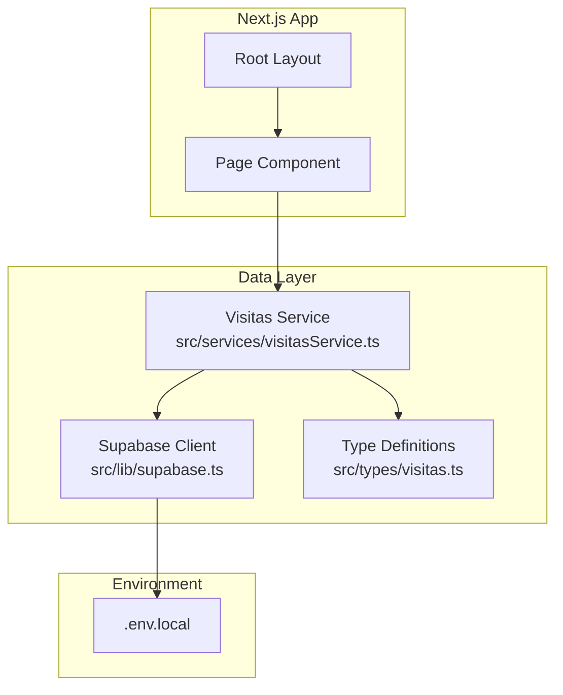
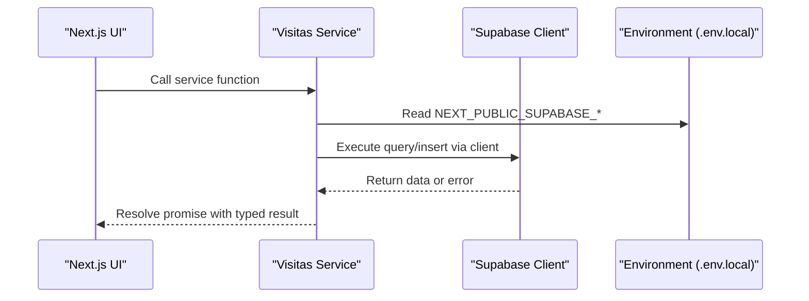
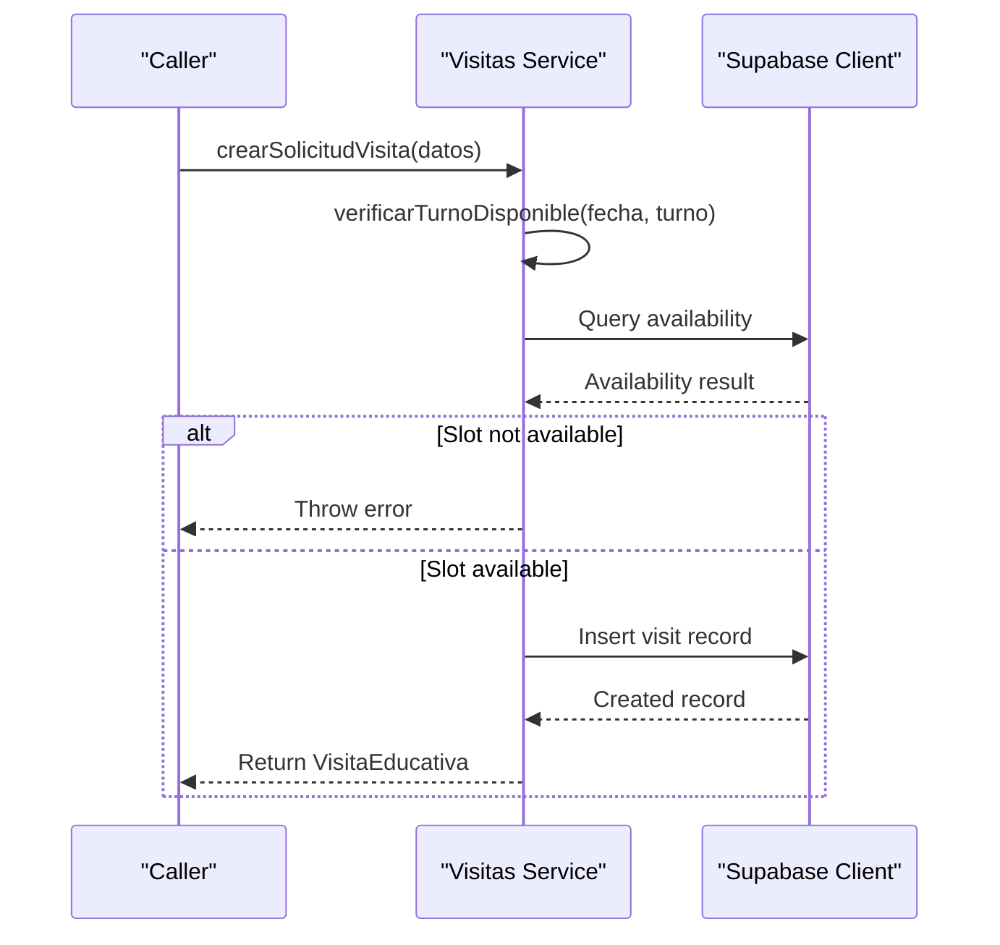
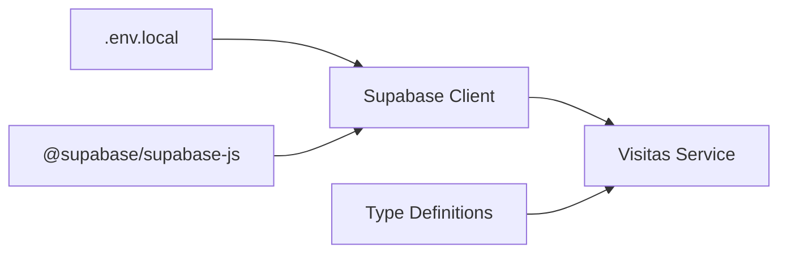

# Supabase Client Configuration

<cite>
**Referenced Files in This Document**
- [supabase.ts](file://src/lib/supabase.ts)
- [visitasService.ts](file://src/services/visitasService.ts)
- [visitas.ts](file://src/types/visitas.ts)
- [package.json](file://package.json)
- [.env.local](file://.env.local)
- [next-env.d.ts](file://next-env.d.ts)
</cite>

## Table of Contents
1. [Introduction](#introduction)
2. [Project Structure](#project-structure)
3. [Core Components](#core-components)
4. [Architecture Overview](#architecture-overview)
5. [Detailed Component Analysis](#detailed-component-analysis)
6. [Dependency Analysis](#dependency-analysis)
7. [Performance Considerations](#performance-considerations)
8. [Troubleshooting Guide](#troubleshooting-guide)
9. [Conclusion](#conclusion)

## Introduction
This document explains the Supabase client configuration that acts as the database connection layer for this Next.js application. It covers how a single shared client instance is created, how environment variables provide credentials, and how services import and use the client to perform database operations. It also includes best practices for environment variable management, security considerations, and troubleshooting common connection issues.

## Project Structure
The Supabase integration is organized into focused modules:
- A centralized client module that creates and exports a singleton Supabase client.
- A service module that uses the client to interact with Supabase tables.
- Type definitions that describe data shapes used by the service.
- Environment configuration that supplies the Supabase URL and anonymous key.

**Diagram sources**
- [supabase.ts:1-7](file://src/lib/supabase.ts#L1-L7)
- [visitasService.ts:1-59](file://src/services/visitasService.ts#L1-L59)
- [visitas.ts:1-28](file://src/types/visitas.ts#L1-L28)
- [.env.local:1-2](file://.env.local#L1-L2)

**Section sources**
- [supabase.ts:1-7](file://src/lib/supabase.ts#L1-L7)
- [visitasService.ts:1-59](file://src/services/visitasService.ts#L1-L59)
- [visitas.ts:1-28](file://src/types/visitas.ts#L1-L28)
- [.env.local:1-2](file://.env.local#L1-L2)

## Core Components
- Supabase client singleton: The client is created once at module load time and exported for reuse across the app. This ensures a single connection manager per process and avoids redundant initialization.
- Service layer: Business logic functions encapsulate database operations (queries, inserts) and error handling, using the shared client.
- Types: Shared TypeScript interfaces define request/response shapes and ensure type safety between service and consumers.
- Environment variables: The Supabase URL and anonymous key are loaded from environment variables configured in the project’s environment file.

Key implementation references:
- Client creation and export: [supabase.ts:1-7](file://src/lib/supabase.ts#L1-L7)
- Service usage of the client: [visitasService.ts:1-59](file://src/services/visitasService.ts#L1-L59)
- Type definitions used by the service: [visitas.ts:1-28](file://src/types/visitas.ts#L1-L28)
- Environment variables providing credentials: [.env.local:1-2](file://.env.local#L1-L2)

**Section sources**
- [supabase.ts:1-7](file://src/lib/supabase.ts#L1-L7)
- [visitasService.ts:1-59](file://src/services/visitasService.ts#L1-L59)
- [visitas.ts:1-28](file://src/types/visitas.ts#L1-L28)
- [.env.local:1-2](file://.env.local#L1-L2)

## Architecture Overview
The application follows a layered architecture:
- Presentation layer (Next.js pages/layouts) calls service functions.
- Service layer performs business logic and invokes the Supabase client.
- Supabase client handles HTTP requests to the Supabase REST API using the provided URL and anonymous key.
- Environment variables supply runtime configuration without hardcoding secrets.

**Diagram sources**
- [visitasService.ts:9-58](file://src/services/visitasService.ts#L9-L58)
- [supabase.ts:1-7](file://src/lib/supabase.ts#L1-L7)
- [.env.local:1-2](file://.env.local#L1-L2)

## Detailed Component Analysis

### Supabase Client Singleton
- Purpose: Provide a single, reusable Supabase client instance for all database operations.
- Implementation highlights:
  - Imports the client factory from the Supabase SDK.
  - Creates the client using environment variables for URL and anonymous key.
  - Exports the instance so other modules can import it directly.
- Benefits:
  - Avoids repeated initialization overhead.
  - Centralizes configuration in one place.
  - Simplifies testing and mocking by replacing the imported instance.

References:
- Client creation and export: [supabase.ts:1-7](file://src/lib/supabase.ts#L1-L7)

**Section sources**
- [supabase.ts:1-7](file://src/lib/supabase.ts#L1-L7)

### Environment Variables and Configuration
- Variables used:
  - NEXT_PUBLIC_SUPABASE_URL: Base URL for Supabase REST API.
  - NEXT_PUBLIC_SUPABASE_ANON_KEY: Anonymous key for authenticated requests.
- Location:
  - Defined in the local environment file for development.
- Next.js typing:
  - Next.js auto-generates types for environment variables; ensure your IDE recognizes them via the generated declaration file.

References:
- Environment values: [.env.local:1-2](file://.env.local#L1-L2)
- Next.js environment types reference: [next-env.d.ts:1-7](file://next-env.d.ts#L1-L7)

Security notes:
- Use NEXT_PUBLIC_ variables only when the value must be available in the browser. For server-only secrets, prefer non-prefixed variables and access them only in server-side code.
- Never commit secrets to version control. Keep .env files out of repositories and configure them in your deployment platform’s secret store.

**Section sources**
- [.env.local:1-2](file://.env.local#L1-L2)
- [next-env.d.ts:1-7](file://next-env.d.ts#L1-L7)

### Service Integration and Usage Patterns
- The service imports the shared client and exposes typed functions for:
  - Fetching schools with ordering.
  - Checking slot availability for visits.
  - Creating visit requests with validation and insertion.
- Error handling:
  - Each operation checks for errors returned by the client and throws to propagate failures to callers.
- Data shaping:
  - Uses TypeScript interfaces to ensure consistent data contracts between service and consumers.

References:
- Importing the client and performing operations: [visitasService.ts:1-59](file://src/services/visitasService.ts#L1-L59)
- Type definitions used by the service: [visitas.ts:1-28](file://src/types/visitas.ts#L1-L28)

Example call flow for creating a visit request:

**Diagram sources**
- [visitasService.ts:20-58](file://src/services/visitasService.ts#L20-L58)

**Section sources**
- [visitasService.ts:1-59](file://src/services/visitasService.ts#L1-L59)
- [visitas.ts:1-28](file://src/types/visitas.ts#L1-L28)

### Connection Setup Best Practices
- Use a single client instance per module scope to avoid duplicate connections.
- Load credentials from environment variables; never hardcode secrets.
- Validate environment variables at startup if needed (e.g., assert presence).
- Prefer server-side operations for sensitive logic; expose minimal APIs to the client.
- Leverage TypeScript interfaces to enforce correct payloads and responses.

[No sources needed since this section provides general guidance]

## Dependency Analysis
The Supabase client depends on the SDK and environment variables. Services depend on the client and shared types.

**Diagram sources**
- [package.json:11-15](file://package.json#L11-L15)
- [supabase.ts:1-7](file://src/lib/supabase.ts#L1-L7)
- [visitasService.ts:1-59](file://src/services/visitasService.ts#L1-L59)
- [visitas.ts:1-28](file://src/types/visitas.ts#L1-L28)
- [.env.local:1-2](file://.env.local#L1-L2)

**Section sources**
- [package.json:11-15](file://package.json#L11-L15)
- [supabase.ts:1-7](file://src/lib/supabase.ts#L1-L7)
- [visitasService.ts:1-59](file://src/services/visitasService.ts#L1-L59)
- [visitas.ts:1-28](file://src/types/visitas.ts#L1-L28)
- [.env.local:1-2](file://.env.local#L1-L2)

## Performance Considerations
- Singleton client reduces connection overhead and reuses internal resources.
- Batch operations where possible to minimize network round trips.
- Select only required fields to reduce payload size.
- Cache read-heavy results at the application level when appropriate.
- Monitor latency and adjust timeouts or retry strategies based on environment.

[No sources needed since this section provides general guidance]

## Troubleshooting Guide
Common issues and resolutions:
- Missing or invalid environment variables:
  - Ensure NEXT_PUBLIC_SUPABASE_URL and NEXT_PUBLIC_SUPABASE_ANON_KEY are set in your environment file and loaded by Next.js.
  - Verify the URL points to the correct Supabase project and includes the REST endpoint path.
- Network or CORS errors:
  - Confirm the Supabase project allows requests from your domain and that the anonymous key has appropriate permissions.
- Authentication errors:
  - If using anonymous auth, verify the key is valid and has necessary Row Level Security policies.
- Type errors in development:
  - Ensure Next.js environment types are recognized by your editor; regenerate types if necessary.

Operational tips:
- Log errors thrown by service functions to capture detailed messages from Supabase.
- Test connectivity by executing a simple query through the service during development.
- Rotate keys if compromised and update environment variables accordingly.

**Section sources**
- [.env.local:1-2](file://.env.local#L1-L2)
- [visitasService.ts:9-58](file://src/services/visitasService.ts#L9-L58)

## Conclusion
This project implements a clean, maintainable Supabase client configuration using a singleton pattern, environment-based credentials, and a service layer that encapsulates database operations. By centralizing client setup, enforcing type safety, and following secure environment practices, the application achieves reliable and scalable database access. Adopting the recommended best practices will help prevent common pitfalls and improve maintainability as the application grows.

[No sources needed since this section summarizes without analyzing specific files]