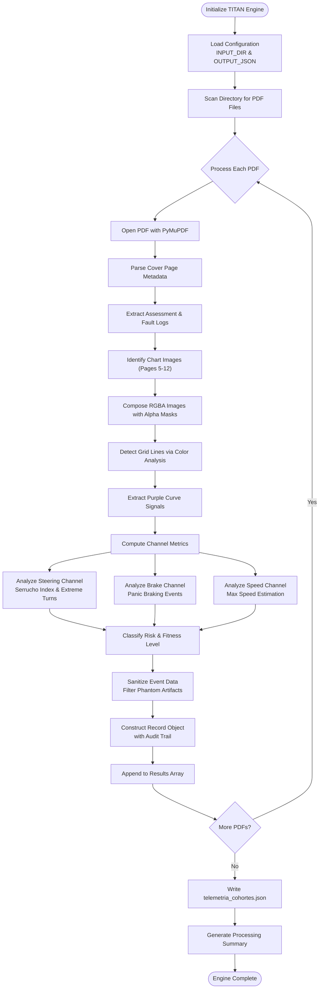
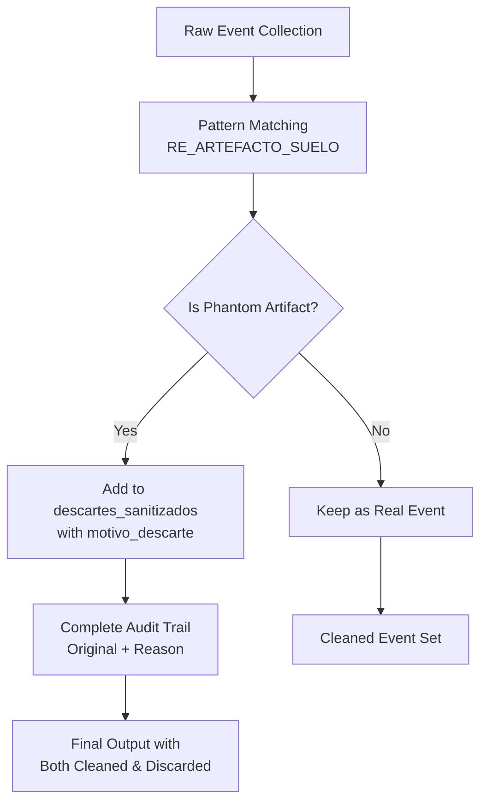
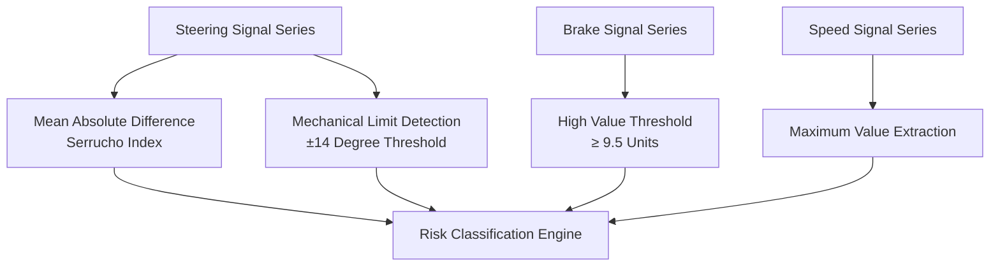
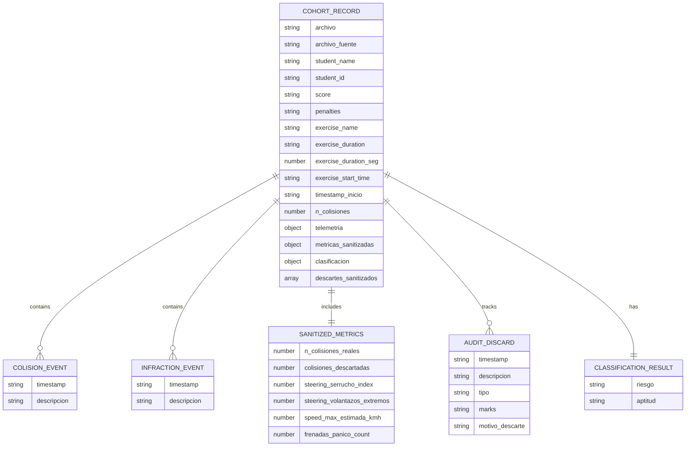
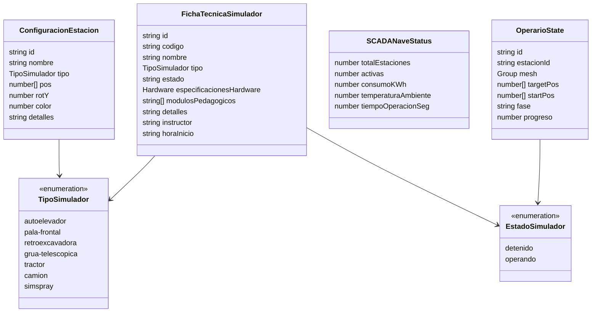

# Telemetry Processing Engine

<cite>
**Referenced Files in This Document**   
- [scripts/parse_simuladores.py](file://scripts/parse_simuladores.py)
- [telemetria_cohortes.json](file://telemetria_cohortes.json)
- [src/types/gemelo.ts](file://src/types/gemelo.ts)
- [src/components/gemelo/GemeloGalponCanvas.tsx](file://src/components/gemelo/GemeloGalponCanvas.tsx)
- [src/components/gemelo/VisorNave3D.tsx](file://src/components/gemelo/VisorNave3D.tsx)
- [README.md](file://README.md)
- [package.json](file://package.json)
- [docs/WIKI.md](file://docs/WIKI.md)
</cite>

## Update Summary
**Changes Made**   
- Enhanced data sanitization system with artifact filtering and audit trails
- Added structured source file references and exercise metadata fields
- Implemented comprehensive timestamp tracking and sanitized metric collections
- Updated data model documentation with new audit and validation fields
- Enhanced troubleshooting guide with sanitization-specific scenarios

## Table of Contents
1. [Introduction](#introduction)
2. [Architecture Overview](#architecture-overview)
3. [Processing Pipeline](#processing-pipeline)
4. [Core Components](#core-components)
5. [Detailed Component Analysis](#detailed-component-analysis)
6. [Data Model](#data-model)
7. [Integration Architecture](#integration-architecture)
8. [Performance Considerations](#performance-considerations)
9. [Dependency Analysis](#dependency-analysis)
10. [Troubleshooting Guide](#troubleshooting-guide)
11. [Conclusion](#conclusion)

## Introduction
The Telemetry Processing Engine (TITAN TELEMETRY ENGINE) is a sophisticated Python-based system that transforms ETECH Simulation diagnostic PDF reports into structured telemetry data for cohorts of trainees. The engine performs advanced image processing to extract structured metadata, driving violations, collision events, and derived operational metrics from rasterized charts embedded within each report, then generates a cohort-level JSON artifact consumed by analytics and training classification workflows.

This system operates as a standalone batch processor that reads PDF diagnostics from external desktop folders and produces structured JSON datasets at the project root. While the broader Simu-Twin Web application includes an interactive 3D digital twin with SCADA-style visualization, this document focuses specifically on the Python-based telemetry processing pipeline and its integration points within the project ecosystem.

**Section sources**
- [scripts/parse_simuladores.py:1-17](file://scripts/parse_simuladores.py#L1-L17)
- [README.md:1-10](file://README.md#L1-L10)
- [docs/WIKI.md:24-33](file://docs/WIKI.md#L24-L33)

## Architecture Overview
The telemetry processing architecture follows a sophisticated batch-oriented pipeline designed for high-throughput PDF processing and image analysis:



**Diagram sources**
- [scripts/parse_simuladores.py:272-299](file://scripts/parse_simuladores.py#L272-L299)
- [scripts/parse_simuladores.py:223-269](file://scripts/parse_simuladores.py#L223-L269)

The architecture implements a robust error-handling mechanism that catches exceptions per PDF file while accumulating failures for comprehensive reporting. The system processes PDFs sequentially to ensure memory efficiency and provides detailed progress tracking throughout the pipeline execution.

**Section sources**
- [scripts/parse_simuladores.py:272-299](file://scripts/parse_simuladores.py#L272-L299)

## Processing Pipeline
The telemetry processing pipeline consists of seven distinct phases, each optimized for specific aspects of PDF analysis and metric extraction:

### Phase 1: Input Discovery and Validation
The pipeline begins by scanning the configured input directory for PDF files, sorting them alphabetically to ensure consistent processing order. Each file undergoes basic validation before entering the main processing loop.

### Phase 2: Document Structure Parsing
Each PDF is analyzed based on its fixed 16-page structure:
- **Page 1**: Cover page with key-value metadata pairs and consolidated results table
- **Pages 2-3**: Assessment logs containing sequence numbers, timestamps, descriptions, types, and marks
- **Page 4**: Fault log entries
- **Pages 5-12**: Raster chart images (2 per page) with fixed channel ordering
- **Pages 13-16**: Student console event logs

### Phase 3: Image Composition and Enhancement
Chart images are extracted from PDFs and composed with alpha masks to produce clean RGB arrays. The system handles both standard RGB images and those with separate alpha masks (SMask), ensuring accurate color representation for subsequent analysis.

### Phase 4: Signal Extraction and Grid Detection
The pipeline employs advanced image processing techniques:
- Gray band detection identifies grid lines through color thresholding
- Median gap calculation filters noise and ensures robust row center estimation
- Equidistant row filtering maintains only evenly spaced horizontal lines
- Diagonal label filtering removes X-axis annotations that don't form progression patterns

### Phase 5: Metric Computation
Three primary channels are analyzed using specialized algorithms:
- **Steering Channel**: Computes serrucho index (mean absolute difference) and counts extreme turns near mechanical limits (±14 degrees)
- **Brake Channel**: Identifies panic braking events by thresholding values above 9.5 units
- **Speed Channel**: Estimates maximum speed from peak values in the speed channel

### Phase 6: Event Sanitization and Audit Trail
**Updated** Enhanced event processing now includes sophisticated artifact filtering:
- **Phantom Artifact Detection**: Filters false collision events caused by simulator physics bugs (ground/mesh interactions, fork height sensor errors)
- **Audit Trail Generation**: Maintains complete record of filtered events with exclusion reasons
- **Sanitized Metrics**: Provides cleaned metric collections excluding phantom artifacts

### Phase 7: Classification and Output Generation
Derived metrics feed into a multi-criteria classification system that determines risk levels and fitness status based on collision frequency, steering behavior patterns, and braking intensity.

**Section sources**
- [scripts/parse_simuladores.py:48-94](file://scripts/parse_simuladores.py#L48-L94)
- [scripts/parse_simuladores.py:97-173](file://scripts/parse_simuladores.py#L97-L173)
- [scripts/parse_simuladores.py:176-220](file://scripts/parse_simuladores.py#L176-L220)
- [scripts/parse_simuladores.py:108-122](file://scripts/parse_simuladores.py#L108-L122)

## Core Components
The telemetry processing engine comprises several specialized components, each responsible for specific aspects of the processing pipeline:

### PDF Parser Component
Handles document opening, page iteration, and structural parsing. Implements robust error handling for corrupted or malformed PDF files.

### Metadata Extraction Module
Processes cover page information including student identity, evaluation scores, penalties, exercise duration, timing information, and exercise names. Converts time strings to numeric formats for consistent analysis.

### Event Log Processor
Analyzes assessment and fault logs across multiple pages, grouping rows by sequence numbers and timestamps. Associates multi-line descriptions with event types such as collisions, driving infractions, prechecks violations, and vehicle parking incidents.

### Advanced Sanitization Engine
**New** Sophisticated artifact filtering system that:
- Identifies phantom collision events from simulator physics bugs
- Filters ground/mesh interaction artifacts and sensor errors
- Maintains complete audit trail of all filtered events
- Preserves original event data alongside sanitized versions

### Image Processing Engine
Manages chart image extraction, alpha mask composition, and color space conversions. Implements efficient NumPy operations for pixel-wise analysis and vectorized computations.

### Signal Analysis System
Performs grid line detection, curve extraction, and value mapping. Uses color thresholding to isolate specific signal traces and converts pixel coordinates to physical units using channel-specific calibration factors.

### Metric Calculator
Computes derived metrics including steering behavior indices, braking intensity measures, and speed estimations. Implements statistical analysis for pattern recognition and anomaly detection.

### Classification Engine
Applies multi-criteria decision logic to determine risk levels and fitness classifications based on combined telemetry metrics and event frequencies.

**Section sources**
- [scripts/parse_simuladores.py:48-94](file://scripts/parse_simuladores.py#L48-L94)
- [scripts/parse_simuladores.py:97-173](file://scripts/parse_simuladores.py#L97-L173)
- [scripts/parse_simuladores.py:176-220](file://scripts/parse_simuladores.py#L176-L220)
- [scripts/parse_simuladores.py:108-122](file://scripts/parse_simuladores.py#L108-L122)

## Detailed Component Analysis

### PDF Parsing and Metadata Extraction
The cover page parser extracts critical key-value pairs including student identity, evaluation scores, penalty deductions, exercise duration, start timestamps, and exercise names. The system uses predefined field names and relies on adjacent line relationships for value extraction.

Key cover fields processed include:
- Penalties and score calculations
- Task identification and exercise details
- Student name and ID verification
- Class information and instructor assignment
- Equipment identification and timing data
- Exercise names and session identifiers

Duration strings are automatically converted to seconds for consistent numeric analysis across all records.

**Section sources**
- [scripts/parse_simuladores.py:48-63](file://scripts/parse_simuladores.py#L48-L63)

### Event Log Parsing and Classification
Assessment and fault logs are parsed across multiple pages with sophisticated text processing. The parser groups rows anchored by sequence numbers and timestamps, then associates multi-line descriptions with categorized event types.

Event categories include:
- Prechecks violations and safety protocol breaches
- Driving infractions and operational violations
- Collision events with object interactions
- Exercise task completions and milestones
- Vehicle parking and positioning errors

The system reconstructs tabular layout from plain text lines, handling variable formatting and inconsistent spacing patterns.

**Section sources**
- [scripts/parse_simuladores.py:66-94](file://scripts/parse_simuladores.py#L66-L94)

### Advanced Sanitization and Audit Trail System
**New** The sanitization engine implements sophisticated artifact filtering to handle known simulator physics bugs:

#### Phantom Artifact Detection
- **Ground/Mesh Interaction Filter**: Identifies false collision events where the forklift appears to collide with the ground plane due to sensor bugs
- **Fork Height Sensor Error**: Filters events related to negative fork height readings (-2 meters) that indicate sensor malfunctions
- **Horn Contact Artifacts**: Removes phantom horn contact events that occur at floor level

#### Audit Trail Implementation
- **Complete Event Preservation**: All original events are maintained alongside sanitized versions
- **Exclusion Reason Tracking**: Each filtered event includes detailed reason codes (e.g., "ARTEFACTO_SUELO")
- **Post-Run Analysis Support**: Enables comprehensive review of data quality and filtering effectiveness



**Diagram sources**
- [scripts/parse_simuladores.py:108-122](file://scripts/parse_simuladores.py#L108-L122)
- [scripts/parse_simuladores.py:47-52](file://scripts/parse_simuladores.py#L47-L52)

**Section sources**
- [scripts/parse_simuladores.py:108-122](file://scripts/parse_simuladores.py#L108-L122)
- [scripts/parse_simuladores.py:47-52](file://scripts/parse_simuladores.py#L47-L52)

### Advanced Chart Signal Extraction
Chart images embedded in PDFs undergo sophisticated processing to extract meaningful telemetry data:

#### Image Composition Pipeline
- Extract base RGB images from PDF resources
- Handle alpha masks (SMask) for transparency effects
- Compose images against white backgrounds for consistent analysis
- Convert to NumPy arrays for vectorized processing

#### Grid Detection Algorithm
- Identify gray bands through color thresholding (RGB differences < 6)
- Filter diagonal labels that don't form progression patterns
- Calculate median gaps between detected rows
- Retain only equidistant rows for reliable calibration

#### Curve Signal Isolation
- Apply violet color thresholds (blue-green > 25, red-green > 15)
- Compute mean pixel rows per column for curve series
- Map pixel coordinates to physical units using channel-specific grid steps
- Handle edge cases with missing or incomplete signals

**Section sources**
- [scripts/parse_simuladores.py:97-113](file://scripts/parse_simuladores.py#L97-L113)
- [scripts/parse_simuladores.py:116-138](file://scripts/parse_simuladores.py#L116-L138)
- [scripts/parse_simuladores.py:141-152](file://scripts/parse_simuladores.py#L141-L152)
- [scripts/parse_simuladores.py:155-173](file://scripts/parse_simuladores.py#L155-L173)

### Derived Metrics Calculation
Three primary telemetry channels are analyzed using specialized algorithms:

#### Steering Behavior Analysis
- **Serrucho Index**: Mean absolute difference between consecutive steering values, indicating steering smoothness
- **Extreme Turn Events**: Count of steering positions near mechanical limits (±14 degrees)
- **Pattern Recognition**: Identification of erratic vs. smooth steering patterns

#### Braking Intensity Measurement
- **Panic Braking Events**: Threshold-based detection of sudden high-intensity braking (values ≥ 9.5)
- **Event Sequencing**: Counting discrete braking events rather than continuous pressure
- **Intensity Classification**: Categorizing braking patterns by severity

#### Speed Estimation
- **Peak Detection**: Maximum speed values from the speed channel
- **Unit Conversion**: Pixel-to-kilometer-per-hour conversion using calibrated grid steps
- **Temporal Analysis**: Speed profile analysis for acceleration and deceleration patterns



**Diagram sources**
- [scripts/parse_simuladores.py:176-208](file://scripts/parse_simuladores.py#L176-L208)
- [scripts/parse_simuladores.py:211-220](file://scripts/parse_simuladores.py#L211-L220)

**Section sources**
- [scripts/parse_simuladores.py:176-208](file://scripts/parse_simuladores.py#L176-L208)

### Multi-Criteria Classification Logic
The classification system evaluates multiple telemetry indicators to determine appropriate risk levels and fitness classifications:

#### Risk Categories
- **Minimal Autonomous**: Low collision count (≤1), low serrucho index (<1.8), minimal panic braking (≤1)
- **Medium Observation**: Moderate collision tolerance (≤2), acceptable serrucho index (<3.2)
- **High Conditional**: Elevated risk requiring supervised operation

#### Fitness Determination
- **Direct Aptitude**: Suitable for autonomous operation without supervision
- **Observation Required**: Needs monitoring during initial operations
- **Conditional Approval**: Requires additional training or supervision

The classification algorithm applies weighted scoring across multiple dimensions to provide nuanced risk assessments that account for various operational factors.

**Section sources**
- [scripts/parse_simuladores.py:211-220](file://scripts/parse_simuladores.py#L211-L220)

### Record Construction and Output Serialization
**Updated** Each processed PDF generates a comprehensive record containing structured telemetry data, event histories, and classification results with enhanced audit capabilities:

Key record components include:
- **Source File References**: `archivo` and `archivo_fuente` for complete traceability
- **Exercise Metadata**: `exercise_name` and `exercise_start_time` for contextual information
- **Timestamp Tracking**: `timestamp_inicio` for temporal analysis
- **Event Histories**: Both real and sanitized collision/infringement records
- **Audit Trail**: Complete `descartes_sanitizados` array with exclusion reasons
- **Sanitized Metrics**: `metricas_sanitizadas` object with cleaned metric collections
- **Classification Results**: Risk and fitness determinations

The system implements robust error collection and summary reporting, providing detailed feedback on processing success rates and failure reasons.

**Section sources**
- [scripts/parse_simuladores.py:223-269](file://scripts/parse_simuladores.py#L223-L269)
- [scripts/parse_simuladores.py:272-299](file://scripts/parse_simuladores.py#L272-L299)

## Data Model
The telemetry processing engine generates a comprehensive JSON data structure that captures all aspects of trainee performance and operational metrics with enhanced data quality and audit capabilities:

### Cohort Record Structure
Each record in the output array represents a complete trainee evaluation session with the following enhanced fields:

#### Identity and Source Traceability
- `archivo`: Source PDF filename for basic traceability
- `archivo_fuente`: Full source file reference for complete audit trail
- `student_name` and `student_id`: Trainee identification
- `score` and `penalties`: Numerical evaluation outcomes

#### Exercise Context and Timing
- `exercise_name`: Specific exercise type and difficulty level
- `exercise_duration` and `exercise_duration_seg`: Duration in string and seconds formats
- `exercise_start_time`: Original timestamp of exercise initiation
- `timestamp_inicio`: Structured timestamp for temporal analysis

#### Event History with Sanitization
- `colisiones`: Array of validated collision events with timestamps and descriptions
- `n_colisiones`: Total collision count for quick assessment
- `infracciones_conduccion`: Array of driving infractions with temporal context
- `descartes_sanitizados`: Complete audit trail of filtered phantom artifacts

#### Sanitized Telemetry Metrics
- `steering_serrucho_index`: Quantitative measure of steering smoothness
- `steering_volantazos_extremos`: Count of extreme steering maneuvers
- `speed_max_estimada_kmh`: Estimated maximum speed achieved
- `frenadas_panico_count`: Number of panic braking events

#### Comprehensive Sanitized Metrics
- `n_colisiones_reales`: Validated collision count after artifact filtering
- `colisiones_descartadas`: Count of phantom artifacts removed
- Complete metric sets mirroring `telemetria` but guaranteed clean

#### Classification Results
- `riesgo`: Risk level categorization (Mínima, Media, Alta)
- `aptitud`: Fitness determination (Apto Directo, Apto / Observación, Condicional)



**Diagram sources**
- [telemetria_cohortes.json:1-40](file://telemetria_cohortes.json#L1-L40)
- [scripts/parse_simuladores.py:281-314](file://scripts/parse_simuladores.py#L281-L314)

**Section sources**
- [telemetria_cohortes.json:1-40](file://telemetria_cohortes.json#L1-L40)

## Integration Architecture
While the telemetry processing engine operates as a standalone batch processor, it integrates seamlessly with the broader Simu-Twin Web application ecosystem:

### Type Contract Integration
The application's TypeScript type contracts define simulation states and station configurations that complement the offline telemetry dataset:

#### Simulator Types and States
- `TipoSimulador`: Enumerated simulator types (autoelevador, pala-frontal, retroexcavadora, etc.)
- `EstadoSimulador`: Operational states (detenido, operando)
- `ConfiguracionEstacion`: Station configuration with 3D positioning and visual properties

#### Operational State Management
- `OperarioState`: Animated operator state management with kinematic properties
- `SCADANaveStatus`: Real-time SCADA status including consumption, temperature, and operational metrics
- `FichaTecnicaSimulador`: Technical specifications and pedagogical modules for each simulator type

### Visualization Integration
The 3D visualization components provide real-time operational context for simulation stations:

#### Canvas Component Architecture
- Procedural geometry generation for industrial environments
- Interactive control systems for camera manipulation
- Real-time state synchronization between simulation and visualization
- HUD overlay for SCADA-style telemetry display

#### Viewer Component Integration
- Dynamic loading of Three.js canvas components
- State management for selected stations and active operations
- Responsive UI with drawer panels for technical specifications
- Real-time status indicators and operational metrics



**Diagram sources**
- [src/types/gemelo.ts:3-12](file://src/types/gemelo.ts#L3-L12)
- [src/types/gemelo.ts:14-23](file://src/types/gemelo.ts#L14-L23)
- [src/types/gemelo.ts:33-46](file://src/types/gemelo.ts#L33-L46)
- [src/types/gemelo.ts:58-64](file://src/types/gemelo.ts#L58-L64)
- [src/types/gemelo.ts:68-83](file://src/types/gemelo.ts#L68-L83)
- [src/types/gemelo.ts:85-91](file://src/types/gemelo.ts#L85-L91)

**Section sources**
- [src/types/gemelo.ts:1-92](file://src/types/gemelo.ts#L1-L92)
- [src/components/gemelo/GemeloGalponCanvas.tsx:1-34](file://src/components/gemelo/GemeloGalponCanvas.tsx#L1-L34)
- [src/components/gemelo/VisorNave3D.tsx:18-37](file://src/components/gemelo/VisorNave3D.tsx#L18-L37)
- [src/components/gemelo/VisorNave3D.tsx:175-192](file://src/components/gemelo/VisorNave3D.tsx#L175-L192)
- [src/components/gemelo/VisorNave3D.tsx:223-246](file://src/components/gemelo/VisorNave3D.tsx#L223-L246)

## Performance Considerations
The telemetry processing engine incorporates several optimization strategies to ensure efficient processing of large PDF batches:

### Computational Optimization
- **NumPy Vectorization**: All pixel-wise operations utilize NumPy vectorization for significant performance improvements over pure Python loops
- **Memory Efficiency**: Sequential processing of PDFs prevents memory accumulation from large image arrays
- **Color Space Optimization**: Single RGBA composition followed by RGB conversion reduces redundant color space transformations
- **Grid Detection Optimization**: Median gap calculation filters noise and ensures robust row center estimation with minimal computational overhead

### Processing Pipeline Optimization
- **Early Termination**: Chart extraction stops when insufficient images are found, preventing unnecessary processing
- **Selective Analysis**: Only three primary channels (steering, brake, speed) are analyzed, reducing computational load
- **Threshold-Based Filtering**: Grid detection uses strict thresholds to eliminate false positives early in the pipeline
- **Efficient String Processing**: Time format validation uses compiled regular expressions for faster matching

### Enhanced Sanitization Performance
**New** The sanitization system is optimized for performance:
- **Pattern Matching Efficiency**: Compiled regular expressions for artifact detection
- **Single-Pass Processing**: Event filtering occurs during initial parsing, avoiding multiple passes
- **Memory-Efficient Audit Trail**: Discarded events are stored compactly with minimal overhead
- **Parallelizable Design**: Sanitization logic can be parallelized for large event sets

### Scalability Considerations
- **Batch Processing**: Sequential PDF processing scales linearly with input size
- **Error Isolation**: Individual PDF failures don't affect processing of other files
- **Progressive Output**: Results are accumulated in memory and written once at completion
- **Resource Cleanup**: Proper PDF document closure prevents resource leaks

### Memory Management
- **Image Resolution Control**: Embedded chart images are processed at native resolution without upscaling
- **Array Reuse**: NumPy arrays are reused where possible to minimize allocation overhead
- **Temporary File Management**: No intermediate files are created, reducing disk I/O operations
- **Garbage Collection**: Large arrays become eligible for garbage collection after processing completion

### Future Optimization Opportunities
- **Parallel Processing**: Multi-threaded PDF processing could significantly improve throughput for large batches
- **Caching Strategy**: Intermediate results could be cached to avoid reprocessing identical PDFs
- **GPU Acceleration**: Image processing operations could leverage GPU acceleration for further performance gains
- **Streaming Processing**: For extremely large datasets, streaming approaches could reduce memory requirements

**Section sources**
- [scripts/parse_simuladores.py:97-173](file://scripts/parse_simuladores.py#L97-L173)
- [scripts/parse_simuladores.py:272-299](file://scripts/parse_simuladores.py#L272-L299)

## Dependency Analysis
The telemetry processing engine has well-defined dependencies that support its specialized functionality:

### Python Dependencies
- **PyMuPDF (fitz)**: Primary PDF processing library for document reading, image extraction, and metadata access
- **NumPy**: Vectorized numerical operations for efficient image processing and metric computation
- **Pillow**: Image manipulation capabilities for alpha compositing and color space conversions
- **Standard Library**: Regular expressions, JSON serialization, file system operations, and mathematical functions

### Web Application Dependencies
- **Next.js 15.5.25**: Modern React framework with App Router and Server Components
- **React 19.1.0**: Component-based UI framework for interactive interfaces
- **TypeScript 5.x**: Static typing for improved code quality and developer experience
- **Three.js 0.186.1**: 3D graphics rendering for the digital twin visualization
- **Tailwind CSS v4**: Utility-first CSS framework for responsive design
- **Supabase Libraries**: Authentication and database connectivity for backend services
- **XLSX**: Excel export capabilities for data reporting and analysis

```mermaid
graph TB
subgraph ["Telemetry Processing Engine"]
Parser["parse_simuladores.py"]
FitZ["PyMuPDF (fitz)<br/>PDF Processing"]
Numpy["NumPy<br/>Vectorized Operations"]
Pillow["Pillow<br/>Image Manipulation"]
end
subgraph ["Web Application"]
App["Next.js Application"]
ThreeJS["Three.js<br/>3D Rendering"]
Supabase["@supabase/ssr / supabase-js<br/>Authentication & Database"]
Tailwind["Tailwind CSS v4<br/>Styling Framework"]
XLSX["xlsx<br/>Export Capabilities"]
end
Parser --> FitZ
Parser --> Numpy
Parser --> Pillow
App --> ThreeJS
App --> Supabase
App --> Tailwind
App --> XLSX
```

**Diagram sources**
- [scripts/parse_simuladores.py:18-26](file://scripts/parse_simuladores.py#L18-L26)
- [package.json:11-21](file://package.json#L11-L21)

**Section sources**
- [scripts/parse_simuladores.py:18-26](file://scripts/parse_simuladores.py#L18-L26)
- [package.json:11-21](file://package.json#L11-L21)

## Troubleshooting Guide
Common issues and their resolutions when working with the telemetry processing engine:

### Configuration Issues
- **Missing INPUT_DIR Path**: Ensure the configured directory exists and contains valid PDF files
- **Permission Errors**: Verify read permissions for the input directory and write permissions for the output location
- **Path Format Issues**: Use proper path separators and absolute paths for cross-platform compatibility

### PDF Processing Errors
- **Corrupted PDF Files**: The engine catches individual file errors and continues processing remaining files
- **Unexpected Page Layouts**: The parser assumes a fixed 16-page structure; deviations may cause missing charts or misaligned indices
- **Missing Images**: Pages without embedded chart images will result in None values for telemetry metrics

### Enhanced Sanitization Issues
**New** Sanitization-related troubleshooting:
- **Over-Filtering**: If legitimate events are being filtered, review the `RE_ARTEFACTO_SUELO` pattern and adjust regex if needed
- **Under-Filtering**: If phantom artifacts remain in the data, check that the artifact detection patterns match the simulator's bug signatures
- **Audit Trail Gaps**: If `descartes_sanitizados` is empty but should contain filtered events, verify the sanitization function is being called correctly

### Image Processing Issues
- **Color Mask Failures**: If chart colors differ from expected violet traces, adjust thresholds in the curve extraction function
- **Grid Detection Errors**: Non-uniform grids or heavy annotations can break row center detection; verify grid step constants
- **Alpha Mask Problems**: Some PDFs may have complex alpha masks that require manual adjustment

### Metric Calculation Anomalies
- **Classification Anomalies**: Adjust thresholds in classification logic if training standards change
- **Channel Calibration**: Verify GRID_STEP values match the actual chart calibrations
- **Signal Quality**: Poor image quality or compression artifacts may affect curve extraction accuracy
- **Sanitized vs Raw Metrics**: Compare `telemetria` and `metricas_sanitizadas` to understand the impact of artifact filtering

### Performance Issues
- **Large Batch Processing**: For very large PDF collections, consider implementing parallel processing
- **Memory Usage**: Monitor memory consumption when processing high-resolution chart images
- **Processing Time**: Optimize image processing parameters for faster throughput
- **Sanitization Overhead**: For datasets with many phantom artifacts, the filtering process may add noticeable overhead

### Error Handling and Debugging
The engine implements comprehensive error handling:
- Individual PDF processing failures are caught and logged with filenames and exception messages
- Processing summaries include success/failure counts and sample error details
- Failed entries are printed with full exception information for debugging
- **Sanitization Logging**: The audit trail provides detailed information about filtered events and exclusion reasons

**Section sources**
- [scripts/parse_simuladores.py:272-299](file://scripts/parse_simuladores.py#L272-L299)
- [scripts/parse_simuladores.py:108-122](file://scripts/parse_simuladores.py#L108-L122)

## Conclusion
The Telemetry Processing Engine represents a sophisticated solution for transforming unstructured PDF diagnostic reports into actionable telemetry data. Through advanced image processing, signal extraction, multi-criteria classification, and enhanced data sanitization, the system provides comprehensive insights into trainee performance and operational safety.

The recent enhancements introduce robust artifact filtering capabilities that address known simulator physics bugs, maintaining data integrity while preserving complete audit trails. The addition of structured source file references, exercise metadata, and comprehensive timestamp tracking enables more sophisticated analysis and reporting capabilities.

The engine's modular architecture enables easy maintenance and extension, while its robust error handling ensures reliable operation in production environments. The generated telemetry datasets serve as valuable inputs for training classification, analytics workflows, and performance monitoring systems.

When integrated with the broader Simu-Twin Web application, the telemetry processing engine complements the interactive 3D SCADA visualization and type-driven simulation model, enabling comprehensive oversight of training operations and safety performance. This combination of offline data processing and real-time visualization creates a powerful platform for evaluating and improving heavy machinery training programs.

The system's emphasis on performance optimization, scalability, maintainability, and data quality assurance ensures it can handle growing datasets while providing consistent, reliable results for training program evaluation and improvement initiatives. The enhanced sanitization and audit capabilities provide unprecedented visibility into data quality and processing decisions, making the system suitable for regulatory compliance and quality assurance requirements.