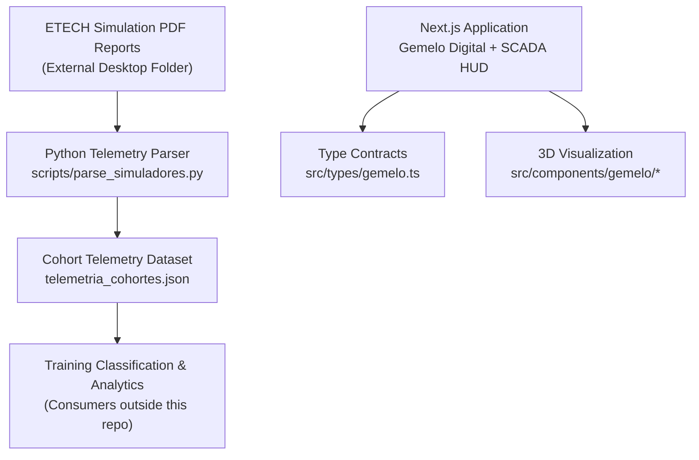
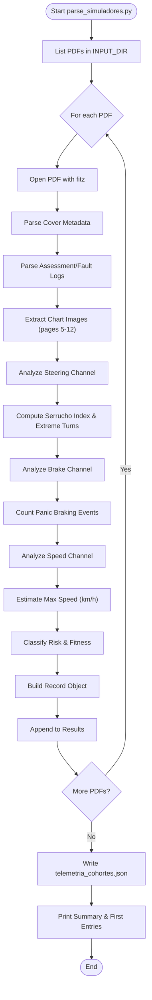
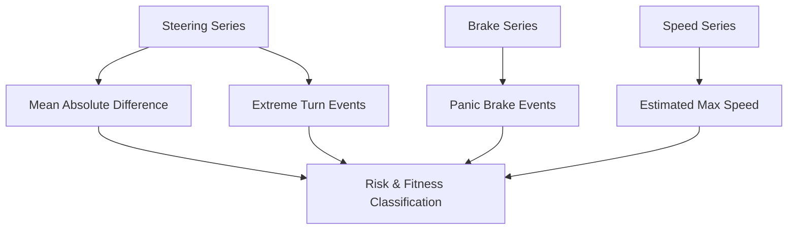
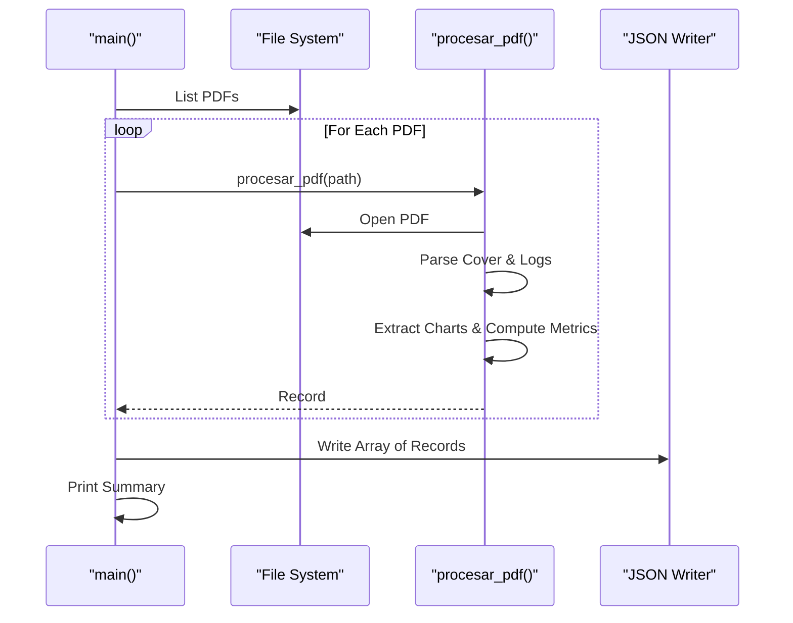
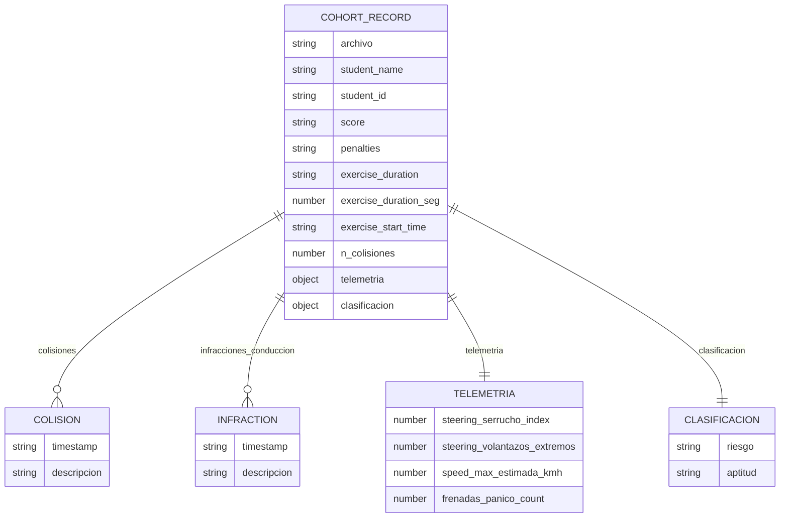
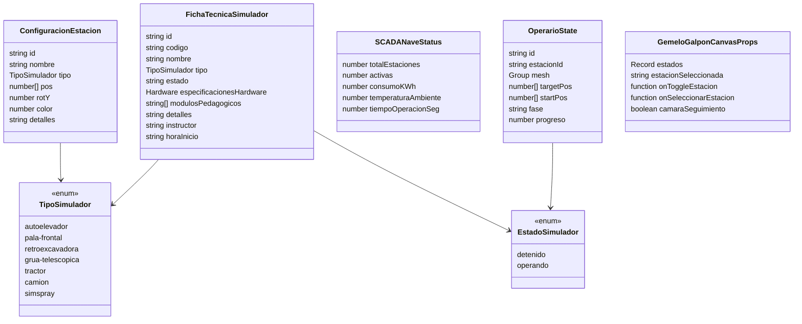
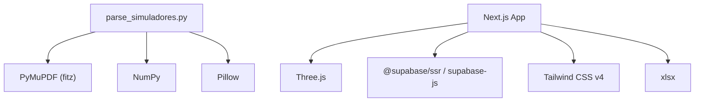

# Telemetry Processing Engine

<cite>
**Referenced Files in This Document**   
- [README.md](file://README.md)
- [package.json](file://package.json)
- [scripts/parse_simuladores.py](file://scripts/parse_simuladores.py)
- [telemetria_cohortes.json](file://telemetria_cohortes.json)
- [src/components/gemelo/GemeloGalponCanvas.tsx](file://src/components/gemelo/GemeloGalponCanvas.tsx)
- [src/components/gemelo/VisorNave3D.tsx](file://src/components/gemelo/VisorNave3D.tsx)
- [src/types/gemelo.ts](file://src/types/gemelo.ts)
- [docs/WIKI.md](file://docs/WIKI.md)
</cite>

## Table of Contents
1. [Introduction](#introduction)
2. [Project Structure](#project-structure)
3. [Core Components](#core-components)
4. [Architecture Overview](#architecture-overview)
5. [Detailed Component Analysis](#detailed-component-analysis)
6. [Dependency Analysis](#dependency-analysis)
7. [Performance Considerations](#performance-considerations)
8. [Troubleshooting Guide](#troubleshooting-guide)
9. [Conclusion](#conclusion)

## Introduction
This document describes the Telemetry Processing Engine used by the Simu-Twin Web platform to transform ETECH Simulation diagnostic PDF reports into structured telemetry data for cohorts of trainees. The engine extracts structured metadata, driving violations, collision events, and derived operational metrics from rasterized charts inside each report, then writes a cohort JSON artifact consumed by analytics and training classification workflows.

The broader application also includes a 3D digital twin with SCADA-style visualization, but this document focuses on the Python-based telemetry processing pipeline and its integration points within the project.

**Section sources**
- [README.md:1-10](file://README.md#L1-L10)
- [docs/WIKI.md:24-33](file://docs/WIKI.md#L24-L33)

## Project Structure
At the root of the repository, the telemetry processing engine is implemented as a standalone Python script that reads PDF diagnostics from an external folder and produces a JSON file at the project root. The web application provides a 3D SCADA-like interface and type contracts for simulation states, while the telemetry dataset is generated offline by the script.

**Diagram sources**
- [scripts/parse_simuladores.py:1-30](file://scripts/parse_simuladores.py#L1-L30)
- [telemetria_cohortes.json:1-40](file://telemetria_cohortes.json#L1-L40)
- [src/types/gemelo.ts:1-23](file://src/types/gemelo.ts#L1-L23)
- [src/components/gemelo/VisorNave3D.tsx:18-37](file://src/components/gemelo/VisorNave3D.tsx#L18-L37)

**Section sources**
- [scripts/parse_simuladores.py:1-30](file://scripts/parse_simuladores.py#L1-L30)
- [package.json:1-21](file://package.json#L1-L21)
- [docs/WIKI.md:87-155](file://docs/WIKI.md#L87-L155)

## Core Components
The telemetry processing engine consists of:
- A PDF parser that locates and interprets fixed-layout pages and embedded raster charts.
- Chart signal extraction using color masks and grid detection.
- Metric computation for steering behavior, braking intensity, and estimated maximum speed.
- Event extraction for collisions and driving infractions.
- Risk and fitness classification based on derived metrics.
- Output serialization into a cohort-level JSON structure.

Key responsibilities:
- Input discovery and iteration over PDF files.
- Page-specific parsing (cover page, assessment logs, fault logs, chart images).
- Image composition and mask handling for accurate curve extraction.
- Grid line detection and value mapping to physical units.
- Aggregation and classification logic.
- Error collection and summary reporting.

**Section sources**
- [scripts/parse_simuladores.py:18-46](file://scripts/parse_simuladores.py#L18-L46)
- [scripts/parse_simuladores.py:48-94](file://scripts/parse_simuladores.py#L48-L94)
- [scripts/parse_simuladores.py:97-173](file://scripts/parse_simuladores.py#L97-L173)
- [scripts/parse_simuladores.py:176-208](file://scripts/parse_simuladores.py#L176-L208)
- [scripts/parse_simuladores.py:211-269](file://scripts/parse_simuladores.py#L211-L269)
- [scripts/parse_simuladores.py:272-299](file://scripts/parse_simuladores.py#L272-L299)

## Architecture Overview
The telemetry processing architecture follows a batch-oriented pipeline:

**Diagram sources**
- [scripts/parse_simuladores.py:223-299](file://scripts/parse_simuladores.py#L223-L299)

## Detailed Component Analysis

### PDF Parsing and Metadata Extraction
The cover page parser extracts key-value pairs such as student identity, score, penalties, exercise duration, and start time. It uses a predefined set of field names and relies on adjacent lines for values.

- Cover fields include penalties, task, score, student name/id, class info, instructor, exercise details, equipment name, and timing.
- Duration strings are converted to seconds for consistent numeric analysis.

**Section sources**
- [scripts/parse_simuladores.py:48-63](file://scripts/parse_simuladores.py#L48-L63)
- [scripts/parse_simuladores.py:43-45](file://scripts/parse_simuladores.py#L43-L45)

### Event Log Parsing
Assessment and fault logs are parsed across multiple pages. The parser groups rows anchored by sequence numbers and timestamps, then associates multi-line descriptions with event types such as collisions or driving infractions. Marks and descriptions are captured per event.

- Event types include prechecks violations, driving issues, collisions, exercise tasks, and vehicle parking.
- The parser reconstructs tabular layout from plain text lines.

**Section sources**
- [scripts/parse_simuladores.py:66-94](file://scripts/parse_simuladores.py#L66-L94)
- [scripts/parse_simuladores.py:40-41](file://scripts/parse_simuladores.py#L40-L41)

### Chart Signal Extraction
Chart images embedded in the PDF are extracted and composed with alpha masks to produce clean RGB arrays. Grid lines are detected by analyzing gray bands and computing row centers; only equidistant rows are retained. The purple curve is isolated via color thresholds, and the mean pixel row per column yields the curve series.

- Grid detection filters diagonal labels and keeps evenly spaced horizontal lines.
- Curve extraction isolates violet-colored traces and computes y-values relative to top/bottom grid lines.
- Value mapping converts pixel coordinates to physical units using channel-specific grid steps.

**Section sources**
- [scripts/parse_simuladores.py:97-113](file://scripts/parse_simuladores.py#L97-L113)
- [scripts/parse_simuladores.py:116-138](file://scripts/parse_simuladores.py#L116-L138)
- [scripts/parse_simuladores.py:141-152](file://scripts/parse_simuladores.py#L141-L152)
- [scripts/parse_simuladores.py:155-173](file://scripts/parse_simuladores.py#L155-L173)
- [scripts/parse_simuladores.py:37-38](file://scripts/parse_simuladores.py#L37-L38)

### Derived Metrics
Three primary channels are analyzed:
- Steering: Computes the absolute difference mean (serrucho index) and counts extreme turns near mechanical limits.
- Brake: Counts panic braking events by thresholding high brake values.
- Speed: Estimates maximum speed from the peak of the speed channel.

These metrics feed into risk and fitness classification.

**Diagram sources**
- [scripts/parse_simuladores.py:176-208](file://scripts/parse_simuladores.py#L176-L208)
- [scripts/parse_simuladores.py:211-220](file://scripts/parse_simuladores.py#L211-L220)

**Section sources**
- [scripts/parse_simuladores.py:176-208](file://scripts/parse_simuladores.py#L176-L208)

### Classification Logic
Classification determines risk level and fitness status based on collision count, steering serrucho index, and panic braking count. Thresholds define three categories: minimal autonomous, medium observation, and high conditional.

- Minimal autonomous requires low collisions, low serrucho index, and few panic brakes.
- Medium allows slightly more collisions and higher serrucho index.
- High indicates elevated risk requiring conditional approval.

**Section sources**
- [scripts/parse_simuladores.py:211-220](file://scripts/parse_simuladores.py#L211-L220)

### Record Construction and Output
Each processed PDF yields a record containing:
- File reference and student identifiers.
- Score and penalties.
- Exercise duration in string and seconds.
- Start time.
- Collision list and count.
- Driving infractions list.
- Telemetry metrics object.
- Classification object with risk and fitness.

The main function iterates all PDFs, collects results, writes JSON, and prints a summary including failures and first entries.

**Diagram sources**
- [scripts/parse_simuladores.py:272-299](file://scripts/parse_simuladores.py#L272-L299)
- [scripts/parse_simuladores.py:223-269](file://scripts/parse_simuladores.py#L223-L269)

**Section sources**
- [scripts/parse_simuladores.py:223-269](file://scripts/parse_simuladores.py#L223-L269)
- [scripts/parse_simuladores.py:272-299](file://scripts/parse_simuladores.py#L272-L299)

### Data Model: Cohort Telemetry Record
The output JSON contains an array of records. Each record includes:
- archivo: source PDF filename.
- student_name and student_id: trainee identity.
- score and penalties: evaluation outcomes.
- exercise_duration and exercise_duration_seg: duration in string and seconds.
- exercise_start_time: timestamp of exercise start.
- colisiones: list of collision events with timestamp and description.
- n_colisiones: total collision count.
- infracciones_conduccion: list of driving infractions with timestamp and description.
- telemetria: derived metrics including steering serrucho index, extreme turns, estimated max speed, and panic brake count.
- clasificacion: risk and fitness classification.

**Diagram sources**
- [telemetria_cohortes.json:1-40](file://telemetria_cohortes.json#L1-L40)

**Section sources**
- [telemetria_cohortes.json:1-40](file://telemetria_cohortes.json#L1-L40)

### Integration With 3D Visualization and SCADA
While the telemetry processing engine generates offline datasets, the application’s 3D visualization and SCADA HUD provide real-time operational context for simulation stations. The type contracts define simulation states and station configurations, which are rendered in the canvas component and exposed through the viewer component.

- Type contracts define simulator types, states, station configuration, operator state, and SCADA status.
- The 3D canvas builds procedural geometry for stations and manages interactive controls.
- The viewer wraps the canvas, maps states, and renders HUD elements indicating active stations.

**Diagram sources**
- [src/types/gemelo.ts:3-12](file://src/types/gemelo.ts#L3-L12)
- [src/types/gemelo.ts:14-23](file://src/types/gemelo.ts#L14-L23)
- [src/types/gemelo.ts:33-46](file://src/types/gemelo.ts#L33-L46)
- [src/types/gemelo.ts:58-64](file://src/types/gemelo.ts#L58-L64)
- [src/types/gemelo.ts:68-83](file://src/types/gemelo.ts#L68-L83)
- [src/types/gemelo.ts:85-91](file://src/types/gemelo.ts#L85-L91)

**Section sources**
- [src/types/gemelo.ts:1-92](file://src/types/gemelo.ts#L1-L92)
- [src/components/gemelo/GemeloGalponCanvas.tsx:1-34](file://src/components/gemelo/GemeloGalponCanvas.tsx#L1-L34)
- [src/components/gemelo/VisorNave3D.tsx:18-37](file://src/components/gemelo/VisorNave3D.tsx#L18-L37)
- [src/components/gemelo/VisorNave3D.tsx:175-192](file://src/components/gemelo/VisorNave3D.tsx#L175-L192)
- [src/components/gemelo/VisorNave3D.tsx:223-246](file://src/components/gemelo/VisorNave3D.tsx#L223-L246)

## Dependency Analysis
The telemetry processing engine depends on:
- PyMuPDF (fitz) for PDF reading and image extraction.
- NumPy for vectorized operations on image arrays and metric computation.
- Pillow for image manipulation and alpha compositing.

The web application depends on:
- Next.js, React, TypeScript, Tailwind CSS.
- Three.js for 3D rendering.
- Supabase client libraries for authentication and data access.
- XLSX for export capabilities.

**Diagram sources**
- [scripts/parse_simuladores.py:18-26](file://scripts/parse_simuladores.py#L18-L26)
- [package.json:11-21](file://package.json#L11-L21)

**Section sources**
- [scripts/parse_simuladores.py:18-26](file://scripts/parse_simuladores.py#L18-L26)
- [package.json:11-21](file://package.json#L11-L21)

## Performance Considerations
- Image processing uses NumPy vectorization for efficient pixel-wise operations, reducing overhead compared to pure Python loops.
- Grid detection relies on median gap calculation to filter noise and ensure robust row center estimation.
- Chart extraction avoids unnecessary conversions by composing RGBA images once and converting to RGB for analysis.
- The main loop processes PDFs sequentially; batching or parallelization could improve throughput if input volume grows significantly.
- Memory usage scales with the number and size of embedded chart images; consider limiting resolution or caching intermediate results if needed.

[No sources needed since this section provides general guidance]

## Troubleshooting Guide
Common issues and resolutions:
- Missing or incorrect INPUT_DIR path: Ensure the directory exists and contains valid PDFs.
- Unexpected page layouts: The parser assumes a fixed 16-page structure; deviations may cause missing charts or misaligned indices.
- Color mask failures: If chart colors differ from expected violet traces, adjust thresholds in curve extraction.
- Grid detection errors: Non-uniform grids or heavy annotations can break row center detection; verify grid step constants.
- Classification anomalies: Adjust thresholds in classification logic if training standards change.

Error handling:
- The main function catches exceptions per PDF and accumulates failures for reporting.
- Failed entries are printed with filenames and exception messages to aid debugging.

**Section sources**
- [scripts/parse_simuladores.py:272-299](file://scripts/parse_simuladores.py#L272-L299)

## Conclusion
The Telemetry Processing Engine transforms ETECH Simulation PDF diagnostics into structured cohort telemetry data through robust PDF parsing, chart signal extraction, and metric derivation. Its output supports training classification and analytics workflows. While the engine operates offline, it complements the application’s 3D SCADA visualization and type-driven simulation model, enabling comprehensive oversight of training operations and safety performance.

[No sources needed since this section summarizes without analyzing specific files]