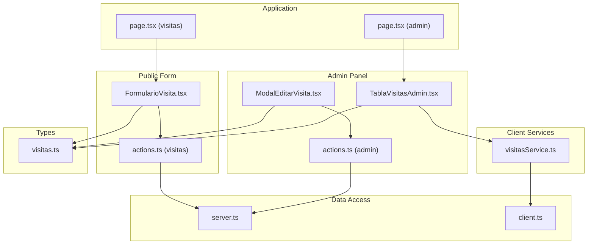
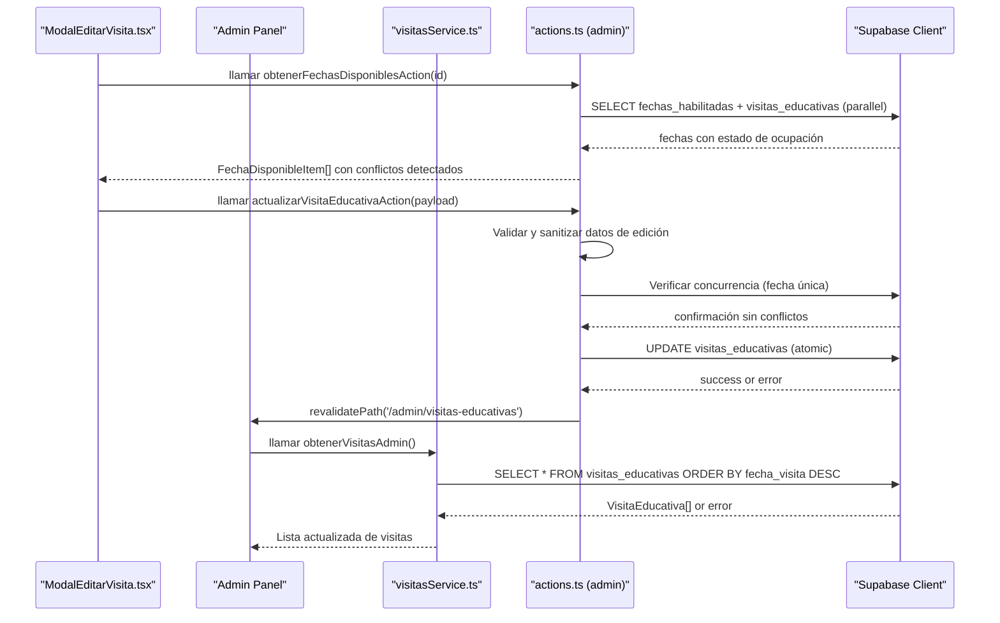
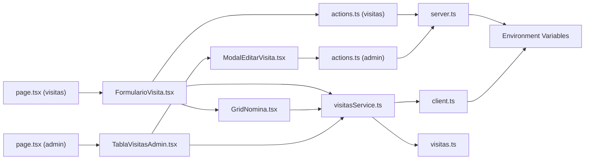

# Visit Management Service

<cite>
**Referenced Files in This Document**
- [actions.ts](file://src/app/visitas/actions.ts)
- [actions.ts](file://src/app/admin/visitas-educativas/actions.ts)
- [visitasService.ts](file://src/services/visitasService.ts)
- [visitas.ts](file://src/types/visitas.ts)
- [server.ts](file://src/lib/supabase/server.ts)
- [client.ts](file://src/lib/supabase/client.ts)
- [FormularioVisita.tsx](file://src/components/visitas/FormularioVisita.tsx)
- [GridNomina.tsx](file://src/components/visitas/GridNomina.tsx)
- [page.tsx](file://src/app/visitas/page.tsx)
- [page.tsx](file://src/app/admin/visitas-educativas/page.tsx)
- [TablaVisitasAdmin.tsx](file://src/components/admin/visitas/TablaVisitasAdmin.tsx)
- [ModalEditarVisita.tsx](file://src/components/admin/visitas/ModalEditarVisita.tsx)
</cite>

## Update Summary
**Changes Made**
- **Major Enhancement**: Added comprehensive educational visit editing capabilities with sophisticated validation and concurrent request handling
- **New Server Actions**: Implemented `actualizarVisitaEducativaAction()` and `obtenerFechasDisponiblesAction()` for administrative editing workflows
- **Enhanced UI Components**: Added `ModalEditarVisita.tsx` with real-time fecha disponible checking and conflict prevention
- **Improved Validation**: Enhanced validation rules including TUP schedule validation, state management, and capacity limits
- **Concurrent Request Handling**: Optimized data loading with parallel requests for improved performance
- **Type Safety**: Extended TypeScript interfaces with `FechaDisponibleItem`, `EditarVisitaInput`, and `ResultadoEdicionVisita`

## Table of Contents
1. [Introduction](#introduction)
2. [Project Structure](#project-structure)
3. [Core Components](#core-components)
4. [Architecture Overview](#architecture-overview)
5. [Server Actions Implementation](#server-actions-implementation)
6. [Administrative Edit Capabilities](#administrative-edit-capabilities)
7. [Detailed Component Analysis](#detailed-component-analysis)
8. [Dependency Analysis](#dependency-analysis)
9. [Performance Considerations](#performance-considerations)
10. [Troubleshooting Guide](#troubleshooting-guide)
11. [Conclusion](#conclusion)
12. [Appendices](#appendices)

## Introduction
This document explains the enhanced Visit Management Service that encapsulates all educational visit business logic for a streamlined booking system with comprehensive administrative editing capabilities. The service has been significantly upgraded with **advanced editing features** including real-time fecha disponible checking, concurrent request handling, and sophisticated validation for administrative edit workflows.

**Core Functions:**
- obtenerEscuelas(): fetches school data from the database (client-side service)
- verificarTurnoDisponible(): checks time slot availability with conflict prevention (client-side service)
- crearSolicitudVisitaAction(): creates new visit requests with automatic status assignment through Server Actions

**Administrative Operations:**
- obtenerVisitasAdmin(): retrieves all educational visits for administrative panel display
- actualizarCheckOperativo(): updates operational check statuses (insurance, TUP, invoices, Drive upload)
- obtenerAsistentesPorVisita(): fetches attendee lists for specific visits
- **actualizarVisitaEducativaAction()**: updates existing visits with comprehensive validation and concurrency control
- **obtenerFechasDisponiblesAction()**: retrieves available dates with occupancy status for editing workflows

The service follows a hybrid architecture pattern that separates concerns between client-side data fetching and server-side critical operations, centralizing Supabase integration for type-safe operations while maintaining security through Server Actions and enhanced administrative controls.

## Project Structure
The project is organized into focused modules with enhanced editing capabilities:
- **Server Actions layer**: contains secure business logic for visit creation and editing operations (actions.ts files).
- **Services layer**: contains client-side business logic for read operations (visitasService.ts).
- **Types layer**: defines TypeScript interfaces for strong typing including new editing types (visitas.ts).
- **Data access layer**: configures both client and server Supabase clients (server.ts, client.ts).
- **UI components**: implements user interfaces with integrated service and action calls including editing modal (FormularioVisita.tsx, GridNomina.tsx, ModalEditarVisita.tsx).
- **Application pages**: routes and page composition for both public and admin interfaces (page.tsx files).

**Diagram sources**
- [FormularioVisita.tsx:1-749](file://src/components/visitas/FormularioVisita.tsx#L1-L749)
- [ModalEditarVisita.tsx:1-625](file://src/components/admin/visitas/ModalEditarVisita.tsx#L1-L625)
- [actions.ts:170-321](file://src/app/visitas/actions.ts#L170-L321)
- [actions.ts:200-332](file://src/app/admin/visitas-educativas/actions.ts#L200-L332)
- [visitasService.ts:1-105](file://src/services/visitasService.ts#L1-L105)
- [visitas.ts:1-128](file://src/types/visitas.ts#L1-L128)

**Section sources**
- [FormularioVisita.tsx:1-749](file://src/components/visitas/FormularioVisita.tsx#L1-L749)
- [ModalEditarVisita.tsx:1-625](file://src/components/admin/visitas/ModalEditarVisita.tsx#L1-L625)
- [actions.ts:170-321](file://src/app/visitas/actions.ts#L170-L321)
- [actions.ts:200-332](file://src/app/admin/visitas-educativas/actions.ts#L200-L332)
- [visitasService.ts:1-105](file://src/services/visitasService.ts#L1-L105)
- [visitas.ts:1-128](file://src/types/visitas.ts#L1-L128)

## Core Components
- Escuela: represents a school record with identifiers and contact details.
- FechaHabilitada: represents enabled dates for educational visits with optional observations.
- **FechaDisponibleItem**: extended date representation with occupancy status and conflict information for editing workflows.
- TurnoVisita: union type restricting shifts to morning or afternoon (maintained for compatibility but no longer manually selected).
- AnioEscolar: academic year type ('5°' | '6°').
- RolAsistente: role classification for attendees ('Alumno' | 'Docente').
- AsistenteInput: represents attendees (students and teachers) with role classification.
- SolicitudVisitaInput: input shape for creating a visit request with automated TUP calculation and mandatory attendee list.
- **EditarVisitaInput**: comprehensive input type for editing existing visits with validation constraints.
- VisitaEducativa: full visit record including system-managed fields like IDs, statuses, and automatically calculated TUP schedules.
- CampoCheckOperativo: operational status fields for administrative tracking (insurance, TUP, invoices, Drive upload).
- AsistenteVisita: attendee record associated with a specific educational visit.

These types ensure compile-time safety across the service and any UI components that consume it, with enhanced support for editing workflows.

**Section sources**
- [visitas.ts:1-128](file://src/types/visitas.ts#L1-L128)

## Architecture Overview
The service uses an **enhanced hybrid architecture** combining client-side services for read operations and Server Actions for write operations with advanced editing capabilities:
- **Client-side services** handle data retrieval (schools, dates, availability checks) for better performance and user experience.
- **Server Actions** handle critical write operations (visit creation and editing) with enhanced security, validation, and atomicity.
- **Real-time fecha disponible checking** provides immediate feedback during editing workflows with concurrent request optimization.
- **Advanced validation** includes TUP schedule validation, state management, and capacity limits for editing operations.
- **Concurrency control** prevents race conditions during edit operations with pre-validation and database constraint enforcement.
- The service enforces business rules including mandatory roster validation and delegates persistence to Supabase via centralized clients.
- Errors are thrown consistently so callers can handle them uniformly.
- Transportation logistics (TUP) are automatically calculated based on school selection rather than manual configuration.
- Form validation ensures all required fields including attendee lists are complete before submission.
- Administrative operations provide complete visibility and control over the visit management workflow with editing capabilities.

**Diagram sources**
- [ModalEditarVisita.tsx:133-153](file://src/components/admin/visitas/ModalEditarVisita.tsx#L133-L153)
- [actions.ts:114-176](file://src/app/admin/visitas-educativas/actions.ts#L114-L176)
- [actions.ts:200-332](file://src/app/admin/visitas-educativas/actions.ts#L200-L332)
- [visitasService.ts:60-70](file://src/services/visitasService.ts#L60-L70)

## Server Actions Implementation

### Function: crearSolicitudVisitaAction()
Purpose:
- Create a new educational visit request with comprehensive validation, security, and atomic database operations through Server Actions.

**Security Enhancements:**
- **PII-safe logging**: Logs only non-sensitive error information (code, message) without exposing personal data.
- **Strict input validation**: Validates all input data before any database operations.
- **Atomic operations**: Ensures database consistency by validating all data before insertion.
- **White-listed columns**: Only allows specific columns to be inserted, preventing malicious data injection.

Business rules:
- Prevents double booking by checking database constraints.
- Automatically sets initial statuses:
  - Visit status: confirmed
  - Insurance policy status: pending
- Enforces maximum student capacity of 40 students per session.
- Requires legal consent acceptance before submission.
- **Requires mandatory attendee roster**: At least one attendee must be provided before reservation confirmation.
- **Automatically calculates TUP (public transportation) requirements based on school selection**: schools from the official list receive municipal transportation, while custom institutions do not.

Validation and sanitization:
- **Date validation**: Validates ISO format and calendar validity before database insertion.
- **Attendee validation**: Sanitizes and validates all attendee data including birth dates.
- **Capacity validation**: Ensures student count doesn't exceed maximum limits.
- **Legal consent validation**: Verifies both image usage and judicial measures consent.

Workflow:
- Validate legal consent acceptance and student capacity limits.
- **Validate mandatory attendee roster**: Ensure at least one attendee is provided.
- Determine TUP requirement: `requiere_tup = !!datos.id_escuela` (true if selecting from official school list).
- Generate unique reservation code.
- Execute atomic insert operation with all validated data.
- Insert associated attendees if provided.
- Return created VisitaEducativa object with server-authoritative values.

Error handling:
- Throws structured errors with user-friendly Spanish messages.
- Handles database constraint violations (duplicate bookings) specifically.
- Provides fallback generic error messages for unexpected failures.
- Uses PII-safe logging to protect sensitive data in logs.

Type safety:
- Input conforms to SolicitudVisitaInput.
- Output conforms to ResultadoSolicitud union type.
- All intermediate data structures are strongly typed.

**Section sources**
- [actions.ts:170-321](file://src/app/visitas/actions.ts#L170-L321)
- [visitas.ts:28-73](file://src/types/visitas.ts#L28-L73)

### Function: actualizarVisitaEducativaAction()
Purpose:
- Update an existing educational visit with comprehensive validation, concurrency control, and atomic database operations through Server Actions.

**Enhanced Security Features:**
- **PII-safe logging**: Logs only non-sensitive error information without exposing personal data.
- **Strict input validation**: Validates all input data before any database operations.
- **Concurrency control**: Prevents race conditions with pre-validation and database constraint enforcement.
- **White-listed columns**: Only allows specific columns to be updated, preventing unauthorized field modifications.

**Advanced Business Rules:**
- **Capacity validation**: Enforces maximum student capacity of 45 students per session (higher limit for administrative edits).
- **State management**: Automatically transitions states when dates change (e.g., "Confirmada" → "Reprogramada").
- **TUP schedule validation**: Validates time formats for transportation schedules when required.
- **Conflict prevention**: Checks for date conflicts before allowing updates to prevent double bookings.

**Sophisticated Validation:**
- **Date validation**: Validates ISO format and calendar validity with enhanced error handling.
- **Time validation**: Ensures TUP schedules follow proper HH:MM format when transportation is required.
- **State validation**: Restricts updates to predefined valid states only.
- **Field validation**: Validates all input fields including optional fields with proper null handling.

**Concurrency Control Workflow:**
- Pre-validate all input data before database operations.
- Check for date conflicts excluding the current visit being edited.
- Handle state transitions automatically when dates change.
- Execute atomic UPDATE operation with white-listed columns only.
- Revalidate path to refresh admin interface after successful updates.

Error handling:
- Returns structured error responses with user-friendly Spanish messages.
- Handles database constraint violations (unique date conflicts) specifically.
- Provides fallback generic error messages for unexpected failures.
- Uses PII-safe logging to protect sensitive data in logs.

Type safety:
- Input conforms to EditarVisitaInput with comprehensive field validation.
- Output conforms to ResultadoEdicionVisita union type.
- All intermediate data structures are strongly typed with proper null handling.

**Updated** Enhanced with sophisticated validation, concurrency control, and administrative editing capabilities.

**Section sources**
- [actions.ts:200-332](file://src/app/admin/visitas-educativas/actions.ts#L200-L332)
- [visitas.ts:102-128](file://src/types/visitas.ts#L102-L128)

### Function: obtenerFechasDisponiblesAction()
Purpose:
- Retrieve available dates for educational visit editing with real-time occupancy status and conflict detection.

**Enhanced Features:**
- **Parallel data loading**: Uses Promise.all() to load habilitadas dates and occupied visits simultaneously for optimal performance.
- **Real-time conflict detection**: Identifies dates already occupied by other active visits (excluding cancelled ones).
- **Context-aware filtering**: Excludes the current visit being edited from conflict detection to allow date preservation.
- **Rich data structure**: Returns FechaDisponibleItem objects with occupancy status and conflict information.

**Business Logic:**
- Filters enabled dates from today onwards with proper date comparison.
- Loads all active visits (non-cancelled) to identify occupied dates.
- Creates efficient Map-based lookup for conflict detection.
- Marks dates as occupied only if they belong to different visits than the one being edited.
- Includes reservation codes for UI display of conflict information.

**Performance Optimization:**
- Parallel database queries reduce total loading time significantly.
- Efficient Map-based conflict detection algorithm (O(n) complexity).
- Minimal data transfer with selective field projection.
- Proper error handling with fallback to empty arrays on database errors.

Error handling:
- Comprehensive error handling for both parallel queries.
- PII-safe logging that captures only error codes and messages.
- Graceful degradation returns empty arrays on database errors.
- User-friendly error messages for failed operations.

Type safety:
- Returns FechaDisponibleItem[] with complete occupancy information.
- Strongly typed conflict detection with proper null handling.
- Union type return for consistent error handling patterns.

**Updated** Enhanced with concurrent request handling and sophisticated conflict detection for editing workflows.

**Section sources**
- [actions.ts:114-176](file://src/app/admin/visitas-educativas/actions.ts#L114-L176)
- [visitas.ts:90-100](file://src/types/visitas.ts#L90-L100)

## Administrative Edit Capabilities

### Enhanced Editing Modal
The new `ModalEditarVisita.tsx` component provides comprehensive editing capabilities with real-time validation and user feedback:

**Key Features:**
- **Real-time fecha disponible checking**: Loads available dates with occupancy status when modal opens.
- **Conflict prevention**: Disables occupied dates in the dropdown with clear visual indicators showing which reservation occupies the date.
- **Comprehensive form validation**: Validates all fields including TUP schedules, contact information, and attendance numbers.
- **State management**: Automatically handles state transitions when dates change (e.g., "Confirmada" → "Reprogramada").
- **Optimistic UI updates**: Shows loading states and provides immediate user feedback during operations.

**User Experience Enhancements:**
- **Visual conflict indicators**: Shows "(OCUPADA)" with reservation codes for occupied dates.
- **Reprogramming warnings**: Displays amber warning banners when dates are changed to alert users of potential scheduling impacts.
- **Conditional field rendering**: TUP schedule fields only appear when transportation is required.
- **Keyboard accessibility**: Supports Escape key to close modal and proper ARIA attributes for screen readers.

**Technical Implementation:**
- Uses React's useTransition hook for smooth UI updates during async operations.
- Implements proper cleanup functions to prevent memory leaks and race conditions.
- Integrates with Server Actions for all data mutations with proper error handling.
- Maintains form state synchronization with selected visit data.

**Section sources**
- [ModalEditarVisita.tsx:1-625](file://src/components/admin/visitas/ModalEditarVisita.tsx#L1-L625)

### Enhanced Admin Table Integration
The `TablaVisitasAdmin.tsx` component now integrates seamlessly with the editing capabilities:

**New Features:**
- **Edit button integration**: Each visit row includes an edit button that opens the ModalEditarVisita with pre-populated data.
- **Dynamic modal loading**: Uses Next.js dynamic imports for optimal bundle size and performance.
- **State synchronization**: Automatically reloads visit data after successful edits to reflect changes immediately.
- **Enhanced visual design**: Consistent styling with the rest of the admin interface using Tailwind CSS classes.

**Section sources**
- [TablaVisitasAdmin.tsx:1-349](file://src/components/admin/visitas/TablaVisitasAdmin.tsx#L1-L349)

## Detailed Component Analysis

### Function: obtenerEscuelas()
Purpose:
- Retrieve schools sorted by institution name.
- Return an array of Escuela objects.

Behavior:
- Queries the escuelas table with a specific projection and ordering.
- Throws on database errors; returns an empty array if no rows exist.

Usage example (conceptual):
- Call the function when loading a dropdown of schools.
- Handle potential network or permission errors.

Validation and constraints:
- None beyond database schema; relies on Supabase permissions and schema.

Error handling:
- Any Supabase error is thrown to the caller for consistent handling.

Type safety:
- Returns Escuela[], typed by the interface.

**Section sources**
- [visitasService.ts:11-21](file://src/services/visitasService.ts#L11-L21)
- [visitas.ts:1-6](file://src/types/visitas.ts#L1-L6)

### Function: obtenerFechasHabilitadas()
Purpose:
- Retrieve enabled dates for educational visits.
- Return an array of FechaHabilitada objects with optional observations.

Behavior:
- Queries the fechas_habilitadas table filtering only enabled dates.
- Orders results by date ascending.
- Throws on database errors; returns an empty array if no rows exist.

Usage example (conceptual):
- Call the function alongside obtenerEscuelas() to populate available dates.
- Display dates with any associated observations to users.

Validation and constraints:
- Filters for habilitada = true only.
- Relies on Supabase permissions and schema.

Error handling:
- Any Supabase error is thrown to the caller for consistent handling.

Type safety:
- Returns FechaHabilitada[], typed by the interface.

**Section sources**
- [visitasService.ts:23-34](file://src/services/visitasService.ts#L23-L34)
- [visitas.ts:8-13](file://src/types/visitas.ts#L8-L13)

### Function: verificarTurnoDisponible()
Purpose:
- Check whether a given date and shift are available for scheduling.

Business rule:
- A slot is considered unavailable if there exists at least one non-cancelled visit for that date and shift.

Algorithm overview:
- Query visitas_educativas for matching date and shift while excluding cancelled visits.
- If any records are found, the slot is not available.

Complexity:
- O(k) where k is the number of conflicting records; typically small due to indexing on date and shift.

Usage example (conceptual):
- Disable a submit button or show a warning when a user selects an already-booked slot.

Error handling:
- Throws on database errors; otherwise returns a boolean indicating availability.

Type safety:
- Uses TurnoVisita union to restrict allowed values.

**Section sources**
- [visitasService.ts:36-51](file://src/services/visitasService.ts#L36-L51)
- [visitas.ts:15-15](file://src/types/visitas.ts#L15-L15)

## Dependency Analysis
- **Server Actions** depend on:
  - Server Supabase client for secure database operations.
  - Shared constants and types for consistency.
- **Client Services** depend on:
  - Client Supabase client for browser-based operations.
  - TypeScript interfaces for type safety.
- **Supabase clients** depend on environment variables for URL and anonymous key.
- **UI components** depend on both server actions and client services for complete functionality.
- **Admin components** depend on client services for administrative operations and Server Actions for editing workflows.
- **Editing modal** depends on admin Server Actions for fecha disponible checking and visit updates.

**Diagram sources**
- [actions.ts:1-6](file://src/app/visitas/actions.ts#L1-L6)
- [actions.ts:1-9](file://src/app/admin/visitas-educativas/actions.ts#L1-L9)
- [visitasService.ts:1-9](file://src/services/visitasService.ts#L1-L9)
- [FormularioVisita.tsx:3-17](file://src/components/visitas/FormularioVisita.tsx#L3-L17)
- [ModalEditarVisita.tsx:3-13](file://src/components/admin/visitas/ModalEditarVisita.tsx#L3-L13)
- [TablaVisitasAdmin.tsx:3-11](file://src/components/admin/visitas/TablaVisitasAdmin.tsx#L3-L11)
- [server.ts:1-41](file://src/lib/supabase/server.ts#L1-L41)
- [client.ts:1-34](file://src/lib/supabase/client.ts#L1-L34)
- [page.tsx:1-8](file://src/app/visitas/page.tsx#L1-L8)
- [page.tsx:1-26](file://src/app/admin/visitas-educativas/page.tsx#L1-L26)

**Section sources**
- [actions.ts:1-6](file://src/app/visitas/actions.ts#L1-L6)
- [actions.ts:1-9](file://src/app/admin/visitas-educativas/actions.ts#L1-L9)
- [visitasService.ts:1-9](file://src/services/visitasService.ts#L1-L9)
- [FormularioVisita.tsx:3-17](file://src/components/visitas/FormularioVisita.tsx#L3-L17)
- [ModalEditarVisita.tsx:3-13](file://src/components/admin/visitas/ModalEditarVisita.tsx#L3-L13)
- [TablaVisitasAdmin.tsx:3-11](file://src/components/admin/visitas/TablaVisitasAdmin.tsx#L3-L11)
- [server.ts:1-41](file://src/lib/supabase/server.ts#L1-L41)
- [client.ts:1-34](file://src/lib/supabase/client.ts#L1-L34)
- [page.tsx:1-8](file://src/app/visitas/page.tsx#L1-L8)
- [page.tsx:1-26](file://src/app/admin/visitas-educativas/page.tsx#L1-L26)

## Performance Considerations
- **Parallel data loading**: Using Promise.all() for schools, dates, and occupancy status improves initial load performance significantly.
- **Optimized queries**: Minimize payload size by selecting only needed columns in client services and Server Actions.
- **Efficient admin operations**: Administrative operations use efficient queries with proper filtering and ordering.
- **Atomic operations**: Server Actions perform atomic database operations to prevent race conditions.
- **Client-side caching**: School lists can be cached in UI state when appropriate to reduce redundant calls.
- **Batch operations**: Consider future enhancements for batch operations if volume increases.
- **Index optimization**: Ensure indexes on visitas_educativas(fecha_visita, turno) to speed up availability checks.
- **PII-safe logging**: Reduced log verbosity protects sensitive data while maintaining debugging capability.
- **Concurrent request handling**: New editing capabilities use parallel queries to minimize loading times.
- **Optimistic UI updates**: Admin table provides immediate visual feedback for operational status changes.

## Troubleshooting Guide
Common issues and resolutions:
- **Slot already booked**:
  - Occurs when creating a visit for a date and shift that has a non-cancelled visit.
  - Resolution: choose another date or shift; verify existing bookings.
- **Database errors**:
  - Network, authentication, or permission errors will be thrown by Supabase.
  - Resolution: check environment configuration, RLS policies, and connection settings.
- **Type mismatches**:
  - Passing invalid shift values will cause TypeScript errors at compile time.
  - Resolution: use the provided TurnoVisita type to constrain inputs.
- **Capacity exceeded**:
  - Occurs when student count exceeds the 40-student maximum limit (public) or 45-student limit (editing).
  - Resolution: reduce student count or split into multiple sessions.
- **Legal consent not accepted**:
  - Occurs when users don't accept required legal conditions before submission.
  - Resolution: ensure both image usage and judicial measures checkboxes are checked.
- **Invalid school selection**:
  - Occurs when neither an official school nor a custom institution name is provided.
  - Resolution: select from the official school list or provide a custom institution name.
- **Missing attendee roster**:
  - Occurs when users try to submit without adding at least one attendee.
  - Resolution: add at least one student or teacher to the attendee list before submission.
- **Invalid attendee data**:
  - Occurs when attendee information is incomplete or malformed.
  - Resolution: ensure all required attendee fields are properly filled out.
- **Administrative operation failures**:
  - Occurs when attempting to update non-existent visits or invalid operational fields.
  - Resolution: verify visit IDs exist and use only supported operational field names.
- **Attendee retrieval errors**:
  - Occurs when querying attendees for visits without associated attendee records.
  - Resolution: handle empty arrays gracefully in administrative interfaces.
- **Server Action validation errors**:
  - Occurs when input data fails validation in Server Actions.
  - Resolution: check form data completeness and validate user inputs before submission.
- **PII-safe logging issues**:
  - Occurs when sensitive data appears in logs despite protection measures.
  - Resolution: review logging functions to ensure they only capture non-sensitive error information.
- **Date conflict during editing**:
  - Occurs when trying to reschedule a visit to an already occupied date.
  - Resolution: choose an available date from the fecha disponible dropdown or resolve conflicts first.
- **Invalid TUP schedule format**:
  - Occurs when transportation schedules don't follow proper HH:MM format.
  - Resolution: ensure all TUP time fields use valid time format (HH:MM or HH:MM:SS).
- **Concurrent modification conflicts**:
  - Occurs when multiple administrators try to edit the same visit simultaneously.
  - Resolution: implement proper locking mechanisms or handle optimistic updates gracefully.

Error propagation:
- All service functions throw errors on failure; callers should wrap calls in try/catch blocks and present user-friendly messages.
- Server Actions return structured ResultadoSolicitud and ResultadoEdicionVisita objects with clear success/failure states.

**Updated** Added troubleshooting guidance for new editing capabilities including date conflicts, TUP schedule validation, and concurrent modification scenarios.

**Section sources**
- [actions.ts:174-224](file://src/app/visitas/actions.ts#L174-L224)
- [actions.ts:272-284](file://src/app/visitas/actions.ts#L272-L284)
- [actions.ts:203-245](file://src/app/admin/visitas-educativas/actions.ts#L203-L245)
- [actions.ts:316-327](file://src/app/admin/visitas-educativas/actions.ts#L316-L327)
- [visitasService.ts:18-19](file://src/services/visitasService.ts#L18-L19)
- [visitasService.ts:48-49](file://src/services/visitasService.ts#L48-L49)
- [visitasService.ts:67-68](file://src/services/visitasService.ts#L67-L68)
- [visitasService.ts:87-88](file://src/services/visitasService.ts#L87-L88)
- [visitasService.ts:101-102](file://src/services/visitasService.ts#L101-L102)
- [FormularioVisita.tsx:152-191](file://src/components/visitas/FormularioVisita.tsx#L152-L191)

## Conclusion
The Visit Management Service has been successfully enhanced with **comprehensive educational visit editing capabilities** including real-time fecha disponible checking, concurrent request handling, and sophisticated validation for administrative edit workflows. The enhanced hybrid architecture maintains optimal performance for read operations while ensuring data integrity and security for critical write operations.

Key improvements include:
- **Enhanced Security**: Server Actions provide secure data processing with PII-safe logging and strict input validation for both creation and editing operations.
- **Advanced Editing Features**: Complete visit editing capabilities with real-time conflict detection and validation.
- **Concurrency Control**: Sophisticated conflict prevention mechanisms for simultaneous editing operations.
- **Improved Validation**: Comprehensive server-side validation catches errors before database operations for both new and existing visits.
- **Better User Experience**: Real-time fecha disponible checking with visual conflict indicators and optimistic UI updates.
- **Type Safety**: Strong TypeScript typing throughout the entire application stack with enhanced editing types.
- **Administrative Capabilities**: Complete visibility and control over the visit management lifecycle with editing workflows.
- **Performance Optimization**: Parallel data loading and optimized queries for improved responsiveness.

The system now provides a robust foundation for educational visit scheduling with enhanced security, reliability, maintainability, and comprehensive administrative editing capabilities. By following the patterns described here, you can reliably schedule visits, manage school data, maintain operational workflows, edit existing reservations safely, and scale the system effectively while maintaining high security standards.

## Appendices

### API Reference Summary
**Server Actions:**
- crearSolicitudVisitaAction(datos):
  - Purpose: Create a visit request with comprehensive validation, security, and atomic database operations.
  - Parameters: SolicitudVisitaInput with all required fields.
  - Returns: ResultadoSolicitud union type with success data or error message.
  - Errors: Returns structured error responses for validation failures and database conflicts.

- **actualizarVisitaEducativaAction(payload)**:
  - Purpose: Update an existing visit with comprehensive validation, concurrency control, and atomic database operations.
  - Parameters: EditarVisitaInput with all editable fields and validation constraints.
  - Returns: ResultadoEdicionVisita union type with success confirmation or error message.
  - Errors: Returns structured error responses for validation failures, date conflicts, and database errors.

- **obtenerFechasDisponiblesAction(idVisitaActual?)**:
  - Purpose: Retrieve available dates with real-time occupancy status for editing workflows.
  - Parameters: Optional ID of visit currently being edited (excluded from conflict detection).
  - Returns: FechaDisponibleItem[] with occupancy status and conflict information.
  - Errors: Returns structured error responses for database failures.

**Client Services:**
- obtenerEscuelas():
  - Purpose: Fetch schools sorted by institution name.
  - Returns: Array of Escuela.
  - Errors: Throws on database errors.

- obtenerFechasHabilitadas():
  - Purpose: Fetch enabled dates for educational visits.
  - Returns: Array of FechaHabilitada.
  - Errors: Throws on database errors.

- verificarTurnoDisponible(fecha, turno):
  - Purpose: Check availability for a date and shift.
  - Returns: Boolean indicating availability.
  - Errors: Throws on database errors.

- obtenerVisitasAdmin():
  - Purpose: Retrieve all educational visits for administrative panel display.
  - Returns: Array of VisitaEducativa ordered by most recent first.
  - Errors: Throws on database errors.

- actualizarCheckOperativo(id, campo, valor):
  - Purpose: Update operational check status for a specific visit.
  - Parameters: Visit ID, operational field name, boolean value.
  - Returns: void on success.
  - Errors: Throws on database errors or invalid field names.

- obtenerAsistentesPorVisita(idVisita):
  - Purpose: Fetch attendee list for a specific visit.
  - Returns: Array of AsistenteVisita ordered alphabetically.
  - Errors: Throws on database errors.

**Updated** Comprehensive API reference including new editing Server Actions and enhanced client services for complete visit management workflow.

**Section sources**
- [actions.ts:170-321](file://src/app/visitas/actions.ts#L170-L321)
- [actions.ts:114-176](file://src/app/admin/visitas-educativas/actions.ts#L114-L176)
- [actions.ts:200-332](file://src/app/admin/visitas-educativas/actions.ts#L200-L332)
- [visitasService.ts:11-104](file://src/services/visitasService.ts#L11-L104)
- [visitas.ts:1-128](file://src/types/visitas.ts#L1-L128)

### Practical Usage Examples (Conceptual)
**Server Action Workflow:**
- Creating a visit through Server Action:
  - Call crearSolicitudVisitaAction(formData) with complete visitor information.
  - Handle ResultadoSolicitud response with success or error states.
  - On success, display confirmation with server-authoritative values.
  - On error, show user-friendly error messages based on validation results.

- **Editing a visit through Server Action**:
  - Call obtenerFechasDisponiblesAction(visitaId) to load available dates with occupancy status.
  - Display dates with conflict indicators for occupied slots.
  - Call actualizarVisitaEducativaAction(editPayload) with validated edit data.
  - Handle ResultadoEdicionVisita response with success or error states.
  - On success, revalidate admin path to refresh the interface.

**Client Service Workflow:**
- Loading schools and dates:
  - Call obtenerEscuelas() and obtenerFechasHabilitadas() when initializing the form.
  - Populate dropdowns for institution and date selection.
  - Handle errors by showing retry options.

- Checking availability:
  - Before enabling submit, call verificarTurnoDisponible(date, shift).
  - If false, inform the user to select another slot.

**Administrative Workflow:**
- Loading administrative dashboard:
  - Call obtenerVisitasAdmin() to retrieve all visits for display.
  - Implement sorting and filtering capabilities in the UI.
  - Show visit status indicators based on operational check fields.

- **Managing visit edits**:
  - Open ModalEditarVisita when user clicks edit button on a visit row.
  - Load available dates with occupancy status using Server Action.
  - Validate edit payload including TUP schedules and capacity limits.
  - Submit edits with concurrency control and conflict prevention.
  - Refresh admin table after successful edits.

- Managing operational status:
  - When insurance is processed, call actualizarCheckOperativo(id, 'check_poliza', true).
  - When TUP is coordinated, call actualizarCheckOperativo(id, 'check_tup', true).
  - When invoices are processed, call actualizarCheckOperativo(id, 'check_facturas', true).
  - When Drive documents are uploaded, call actualizarCheckOperativo(id, 'check_drive_sum', true).

- Viewing attendee details:
  - Call obtenerAsistentesPorVisita(idVisita) when displaying visit details.
  - Present attendee information for insurance verification and safety planning.
  - Enable export functionality for attendee lists.

**Updated** Comprehensive examples covering both creation and editing workflows with Server Actions and client services for complete visit management.

[No sources needed since this section provides conceptual examples]

### Business Rules Summary
**Core Booking Rules:**
- **Capacity Limit**: Maximum 40 students per session for public forms, 45 students for administrative edits.
- **Legal Consent**: Both image usage and judicial measures consent must be accepted for new visits.
- **School Selection**: Either select from official school list (receives TUP) or enter custom institution name (no TUP).
- **Availability**: No double bookings allowed for same date and shift combination.
- **Status Management**: Automatic assignment of visit and insurance policy statuses for new visits.
- **Transportation Logistics**: Automated TUP scheduling based on school selection with predefined time slots.
- **Mandatory Roster**: At least one attendee must be provided before reservation confirmation.
- **Attendee Validation**: Complete attendee information required for insurance and safety purposes.

**Server Action Security Rules:**
- **PII Protection**: Logging functions only capture non-sensitive error information.
- **Input Validation**: All input data is validated and sanitized before database operations.
- **Atomic Operations**: Database operations are atomic to prevent inconsistent states.
- **White-listed Columns**: Only specific columns can be inserted or updated, preventing data injection attacks.

**Administrative Rules:**
- **Operational Status Tracking**: Four distinct operational phases (insurance, TUP, invoices, Drive upload) can be independently tracked.
- **Visit Visibility**: All visits are accessible through administrative operations regardless of their current status.
- **Attendee Management**: Complete attendee information is retrievable for each visit for administrative purposes.
- **Data Integrity**: Operational updates are atomic and validated to prevent inconsistent states.
- **Edit State Management**: Automatic state transitions when dates change (e.g., "Confirmada" → "Reprogramada").
- **Concurrency Control**: Conflict prevention mechanisms ensure data consistency during simultaneous edits.
- **TUP Schedule Validation**: Time format validation for transportation schedules when required.

**Updated** Business rules reflect the enhanced security, validation, and editing capabilities provided by Server Actions while maintaining core booking and administrative functionality.

[No sources needed since this section provides conceptual information]