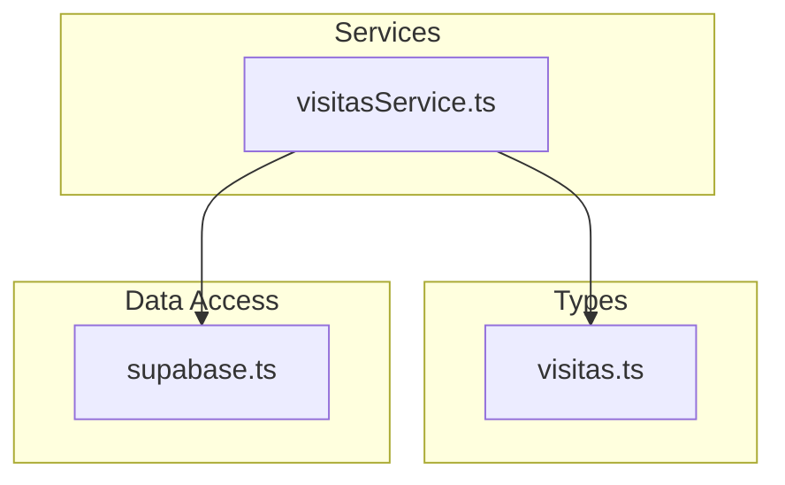
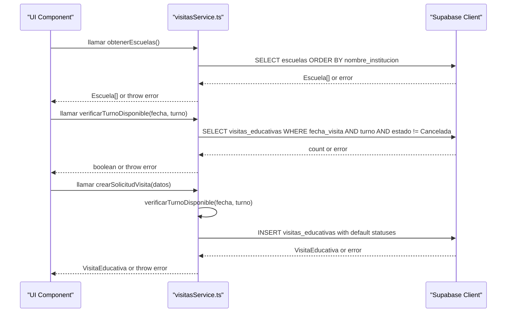
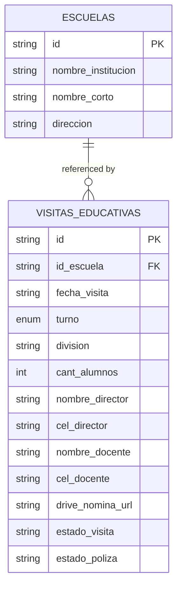
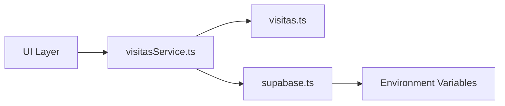

# Visit Management Service

<cite>
**Referenced Files in This Document**
- [visitasService.ts](file://src/services/visitasService.ts)
- [visitas.ts](file://src/types/visitas.ts)
- [supabase.ts](file://src/lib/supabase.ts)
</cite>

## Table of Contents
1. [Introduction](#introduction)
2. [Project Structure](#project-structure)
3. [Core Components](#core-components)
4. [Architecture Overview](#architecture-overview)
5. [Detailed Component Analysis](#detailed-component-analysis)
6. [Dependency Analysis](#dependency-analysis)
7. [Performance Considerations](#performance-considerations)
8. [Troubleshooting Guide](#troubleshooting-guide)
9. [Conclusion](#conclusion)
10. [Appendices](#appendices)

## Introduction
This document explains the Visit Management Service that encapsulates all educational visit business logic. It provides three core functions:
- obtenerEscuelas(): fetches school data from the database.
- verificarTurnoDisponible(): checks time slot availability and prevents double bookings.
- crearSolicitudVisita(): creates a new visit request with automatic status assignment.

The service follows a clear separation of concerns pattern, isolating business logic from UI components and centralizing Supabase integration for type-safe operations.

## Project Structure
The project is organized into focused modules:
- Services layer: contains business logic for visits (visitasService.ts).
- Types layer: defines TypeScript interfaces for strong typing (visitas.ts).
- Data access layer: configures the Supabase client (supabase.ts).

**Diagram sources**
- [visitasService.ts:1-59](file://src/services/visitasService.ts#L1-L59)
- [visitas.ts:1-28](file://src/types/visitas.ts#L1-L28)
- [supabase.ts:1-7](file://src/lib/supabase.ts#L1-L7)

**Section sources**
- [visitasService.ts:1-59](file://src/services/visitasService.ts#L1-L59)
- [visitas.ts:1-28](file://src/types/visitas.ts#L1-L28)
- [supabase.ts:1-7](file://src/lib/supabase.ts#L1-L7)

## Core Components
- Escuela: represents a school record with identifiers and contact details.
- TurnoVisita: a union type restricting shifts to morning or afternoon.
- SolicitudVisitaInput: input shape for creating a visit request.
- VisitaEducativa: full visit record including system-managed fields like IDs and statuses.

These types ensure compile-time safety across the service and any UI components that consume it.

**Section sources**
- [visitas.ts:1-28](file://src/types/visitas.ts#L1-L28)

## Architecture Overview
The service uses a layered architecture:
- UI components call service functions.
- The service enforces business rules and delegates persistence to Supabase via a centralized client.
- Errors are thrown consistently so callers can handle them uniformly.

**Diagram sources**
- [visitasService.ts:9-58](file://src/services/visitasService.ts#L9-L58)
- [supabase.ts:1-7](file://src/lib/supabase.ts#L1-L7)

## Detailed Component Analysis

### Function: obtenerEscuelas()
Purpose:
- Retrieve schools sorted by institution name.
- Return an array of Escuela objects.

Behavior:
- Queries the escuelas table with a specific projection and ordering.
- Throws on database errors; returns an empty array if no rows exist.

Usage example (conceptual):
- Call the function when loading a dropdown of schools.
- Handle potential network or permission errors.

Validation and constraints:
- None beyond database schema; relies on Supabase permissions and schema.

Error handling:
- Any Supabase error is thrown to the caller for consistent handling.

Type safety:
- Returns Escuela[], typed by the interface.

**Section sources**
- [visitasService.ts:9-18](file://src/services/visitasService.ts#L9-L18)
- [visitas.ts:1-6](file://src/types/visitas.ts#L1-L6)

### Function: verificarTurnoDisponible()
Purpose:
- Check whether a given date and shift are available for scheduling.

Business rule:
- A slot is considered unavailable if there exists at least one non-cancelled visit for that date and shift.

Algorithm overview:
- Query visitas_educativas for matching date and shift while excluding cancelled visits.
- If any records are found, the slot is not available.

Complexity:
- O(k) where k is the number of conflicting records; typically small due to indexing on date and shift.

Usage example (conceptual):
- Disable a submit button or show a warning when a user selects an already-booked slot.

Error handling:
- Throws on database errors; otherwise returns a boolean indicating availability.

Type safety:
- Uses TurnoVisita union to restrict allowed values.

**Section sources**
- [visitasService.ts:20-34](file://src/services/visitasService.ts#L20-L34)
- [visitas.ts:8-8](file://src/types/visitas.ts#L8-L8)

### Function: crearSolicitudVisita()
Purpose:
- Create a new educational visit request with automatic status assignment and conflict prevention.

Business rules:
- Prevents double booking by calling verificarTurnoDisponible before insertion.
- Automatically sets initial statuses:
  - Visit status: confirmed
  - Insurance policy status: pending

Workflow:
- Validate availability for the requested date and shift.
- Insert the visit record with required fields plus default statuses.
- Return the created VisitaEducativa object.

Error handling:
- Throws if the slot is already occupied.
- Throws on database errors during insert.

Type safety:
- Input conforms to SolicitudVisitaInput.
- Output conforms to VisitaEducativa, which extends input with system-managed fields.

Practical usage example (conceptual):
- On form submission, call this function and handle success or error states in the UI.

**Section sources**
- [visitasService.ts:36-58](file://src/services/visitasService.ts#L36-L58)
- [visitas.ts:10-27](file://src/types/visitas.ts#L10-L27)

### Data Model Relationships

Notes:
- The service queries and inserts into these tables through Supabase.
- The exact foreign key relationships depend on your database schema; the service assumes id_escuela links to escuelas.id.

[No sources needed since this diagram shows conceptual model mapping]

## Dependency Analysis
- visitasService.ts depends on:
  - supabase client for data access.
  - TypeScript interfaces for type safety.
- supabase.ts depends on environment variables for URL and anonymous key.

**Diagram sources**
- [visitasService.ts:1-7](file://src/services/visitasService.ts#L1-L7)
- [supabase.ts:1-7](file://src/lib/supabase.ts#L1-L7)

**Section sources**
- [visitasService.ts:1-7](file://src/services/visitasService.ts#L1-L7)
- [supabase.ts:1-7](file://src/lib/supabase.ts#L1-L7)

## Performance Considerations
- Minimize payload size by selecting only needed columns in obtenerEscuelas().
- Ensure indexes on visitas_educativas(fecha_visita, turno) to speed up availability checks.
- Avoid redundant calls by caching school lists in UI state when appropriate.
- Batch operations are not used here; consider future enhancements if volume increases.

[No sources needed since this section provides general guidance]

## Troubleshooting Guide
Common issues and resolutions:
- Slot already booked:
  - Occurs when creating a visit for a date and shift that has a non-cancelled visit.
  - Resolution: choose another date or shift; verify existing bookings.
- Database errors:
  - Network, authentication, or permission errors will be thrown by Supabase.
  - Resolution: check environment configuration, RLS policies, and connection settings.
- Type mismatches:
  - Passing invalid shift values will cause TypeScript errors at compile time.
  - Resolution: use the provided TurnoVisita type to constrain inputs.

Error propagation:
- All service functions throw errors on failure; callers should wrap calls in try/catch blocks and present user-friendly messages.

**Section sources**
- [visitasService.ts:15-16](file://src/services/visitasService.ts#L15-L16)
- [visitasService.ts:31-32](file://src/services/visitasService.ts#L31-L32)
- [visitasService.ts:41-43](file://src/services/visitasService.ts#L41-L43)
- [visitasService.ts:55-56](file://src/services/visitasService.ts#L55-L56)

## Conclusion
The Visit Management Service centralizes educational visit business logic with clear separation from UI layers. It enforces robust validation, prevents double bookings, and integrates cleanly with Supabase using strongly-typed interfaces. By following the patterns described here, you can reliably schedule visits, manage school data, and maintain a scalable architecture.

[No sources needed since this section summarizes without analyzing specific files]

## Appendices

### API Reference Summary
- obtenerEscuelas():
  - Purpose: Fetch schools sorted by institution name.
  - Returns: Array of Escuela.
  - Errors: Throws on database errors.

- verificarTurnoDisponible(fecha, turno):
  - Purpose: Check availability for a date and shift.
  - Returns: Boolean indicating availability.
  - Errors: Throws on database errors.

- crearSolicitudVisita(datos):
  - Purpose: Create a visit request with automatic statuses and conflict prevention.
  - Returns: Created VisitaEducativa.
  - Errors: Throws if slot is occupied or on database errors.

**Section sources**
- [visitasService.ts:9-58](file://src/services/visitasService.ts#L9-L58)
- [visitas.ts:1-27](file://src/types/visitas.ts#L1-L27)

### Practical Usage Examples (Conceptual)
- Loading schools:
  - Call obtenerEscuelas() and populate a dropdown.
  - Handle errors by showing a retry message.

- Checking availability:
  - Before enabling submit, call verificarTurnoDisponible(date, shift).
  - If false, inform the user to select another slot.

- Creating a visit:
  - On form submit, call crearSolicitudVisita(formData).
  - On success, navigate or show confirmation.
  - On error, display a user-friendly message based on the error type.

[No sources needed since this section provides conceptual examples]