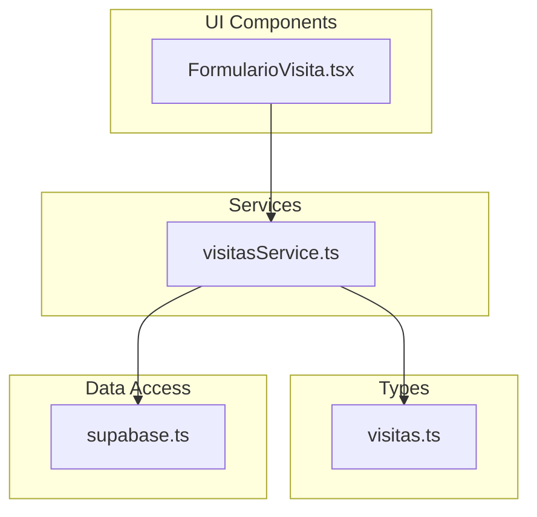
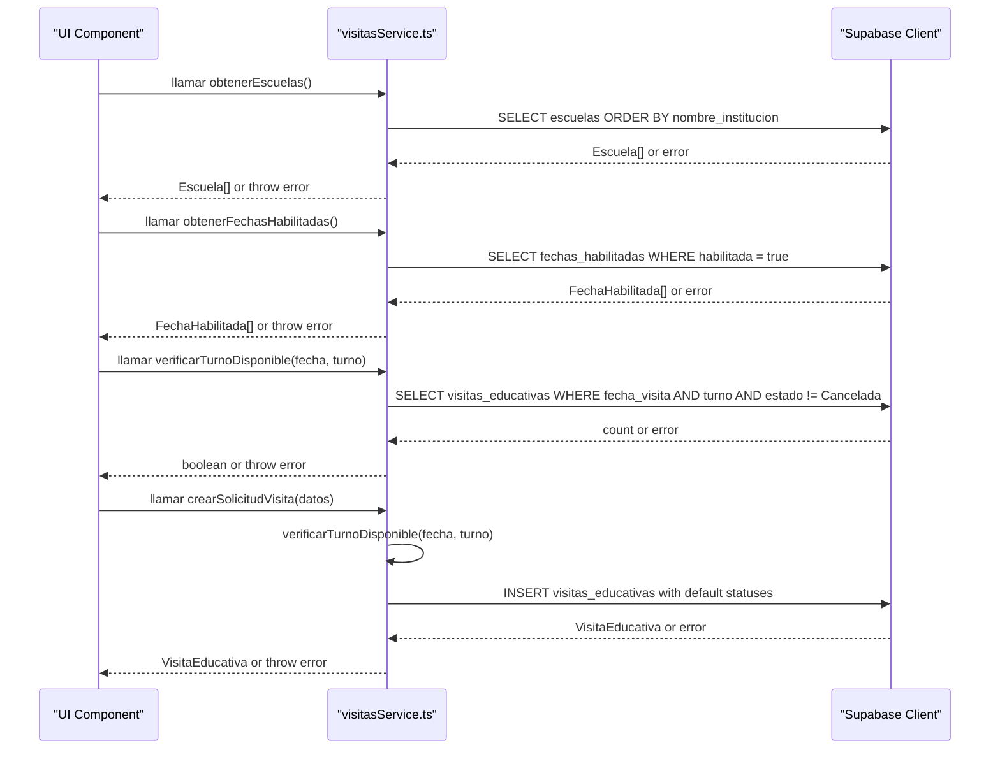
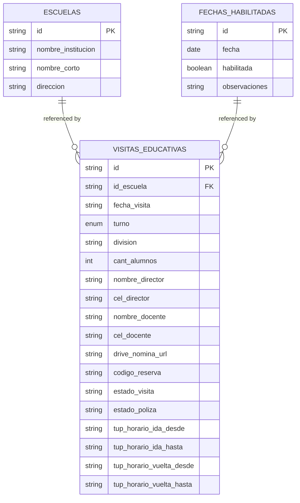
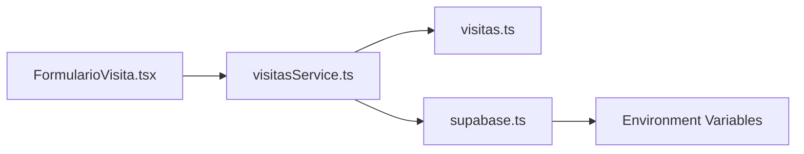

# Visit Management Service

<cite>
**Referenced Files in This Document**
- [visitasService.ts](file://src/services/visitasService.ts)
- [visitas.ts](file://src/types/visitas.ts)
- [supabase.ts](file://src/lib/supabase.ts)
- [FormularioVisita.tsx](file://src/components/visitas/FormularioVisita.tsx)
</cite>

## Update Summary
**Changes Made**
- Added documentation for the new `obtenerFechasHabilitadas()` function for fetching available visit dates
- Updated core components section to include the new FechaHabilitada interface
- Enhanced architecture overview with the new date management capability
- Updated API reference summary to include the new function
- Added practical usage examples showing integration with the form component

## Table of Contents
1. [Introduction](#introduction)
2. [Project Structure](#project-structure)
3. [Core Components](#core-components)
4. [Architecture Overview](#architecture-overview)
5. [Detailed Component Analysis](#detailed-component-analysis)
6. [Dependency Analysis](#dependency-analysis)
7. [Performance Considerations](#performance-considerations)
8. [Troubleshooting Guide](#troubleshooting-guide)
9. [Conclusion](#conclusion)
10. [Appendices](#appendices)

## Introduction
This document explains the Visit Management Service that encapsulates all educational visit business logic. It provides four core functions:
- obtenerEscuelas(): fetches school data from the database.
- obtenerFechasHabilitadas(): retrieves available visit dates with capacity validation.
- verificarTurnoDisponible(): checks time slot availability and prevents double bookings.
- crearSolicitudVisita(): creates a new visit request with automatic status assignment.

The service follows a clear separation of concerns pattern, isolating business logic from UI components and centralizing Supabase integration for type-safe operations.

## Project Structure
The project is organized into focused modules:
- Services layer: contains business logic for visits (visitasService.ts).
- Types layer: defines TypeScript interfaces for strong typing (visitas.ts).
- Data access layer: configures the Supabase client (supabase.ts).
- UI components: implements the user interface with integrated service calls (FormularioVisita.tsx).

**Diagram sources**
- [visitasService.ts:1-115](file://src/services/visitasService.ts#L1-L115)
- [visitas.ts:1-60](file://src/types/visitas.ts#L1-L60)
- [supabase.ts:1-7](file://src/lib/supabase.ts#L1-L7)
- [FormularioVisita.tsx:1-749](file://src/components/visitas/FormularioVisita.tsx#L1-L749)

**Section sources**
- [visitasService.ts:1-115](file://src/services/visitasService.ts#L1-L115)
- [visitas.ts:1-60](file://src/types/visitas.ts#L1-L60)
- [supabase.ts:1-7](file://src/lib/supabase.ts#L1-L7)
- [FormularioVisita.tsx:1-749](file://src/components/visitas/FormularioVisita.tsx#L1-L749)

## Core Components
- Escuela: represents a school record with identifiers and contact details.
- FechaHabilitada: represents an enabled visit date with optional observations.
- TurnoVisita: a union type restricting shifts to morning or afternoon.
- SolicitudVisitaInput: input shape for creating a visit request.
- VisitaEducativa: full visit record including system-managed fields like IDs and statuses.

These types ensure compile-time safety across the service and any UI components that consume it.

**Section sources**
- [visitas.ts:1-60](file://src/types/visitas.ts#L1-L60)

## Architecture Overview
The service uses a layered architecture with enhanced date management capabilities:
- UI components call service functions for both schools and available dates.
- The service enforces business rules and delegates persistence to Supabase via a centralized client.
- Errors are thrown consistently so callers can handle them uniformly.
- Date availability is managed through a dedicated table that allows administrators to control which dates are open for booking.

**Diagram sources**
- [visitasService.ts:10-115](file://src/services/visitasService.ts#L10-L115)
- [FormularioVisita.tsx:88-107](file://src/components/visitas/FormularioVisita.tsx#L88-L107)
- [supabase.ts:1-7](file://src/lib/supabase.ts#L1-L7)

## Detailed Component Analysis

### Function: obtenerEscuelas()
Purpose:
- Retrieve schools sorted by institution name.
- Return an array of Escuela objects.

Behavior:
- Queries the escuelas table with a specific projection and ordering.
- Throws on database errors; returns an empty array if no rows exist.

Usage example (conceptual):
- Call the function when loading a dropdown of schools.
- Handle potential network or permission errors.

Validation and constraints:
- None beyond database schema; relies on Supabase permissions and schema.

Error handling:
- Any Supabase error is thrown to the caller for consistent handling.

Type safety:
- Returns Escuela[], typed by the interface.

**Section sources**
- [visitasService.ts:10-19](file://src/services/visitasService.ts#L10-L19)
- [visitas.ts:1-6](file://src/types/visitas.ts#L1-L6)

### Function: obtenerFechasHabilitadas()
Purpose:
- Retrieve available visit dates that are currently enabled for booking.
- Return an array of FechaHabilitada objects with optional observations.

Business rule:
- Only returns dates where the habilitada field is true, allowing administrators to control which dates are open for scheduling.

Algorithm overview:
- Queries the fechas_habilitadas table filtering for enabled dates only.
- Orders results by date in ascending order for chronological display.
- Includes optional observation text for each date.

Complexity:
- O(n) where n is the number of enabled dates; typically small due to administrative control over available dates.

Usage example (conceptual):
- Load available dates when initializing the visit booking form.
- Display dates with optional notes about restrictions or special conditions.

Error handling:
- Throws on database errors; returns an empty array if no enabled dates exist.

Type safety:
- Returns FechaHabilitada[], typed by the interface with optional observaciones field.

**Updated** Added new function for managing available visit dates with administrative control.

**Section sources**
- [visitasService.ts:21-31](file://src/services/visitasService.ts#L21-L31)
- [visitas.ts:8-13](file://src/types/visitas.ts#L8-L13)
- [FormularioVisita.tsx:92-97](file://src/components/visitas/FormularioVisita.tsx#L92-L97)

### Function: verificarTurnoDisponible()
Purpose:
- Check whether a given date and shift are available for scheduling.

Business rule:
- A slot is considered unavailable if there exists at least one non-cancelled visit for that date and shift.

Algorithm overview:
- Query visitas_educativas for matching date and shift while excluding cancelled visits.
- If any records are found, the slot is not available.

Complexity:
- O(k) where k is the number of conflicting records; typically small due to indexing on date and shift.

Usage example (conceptual):
- Disable a submit button or show a warning when a user selects an already-booked slot.

Error handling:
- Throws on database errors; otherwise returns a boolean indicating availability.

Type safety:
- Uses TurnoVisita union to restrict allowed values.

**Section sources**
- [visitasService.ts:33-47](file://src/services/visitasService.ts#L33-L47)
- [visitas.ts:15-15](file://src/types/visitas.ts#L15-L15)

### Function: crearSolicitudVisita()
Purpose:
- Create a new educational visit request with automatic status assignment and conflict prevention.

Business rules:
- Prevents double booking by calling verificarTurnoDisponible before insertion.
- Automatically sets initial statuses:
  - Visit status: confirmed
  - Insurance policy status: pending
- Enforces maximum student capacity of 40 students per session.
- Requires legal consent acceptance before submission.

Workflow:
- Validate legal consent acceptance and student capacity limits.
- Validate availability for the requested date and shift.
- Generate unique reservation code.
- Insert the visit record with required fields plus default statuses and time slots.
- Optionally insert associated attendees if provided.
- Return the created VisitaEducativa object.

Error handling:
- Throws if legal consent is not accepted.
- Throws if student capacity exceeds maximum limit.
- Throws if the slot is already occupied.
- Throws on database errors during insert.

Type safety:
- Input conforms to SolicitudVisitaInput.
- Output conforms to VisitaEducativa, which extends input with system-managed fields.

Practical usage example (conceptual):
- On form submission, call this function and handle success or error states in the UI.

**Updated** Enhanced with additional validation rules for legal consent and capacity limits.

**Section sources**
- [visitasService.ts:49-115](file://src/services/visitasService.ts#L49-L115)
- [visitas.ts:21-59](file://src/types/visitas.ts#L21-L59)

### Data Model Relationships

Notes:
- The service queries and inserts into these tables through Supabase.
- The exact foreign key relationships depend on your database schema; the service assumes id_escuela links to escuelas.id.
- The new fechas_habilitadas table provides administrative control over available booking dates.

[No sources needed since this diagram shows conceptual model mapping]

## Dependency Analysis
- visitasService.ts depends on:
  - supabase client for data access.
  - TypeScript interfaces for type safety.
- supabase.ts depends on environment variables for URL and anonymous key.
- FormularioVisita.tsx depends on service functions for data loading and form submission.

**Diagram sources**
- [visitasService.ts:1-8](file://src/services/visitasService.ts#L1-L8)
- [FormularioVisita.tsx:4-8](file://src/components/visitas/FormularioVisita.tsx#L4-L8)
- [supabase.ts:1-7](file://src/lib/supabase.ts#L1-L7)

**Section sources**
- [visitasService.ts:1-8](file://src/services/visitasService.ts#L1-L8)
- [FormularioVisita.tsx:4-8](file://src/components/visitas/FormularioVisita.tsx#L4-L8)
- [supabase.ts:1-7](file://src/lib/supabase.ts#L1-L7)

## Performance Considerations
- Minimize payload size by selecting only needed columns in obtenerEscuelas() and obtenerFechasHabilitadas().
- Ensure indexes on visitas_educativas(fecha_visita, turno) to speed up availability checks.
- Avoid redundant calls by caching school lists and available dates in UI state when appropriate.
- Batch operations are not used here; consider future enhancements if volume increases.
- The new fecha_habilitadas table should be indexed on the habilitada column for efficient filtering.

[No sources needed since this section provides general guidance]

## Troubleshooting Guide
Common issues and resolutions:
- Slot already booked:
  - Occurs when creating a visit for a date and shift that has a non-cancelled visit.
  - Resolution: choose another date or shift; verify existing bookings.
- No available dates:
  - Occurs when no dates are marked as habilitada = true in the fechas_habilitadas table.
  - Resolution: check administrative settings to enable dates for booking.
- Database errors:
  - Network, authentication, or permission errors will be thrown by Supabase.
  - Resolution: check environment configuration, RLS policies, and connection settings.
- Type mismatches:
  - Passing invalid shift values will cause TypeScript errors at compile time.
  - Resolution: use the provided TurnoVisita type to constrain inputs.
- Capacity exceeded:
  - Occurs when student count exceeds the 40-student maximum limit.
  - Resolution: reduce student count or split into multiple sessions.

Error propagation:
- All service functions throw errors on failure; callers should wrap calls in try/catch blocks and present user-friendly messages.

**Updated** Added troubleshooting guidance for the new date management functionality.

**Section sources**
- [visitasService.ts:16-17](file://src/services/visitasService.ts#L16-L17)
- [visitasService.ts:28-29](file://src/services/visitasService.ts#L28-L29)
- [visitasService.ts:44-45](file://src/services/visitasService.ts#L44-L45)
- [visitasService.ts:59-67](file://src/services/visitasService.ts#L59-L67)
- [visitasService.ts:71-73](file://src/services/visitasService.ts#L71-L73)
- [visitasService.ts:93-94](file://src/services/visitasService.ts#L93-L94)

## Conclusion
The Visit Management Service centralizes educational visit business logic with clear separation from UI layers. It now includes enhanced date management capabilities through the new obtenerFechasHabilitadas() function, allowing administrators to control which dates are available for booking. The service enforces robust validation, prevents double bookings, manages capacity limits, and integrates cleanly with Supabase using strongly-typed interfaces. By following the patterns described here, you can reliably schedule visits, manage school data, control available dates, and maintain a scalable architecture.

[No sources needed since this section summarizes without analyzing specific files]

## Appendices

### API Reference Summary
- obtenerEscuelas():
  - Purpose: Fetch schools sorted by institution name.
  - Returns: Array of Escuela.
  - Errors: Throws on database errors.

- obtenerFechasHabilitadas():
  - Purpose: Fetch enabled visit dates with optional observations.
  - Returns: Array of FechaHabilitada.
  - Errors: Throws on database errors.

- verificarTurnoDisponible(fecha, turno):
  - Purpose: Check availability for a date and shift.
  - Returns: Boolean indicating availability.
  - Errors: Throws on database errors.

- crearSolicitudVisita(datos):
  - Purpose: Create a visit request with automatic statuses and conflict prevention.
  - Returns: Created VisitaEducativa.
  - Errors: Throws if slot is occupied, capacity exceeded, or on database errors.

**Updated** Added documentation for the new obtenerFechasHabilitadas() function.

**Section sources**
- [visitasService.ts:10-115](file://src/services/visitasService.ts#L10-L115)
- [visitas.ts:1-60](file://src/types/visitas.ts#L1-L60)

### Practical Usage Examples (Conceptual)
- Loading schools and dates:
  - Call obtenerEscuelas() and obtenerFechasHabilitadas() concurrently using Promise.all.
  - Populate dropdowns for both institutions and available dates.
  - Handle errors by showing retry options.

- Checking availability:
  - Before enabling submit, call verificarTurnoDisponible(date, shift).
  - If false, inform the user to select another slot.

- Creating a visit:
  - On form submit, call crearSolicitudVisita(formData).
  - On success, navigate or show confirmation with reservation details.
  - On error, display a user-friendly message based on the error type.

**Updated** Added examples showing concurrent loading of schools and available dates.

[No sources needed since this section provides conceptual examples]