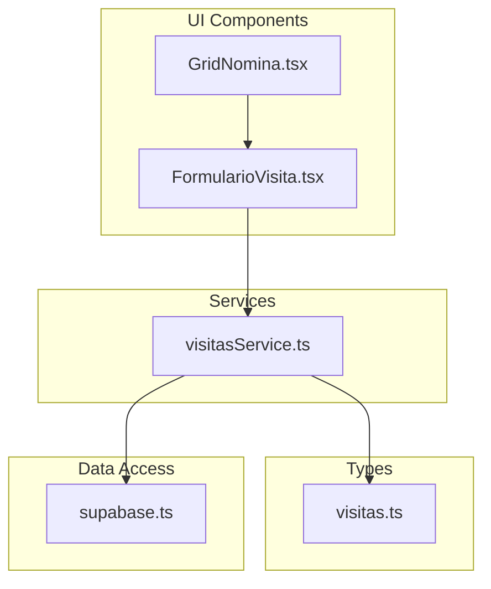
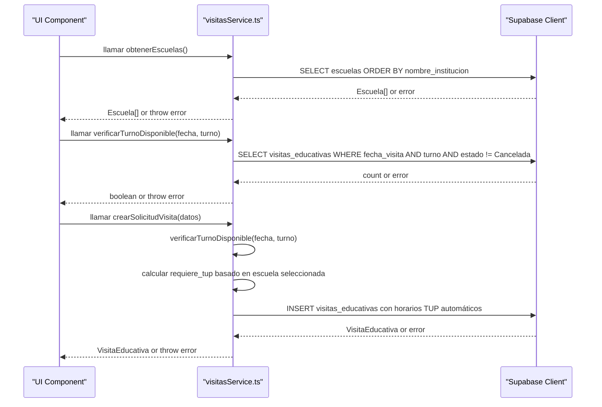
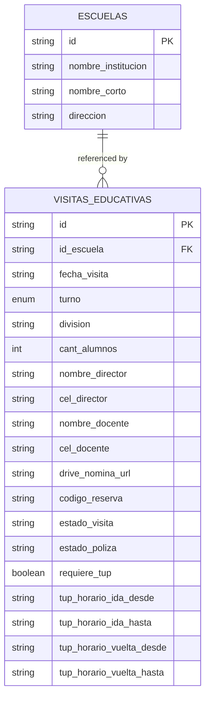
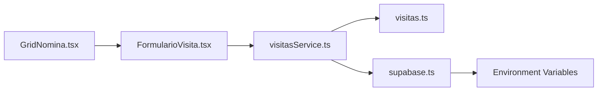

# Visit Management Service

<cite>
**Referenced Files in This Document**
- [visitasService.ts](file://src/services/visitasService.ts)
- [visitas.ts](file://src/types/visitas.ts)
- [supabase.ts](file://src/lib/supabase.ts)
- [FormularioVisita.tsx](file://src/components/visitas/FormularioVisita.tsx)
- [GridNomina.tsx](file://src/components/visitas/GridNomina.tsx)
</cite>

## Update Summary
**Changes Made**
- Updated core functions section to reflect simplified educational visit booking system
- Removed references to manual shift selection functionality
- Added documentation for automated TUP (Transport Urbano Público) calculation based on school selection
- Updated business rules to reflect streamlined form interface
- Enhanced examples to show simplified workflow without manual shift management
- Updated architecture diagrams to reflect current implementation

## Table of Contents
1. [Introduction](#introduction)
2. [Project Structure](#project-structure)
3. [Core Components](#core-components)
4. [Architecture Overview](#architecture-overview)
5. [Detailed Component Analysis](#detailed-component-analysis)
6. [Dependency Analysis](#dependency-analysis)
7. [Performance Considerations](#performance-considerations)
8. [Troubleshooting Guide](#troubleshooting-guide)
9. [Conclusion](#conclusion)
10. [Appendices](#appendices)

## Introduction
This document explains the Visit Management Service that encapsulates all educational visit business logic for a simplified booking system. The service provides three core functions:
- obtenerEscuelas(): fetches school data from the database.
- verificarTurnoDisponible(): checks time slot availability with conflict prevention.
- crearSolicitudVisita(): creates a new visit request with automatic status assignment and automated transportation logistics.

The service follows a clear separation of concerns pattern, isolating business logic from UI components and centralizing Supabase integration for type-safe operations. The system has been streamlined to eliminate manual shift selection, with automatic TUP calculation based on school selection and a simplified form interface.

## Project Structure
The project is organized into focused modules:
- Services layer: contains business logic for visits (visitasService.ts).
- Types layer: defines TypeScript interfaces for strong typing (visitas.ts).
- Data access layer: configures the Supabase client (supabase.ts).
- UI components: implements the user interface with integrated service calls (FormularioVisita.tsx, GridNomina.tsx).

**Diagram sources**
- [visitasService.ts:1-114](file://src/services/visitasService.ts#L1-L114)
- [visitas.ts:1-60](file://src/types/visitas.ts#L1-L60)
- [supabase.ts:1-7](file://src/lib/supabase.ts#L1-L7)
- [FormularioVisita.tsx:1-698](file://src/components/visitas/FormularioVisita.tsx#L1-L698)
- [GridNomina.tsx:1-246](file://src/components/visitas/GridNomina.tsx#L1-L246)

**Section sources**
- [visitasService.ts:1-114](file://src/services/visitasService.ts#L1-L114)
- [visitas.ts:1-60](file://src/types/visitas.ts#L1-L60)
- [supabase.ts:1-7](file://src/lib/supabase.ts#L1-L7)
- [FormularioVisita.tsx:1-698](file://src/components/visitas/FormularioVisita.tsx#L1-L698)
- [GridNomina.tsx:1-246](file://src/components/visitas/GridNomina.tsx#L1-L246)

## Core Components
- Escuela: represents a school record with identifiers and contact details.
- TurnoVisita: a union type restricting shifts to morning or afternoon (maintained for compatibility but no longer manually selected).
- SolicitudVisitaInput: input shape for creating a visit request with automated TUP calculation.
- VisitaEducativa: full visit record including system-managed fields like IDs, statuses, and automatically calculated TUP schedules.
- AsistenteInput: represents attendees (students and teachers) with role classification.

These types ensure compile-time safety across the service and any UI components that consume it.

**Section sources**
- [visitas.ts:1-60](file://src/types/visitas.ts#L1-L60)

## Architecture Overview
The service uses a layered architecture with simplified booking flow:
- UI components call service functions for schools and availability checks.
- The service enforces business rules and delegates persistence to Supabase via a centralized client.
- Errors are thrown consistently so callers can handle them uniformly.
- Transportation logistics (TUP) are automatically calculated based on school selection rather than manual configuration.

**Diagram sources**
- [visitasService.ts:10-114](file://src/services/visitasService.ts#L10-L114)
- [FormularioVisita.tsx:80-99](file://src/components/visitas/FormularioVisita.tsx#L80-L99)
- [supabase.ts:1-7](file://src/lib/supabase.ts#L1-L7)

## Detailed Component Analysis

### Function: obtenerEscuelas()
Purpose:
- Retrieve schools sorted by institution name.
- Return an array of Escuela objects.

Behavior:
- Queries the escuelas table with a specific projection and ordering.
- Throws on database errors; returns an empty array if no rows exist.

Usage example (conceptual):
- Call the function when loading a dropdown of schools.
- Handle potential network or permission errors.

Validation and constraints:
- None beyond database schema; relies on Supabase permissions and schema.

Error handling:
- Any Supabase error is thrown to the caller for consistent handling.

Type safety:
- Returns Escuela[], typed by the interface.

**Section sources**
- [visitasService.ts:10-19](file://src/services/visitasService.ts#L10-L19)
- [visitas.ts:1-6](file://src/types/visitas.ts#L1-L6)

### Function: verificarTurnoDisponible()
Purpose:
- Check whether a given date and shift are available for scheduling.

Business rule:
- A slot is considered unavailable if there exists at least one non-cancelled visit for that date and shift.

Algorithm overview:
- Query visitas_educativas for matching date and shift while excluding cancelled visits.
- If any records are found, the slot is not available.

Complexity:
- O(k) where k is the number of conflicting records; typically small due to indexing on date and shift.

Usage example (conceptual):
- Disable a submit button or show a warning when a user selects an already-booked slot.

Error handling:
- Throws on database errors; otherwise returns a boolean indicating availability.

Type safety:
- Uses TurnoVisita union to restrict allowed values.

**Section sources**
- [visitasService.ts:33-47](file://src/services/visitasService.ts#L33-L47)
- [visitas.ts:15-15](file://src/types/visitas.ts#L15-L15)

### Function: crearSolicitudVisita()
Purpose:
- Create a new educational visit request with automatic status assignment, conflict prevention, and automated transportation logistics.

Business rules:
- Prevents double booking by calling verificarTurnoDisponible before insertion.
- Automatically sets initial statuses:
  - Visit status: confirmed
  - Insurance policy status: pending
- Enforces maximum student capacity of 40 students per session.
- Requires legal consent acceptance before submission.
- **Automatically calculates TUP (public transportation) requirements based on school selection**: schools from the official list receive municipal transportation, while custom institutions do not.

Workflow:
- Validate legal consent acceptance and student capacity limits.
- Determine TUP requirement: `requiere_tup = !!datos.id_escuela` (true if selecting from official school list).
- Validate availability for the requested date and shift.
- Generate unique reservation code.
- Insert the visit record with required fields plus default statuses and automatically calculated TUP time slots.
- Optionally insert associated attendees if provided.
- Return the created VisitaEducativa object.

Error handling:
- Throws if legal consent is not accepted.
- Throws if student capacity exceeds maximum limit.
- Throws if the slot is already occupied.
- Throws on database errors during insert.

Type safety:
- Input conforms to SolicitudVisitaInput.
- Output conforms to VisitaEducativa, which extends input with system-managed fields.

Practical usage example (conceptual):
- On form submission, call this function and handle success or error states in the UI.

**Updated** Enhanced with automated TUP calculation based on school selection and streamlined form processing.

**Section sources**
- [visitasService.ts:49-114](file://src/services/visitasService.ts#L49-L114)
- [visitas.ts:21-59](file://src/types/visitas.ts#L21-L59)

### Data Model Relationships

Notes:
- The service queries and inserts into these tables through Supabase.
- The exact foreign key relationships depend on your database schema; the service assumes id_escuela links to escuelas.id.
- The `requiere_tup` field is automatically set based on whether the school was selected from the official list or entered as a custom institution.

[No sources needed since this diagram shows conceptual model mapping]

## Dependency Analysis
- visitasService.ts depends on:
  - supabase client for data access.
  - TypeScript interfaces for type safety.
- supabase.ts depends on environment variables for URL and anonymous key.
- FormularioVisita.tsx depends on service functions for data loading and form submission.
- GridNomina.tsx depends on TypeScript interfaces for attendee management.

**Diagram sources**
- [visitasService.ts:1-8](file://src/services/visitasService.ts#L1-L8)
- [FormularioVisita.tsx:3-17](file://src/components/visitas/FormularioVisita.tsx#L3-L17)
- [GridNomina.tsx:3-8](file://src/components/visitas/GridNomina.tsx#L3-L8)
- [supabase.ts:1-7](file://src/lib/supabase.ts#L1-L7)

**Section sources**
- [visitasService.ts:1-8](file://src/services/visitasService.ts#L1-L8)
- [FormularioVisita.tsx:3-17](file://src/components/visitas/FormularioVisita.tsx#L3-L17)
- [GridNomina.tsx:3-8](file://src/components/visitas/GridNomina.tsx#L3-L8)
- [supabase.ts:1-7](file://src/lib/supabase.ts#L1-L7)

## Performance Considerations
- Minimize payload size by selecting only needed columns in obtenerEscuelas().
- Ensure indexes on visitas_educativas(fecha_visita, turno) to speed up availability checks.
- Avoid redundant calls by caching school lists in UI state when appropriate.
- Batch operations are not used here; consider future enhancements if volume increases.
- The simplified form reduces client-side validation complexity and improves user experience.

[No sources needed since this section provides general guidance]

## Troubleshooting Guide
Common issues and resolutions:
- Slot already booked:
  - Occurs when creating a visit for a date and shift that has a non-cancelled visit.
  - Resolution: choose another date or shift; verify existing bookings.
- Database errors:
  - Network, authentication, or permission errors will be thrown by Supabase.
  - Resolution: check environment configuration, RLS policies, and connection settings.
- Type mismatches:
  - Passing invalid shift values will cause TypeScript errors at compile time.
  - Resolution: use the provided TurnoVisita type to constrain inputs.
- Capacity exceeded:
  - Occurs when student count exceeds the 40-student maximum limit.
  - Resolution: reduce student count or split into multiple sessions.
- Legal consent not accepted:
  - Occurs when users don't accept required legal conditions before submission.
  - Resolution: ensure both image usage and judicial measures checkboxes are checked.
- Invalid school selection:
  - Occurs when neither an official school nor a custom institution name is provided.
  - Resolution: select from the official school list or provide a custom institution name.

Error propagation:
- All service functions throw errors on failure; callers should wrap calls in try/catch blocks and present user-friendly messages.

**Updated** Added troubleshooting guidance for the simplified form interface and automated TUP calculation.

**Section sources**
- [visitasService.ts:16-17](file://src/services/visitasService.ts#L16-L17)
- [visitasService.ts:44-45](file://src/services/visitasService.ts#L44-L45)
- [visitasService.ts:59-67](file://src/services/visitasService.ts#L59-L67)
- [visitasService.ts:71-73](file://src/services/visitasService.ts#L71-L73)
- [visitasService.ts:93-94](file://src/services/visitasService.ts#L93-L94)

## Conclusion
The Visit Management Service centralizes educational visit business logic with clear separation from UI layers. The system has been successfully simplified by removing manual shift selection and implementing automated transportation logistics based on school selection. The streamlined form interface provides a better user experience while maintaining robust validation, preventing double bookings, managing capacity limits, and integrating cleanly with Supabase using strongly-typed interfaces. By following the patterns described here, you can reliably schedule visits, manage school data, and maintain a scalable architecture with automated TUP calculation.

[No sources needed since this section summarizes without analyzing specific files]

## Appendices

### API Reference Summary
- obtenerEscuelas():
  - Purpose: Fetch schools sorted by institution name.
  - Returns: Array of Escuela.
  - Errors: Throws on database errors.

- verificarTurnoDisponible(fecha, turno):
  - Purpose: Check availability for a date and shift.
  - Returns: Boolean indicating availability.
  - Errors: Throws on database errors.

- crearSolicitudVisita(datos):
  - Purpose: Create a visit request with automatic statuses, conflict prevention, and automated TUP calculation.
  - Returns: Created VisitaEducativa.
  - Errors: Throws if slot is occupied, capacity exceeded, legal consent missing, or on database errors.

**Updated** Simplified API with automated transportation logistics and streamlined form processing.

**Section sources**
- [visitasService.ts:10-114](file://src/services/visitasService.ts#L10-L114)
- [visitas.ts:1-60](file://src/types/visitas.ts#L1-L60)

### Practical Usage Examples (Conceptual)
- Loading schools:
  - Call obtenerEscuelas() when initializing the form.
  - Populate dropdown for institution selection.
  - Handle errors by showing retry options.

- Checking availability:
  - Before enabling submit, call verificarTurnoDisponible(date, shift).
  - If false, inform the user to select another slot.

- Creating a visit:
  - On form submit, call crearSolicitudVisita(formData).
  - The service automatically determines TUP requirements based on school selection.
  - On success, navigate or show confirmation with reservation details.
  - On error, display a user-friendly message based on the error type.

**Updated** Examples reflect the simplified form workflow without manual shift selection.

[No sources needed since this section provides conceptual examples]

### Business Rules Summary
- **Capacity Limit**: Maximum 40 students per session (excluding accompanying teachers).
- **Legal Consent**: Both image usage and judicial measures consent must be accepted.
- **School Selection**: Either select from official school list (receives TUP) or enter custom institution name (no TUP).
- **Availability**: No double bookings allowed for same date and shift combination.
- **Status Management**: Automatic assignment of visit and insurance policy statuses.
- **Transportation Logistics**: Automated TUP scheduling based on school selection with predefined time slots.

**Updated** Business rules reflect the simplified booking system with automated transportation logistics.

[No sources needed since this section provides conceptual information]