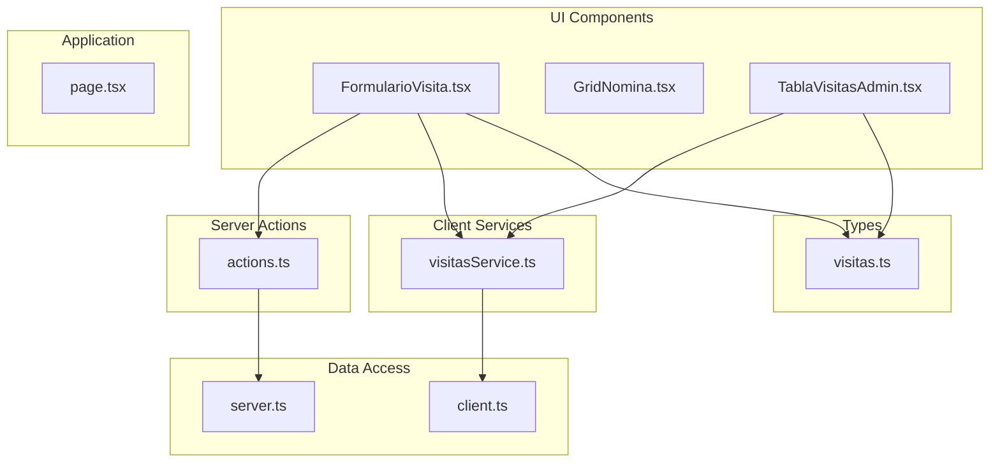
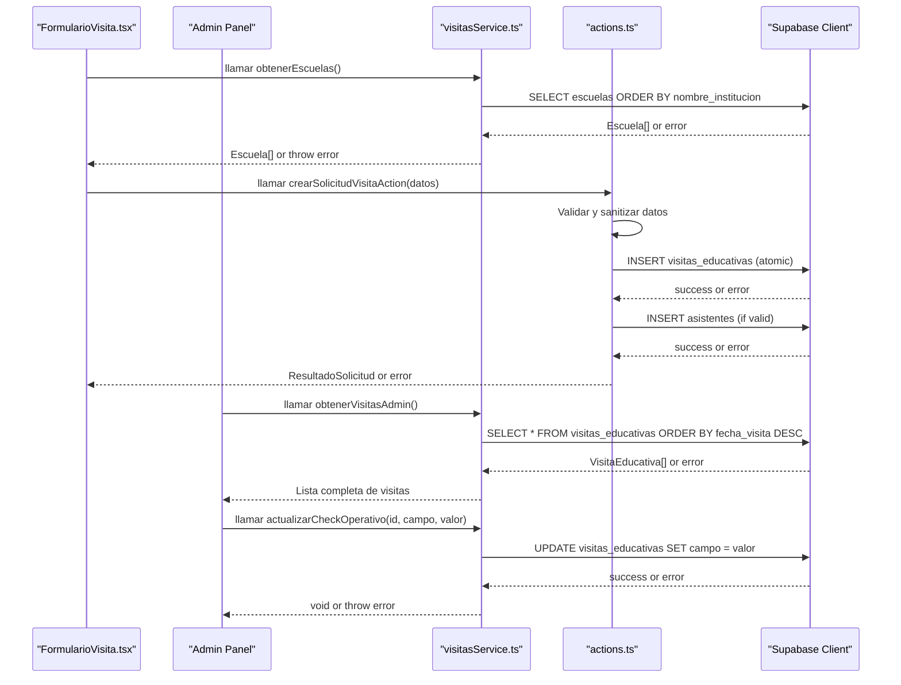
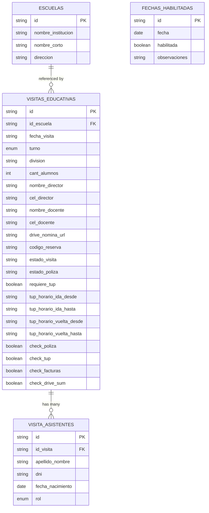
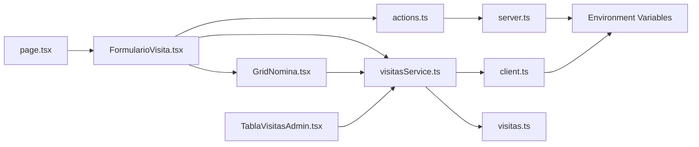

# Visit Management Service

<cite>
**Referenced Files in This Document**
- [actions.ts](file://src/app/visitas/actions.ts)
- [visitasService.ts](file://src/services/visitasService.ts)
- [visitas.ts](file://src/types/visitas.ts)
- [server.ts](file://src/lib/supabase/server.ts)
- [client.ts](file://src/lib/supabase/client.ts)
- [FormularioVisita.tsx](file://src/components/visitas/FormularioVisita.tsx)
- [GridNomina.tsx](file://src/components/visitas/GridNomina.tsx)
- [page.tsx](file://src/app/visitas/page.tsx)
- [TablaVisitasAdmin.tsx](file://src/components/admin/visitas/TablaVisitasAdmin.tsx)
</cite>

## Update Summary
**Changes Made**
- **Major Architecture Shift**: Replaced client-side service calls with Server Actions for secure data processing and improved validation
- **Enhanced Security**: Implemented server-side request handling with strict input validation and sanitization
- **Improved Error Handling**: Added comprehensive error handling with PII-safe logging and user-friendly error messages
- **Atomic Operations**: Ensured database operations are atomic with pre-validation to prevent orphaned records
- **Type Safety**: Maintained strong TypeScript typing throughout the new Server Action architecture
- **Performance Optimization**: Optimized data loading with parallel requests and efficient queries

## Table of Contents
1. [Introduction](#introduction)
2. [Project Structure](#project-structure)
3. [Core Components](#core-components)
4. [Architecture Overview](#architecture-overview)
5. [Server Actions Implementation](#server-actions-implementation)
6. [Detailed Component Analysis](#detailed-component-analysis)
7. [Administrative Operations](#administrative-operations)
8. [Dependency Analysis](#dependency-analysis)
9. [Performance Considerations](#performance-considerations)
10. [Troubleshooting Guide](#troubleshooting-guide)
11. [Conclusion](#conclusion)
12. [Appendices](#appendices)

## Introduction
This document explains the Visit Management Service that encapsulates all educational visit business logic for a streamlined booking system with comprehensive administrative capabilities. The service has been significantly enhanced with **Server Actions** for secure data processing, replacing previous client-side service calls with server-side request handling for improved security and validation.

**Core Functions:**
- obtenerEscuelas(): fetches school data from the database (client-side service)
- verificarTurnoDisponible(): checks time slot availability with conflict prevention (client-side service)
- crearSolicitudVisitaAction(): creates new visit requests with automatic status assignment through Server Actions

**Administrative Operations:**
- obtenerVisitasAdmin(): retrieves all educational visits for administrative panel display
- actualizarCheckOperativo(): updates operational check statuses (insurance, TUP, invoices, Drive upload)
- obtenerAsistentesPorVisita(): fetches attendee lists for specific visits

The service follows a hybrid architecture pattern that separates concerns between client-side data fetching and server-side critical operations, centralizing Supabase integration for type-safe operations while maintaining security through Server Actions.

## Project Structure
The project is organized into focused modules with enhanced Server Action support:
- **Server Actions layer**: contains secure business logic for visit creation and data processing (actions.ts).
- **Services layer**: contains client-side business logic for read operations (visitasService.ts).
- **Types layer**: defines TypeScript interfaces for strong typing (visitas.ts).
- **Data access layer**: configures both client and server Supabase clients (server.ts, client.ts).
- **UI components**: implements the user interface with integrated service and action calls (FormularioVisita.tsx, GridNomina.tsx).
- **Application pages**: routes and page composition (page.tsx).

**Diagram sources**
- [actions.ts:1-322](file://src/app/visitas/actions.ts#L1-L322)
- [visitasService.ts:1-105](file://src/services/visitasService.ts#L1-L105)
- [visitas.ts:1-89](file://src/types/visitas.ts#L1-L89)
- [server.ts:1-41](file://src/lib/supabase/server.ts#L1-L41)
- [client.ts:1-34](file://src/lib/supabase/client.ts#L1-L34)
- [FormularioVisita.tsx:1-749](file://src/components/visitas/FormularioVisita.tsx#L1-L749)
- [GridNomina.tsx:1-277](file://src/components/visitas/GridNomina.tsx#L1-L277)
- [page.tsx:1-28](file://src/app/visitas/page.tsx#L1-L28)
- [TablaVisitasAdmin.tsx:1-324](file://src/components/admin/visitas/TablaVisitasAdmin.tsx#L1-L324)

**Section sources**
- [actions.ts:1-322](file://src/app/visitas/actions.ts#L1-L322)
- [visitasService.ts:1-105](file://src/services/visitasService.ts#L1-L105)
- [visitas.ts:1-89](file://src/types/visitas.ts#L1-L89)
- [server.ts:1-41](file://src/lib/supabase/server.ts#L1-L41)
- [client.ts:1-34](file://src/lib/supabase/client.ts#L1-L34)
- [FormularioVisita.tsx:1-749](file://src/components/visitas/FormularioVisita.tsx#L1-L749)
- [GridNomina.tsx:1-277](file://src/components/visitas/GridNomina.tsx#L1-L277)
- [page.tsx:1-28](file://src/app/visitas/page.tsx#L1-L28)
- [TablaVisitasAdmin.tsx:1-324](file://src/components/admin/visitas/TablaVisitasAdmin.tsx#L1-L324)

## Core Components
- Escuela: represents a school record with identifiers and contact details.
- FechaHabilitada: represents enabled dates for educational visits with optional observations.
- TurnoVisita: union type restricting shifts to morning or afternoon (maintained for compatibility but no longer manually selected).
- AnioEscolar: academic year type ('5°' | '6°').
- RolAsistente: role classification for attendees ('Alumno' | 'Docente').
- AsistenteInput: represents attendees (students and teachers) with role classification.
- SolicitudVisitaInput: input shape for creating a visit request with automated TUP calculation and mandatory attendee list.
- VisitaEducativa: full visit record including system-managed fields like IDs, statuses, and automatically calculated TUP schedules.
- CampoCheckOperativo: operational status fields for administrative tracking (insurance, TUP, invoices, Drive upload).
- AsistenteVisita: attendee record associated with a specific educational visit.

These types ensure compile-time safety across the service and any UI components that consume it.

**Section sources**
- [visitas.ts:1-89](file://src/types/visitas.ts#L1-L89)

## Architecture Overview
The service uses a **hybrid architecture** combining client-side services for read operations and Server Actions for write operations:
- **Client-side services** handle data retrieval (schools, dates, availability checks) for better performance and user experience.
- **Server Actions** handle critical write operations (visit creation) with enhanced security, validation, and atomicity.
- The service enforces business rules including mandatory roster validation and delegates persistence to Supabase via centralized clients.
- Errors are thrown consistently so callers can handle them uniformly.
- Transportation logistics (TUP) are automatically calculated based on school selection rather than manual configuration.
- Form validation ensures all required fields including attendee lists are complete before submission.
- Administrative operations provide complete visibility and control over the visit management workflow.

**Diagram sources**
- [actions.ts:170-321](file://src/app/visitas/actions.ts#L170-L321)
- [visitasService.ts:11-104](file://src/services/visitasService.ts#L11-L104)
- [FormularioVisita.tsx:197-242](file://src/components/visitas/FormularioVisita.tsx#L197-L242)
- [server.ts:11-40](file://src/lib/supabase/server.ts#L11-L40)
- [client.ts:26-33](file://src/lib/supabase/client.ts#L26-L33)

## Server Actions Implementation

### Function: crearSolicitudVisitaAction()
Purpose:
- Create a new educational visit request with comprehensive validation, security, and atomic database operations through Server Actions.

**Security Enhancements:**
- **PII-safe logging**: Logs only non-sensitive error information (code, message) without exposing personal data.
- **Strict input validation**: Validates all input data before any database operations.
- **Atomic operations**: Ensures database consistency by validating all data before insertion.
- **White-listed columns**: Only allows specific columns to be inserted, preventing malicious data injection.

Business rules:
- Prevents double booking by checking database constraints.
- Automatically sets initial statuses:
  - Visit status: confirmed
  - Insurance policy status: pending
- Enforces maximum student capacity of 40 students per session.
- Requires legal consent acceptance before submission.
- **Requires mandatory attendee roster**: At least one attendee must be provided before reservation confirmation.
- **Automatically calculates TUP (public transportation) requirements based on school selection**: schools from the official list receive municipal transportation, while custom institutions do not.

Validation and sanitization:
- **Date validation**: Validates ISO format and calendar validity before database insertion.
- **Attendee validation**: Sanitizes and validates all attendee data including birth dates.
- **Capacity validation**: Ensures student count doesn't exceed maximum limits.
- **Legal consent validation**: Verifies both image usage and judicial measures consent.

Workflow:
- Validate legal consent acceptance and student capacity limits.
- **Validate mandatory attendee roster**: Ensure at least one attendee is provided.
- Determine TUP requirement: `requiere_tup = !!datos.id_escuela` (true if selecting from official school list).
- Generate unique reservation code.
- Execute atomic insert operation with all validated data.
- Insert associated attendees if provided.
- Return created VisitaEducativa object with server-authoritative values.

Error handling:
- Throws structured errors with user-friendly Spanish messages.
- Handles database constraint violations (duplicate bookings) specifically.
- Provides fallback generic error messages for unexpected failures.
- Uses PII-safe logging to protect sensitive data in logs.

Type safety:
- Input conforms to SolicitudVisitaInput.
- Output conforms to ResultadoSolicitud union type.
- All intermediate data structures are strongly typed.

**Updated** Enhanced with comprehensive Server Action implementation featuring PII-safe logging, atomic operations, and robust validation.

**Section sources**
- [actions.ts:170-321](file://src/app/visitas/actions.ts#L170-L321)
- [visitas.ts:28-73](file://src/types/visitas.ts#L28-L73)

## Detailed Component Analysis

### Function: obtenerEscuelas()
Purpose:
- Retrieve schools sorted by institution name.
- Return an array of Escuela objects.

Behavior:
- Queries the escuelas table with a specific projection and ordering.
- Throws on database errors; returns an empty array if no rows exist.

Usage example (conceptual):
- Call the function when loading a dropdown of schools.
- Handle potential network or permission errors.

Validation and constraints:
- None beyond database schema; relies on Supabase permissions and schema.

Error handling:
- Any Supabase error is thrown to the caller for consistent handling.

Type safety:
- Returns Escuela[], typed by the interface.

**Section sources**
- [visitasService.ts:11-21](file://src/services/visitasService.ts#L11-L21)
- [visitas.ts:1-6](file://src/types/visitas.ts#L1-L6)

### Function: obtenerFechasHabilitadas()
Purpose:
- Retrieve enabled dates for educational visits.
- Return an array of FechaHabilitada objects with optional observations.

Behavior:
- Queries the fechas_habilitadas table filtering only enabled dates.
- Orders results by date ascending.
- Throws on database errors; returns an empty array if no rows exist.

Usage example (conceptual):
- Call the function alongside obtenerEscuelas() to populate available dates.
- Display dates with any associated observations to users.

Validation and constraints:
- Filters for habilitada = true only.
- Relies on Supabase permissions and schema.

Error handling:
- Any Supabase error is thrown to the caller for consistent handling.

Type safety:
- Returns FechaHabilitada[], typed by the interface.

**Section sources**
- [visitasService.ts:23-34](file://src/services/visitasService.ts#L23-L34)
- [visitas.ts:8-13](file://src/types/visitas.ts#L8-L13)

### Function: verificarTurnoDisponible()
Purpose:
- Check whether a given date and shift are available for scheduling.

Business rule:
- A slot is considered unavailable if there exists at least one non-cancelled visit for that date and shift.

Algorithm overview:
- Query visitas_educativas for matching date and shift while excluding cancelled visits.
- If any records are found, the slot is not available.

Complexity:
- O(k) where k is the number of conflicting records; typically small due to indexing on date and shift.

Usage example (conceptual):
- Disable a submit button or show a warning when a user selects an already-booked slot.

Error handling:
- Throws on database errors; otherwise returns a boolean indicating availability.

Type safety:
- Uses TurnoVisita union to restrict allowed values.

**Section sources**
- [visitasService.ts:36-51](file://src/services/visitasService.ts#L36-L51)
- [visitas.ts:15-15](file://src/types/visitas.ts#L15-L15)

## Administrative Operations

### Function: obtenerVisitasAdmin()
Purpose:
- Retrieve all educational visits for administrative panel display.
- Return visits ordered by most recent first.

Behavior:
- Queries the visitas_educativas table with full field selection.
- Orders results by fecha_visita in descending order (most recent first).
- Throws on database errors; returns an empty array if no visits exist.

Usage example (conceptual):
- Call the function when loading the administrative dashboard.
- Display visits in a sortable table with filtering capabilities.
- Enable administrative actions on each visit record.

Validation and constraints:
- No additional validation beyond database schema.
- Relies on Supabase permissions and schema.

Error handling:
- Any Supabase error is thrown to the caller for consistent handling.

Type safety:
- Returns VisitaEducativa[], providing complete visit information including operational status fields.

**Section sources**
- [visitasService.ts:60-70](file://src/services/visitasService.ts#L60-L70)
- [visitas.ts:62-78](file://src/types/visitas.ts#L62-L78)

### Function: actualizarCheckOperativo()
Purpose:
- Update operational check status for a specific visit.
- Supports insurance policy, TUP transport, invoice processing, and Drive upload tracking.

Business rules:
- Updates only the specified operational field for the given visit ID.
- Validates that the field is one of the supported operational check types.
- Maintains atomic updates to prevent partial state changes.

Supported operational fields:
- check_poliza: Insurance policy status tracking
- check_tup: Public transportation coordination status
- check_facturas: Invoice processing status
- check_drive_sum: Drive document upload status

Workflow:
- Validate the field parameter against CampoCheckOperativo type.
- Execute targeted update to the specified column.
- Throw error if update fails or field is invalid.

Error handling:
- Throws on database errors during update.
- Type safety prevents invalid field names at compile time.

Type safety:
- Field parameter constrained by CampoCheckOperativo union type.
- Boolean value ensures consistent status representation.

**Section sources**
- [visitasService.ts:76-88](file://src/services/visitasService.ts#L76-L88)
- [visitas.ts:56-60](file://src/types/visitas.ts#L56-L60)

### Function: obtenerAsistentesPorVisita()
Purpose:
- Retrieve the complete attendee list for a specific educational visit.
- Return attendees ordered alphabetically by name.

Behavior:
- Queries the visita_asistentes table filtered by visit ID.
- Selects only relevant attendee fields for efficient data transfer.
- Orders results by apellido_nombre in ascending alphabetical order.
- Throws on database errors; returns an empty array if no attendees exist.

Usage example (conceptual):
- Call the function when viewing visit details in administrative panel.
- Display attendee information for insurance verification and safety planning.
- Enable export functionality for attendee lists.

Validation and constraints:
- Requires valid visit ID parameter.
- Relies on proper foreign key relationships between tables.

Error handling:
- Any Supabase error is thrown to the caller for consistent handling.

Type safety:
- Returns AsistenteVisita[], providing structured attendee information.

**Section sources**
- [visitasService.ts:91-104](file://src/services/visitasService.ts#L91-L104)
- [visitas.ts:81-88](file://src/types/visitas.ts#L81-L88)

### Data Model Relationships

Notes:
- The service queries and inserts into these tables through Supabase.
- The exact foreign key relationships depend on your database schema; the service assumes id_escuela links to escuelas.id and id_visita links to visitas_educativas.id.
- The `requiere_tup` field is automatically set based on whether the school was selected from the official list or entered as a custom institution.
- Attendee records are stored separately in the visita_asistentes table for better data organization.
- Operational status fields (check_poliza, check_tup, check_facturas, check_drive_sum) enable comprehensive administrative workflow tracking.

[No sources needed since this diagram shows conceptual model mapping]

## Dependency Analysis
- **Server Actions** depend on:
  - Server Supabase client for secure database operations.
  - Shared constants and types for consistency.
- **Client Services** depend on:
  - Client Supabase client for browser-based operations.
  - TypeScript interfaces for type safety.
- **Supabase clients** depend on environment variables for URL and anonymous key.
- **UI components** depend on both server actions and client services for complete functionality.
- **Admin components** depend on client services for administrative operations.

**Diagram sources**
- [actions.ts:1-6](file://src/app/visitas/actions.ts#L1-L6)
- [visitasService.ts:1-9](file://src/services/visitasService.ts#L1-L9)
- [FormularioVisita.tsx:3-17](file://src/components/visitas/FormularioVisita.tsx#L3-L17)
- [GridNomina.tsx:3-4](file://src/components/visitas/GridNomina.tsx#L3-L4)
- [server.ts:1-41](file://src/lib/supabase/server.ts#L1-L41)
- [client.ts:1-34](file://src/lib/supabase/client.ts#L1-L34)
- [page.tsx:1-8](file://src/app/visitas/page.tsx#L1-L8)
- [TablaVisitasAdmin.tsx:3-11](file://src/components/admin/visitas/TablaVisitasAdmin.tsx#L3-L11)

**Section sources**
- [actions.ts:1-6](file://src/app/visitas/actions.ts#L1-L6)
- [visitasService.ts:1-9](file://src/services/visitasService.ts#L1-L9)
- [FormularioVisita.tsx:3-17](file://src/components/visitas/FormularioVisita.tsx#L3-L17)
- [GridNomina.tsx:3-4](file://src/components/visitas/GridNomina.tsx#L3-L4)
- [server.ts:1-41](file://src/lib/supabase/server.ts#L1-L41)
- [client.ts:1-34](file://src/lib/supabase/client.ts#L1-L34)
- [page.tsx:1-8](file://src/app/visitas/page.tsx#L1-L8)
- [TablaVisitasAdmin.tsx:3-11](file://src/components/admin/visitas/TablaVisitasAdmin.tsx#L3-L11)

## Performance Considerations
- **Parallel data loading**: Using Promise.all() for schools and dates improves initial load performance.
- **Optimized queries**: Minimize payload size by selecting only needed columns in client services.
- **Efficient admin operations**: Administrative operations use efficient queries with proper filtering and ordering.
- **Atomic operations**: Server Actions perform atomic database operations to prevent race conditions.
- **Client-side caching**: School lists can be cached in UI state when appropriate to reduce redundant calls.
- **Batch operations**: Consider future enhancements for batch operations if volume increases.
- **Index optimization**: Ensure indexes on visitas_educativas(fecha_visita, turno) to speed up availability checks.
- **PII-safe logging**: Reduced log verbosity protects sensitive data while maintaining debugging capability.

[No sources needed since this section provides general guidance]

## Troubleshooting Guide
Common issues and resolutions:
- **Slot already booked**:
  - Occurs when creating a visit for a date and shift that has a non-cancelled visit.
  - Resolution: choose another date or shift; verify existing bookings.
- **Database errors**:
  - Network, authentication, or permission errors will be thrown by Supabase.
  - Resolution: check environment configuration, RLS policies, and connection settings.
- **Type mismatches**:
  - Passing invalid shift values will cause TypeScript errors at compile time.
  - Resolution: use the provided TurnoVisita type to constrain inputs.
- **Capacity exceeded**:
  - Occurs when student count exceeds the 40-student maximum limit.
  - Resolution: reduce student count or split into multiple sessions.
- **Legal consent not accepted**:
  - Occurs when users don't accept required legal conditions before submission.
  - Resolution: ensure both image usage and judicial measures checkboxes are checked.
- **Invalid school selection**:
  - Occurs when neither an official school nor a custom institution name is provided.
  - Resolution: select from the official school list or provide a custom institution name.
- **Missing attendee roster**:
  - Occurs when users try to submit without adding at least one attendee.
  - Resolution: add at least one student or teacher to the attendee list before submission.
- **Invalid attendee data**:
  - Occurs when attendee information is incomplete or malformed.
  - Resolution: ensure all required attendee fields are properly filled out.
- **Administrative operation failures**:
  - Occurs when attempting to update non-existent visits or invalid operational fields.
  - Resolution: verify visit IDs exist and use only supported operational field names.
- **Attendee retrieval errors**:
  - Occurs when querying attendees for visits without associated attendee records.
  - Resolution: handle empty arrays gracefully in administrative interfaces.
- **Server Action validation errors**:
  - Occurs when input data fails validation in Server Actions.
  - Resolution: check form data completeness and validate user inputs before submission.
- **PII-safe logging issues**:
  - Occurs when sensitive data appears in logs despite protection measures.
  - Resolution: review logging functions to ensure they only capture non-sensitive error information.

Error propagation:
- All service functions throw errors on failure; callers should wrap calls in try/catch blocks and present user-friendly messages.
- Server Actions return structured ResultadoSolicitud objects with clear success/failure states.

**Updated** Added troubleshooting guidance for Server Action validation, PII-safe logging, and enhanced error handling scenarios.

**Section sources**
- [actions.ts:174-224](file://src/app/visitas/actions.ts#L174-L224)
- [actions.ts:272-284](file://src/app/visitas/actions.ts#L272-L284)
- [visitasService.ts:18-19](file://src/services/visitasService.ts#L18-L19)
- [visitasService.ts:48-49](file://src/services/visitasService.ts#L48-L49)
- [visitasService.ts:67-68](file://src/services/visitasService.ts#L67-L68)
- [visitasService.ts:87-88](file://src/services/visitasService.ts#L87-L88)
- [visitasService.ts:101-102](file://src/services/visitasService.ts#L101-L102)
- [FormularioVisita.tsx:152-191](file://src/components/visitas/FormularioVisita.tsx#L152-L191)

## Conclusion
The Visit Management Service has been successfully enhanced with **Server Actions** for secure data processing, replacing previous client-side service calls with server-side request handling for improved security and validation. The hybrid architecture maintains optimal performance for read operations while ensuring data integrity and security for critical write operations.

Key improvements include:
- **Enhanced Security**: Server Actions provide secure data processing with PII-safe logging and strict input validation.
- **Atomic Operations**: Database operations are now atomic, preventing orphaned records and ensuring data consistency.
- **Improved Validation**: Comprehensive server-side validation catches errors before database operations.
- **Better User Experience**: Client-side services maintain fast response times for read operations.
- **Type Safety**: Strong TypeScript typing throughout the entire application stack.
- **Administrative Capabilities**: Complete visibility and control over the visit management lifecycle.

The system now provides a robust foundation for educational visit scheduling with enhanced security, reliability, and maintainability. By following the patterns described here, you can reliably schedule visits, manage school data, maintain operational workflows, and scale the system effectively while maintaining high security standards.

[No sources needed since this section summarizes without analyzing specific files]

## Appendices

### API Reference Summary
**Server Actions:**
- crearSolicitudVisitaAction(datos):
  - Purpose: Create a visit request with comprehensive validation, security, and atomic database operations.
  - Parameters: SolicitudVisitaInput with all required fields.
  - Returns: ResultadoSolicitud union type with success data or error message.
  - Errors: Returns structured error responses for validation failures and database conflicts.

**Client Services:**
- obtenerEscuelas():
  - Purpose: Fetch schools sorted by institution name.
  - Returns: Array of Escuela.
  - Errors: Throws on database errors.

- obtenerFechasHabilitadas():
  - Purpose: Fetch enabled dates for educational visits.
  - Returns: Array of FechaHabilitada.
  - Errors: Throws on database errors.

- verificarTurnoDisponible(fecha, turno):
  - Purpose: Check availability for a date and shift.
  - Returns: Boolean indicating availability.
  - Errors: Throws on database errors.

- obtenerVisitasAdmin():
  - Purpose: Retrieve all educational visits for administrative panel display.
  - Returns: Array of VisitaEducativa ordered by most recent first.
  - Errors: Throws on database errors.

- actualizarCheckOperativo(id, campo, valor):
  - Purpose: Update operational check status for a specific visit.
  - Parameters: Visit ID, operational field name, boolean value.
  - Returns: void on success.
  - Errors: Throws on database errors or invalid field names.

- obtenerAsistentesPorVisita(idVisita):
  - Purpose: Fetch attendee list for a specific visit.
  - Returns: Array of AsistenteVisita ordered alphabetically.
  - Errors: Throws on database errors.

**Updated** Comprehensive API reference including both Server Actions and client services for complete visit management workflow.

**Section sources**
- [actions.ts:170-321](file://src/app/visitas/actions.ts#L170-L321)
- [visitasService.ts:11-104](file://src/services/visitasService.ts#L11-L104)
- [visitas.ts:1-89](file://src/types/visitas.ts#L1-L89)

### Practical Usage Examples (Conceptual)
**Server Action Workflow:**
- Creating a visit through Server Action:
  - Call crearSolicitudVisitaAction(formData) with complete visitor information.
  - Handle ResultadoSolicitud response with success or error states.
  - On success, display confirmation with server-authoritative values.
  - On error, show user-friendly error messages based on validation results.

**Client Service Workflow:**
- Loading schools and dates:
  - Call obtenerEscuelas() and obtenerFechasHabilitadas() when initializing the form.
  - Populate dropdowns for institution and date selection.
  - Handle errors by showing retry options.

- Checking availability:
  - Before enabling submit, call verificarTurnoDisponible(date, shift).
  - If false, inform the user to select another slot.

**Administrative Workflow:**
- Loading administrative dashboard:
  - Call obtenerVisitasAdmin() to retrieve all visits for display.
  - Implement sorting and filtering capabilities in the UI.
  - Show visit status indicators based on operational check fields.

- Managing operational status:
  - When insurance is processed, call actualizarCheckOperativo(id, 'check_poliza', true).
  - When TUP is coordinated, call actualizarCheckOperativo(id, 'check_tup', true).
  - When invoices are processed, call actualizarCheckOperativo(id, 'check_facturas', true).
  - When Drive documents are uploaded, call actualizarCheckOperativo(id, 'check_drive_sum', true).

- Viewing attendee details:
  - Call obtenerAsistentesPorVisita(idVisita) when displaying visit details.
  - Present attendee information for insurance verification and safety planning.
  - Enable export functionality for attendee lists.

**Updated** Comprehensive examples covering both Server Action and client service workflows for complete visit management.

[No sources needed since this section provides conceptual examples]

### Business Rules Summary
**Core Booking Rules:**
- **Capacity Limit**: Maximum 40 students per session (excluding accompanying teachers).
- **Legal Consent**: Both image usage and judicial measures consent must be accepted.
- **School Selection**: Either select from official school list (receives TUP) or enter custom institution name (no TUP).
- **Availability**: No double bookings allowed for same date and shift combination.
- **Status Management**: Automatic assignment of visit and insurance policy statuses.
- **Transportation Logistics**: Automated TUP scheduling based on school selection with predefined time slots.
- **Mandatory Roster**: At least one attendee must be provided before reservation confirmation.
- **Attendee Validation**: Complete attendee information required for insurance and safety purposes.

**Server Action Security Rules:**
- **PII Protection**: Logging functions only capture non-sensitive error information.
- **Input Validation**: All input data is validated and sanitized before database operations.
- **Atomic Operations**: Database operations are atomic to prevent inconsistent states.
- **White-listed Columns**: Only specific columns can be inserted, preventing data injection attacks.

**Administrative Rules:**
- **Operational Status Tracking**: Four distinct operational phases (insurance, TUP, invoices, Drive upload) can be independently tracked.
- **Visit Visibility**: All visits are accessible through administrative operations regardless of their current status.
- **Attendee Management**: Complete attendee information is retrievable for each visit for administrative purposes.
- **Data Integrity**: Operational updates are atomic and validated to prevent inconsistent states.

**Updated** Business rules reflect the enhanced security and validation provided by Server Actions while maintaining core booking and administrative functionality.

[No sources needed since this section provides conceptual information]