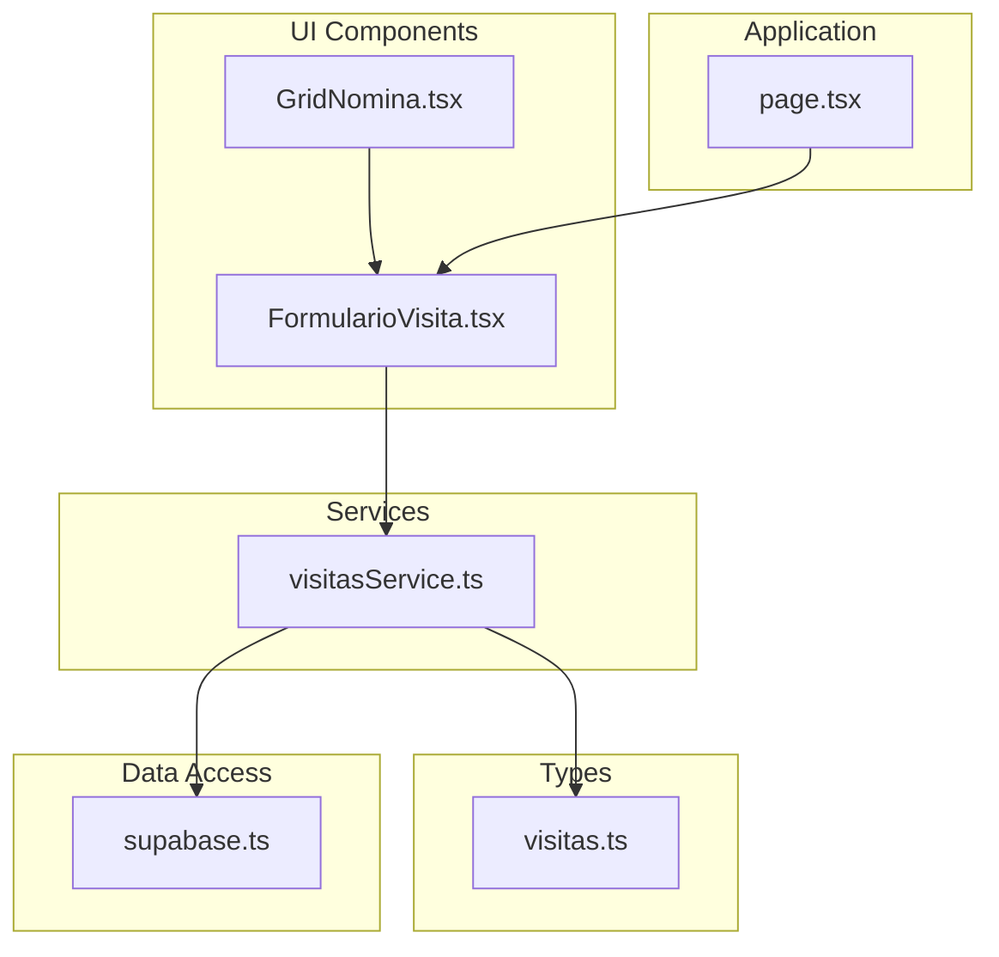
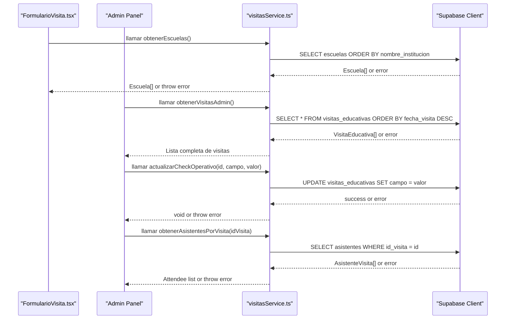
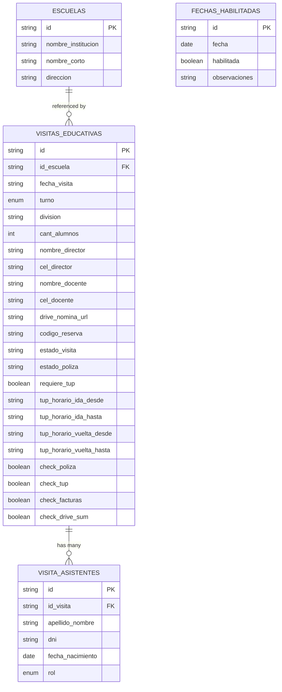
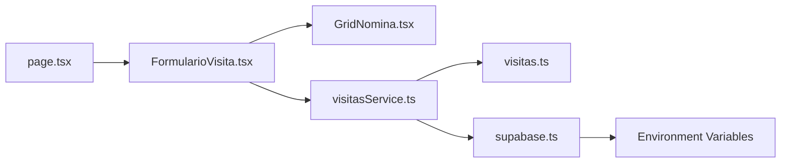

# Visit Management Service

<cite>
**Referenced Files in This Document**
- [visitasService.ts](file://src/services/visitasService.ts)
- [visitas.ts](file://src/types/visitas.ts)
- [supabase.ts](file://src/lib/supabase.ts)
- [FormularioVisita.tsx](file://src/components/visitas/FormularioVisita.tsx)
- [GridNomina.tsx](file://src/components/visitas/GridNomina.tsx)
- [page.tsx](file://src/app/visitas/page.tsx)
</cite>

## Update Summary
**Changes Made**
- Added comprehensive documentation for new administrative API services including retrieving all educational visits, updating operational check statuses, and fetching attendee lists
- Enhanced core functions section to include the three new administrative operations
- Updated architecture diagrams to reflect the expanded service capabilities
- Added detailed examples for administrative operations and operational workflow management
- Expanded error handling documentation to cover administrative operation scenarios
- Updated business rules to include operational status tracking and administrative workflows

## Table of Contents
1. [Introduction](#introduction)
2. [Project Structure](#project-structure)
3. [Core Components](#core-components)
4. [Architecture Overview](#architecture-overview)
5. [Detailed Component Analysis](#detailed-component-analysis)
6. [Administrative Operations](#administrative-operations)
7. [Dependency Analysis](#dependency-analysis)
8. [Performance Considerations](#performance-considerations)
9. [Troubleshooting Guide](#troubleshooting-guide)
10. [Conclusion](#conclusion)
11. [Appendices](#appendices)

## Introduction
This document explains the Visit Management Service that encapsulates all educational visit business logic for a streamlined booking system with comprehensive administrative capabilities. The service provides core functions for educational visit scheduling plus powerful administrative operations:

**Core Functions:**
- obtenerEscuelas(): fetches school data from the database
- verificarTurnoDisponible(): checks time slot availability with conflict prevention
- crearSolicitudVisita(): creates a new visit request with automatic status assignment, automated transportation logistics, and mandatory roster validation

**Administrative Operations:**
- obtenerVisitasAdmin(): retrieves all educational visits for administrative panel display
- actualizarCheckOperativo(): updates operational check statuses (insurance, TUP, invoices, Drive upload)
- obtenerAsistentesPorVisita(): fetches attendee lists for specific visits

The service follows a clear separation of concerns pattern, isolating business logic from UI components and centralizing Supabase integration for type-safe operations. The system includes automated TUP calculation based on school selection, simplified form interface with improved validation, mandatory roster requirement before reservation confirmation, and comprehensive administrative workflow management.

## Project Structure
The project is organized into focused modules:
- Services layer: contains business logic for visits and administrative operations (visitasService.ts).
- Types layer: defines TypeScript interfaces for strong typing (visitas.ts).
- Data access layer: configures the Supabase client (supabase.ts).
- UI components: implements the user interface with integrated service calls (FormularioVisita.tsx, GridNomina.tsx).
- Application pages: routes and page composition (page.tsx).

**Diagram sources**
- [visitasService.ts:1-169](file://src/services/visitasService.ts#L1-L169)
- [visitas.ts:1-84](file://src/types/visitas.ts#L1-L84)
- [supabase.ts:1-7](file://src/lib/supabase.ts#L1-L7)
- [FormularioVisita.tsx:1-723](file://src/components/visitas/FormularioVisita.tsx#L1-L723)
- [GridNomina.tsx:1-277](file://src/components/visitas/GridNomina.tsx#L1-L277)
- [page.tsx:1-28](file://src/app/visitas/page.tsx#L1-L28)

**Section sources**
- [visitasService.ts:1-169](file://src/services/visitasService.ts#L1-L169)
- [visitas.ts:1-84](file://src/types/visitas.ts#L1-L84)
- [supabase.ts:1-7](file://src/lib/supabase.ts#L1-L7)
- [FormularioVisita.tsx:1-723](file://src/components/visitas/FormularioVisita.tsx#L1-L723)
- [GridNomina.tsx:1-277](file://src/components/visitas/GridNomina.tsx#L1-L277)
- [page.tsx:1-28](file://src/app/visitas/page.tsx#L1-L28)

## Core Components
- Escuela: represents a school record with identifiers and contact details.
- FechaHabilitada: represents enabled dates for educational visits with optional observations.
- TurnoVisita: union type restricting shifts to morning or afternoon (maintained for compatibility but no longer manually selected).
- AnioEscolar: academic year type ('5°' | '6°').
- RolAsistente: role classification for attendees ('Alumno' | 'Docente').
- AsistenteInput: represents attendees (students and teachers) with role classification.
- SolicitudVisitaInput: input shape for creating a visit request with automated TUP calculation and mandatory attendee list.
- VisitaEducativa: full visit record including system-managed fields like IDs, statuses, and automatically calculated TUP schedules.
- CampoCheckOperativo: operational status fields for administrative tracking (insurance, TUP, invoices, Drive upload).
- AsistenteVisita: attendee record associated with a specific educational visit.

These types ensure compile-time safety across the service and any UI components that consume it.

**Section sources**
- [visitas.ts:1-84](file://src/types/visitas.ts#L1-L84)

## Architecture Overview
The service uses a layered architecture with comprehensive administrative capabilities:
- UI components call service functions for schools, availability checks, and administrative operations.
- The service enforces business rules including mandatory roster validation and delegates persistence to Supabase via a centralized client.
- Errors are thrown consistently so callers can handle them uniformly.
- Transportation logistics (TUP) are automatically calculated based on school selection rather than manual configuration.
- Form validation ensures all required fields including attendee lists are complete before submission.
- Administrative operations provide complete visibility and control over the visit management workflow.

**Diagram sources**
- [visitasService.ts:12-169](file://src/services/visitasService.ts#L12-L169)
- [FormularioVisita.tsx:93-116](file://src/components/visitas/FormularioVisita.tsx#L93-L116)
- [supabase.ts:1-7](file://src/lib/supabase.ts#L1-L7)

## Detailed Component Analysis

### Function: obtenerEscuelas()
Purpose:
- Retrieve schools sorted by institution name.
- Return an array of Escuela objects.

Behavior:
- Queries the escuelas table with a specific projection and ordering.
- Throws on database errors; returns an empty array if no rows exist.

Usage example (conceptual):
- Call the function when loading a dropdown of schools.
- Handle potential network or permission errors.

Validation and constraints:
- None beyond database schema; relies on Supabase permissions and schema.

Error handling:
- Any Supabase error is thrown to the caller for consistent handling.

Type safety:
- Returns Escuela[], typed by the interface.

**Section sources**
- [visitasService.ts:12-21](file://src/services/visitasService.ts#L12-L21)
- [visitas.ts:1-6](file://src/types/visitas.ts#L1-L6)

### Function: obtenerFechasHabilitadas()
Purpose:
- Retrieve enabled dates for educational visits.
- Return an array of FechaHabilitada objects with optional observations.

Behavior:
- Queries the fechas_habilitadas table filtering only enabled dates.
- Orders results by date ascending.
- Throws on database errors; returns an empty array if no rows exist.

Usage example (conceptual):
- Call the function alongside obtenerEscuelas() to populate available dates.
- Display dates with any associated observations to users.

Validation and constraints:
- Filters for habilitada = true only.
- Relies on Supabase permissions and schema.

Error handling:
- Any Supabase error is thrown to the caller for consistent handling.

Type safety:
- Returns FechaHabilitada[], typed by the interface.

**Section sources**
- [visitasService.ts:23-33](file://src/services/visitasService.ts#L23-L33)
- [visitas.ts:8-13](file://src/types/visitas.ts#L8-L13)

### Function: verificarTurnoDisponible()
Purpose:
- Check whether a given date and shift are available for scheduling.

Business rule:
- A slot is considered unavailable if there exists at least one non-cancelled visit for that date and shift.

Algorithm overview:
- Query visitas_educativas for matching date and shift while excluding cancelled visits.
- If any records are found, the slot is not available.

Complexity:
- O(k) where k is the number of conflicting records; typically small due to indexing on date and shift.

Usage example (conceptual):
- Disable a submit button or show a warning when a user selects an already-booked slot.

Error handling:
- Throws on database errors; otherwise returns a boolean indicating availability.

Type safety:
- Uses TurnoVisita union to restrict allowed values.

**Section sources**
- [visitasService.ts:35-49](file://src/services/visitasService.ts#L35-L49)
- [visitas.ts:15-15](file://src/types/visitas.ts#L15-L15)

### Function: crearSolicitudVisita()
Purpose:
- Create a new educational visit request with automatic status assignment, conflict prevention, automated transportation logistics, and mandatory roster validation.

Business rules:
- Prevents double booking by calling verificarTurnoDisponible before insertion.
- Automatically sets initial statuses:
  - Visit status: confirmed
  - Insurance policy status: pending
- Enforces maximum student capacity of 40 students per session.
- Requires legal consent acceptance before submission.
- **Requires mandatory attendee roster**: At least one attendee must be provided before reservation confirmation.
- **Automatically calculates TUP (public transportation) requirements based on school selection**: schools from the official list receive municipal transportation, while custom institutions do not.

Workflow:
- Validate legal consent acceptance and student capacity limits.
- **Validate mandatory attendee roster**: Ensure at least one attendee is provided.
- Determine TUP requirement: `requiere_tup = !!datos.id_escuela` (true if selecting from official school list).
- Validate availability for the requested date and shift.
- Generate unique reservation code.
- Insert the visit record with required fields plus default statuses and automatically calculated TUP time slots.
- Insert associated attendees if provided.
- Return the created VisitaEducativa object.

Error handling:
- Throws if legal consent is not accepted.
- Throws if student capacity exceeds maximum limit.
- **Throws if attendee roster is missing or empty**.
- Throws if the slot is already occupied.
- Throws on database errors during insert.

Type safety:
- Input conforms to SolicitudVisitaInput.
- Output conforms to VisitaEducativa, which extends input with system-managed fields.

Practical usage example (conceptual):
- On form submission, call this function and handle success or error states in the UI.

**Updated** Enhanced with automated TUP calculation based on school selection, mandatory roster validation, and streamlined form processing.

**Section sources**
- [visitasService.ts:58-121](file://src/services/visitasService.ts#L58-L121)
- [visitas.ts:28-73](file://src/types/visitas.ts#L28-L73)

## Administrative Operations

### Function: obtenerVisitasAdmin()
Purpose:
- Retrieve all educational visits for administrative panel display.
- Return visits ordered by most recent first.

Behavior:
- Queries the visitas_educativas table with full field selection.
- Orders results by fecha_visita in descending order (most recent first).
- Throws on database errors; returns an empty array if no visits exist.

Usage example (conceptual):
- Call the function when loading the administrative dashboard.
- Display visits in a sortable table with filtering capabilities.
- Enable administrative actions on each visit record.

Validation and constraints:
- No additional validation beyond database schema.
- Relies on Supabase permissions and schema.

Error handling:
- Any Supabase error is thrown to the caller for consistent handling.

Type safety:
- Returns VisitaEducativa[], providing complete visit information including operational status fields.

**Section sources**
- [visitasService.ts:127-136](file://src/services/visitasService.ts#L127-L136)
- [visitas.ts:59-73](file://src/types/visitas.ts#L59-L73)

### Function: actualizarCheckOperativo()
Purpose:
- Update operational check status for a specific visit.
- Supports insurance policy, TUP transport, invoice processing, and Drive upload tracking.

Business rules:
- Updates only the specified operational field for the given visit ID.
- Validates that the field is one of the supported operational check types.
- Maintains atomic updates to prevent partial state changes.

Supported operational fields:
- check_poliza: Insurance policy status tracking
- check_tup: Public transportation coordination status
- check_facturas: Invoice processing status
- check_drive_sum: Drive document upload status

Workflow:
- Validate the field parameter against CampoCheckOperativo type.
- Execute targeted update to the specified column.
- Throw error if update fails or field is invalid.

Error handling:
- Throws on database errors during update.
- Type safety prevents invalid field names at compile time.

Type safety:
- Field parameter constrained by CampoCheckOperativo union type.
- Boolean value ensures consistent status representation.

**Section sources**
- [visitasService.ts:142-153](file://src/services/visitasService.ts#L142-L153)
- [visitas.ts:53-57](file://src/types/visitas.ts#L53-L57)

### Function: obtenerAsistentesPorVisita()
Purpose:
- Retrieve the complete attendee list for a specific educational visit.
- Return attendees ordered alphabetically by name.

Behavior:
- Queries the visita_asistentes table filtered by visit ID.
- Selects only relevant attendee fields for efficient data transfer.
- Orders results by apellido_nombre in ascending alphabetical order.
- Throws on database errors; returns an empty array if no attendees exist.

Usage example (conceptual):
- Call the function when viewing visit details in administrative panel.
- Display attendee information for insurance verification and safety planning.
- Enable export functionality for attendee lists.

Validation and constraints:
- Requires valid visit ID parameter.
- Relies on proper foreign key relationships between tables.

Error handling:
- Any Supabase error is thrown to the caller for consistent handling.

Type safety:
- Returns AsistenteVisita[], providing structured attendee information.

**Section sources**
- [visitasService.ts:156-168](file://src/services/visitasService.ts#L156-L168)
- [visitas.ts:76-83](file://src/types/visitas.ts#L76-L83)

### Data Model Relationships

Notes:
- The service queries and inserts into these tables through Supabase.
- The exact foreign key relationships depend on your database schema; the service assumes id_escuela links to escuelas.id and id_visita links to visitas_educativas.id.
- The `requiere_tup` field is automatically set based on whether the school was selected from the official list or entered as a custom institution.
- Attendee records are stored separately in the visita_asistentes table for better data organization.
- Operational status fields (check_poliza, check_tup, check_facturas, check_drive_sum) enable comprehensive administrative workflow tracking.

[No sources needed since this diagram shows conceptual model mapping]

## Dependency Analysis
- visitasService.ts depends on:
  - supabase client for data access.
  - TypeScript interfaces for type safety.
- supabase.ts depends on environment variables for URL and anonymous key.
- FormularioVisita.tsx depends on service functions for data loading and form submission.
- GridNomina.tsx depends on TypeScript interfaces for attendee management.
- page.tsx serves as the main route component for the visits feature.

**Diagram sources**
- [visitasService.ts:1-10](file://src/services/visitasService.ts#L1-L10)
- [FormularioVisita.tsx:3-17](file://src/components/visitas/FormularioVisita.tsx#L3-L17)
- [GridNomina.tsx:3-4](file://src/components/visitas/GridNomina.tsx#L3-L4)
- [supabase.ts:1-7](file://src/lib/supabase.ts#L1-L7)
- [page.tsx:1-8](file://src/app/visitas/page.tsx#L1-L8)

**Section sources**
- [visitasService.ts:1-10](file://src/services/visitasService.ts#L1-L10)
- [FormularioVisita.tsx:3-17](file://src/components/visitas/FormularioVisita.tsx#L3-L17)
- [GridNomina.tsx:3-4](file://src/components/visitas/GridNomina.tsx#L3-L4)
- [supabase.ts:1-7](file://src/lib/supabase.ts#L1-L7)
- [page.tsx:1-8](file://src/app/visitas/page.tsx#L1-L8)

## Performance Considerations
- Minimize payload size by selecting only needed columns in obtenerEscuelas().
- Ensure indexes on visitas_educativas(fecha_visita, turno) to speed up availability checks.
- Avoid redundant calls by caching school lists in UI state when appropriate.
- Batch operations are not used here; consider future enhancements if volume increases.
- The simplified form reduces client-side validation complexity and improves user experience.
- Parallel data loading using Promise.all() for schools and dates improves initial load performance.
- Administrative operations use efficient queries with proper filtering and ordering.
- Attendee retrieval is optimized by selecting only necessary fields and sorting alphabetically.

[No sources needed since this section provides general guidance]

## Troubleshooting Guide
Common issues and resolutions:
- Slot already booked:
  - Occurs when creating a visit for a date and shift that has a non-cancelled visit.
  - Resolution: choose another date or shift; verify existing bookings.
- Database errors:
  - Network, authentication, or permission errors will be thrown by Supabase.
  - Resolution: check environment configuration, RLS policies, and connection settings.
- Type mismatches:
  - Passing invalid shift values will cause TypeScript errors at compile time.
  - Resolution: use the provided TurnoVisita type to constrain inputs.
- Capacity exceeded:
  - Occurs when student count exceeds the 40-student maximum limit.
  - Resolution: reduce student count or split into multiple sessions.
- Legal consent not accepted:
  - Occurs when users don't accept required legal conditions before submission.
  - Resolution: ensure both image usage and judicial measures checkboxes are checked.
- Invalid school selection:
  - Occurs when neither an official school nor a custom institution name is provided.
  - Resolution: select from the official school list or provide a custom institution name.
- **Missing attendee roster**:
  - Occurs when users try to submit without adding at least one attendee.
  - Resolution: add at least one student or teacher to the attendee list before submission.
- **Invalid attendee data**:
  - Occurs when attendee information is incomplete or malformed.
  - Resolution: ensure all required attendee fields are properly filled out.
- **Administrative operation failures**:
  - Occurs when attempting to update non-existent visits or invalid operational fields.
  - Resolution: verify visit IDs exist and use only supported operational field names.
- **Attendee retrieval errors**:
  - Occurs when querying attendees for visits without associated attendee records.
  - Resolution: handle empty arrays gracefully in administrative interfaces.

Error propagation:
- All service functions throw errors on failure; callers should wrap calls in try/catch blocks and present user-friendly messages.

**Updated** Added troubleshooting guidance for administrative operations, operational status management, and attendee retrieval scenarios.

**Section sources**
- [visitasService.ts:16-17](file://src/services/visitasService.ts#L16-L17)
- [visitasService.ts:44-45](file://src/services/visitasService.ts#L44-L45)
- [visitasService.ts:59-73](file://src/services/visitasService.ts#L59-L73)
- [visitasService.ts:98-99](file://src/services/visitasService.ts#L98-L99)
- [visitasService.ts:133-134](file://src/services/visitasService.ts#L133-L134)
- [visitasService.ts:152-153](file://src/services/visitasService.ts#L152-L153)
- [visitasService.ts:165-166](file://src/services/visitasService.ts#L165-L166)
- [FormularioVisita.tsx:140-173](file://src/components/visitas/FormularioVisita.tsx#L140-L173)

## Conclusion
The Visit Management Service centralizes educational visit business logic with clear separation from UI layers and comprehensive administrative capabilities. The system has been successfully enhanced with automated transportation logistics based on school selection, simplified form interface with improved validation, mandatory roster requirement before reservation confirmation, and powerful administrative operations for complete workflow management. The streamlined form interface provides a better user experience while maintaining robust validation, preventing double bookings, managing capacity limits, and integrating cleanly with Supabase using strongly-typed interfaces. The new administrative operations enable complete visibility and control over the visit management lifecycle, from initial booking through operational completion. By following the patterns described here, you can reliably schedule visits, manage school data, maintain operational workflows, and scale the system effectively.

[No sources needed since this section summarizes without analyzing specific files]

## Appendices

### API Reference Summary
**Core Functions:**
- obtenerEscuelas():
  - Purpose: Fetch schools sorted by institution name.
  - Returns: Array of Escuela.
  - Errors: Throws on database errors.

- obtenerFechasHabilitadas():
  - Purpose: Fetch enabled dates for educational visits.
  - Returns: Array of FechaHabilitada.
  - Errors: Throws on database errors.

- verificarTurnoDisponible(fecha, turno):
  - Purpose: Check availability for a date and shift.
  - Returns: Boolean indicating availability.
  - Errors: Throws on database errors.

- crearSolicitudVisita(datos):
  - Purpose: Create a visit request with automatic statuses, conflict prevention, automated TUP calculation, and mandatory roster validation.
  - Returns: Created VisitaEducativa.
  - Errors: Throws if slot is occupied, capacity exceeded, legal consent missing, attendee roster missing, or on database errors.

**Administrative Operations:**
- obtenerVisitasAdmin():
  - Purpose: Retrieve all educational visits for administrative panel display.
  - Returns: Array of VisitaEducativa ordered by most recent first.
  - Errors: Throws on database errors.

- actualizarCheckOperativo(id, campo, valor):
  - Purpose: Update operational check status for a specific visit.
  - Parameters: Visit ID, operational field name, boolean value.
  - Returns: void on success.
  - Errors: Throws on database errors or invalid field names.

- obtenerAsistentesPorVisita(idVisita):
  - Purpose: Fetch attendee list for a specific visit.
  - Returns: Array of AsistenteVisita ordered alphabetically.
  - Errors: Throws on database errors.

**Updated** Comprehensive API reference including both core booking functions and new administrative operations for complete visit management workflow.

**Section sources**
- [visitasService.ts:12-169](file://src/services/visitasService.ts#L12-L169)
- [visitas.ts:1-84](file://src/types/visitas.ts#L1-L84)

### Practical Usage Examples (Conceptual)
**Core Booking Workflow:**
- Loading schools and dates:
  - Call obtenerEscuelas() and obtenerFechasHabilitadas() when initializing the form.
  - Populate dropdowns for institution and date selection.
  - Handle errors by showing retry options.

- Checking availability:
  - Before enabling submit, call verificarTurnoDisponible(date, shift).
  - If false, inform the user to select another slot.

- Creating a visit:
  - On form submit, validate all required fields including attendee roster.
  - Call crearSolicitudVisita(formData) with complete attendee information.
  - The service automatically determines TUP requirements based on school selection.
  - On success, navigate or show confirmation with reservation details.
  - On error, display a user-friendly message based on the error type.

**Administrative Workflow:**
- Loading administrative dashboard:
  - Call obtenerVisitasAdmin() to retrieve all visits for display.
  - Implement sorting and filtering capabilities in the UI.
  - Show visit status indicators based on operational check fields.

- Managing operational status:
  - When insurance is processed, call actualizarCheckOperativo(id, 'check_poliza', true).
  - When TUP is coordinated, call actualizarCheckOperativo(id, 'check_tup', true).
  - When invoices are processed, call actualizarCheckOperativo(id, 'check_facturas', true).
  - When Drive documents are uploaded, call actualizarCheckOperativo(id, 'check_drive_sum', true).

- Viewing attendee details:
  - Call obtenerAsistentesPorVisita(idVisita) when displaying visit details.
  - Present attendee information for insurance verification and safety planning.
  - Enable export functionality for attendee lists.

**Updated** Comprehensive examples covering both core booking operations and administrative workflow management.

[No sources needed since this section provides conceptual examples]

### Business Rules Summary
**Core Booking Rules:**
- **Capacity Limit**: Maximum 40 students per session (excluding accompanying teachers).
- **Legal Consent**: Both image usage and judicial measures consent must be accepted.
- **School Selection**: Either select from official school list (receives TUP) or enter custom institution name (no TUP).
- **Availability**: No double bookings allowed for same date and shift combination.
- **Status Management**: Automatic assignment of visit and insurance policy statuses.
- **Transportation Logistics**: Automated TUP scheduling based on school selection with predefined time slots.
- **Mandatory Roster**: At least one attendee must be provided before reservation confirmation.
- **Attendee Validation**: Complete attendee information required for insurance and safety purposes.

**Administrative Rules:**
- **Operational Status Tracking**: Four distinct operational phases (insurance, TUP, invoices, Drive upload) can be independently tracked.
- **Visit Visibility**: All visits are accessible through administrative operations regardless of their current status.
- **Attendee Management**: Complete attendee information is retrievable for each visit for administrative purposes.
- **Data Integrity**: Operational updates are atomic and validated to prevent inconsistent states.

**Updated** Business rules reflect the comprehensive visit management system with both core booking operations and administrative workflow management capabilities.

[No sources needed since this section provides conceptual information]