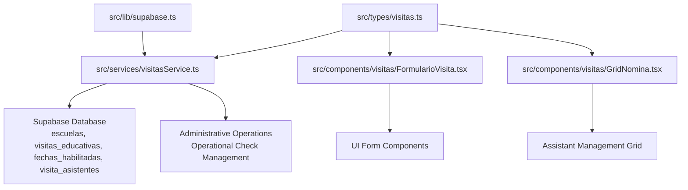
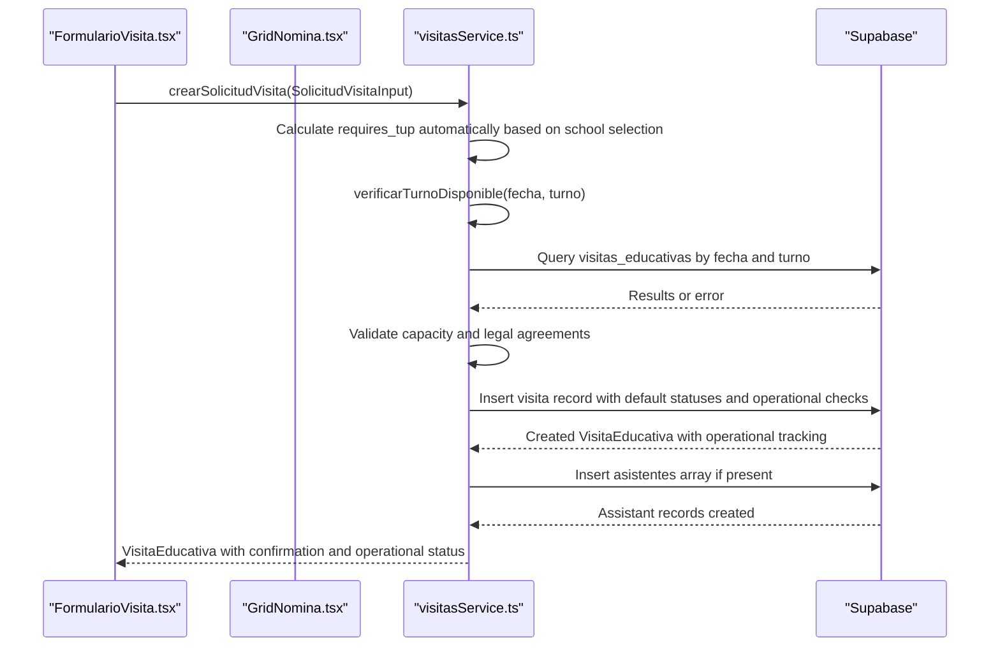
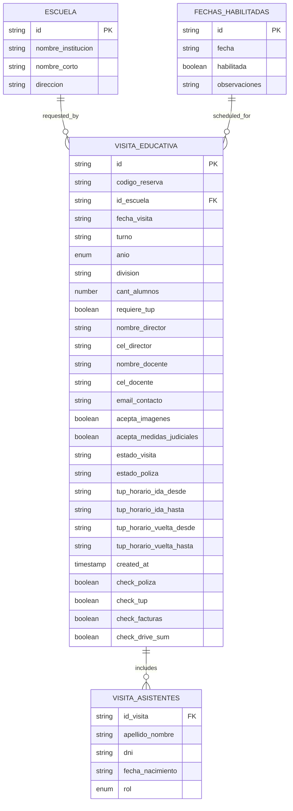
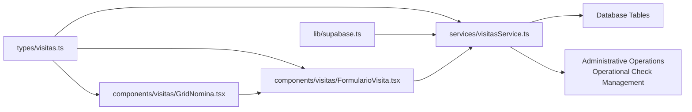

# Data Models & Type System

<cite>
**Referenced Files in This Document**
- [visitas.ts](file://src/types/visitas.ts)
- [visitasService.ts](file://src/services/visitasService.ts)
- [FormularioVisita.tsx](file://src/components/visitas/FormularioVisita.tsx)
- [GridNomina.tsx](file://src/components/visitas/GridNomina.tsx)
- [supabase.ts](file://src/lib/supabase.ts)
</cite>

## Update Summary
**Changes Made**
- Added new operational check fields (check_poliza, check_tup, check_facturas, check_drive_sum) to VisitaEducativa interface
- Introduced CampoCheckOperativo union type for controlled operational status management
- Enhanced service layer with actualizarCheckOperativo function for updating operational checks
- Added AsistenteVisita interface for database retrieval of attendee information
- Updated entity relationship diagrams to reflect new operational tracking capabilities
- Expanded administrative functionality documentation for visit management workflows

## Table of Contents
1. [Introduction](#introduction)
2. [Project Structure](#project-structure)
3. [Core Components](#core-components)
4. [Architecture Overview](#architecture-overview)
5. [Detailed Component Analysis](#detailed-component-analysis)
6. [Dependency Analysis](#dependency-analysis)
7. [Performance Considerations](#performance-considerations)
8. [Troubleshooting Guide](#troubleshooting-guide)
9. [Conclusion](#conclusion)

## Introduction
This document describes the comprehensive data models and type system used in the Simu-Twin-Web project. It focuses on the TypeScript interfaces and types that define entities such as Escuela (schools), VisitaEducativa (educational visits), and supporting types like TurnoVisita (visit shifts), AnioEscolar (school year), AsistenteInput (assistant input), and FechaHabilitada (enabled dates). The system has been enhanced with robust form functionality, assistant management capabilities, sophisticated validation rules, and comprehensive operational tracking for administrative workflows. Recent updates have expanded the type definitions with new operational check fields (check_poliza, check_tup, check_facturas, check_drive_sum) and attendee visitor interfaces to support complete visit lifecycle management from booking through completion.

## Project Structure
The data model is centralized under src/types and consumed by the service layer under src/services. The Supabase client is configured in src/lib and used to interact with the database. UI components in src/components utilize these types to ensure consistent data handling throughout the application. The system now includes comprehensive operational tracking capabilities for administrative workflows.

**Diagram sources**
- [visitas.ts:1-84](file://src/types/visitas.ts#L1-L84)
- [visitasService.ts:1-169](file://src/services/visitasService.ts#L1-L169)
- [FormularioVisita.tsx:1-723](file://src/components/visitas/FormularioVisita.tsx#L1-L723)
- [GridNomina.tsx:1-277](file://src/components/visitas/GridNomina.tsx#L1-L277)

**Section sources**
- [visitas.ts:1-84](file://src/types/visitas.ts#L1-L84)
- [visitasService.ts:1-169](file://src/services/visitasService.ts#L1-L169)
- [FormularioVisita.tsx:1-723](file://src/components/visitas/FormularioVisita.tsx#L1-L723)
- [GridNomina.tsx:1-277](file://src/components/visitas/GridNomina.tsx#L1-L277)

## Core Components
This section documents the primary data models and their relationships with enhanced operational tracking functionality.

### Core Entity Types

- **Escuela**: Represents a school entity with identifiers and descriptive fields.
- **FechaHabilitada**: Defines available visit dates with availability status and optional observations.
- **TurnoVisita**: Controlled union type restricting visit shift values to 'Mañana' or 'Tarde'.
- **AnioEscolar**: Restricted union type for school years ('5°' or '6°').
- **RolAsistente**: Enumerated role type distinguishing between 'Alumno' (student) and 'Docente' (teacher).
- **AsistenteInput**: Input contract for managing assistants attending educational visits.
- **SolicitudVisitaInput**: Comprehensive input contract for creating educational visit requests with enhanced validation and simplified turno handling.
- **VisitaEducativa**: Extended entity representing a created visit record with full lifecycle management and operational tracking.
- **AsistenteVisita**: Database representation of an assistant associated with a specific visit.

Key relationships:
- VisitaEducativa extends SolicitudVisitaInput, adding persistent identifiers, status fields, and operational tracking flags.
- Escuela is referenced by SolicitudVisitaInput through id_escuela, establishing logical links between schools and visit requests.
- AsistenteInput arrays are embedded within SolicitudVisitaInput for comprehensive assistant tracking.
- AsistenteVisita represents individual attendees linked to visits through id_visita foreign key.
- FechaHabilitada provides controlled date selection for visit scheduling.

Validation and constraints enforced by types:
- Union types (TurnoVisita, AnioEscolar, RolAsistente, CampoCheckOperativo) restrict allowed values at compile time.
- Optional fields (fecha_nacimiento, observaciones, turno, operational checks) enable flexible data entry.
- Numeric constraints (cant_alumnos ≤ 40) ensure proper resource allocation.
- Boolean flags (acepta_imagenes, acepta_medidas_judiciales, operational checks) enforce legal compliance and workflow progress.
- Array validation (asistentes[]) ensures structured assistant data collection.
- Simplified turno field allows for more flexible scheduling scenarios.

Type safety across layers:
- Services import and use these types to guarantee consistent shapes for API calls and responses.
- UI components leverage types for form validation and state management.
- Return types of service functions are explicitly declared, enabling predictable consumption.
- Operational check types provide compile-time safety for administrative workflows.

**Section sources**
- [visitas.ts:1-84](file://src/types/visitas.ts#L1-L84)

## Architecture Overview
The type system defines clear boundaries between domain models and service operations with enhanced form processing and operational tracking capabilities. Services validate inputs, perform business checks, manage assistant data, track operational status, and return typed results. The service layer includes enhanced automatic TUP calculation logic based on school selection, where transportation requirements are automatically determined when a school is selected from the official list.

**Diagram sources**
- [visitasService.ts:56-169](file://src/services/visitasService.ts#L56-L169)
- [FormularioVisita.tsx:137-211](file://src/components/visitas/FormularioVisita.tsx#L137-L211)
- [GridNomina.tsx:51-83](file://src/components/visitas/GridNomina.tsx#L51-L83)

## Detailed Component Analysis

### Escuela
Purpose:
- Defines the shape of a school record returned from the database.

Fields:
- id: string — unique identifier for the school.
- nombre_institucion: string — full institution name.
- nombre_corto: string — short name or abbreviation.
- direccion: string — physical address.

Usage examples:
- Function parameter: Not directly used as input here; primarily returned by service functions.
- Return value: obtenerEscuelas returns an array of Escuela objects.

Validation notes:
- All fields are required strings; no optional fields.
- No enum constraints; free-form text for names and address.

**Section sources**
- [visitas.ts:1-6](file://src/types/visitas.ts#L1-L6)
- [visitasService.ts:10-19](file://src/services/visitasService.ts#L10-L19)

### FechaHabilitada
Purpose:
- Manages available visit dates with availability status and optional observations.

Fields:
- id: string — unique identifier for the date record.
- fecha: string — ISO date string representing the visit date.
- habilitada: boolean — indicates whether the date is currently available for bookings.
- observaciones?: string | null — optional field for additional notes about the date.

Usage examples:
- Parameter: Used in UI components to populate date selection dropdowns.
- Return value: obtenerFechasHabilitadas returns filtered array of enabled dates.

Validation notes:
- Boolean habilitada field enables/disables dates dynamically.
- Optional observaciones allows for contextual information display.
- Date filtering ensures only available dates are presented to users.

**Section sources**
- [visitas.ts:8-13](file://src/types/visitas.ts#L8-L13)
- [visitasService.ts:21-31](file://src/services/visitasService.ts#L21-L31)

### TurnoVisita
Purpose:
- Controls allowed visit shift values to prevent invalid inputs.

Values:
- 'Mañana' (Morning shift)
- 'Tarde' (Afternoon shift)

Usage examples:
- Parameter: verificarTurnoDisponible accepts a TurnoVisita argument.
- Input: While the type exists, the actual turno field in SolicitudVisitaInput is now optional string for flexibility.

Validation notes:
- Compile-time enforcement prevents typos or unsupported values when using the type.
- Simplifies UI selection options and backend validation logic.
- Note: Current implementation uses optional string for turno to allow more flexible scheduling scenarios.

**Section sources**
- [visitas.ts:15](file://src/types/visitas.ts#L15)
- [visitasService.ts:33-47](file://src/services/visitasService.ts#L33-L47)

### AnioEscolar
Purpose:
- Restricts school year selection to specific grade levels for educational visits.

Values:
- '5°' (5th grade)
- '6°' (6th grade)

Usage examples:
- Parameter: SolicitudVisitaInput.anio field enforces valid school year selection.
- UI: Form components provide radio buttons or select options bound to this type.

Validation notes:
- Ensures consistency in grade level representation across the application.
- Prevents invalid grade level entries at compile time.

**Section sources**
- [visitas.ts:17](file://src/types/visitas.ts#L17)
- [FormularioVisita.tsx:37](file://src/components/visitas/FormularioVisita.tsx#L37)

### RolAsistente
Purpose:
- Defines the role classification for assistants attending educational visits.

Values:
- 'Alumno' (Student)
- 'Docente' (Teacher)

Usage examples:
- Parameter: AsistenteInput.rol field specifies assistant role.
- UI: GridNomina component uses this type for role selection dropdowns.

Validation notes:
- Enables different handling logic based on assistant role.
- Supports attendance tracking and permission management.

**Section sources**
- [visitas.ts:19](file://src/types/visitas.ts#L19)
- [GridNomina.tsx:11](file://src/components/visitas/GridNomina.tsx#L11)

### AsistenteInput
Purpose:
- Defines the structure for individual assistants attending educational visits.

Fields:
- apellido_nombre: string — full name of the assistant (surname and given name).
- dni: string — national identification number for the assistant.
- fecha_nacimiento?: string — optional birth date for age verification purposes.
- rol: RolAsistente — mandatory role classification (Alumno or Docente).

Usage examples:
- Parameter: SolicitudVisitaInput.asistentes array contains multiple AsistenteInput objects.
- Return value: GridNomina component manages arrays of AsistenteInput for form state.

Validation notes:
- Required fields ensure complete assistant information capture.
- Optional fecha_nacimiento supports flexible data entry while maintaining core requirements.
- Array-based structure enables bulk assistant management.

**Section sources**
- [visitas.ts:21-26](file://src/types/visitas.ts#L21-L26)
- [GridNomina.tsx:17-19](file://src/components/visitas/GridNomina.tsx#L17-L19)

### CampoCheckOperativo
Purpose:
- Defines the set of operational check fields that can be tracked for each visit in the administrative workflow.

Values:
- 'check_poliza' — Insurance policy status check
- 'check_tup' — Transportation (TUP) coordination status
- 'check_facturas' — Invoice processing status
- 'check_drive_sum' — Drive upload completion status

Usage examples:
- Parameter: actualizarCheckOperativo accepts a CampoCheckOperativo argument for type-safe updates.
- Field: Each VisitaEducativa instance includes optional boolean fields for each operational check.

Validation notes:
- Union type ensures only valid operational check fields can be updated programmatically.
- Prevents typos and maintains consistency across administrative operations.
- Supports progressive workflow tracking from booking through completion.

**Section sources**
- [visitas.ts:53-57](file://src/types/visitas.ts#L53-L57)
- [visitasService.ts:142-153](file://src/services/visitasService.ts#L142-L153)

### AsistenteVisita
Purpose:
- Represents an attendee record stored in the database, linked to a specific educational visit.

Fields:
- id: string — unique identifier for the attendee record.
- id_visita: string — foreign key reference to the associated visita educativa.
- apellido_nombre: string — full name of the attendee.
- dni: string — national identification number.
- fecha_nacimiento: string | null — birth date (nullable for privacy or missing data).
- rol: RolAsistente — role classification (Alumno or Docente).

Usage examples:
- Return value: obtenerAsistentesPorVisita returns array of AsistenteVisita records for a specific visit.
- Display: Administrative interfaces can show complete attendee lists with all details.

Validation notes:
- Foreign key relationship ensures referential integrity with visita educativa records.
- Nullable fecha_nacimiento accommodates cases where birth date is not provided.
- Role constraint ensures consistent attendee classification.

**Section sources**
- [visitas.ts:75-83](file://src/types/visitas.ts#L75-L83)
- [visitasService.ts:155-168](file://src/services/visitasService.ts#L155-L168)

### SolicitudVisitaInput
Purpose:
- Comprehensive input contract for creating educational visit requests with enhanced validation and assistant management.

**Updated** Simplified turno field from required TurnoVisita to optional string for more flexible scheduling scenarios.

Fields:
- id_escuela?: string | null — optional reference to the requesting school.
- otra_institucion_nombre?: string | null — alternative institution name when not using predefined schools.
- fecha_visita: string — mandatory date of the visit (ISO format).
- turno?: string — optional field for visit timing (simplified from required TurnoVisita).
- anio: AnioEscolar — mandatory school year selection ('5°' or '6°').
- division: string — class or group designation.
- cant_alumnos: number — student count with maximum limit of 40.
- requiere_tup: boolean — transportation requirement flag, automatically calculated based on school selection.
- nombre_director: string — director's full name.
- cel_director: string — director's contact number.
- nombre_docente: string — teacher's full name.
- cel_docente: string — teacher's contact number.
- email_contacto: string — contact email address.
- acepta_imagenes: boolean — mandatory consent for image usage.
- acepta_medidas_judiciales: boolean — mandatory legal compliance acknowledgment.
- asistentes: AsistenteInput[] — array of assistant records.

Usage examples:
- Parameter: crearSolicitudVisita accepts this comprehensive object.
- Validation: Extensive runtime validation ensures data integrity before database insertion.

Validation notes:
- Mandatory legal agreements (acepta_imagenes, acepta_medidas_judiciales) enforced at service level.
- Student capacity limit (40 students maximum) validated before submission.
- Optional fields support flexible data entry scenarios.
- Array validation ensures assistant data completeness.
- Automatic TUP calculation: When a school is selected from the official list, requires_tup is automatically set to true; when using "+ Otra institución", it's set to false.

**Section sources**
- [visitas.ts:28-47](file://src/types/visitas.ts#L28-L47)
- [visitasService.ts:56-78](file://src/services/visitasService.ts#L56-L78)

### VisitaEducativa
Purpose:
- Represents a persisted educational visit record with complete lifecycle management, scheduling information, and operational tracking.

**Updated** Enhanced with operational check fields for administrative workflow management.

Fields:
- Inherits all fields from SolicitudVisitaInput.
- id: string — unique identifier assigned upon creation.
- codigo_reserva: string — generated reservation code for tracking.
- estado_visita: string — visit status (e.g., 'Confirmada', 'Cancelada').
- estado_poliza: string — insurance policy status (e.g., 'Pendiente', 'Aceptada').
- tup_horario_ida_desde: string — outbound transportation departure time.
- tup_horario_ida_hasta: string — outbound transportation arrival time.
- tup_horario_vuelta_desde: string — return transportation departure time.
- tup_horario_vuelta_hasta: string — return transportation arrival time.
- created_at: string — timestamp of record creation.
- check_poliza?: boolean | null — insurance policy processing status.
- check_tup?: boolean | null — transportation coordination status.
- check_facturas?: boolean | null — invoice processing status.
- check_drive_sum?: boolean | null — Drive upload completion status.

Usage examples:
- Return value: crearSolicitudVisita returns a complete VisitaEducativa instance.
- Consumption: UI displays confirmation details and manages workflow based on status fields.
- Administration: Operational checks enable progressive workflow management.

Validation notes:
- Extends input shape, ensuring all required input fields are present.
- Adds persistent identifiers and state fields necessary for workflow management.
- Scheduling fields provide structured transportation coordination.
- Operational check fields enable comprehensive administrative tracking.

**Section sources**
- [visitas.ts:49-73](file://src/types/visitas.ts#L49-L73)
- [visitasService.ts:82-100](file://src/services/visitasService.ts#L82-L100)

### Enhanced Entity Relationship Diagram

**Diagram sources**
- [visitas.ts:1-84](file://src/types/visitas.ts#L1-L84)

## Dependency Analysis
Types are defined centrally and imported by services and UI components. The service layer depends on these types to ensure consistent data contracts with the database and UI, while components leverage types for form validation and state management. The system now includes comprehensive operational tracking dependencies for administrative workflows.

- Direct dependencies:
  - visitasService imports Escuela, FechaHabilitada, SolicitudVisitaInput, TurnoVisita, VisitaEducativa, AsistenteVisita, CampoCheckOperativo from types.
  - FormularioVisita imports all types for form state management and validation.
  - GridNomina imports AsistenteInput and RolAsistente for assistant management.
  - visitasService uses supabase client to query and insert records.
  - Service layer includes operational check management for administrative workflows.
- Cohesion:
  - Types encapsulate domain concepts; services encapsulate business logic using those types.
  - UI components maintain type-safe state management aligned with data models.
  - Operational check types provide cohesive workflow management.
- Coupling:
  - Services depend on types for compile-time safety; changes to types propagate automatically.
  - Components depend on types for consistent user experience and validation.
  - Administrative operations depend on operational check types for workflow management.

**Diagram sources**
- [visitas.ts:1-84](file://src/types/visitas.ts#L1-L84)
- [visitasService.ts:1-169](file://src/services/visitasService.ts#L1-L169)
- [FormularioVisita.tsx:1-723](file://src/components/visitas/FormularioVisita.tsx#L1-L723)
- [GridNomina.tsx:1-277](file://src/components/visitas/GridNomina.tsx#L1-L277)

**Section sources**
- [visitasService.ts:1-169](file://src/services/visitasService.ts#L1-L169)
- [visitas.ts:1-84](file://src/types/visitas.ts#L1-L84)

## Performance Considerations
- Minimal overhead: TypeScript types are erased at runtime; they do not impact performance.
- Efficient queries: Services select only needed fields and order results to reduce payload size.
- Availability checks: Verifying turn availability before insertion avoids unnecessary writes and reduces conflicts.
- Batch operations: Assistant data is inserted in batch operations to minimize database round trips.
- State optimization: React components use useMemo and useCallback for performance optimization.
- Simplified turno handling: Optional string field reduces validation overhead compared to strict enum checking.
- Automatic TUP calculation: Eliminates manual transportation assignment logic, reducing computational complexity.
- Operational check efficiency: Individual boolean fields allow granular updates without full record rewrites.
- Lazy loading: Attendee data can be loaded on-demand for administrative views to optimize initial page load.

## Troubleshooting Guide
Common issues and how types help:
- Invalid turno or anio values: Compile-time errors prevent passing unsupported strings; UI should provide dropdowns bound to respective types.
- Missing required fields: TypeScript enforces presence of all required fields in SolicitudVisitaInput; missing properties will cause build-time errors.
- Optional fields: fecha_nacimiento, observaciones, turno, and operational checks are optional; omitting them is valid and will not break compilation.
- Runtime errors: Services throw errors on database failures; callers should handle exceptions appropriately.

Runtime validation patterns:
- Availability check: verificarTurnoDisponible queries existing visits for the same date and turno, excluding canceled visits, to ensure slot availability.
- Capacity validation: cant_alumnos is validated against CUPO_MAXIMO_ALUMNOS constant (40 students).
- Legal compliance: acepto_imagenes and acepta_medidas_judiciales must both be true before submission.
- Default statuses: When inserting a new visit, estado_visita and estado_poliza are set to predefined values to maintain consistent state transitions.
- Assistant processing: Empty assistant names are filtered out before database insertion.
- Automatic TUP calculation: Service layer automatically determines requires_tup based on school selection - true for official schools, false for custom institutions.
- Operational check updates: actualizarCheckOperativo provides type-safe updates to operational status fields.

Error handling:
- If database operations fail, errors are thrown; consumers must catch and handle them.
- Business rule violations (e.g., exceeded capacity) result in explicit errors with descriptive messages.
- Form validation provides immediate feedback to users before submission.
- Operational check updates include proper error handling for database operations.

**Section sources**
- [visitasService.ts:56-169](file://src/services/visitasService.ts#L56-L169)
- [FormularioVisita.tsx:137-211](file://src/components/visitas/FormularioVisita.tsx#L137-L211)

## Conclusion
The Simu-Twin-Web project employs a comprehensive, type-driven architecture centered around well-defined interfaces and union types. The enhanced type system now includes Escuela, FechaHabilitada, TurnoVisita, AnioEscolar, RolAsistente, AsistenteInput, SolicitudVisitaInput, VisitaEducativa, AsistenteVisita, and CampoCheckOperativo, forming a cohesive model that ensures type safety across the service layer and UI components. Recent updates have significantly expanded the system's capabilities with new operational check fields (check_poliza, check_tup, check_facturas, check_drive_sum) and attendee visitor interfaces to support complete visit lifecycle management from booking through completion. The addition of CampoCheckOperativo union type and AsistenteVisita interface demonstrates the evolution toward a more robust and feature-rich educational visit booking system with comprehensive administrative capabilities. Union types constrain controlled values, optional fields enable flexible data entry, and service-level validations complement compile-time guarantees. The simplified turno handling, enhanced automatic TUP calculation, and comprehensive operational tracking make the system more flexible and user-friendly while maintaining data integrity. This approach improves reliability, maintainability, and developer experience while keeping runtime overhead minimal and providing powerful administrative tools for visit management workflows.