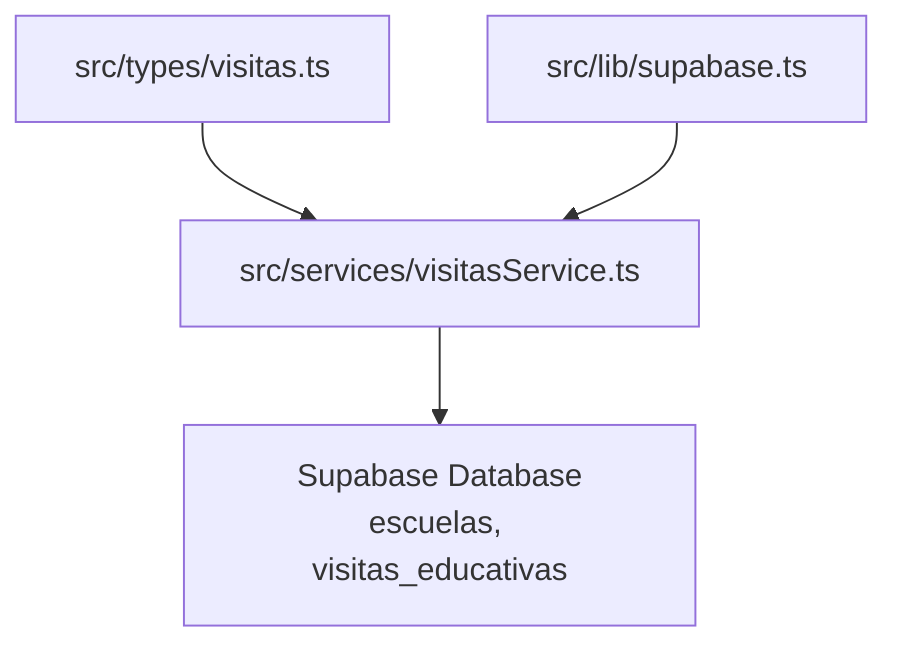
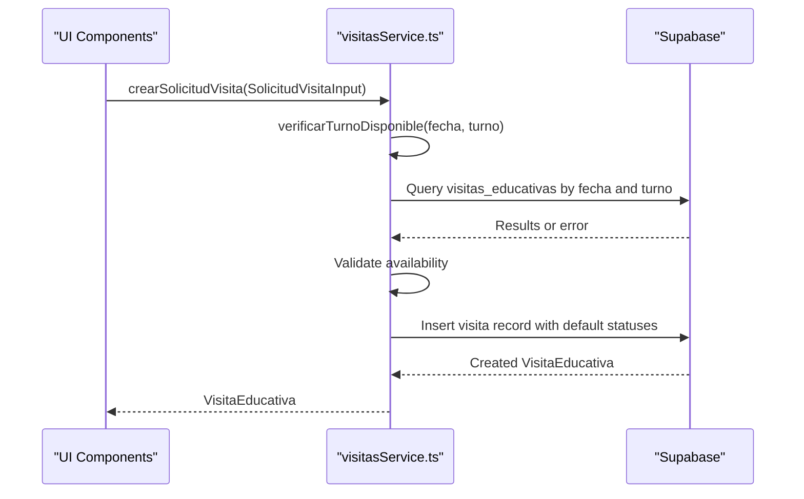
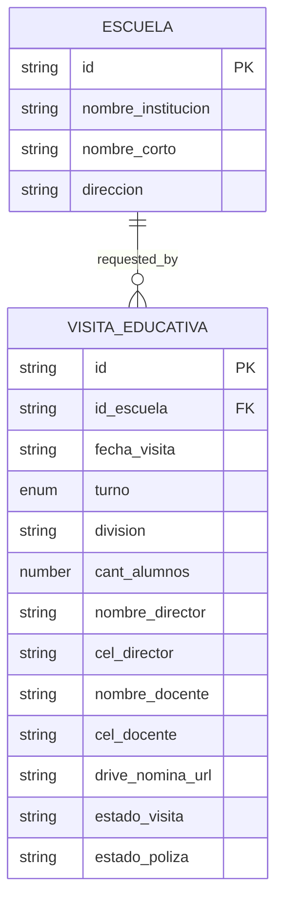
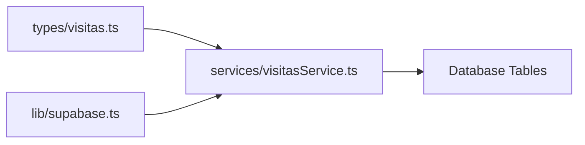

# Data Models & Type System

<cite>
**Referenced Files in This Document**
- [visitas.ts](file://src/types/visitas.ts)
- [visitasService.ts](file://src/services/visitasService.ts)
- [supabase.ts](file://src/lib/supabase.ts)
- [package.json](file://package.json)
</cite>

## Table of Contents
1. [Introduction](#introduction)
2. [Project Structure](#project-structure)
3. [Core Components](#core-components)
4. [Architecture Overview](#architecture-overview)
5. [Detailed Component Analysis](#detailed-component-analysis)
6. [Dependency Analysis](#dependency-analysis)
7. [Performance Considerations](#performance-considerations)
8. [Troubleshooting Guide](#troubleshooting-guide)
9. [Conclusion](#conclusion)

## Introduction
This document describes the data models and type system used in the Simu-Twin-Web project. It focuses on the TypeScript interfaces and types that define entities such as Escuela (schools), VisitaEducativa (educational visits), and supporting types like TurnoVisita (visit shifts). It explains field definitions, data types, validation rules enforced by types, and how these types ensure consistency across the service layer and UI components. It also covers optional fields, controlled values via union types, and runtime validation patterns used in services.

## Project Structure
The data model is centralized under src/types and consumed by the service layer under src/services. The Supabase client is configured in src/lib and used to interact with the database.

**Diagram sources**
- [visitas.ts:1-28](file://src/types/visitas.ts#L1-L28)
- [visitasService.ts:1-59](file://src/services/visitasService.ts#L1-L59)
- [supabase.ts:1-7](file://src/lib/supabase.ts#L1-L7)

**Section sources**
- [visitas.ts:1-28](file://src/types/visitas.ts#L1-L28)
- [visitasService.ts:1-59](file://src/services/visitasService.ts#L1-L59)
- [supabase.ts:1-7](file://src/lib/supabase.ts#L1-L7)

## Core Components
This section documents the primary data models and their relationships.

- Escuela: Represents a school entity with identifiers and descriptive fields.
- SolicitudVisitaInput: Input contract for creating an educational visit request. Includes required and optional fields.
- TurnoVisita: Controlled union type restricting visit shift values.
- VisitaEducativa: Extended entity representing a created visit record, including lifecycle states.

Key relationships:
- VisitaEducativa extends SolicitudVisitaInput, adding persistent identifiers and status fields.
- Escuela is referenced by SolicitudVisitaInput through id_escuela, establishing a logical link between schools and visit requests.

Validation and constraints enforced by types:
- TurnoVisita restricts allowed values to two specific strings, preventing invalid shift assignments at compile time.
- Optional drive_nomina_url allows flexible data entry without requiring a value.
- Numeric cant_alumnos ensures student counts are numbers.
- String fields enforce textual data for names, addresses, and identifiers.

Type safety across layers:
- Services import and use these types to guarantee consistent shapes for API calls and responses.
- Return types of service functions are explicitly declared, enabling predictable consumption in UI components.

**Section sources**
- [visitas.ts:1-28](file://src/types/visitas.ts#L1-L28)

## Architecture Overview
The type system defines a clear boundary between domain models and service operations. Services validate inputs, perform business checks, and return typed results.

**Diagram sources**
- [visitasService.ts:20-58](file://src/services/visitasService.ts#L20-L58)
- [visitas.ts:10-27](file://src/types/visitas.ts#L10-L27)

## Detailed Component Analysis

### Escuela
Purpose:
- Defines the shape of a school record returned from the database.

Fields:
- id: string — unique identifier for the school.
- nombre_institucion: string — full institution name.
- nombre_corto: string — short name or abbreviation.
- direccion: string — physical address.

Usage examples:
- Function parameter: Not directly used as input here; primarily returned by service functions.
- Return value: obtenerEscuelas returns an array of Escuela objects.

Validation notes:
- All fields are required strings; no optional fields.
- No enum constraints; free-form text for names and address.

**Section sources**
- [visitas.ts:1-6](file://src/types/visitas.ts#L1-L6)
- [visitasService.ts:9-18](file://src/services/visitasService.ts#L9-L18)

### TurnoVisita
Purpose:
- Controls allowed visit shift values to prevent invalid inputs.

Values:
- 'Mañana'
- 'Tarde'

Usage examples:
- Parameter: verificarTurnoDisponible accepts a TurnoVisita argument.
- Input: SolicitudVisitaInput requires turno to be one of the allowed values.

Validation notes:
- Compile-time enforcement prevents typos or unsupported values.
- Simplifies UI selection options and backend validation logic.

**Section sources**
- [visitas.ts:8-8](file://src/types/visitas.ts#L8-L8)
- [visitasService.ts:20-34](file://src/services/visitasService.ts#L20-L34)

### SolicitudVisitaInput
Purpose:
- Defines the input contract for creating a new educational visit request.

Fields:
- id_escuela: string — references the school making the request.
- fecha_visita: string — date of the visit (format expected by the database).
- turno: TurnoVisita — restricted to 'Mañana' or 'Tarde'.
- division: string — class or group designation.
- cant_alumnos: number — number of students attending.
- nombre_director: string — director’s name.
- cel_director: string — director’s contact number.
- nombre_docente: string — teacher’s name.
- cel_docente: string — teacher’s contact number.
- drive_nomina_url?: string — optional URL to a roster file.

Usage examples:
- Parameter: crearSolicitudVisita accepts this object.
- Return value: Not returned directly; used to create VisitaEducativa.

Validation notes:
- All fields except drive_nomina_url are required.
- Numeric constraint on cant_alumnos ensures proper counting.
- Optional field supports flexible data entry when roster upload is not available.

**Section sources**
- [visitas.ts:10-21](file://src/types/visitas.ts#L10-L21)
- [visitasService.ts:36-58](file://src/services/visitasService.ts#L36-L58)

### VisitaEducativa
Purpose:
- Represents a persisted educational visit record with lifecycle states.

Fields:
- Inherits all fields from SolicitudVisitaInput.
- id: string — unique identifier assigned upon creation.
- estado_visita: string — visit status (e.g., 'Confirmada').
- estado_poliza: string — insurance policy status (e.g., 'Pendiente').

Usage examples:
- Return value: crearSolicitudVisita returns a VisitaEducativa instance.
- Consumption: UI can display status fields and manage workflows based on them.

Validation notes:
- Extends input shape, ensuring all required input fields are present.
- Adds persistent identifiers and state fields necessary for workflow management.

**Section sources**
- [visitas.ts:23-27](file://src/types/visitas.ts#L23-L27)
- [visitasService.ts:36-58](file://src/services/visitasService.ts#L36-L58)

### Entity Relationship Diagram

**Diagram sources**
- [visitas.ts:1-27](file://src/types/visitas.ts#L1-L27)

## Dependency Analysis
Types are defined centrally and imported by services. The service layer depends on these types to ensure consistent data contracts with the database and UI.

- Direct dependencies:
  - visitasService imports Escuela, SolicitudVisitaInput, TurnoVisita, VisitaEducativa from types.
  - visitasService uses supabase client to query and insert records.
- Cohesion:
  - Types encapsulate domain concepts; services encapsulate business logic using those types.
- Coupling:
  - Services depend on types for compile-time safety; changes to types propagate to services automatically.

**Diagram sources**
- [visitas.ts:1-28](file://src/types/visitas.ts#L1-L28)
- [visitasService.ts:1-59](file://src/services/visitasService.ts#L1-L59)
- [supabase.ts:1-7](file://src/lib/supabase.ts#L1-L7)

**Section sources**
- [visitasService.ts:1-59](file://src/services/visitasService.ts#L1-L59)
- [visitas.ts:1-28](file://src/types/visitas.ts#L1-L28)

## Performance Considerations
- Minimal overhead: TypeScript types are erased at runtime; they do not impact performance.
- Efficient queries: Services select only needed fields and order results to reduce payload size.
- Availability checks: Verifying turn availability before insertion avoids unnecessary writes and reduces conflicts.

[No sources needed since this section provides general guidance]

## Troubleshooting Guide
Common issues and how types help:
- Invalid turno values: Compile-time errors prevent passing unsupported strings; UI should provide dropdowns bound to TurnoVisita.
- Missing required fields: TypeScript enforces presence of all required fields in SolicitudVisitaInput; missing properties will cause build-time errors.
- Optional fields: drive_nomina_url is optional; omitting it is valid and will not break compilation.
- Runtime errors: Services throw errors on database failures; callers should handle exceptions appropriately.

Runtime validation patterns:
- Availability check: verificarTurnoDisponible queries existing visits for the same date and turno, excluding canceled visits, to ensure slot availability.
- Default statuses: When inserting a new visit, estado_visita and estado_poliza are set to predefined values to maintain consistent state transitions.

Error handling:
- If database operations fail, errors are thrown; consumers must catch and handle them.
- Business rule violations (e.g., occupied turno) result in explicit errors with descriptive messages.

**Section sources**
- [visitasService.ts:20-58](file://src/services/visitasService.ts#L20-L58)

## Conclusion
The Simu-Twin-Web project employs a clean, type-driven architecture centered around well-defined interfaces and union types. Escuela, SolicitudVisitaInput, TurnoVisita, and VisitaEducativa form a cohesive model that ensures type safety across the service layer and UI components. Union types constrain controlled values, optional fields enable flexible data entry, and service-level validations complement compile-time guarantees. This approach improves reliability, maintainability, and developer experience while keeping runtime overhead minimal.