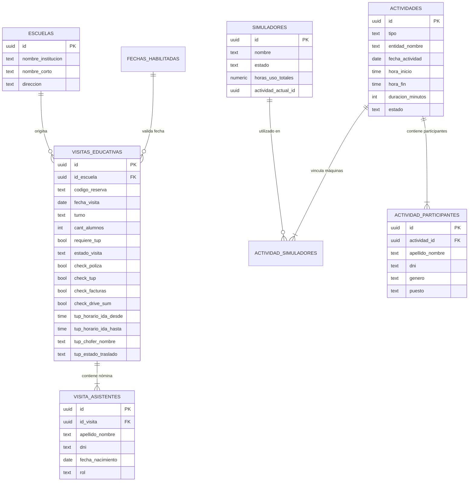

# Data Models & Type System

<cite>
**Referenced Files in This Document**
- [src/types/gemelo.ts](file:///c:/Users/catra/Desktop/simu-twin-web/src/types/gemelo.ts)
- [src/types/visitas.ts](file:///c:/Users/catra/Desktop/simu-twin-web/src/types/visitas.ts)
- [src/types/tup.ts](file:///c:/Users/catra/Desktop/simu-twin-web/src/types/tup.ts)
- [src/types/actividades.ts](file:///c:/Users/catra/Desktop/simu-twin-web/src/types/actividades.ts)
- [src/app/visitas/actions.ts](file:///c:/Users/catra/Desktop/simu-twin-web/src/app/visitas/actions.ts)
- [src/app/admin/visitas-educativas/actions.ts](file:///c:/Users/catra/Desktop/simu-twin-web/src/app/admin/visitas-educativas/actions.ts)
- [src/app/admin/tup/actions.ts](file:///c:/Users/catra/Desktop/simu-twin-web/src/app/admin/tup/actions.ts)
- [src/app/admin/registro-actividades/actions.ts](file:///c:/Users/catra/Desktop/simu-twin-web/src/app/admin/registro-actividades/actions.ts)
- [supabase/migrations/0001_rls_visitas_educativas.sql](file:///c:/Users/catra/Desktop/simu-twin-web/supabase/migrations/0001_rls_visitas_educativas.sql)
- [supabase/migrations/0003_agregar_columnas_tup.sql](file:///c:/Users/catra/Desktop/simu-twin-web/supabase/migrations/0003_agregar_columnas_tup.sql)
</cite>

## Table of Contents
1. [Introduction](#introduction)
2. [Domain Models Overview](#domain-models-overview)
3. [Digital Twin & 3D SCADA Types (gemelo.ts)](#digital-twin--3d-scada-types-gemelots)
4. [Educational Visits Domain (visitas.ts)](#educational-visits-domain-visitasts)
5. [Municipal Transit Logistics (tup.ts)](#municipal-transit-logistics-tupts)
6. [Simulator Rack & Activity Sessions (actividades.ts)](#simulator-rack--activity-sessions-actividadests)
7. [Entity Relationship Diagram](#entity-relationship-diagram)
8. [Data Validation & Sanitization Protocols](#data-validation--sanitization-protocols)
9. [Conclusion](#conclusion)

---

## Introduction
The type system in Simu-Twin Web is built on strict TypeScript contracts located under [`src/types/`](file:///c:/Users/catra/Desktop/simu-twin-web/src/types/). These interfaces map 1:1 to the PostgreSQL database schema and client-side states, ensuring compile-time safety and runtime integrity.

---

## Domain Models Overview
The repository defines four primary domain model modules:
1. **`gemelo.ts`**: WebGL 3D scene parameters, simulator hardware configurations, operator kinematic states, and SCADA telemetry metrics.
2. **`visitas.ts`**: Educational visit requests, school catalogs, available calendar dates, attendee rosters with ID verification, and administrative operational checks.
3. **`tup.ts`**: Municipal transit records, driver assignments, pickup/return schedules, and transit lifecycle states.
4. **`actividades.ts`**: Real-time simulator rack states, live session timers, participant rosters with gender identity categorization, and equipment usage accumulators.

---

## Digital Twin & 3D SCADA Types (`gemelo.ts`)

```typescript
export type TipoSimulador =
  | 'autoelevador'
  | 'pala-frontal'
  | 'retroexcavadora'
  | 'grua-telescopica'
  | 'tractor'
  | 'camion'
  | 'simspray';

export type EstadoSimulador = 'detenido' | 'operando';

export interface ConfiguracionEstacion {
  id: string;
  nombre: string;
  tipo: TipoSimulador;
  subtipo?: string;
  pos: [number, number, number];
  rotY: number;
  color: number;
  detalles: string;
}

export type OperarioFase =
  | 'espera'
  | 'caminando'
  | 'sentandose'
  | 'operando'
  | 'levantandose'
  | 'retornando';

export interface OperarioState {
  id: string;
  estacionId: string;
  mesh: THREE.Group;
  targetPos: [number, number, number];
  startPos: [number, number, number];
  fase: OperarioFase;
  progreso: number;
  piernaIzq?: THREE.Mesh;
  piernaDer?: THREE.Mesh;
  brazoIzq?: THREE.Mesh;
  brazoDer?: THREE.Mesh;
  visorVR?: THREE.Mesh;
}

export interface SCADANaveStatus {
  totalEstaciones: number;
  activas: number;
  consumoKWh: number;
  temperaturaAmbiente: number;
  tiempoOperacionSeg: number;
}
```

---

## Educational Visits Domain (`visitas.ts`)

```typescript
export interface Escuela {
  id: string;
  nombre_institucion: string;
  nombre_corto: string;
  direccion: string;
}

export interface FechaHabilitada {
  id: string;
  fecha: string;
  habilitada: boolean;
  observaciones?: string | null;
}

export type TurnoVisita = 'Mañana' | 'Tarde';
export type AnioEscolar = '5°' | '6°';
export type RolAsistente = 'Alumno' | 'Docente';

export interface AsistenteInput {
  apellido_nombre: string;
  dni: string;
  fecha_nacimiento?: string;
  rol: RolAsistente;
}

export type CampoCheckOperativo =
  | 'check_poliza'
  | 'check_tup'
  | 'check_facturas'
  | 'check_drive_sum';

export interface VisitaEducativa extends SolicitudVisitaInput {
  id: string;
  requiere_tup: boolean;
  codigo_reserva: string;
  estado_visita: string;
  estado_poliza: string;
  tup_horario_ida_desde: string;
  tup_horario_ida_hasta: string;
  tup_horario_vuelta_desde: string;
  tup_horario_vuelta_hasta: string;
  created_at: string;
  check_poliza?: boolean | null;
  check_tup?: boolean | null;
  check_facturas?: boolean | null;
  check_drive_sum?: boolean | null;
}
```

---

## Municipal Transit Logistics (`tup.ts`)

```typescript
export type EstadoTrasladoTup =
  | 'pendiente'
  | 'en_camino'
  | 'en_destino'
  | 'completado'
  | 'cancelado';

export interface TrasladoTupItem {
  id: string;
  codigo_reserva: string;
  fecha_visita: string;
  turno: string | null;
  cant_alumnos: number;
  institucion_nombre: string;
  institucion_direccion?: string | null;
  nombre_docente: string | null;
  cel_docente: string | null;
  tup_horario_ida_desde: string | null;
  tup_horario_ida_hasta: string | null;
  tup_horario_vuelta_desde: string | null;
  tup_horario_vuelta_hasta: string | null;
  tup_chofer_nombre: string | null;
  tup_estado_traslado: EstadoTrasladoTup;
  estado_visita: string;
}
```

---

## Simulator Rack & Activity Sessions (`actividades.ts`)

```typescript
export type EstadoSimulador = 'libre' | 'en_operacion' | 'mantenimiento';
export type EstadoSimuladorConmutable = 'libre' | 'en_operacion';
export type TipoActividad = 'empresa' | 'institucional' | 'capacitacion' | 'visita_especial' | 'mantenimiento' | 'otro';
export type EstadoActividad = 'planificada' | 'en_curso' | 'finalizada';
export type GeneroParticipante = 'hombre' | 'mujer' | 'otro' | 'no_especifica';

export interface Simulador {
  id: string;
  nombre: string;
  estado: EstadoSimulador;
  horas_uso_totales: number;
  actividad_actual_id: string | null;
}

export interface ParticipanteActividad {
  id: string;
  actividad_id: string;
  apellido_nombre: string;
  dni: string | null;
  genero: GeneroParticipante;
  puesto: string | null;
}

export interface ActividadItem {
  id: string;
  tipo: TipoActividad;
  entidad_nombre: string;
  contacto_nombre: string | null;
  contacto_telefono: string | null;
  fecha_actividad: string;
  hora_inicio: string | null;
  hora_fin: string | null;
  duracion_minutos: number;
  estado: EstadoActividad;
  observaciones: string | null;
  created_at: string | null;
  participantes: ParticipanteActividad[];
  simuladores: SimuladorActividad[];
}
```

---

## Entity Relationship Diagram



---

## Data Validation & Sanitization Protocols

1. **Date/Time/UUID Empty-to-Null Normalization**:
   PostgreSQL throws database syntax errors when receiving `""` for `date`, `time`, or `uuid` columns. Helper functions in Server Actions explicitly coerce empty strings to `null`:
   ```typescript
   function normalizarTextoNullable(valor: string | null | undefined): string | null {
     const limpio = (valor ?? '').trim();
     return limpio.length > 0 ? limpio : null;
   }
   ```
2. **Quota Enforcement**:
   - `cant_alumnos` is constrained to a maximum of 40 students per educational visit.
3. **Gender Categorization**:
   - `GeneroParticipante` enforces standard municipal diversity categories (`hombre`, `mujer`, `otro`, `no_especifica`), enabling statistical reporting on women's inclusion in heavy equipment operation.

---

## Conclusion
The data models in Simu-Twin Web provide strong compile-time and runtime integrity, bridging frontend form state, 3D WebGL rendering telemetry, and relational PostgreSQL storage.