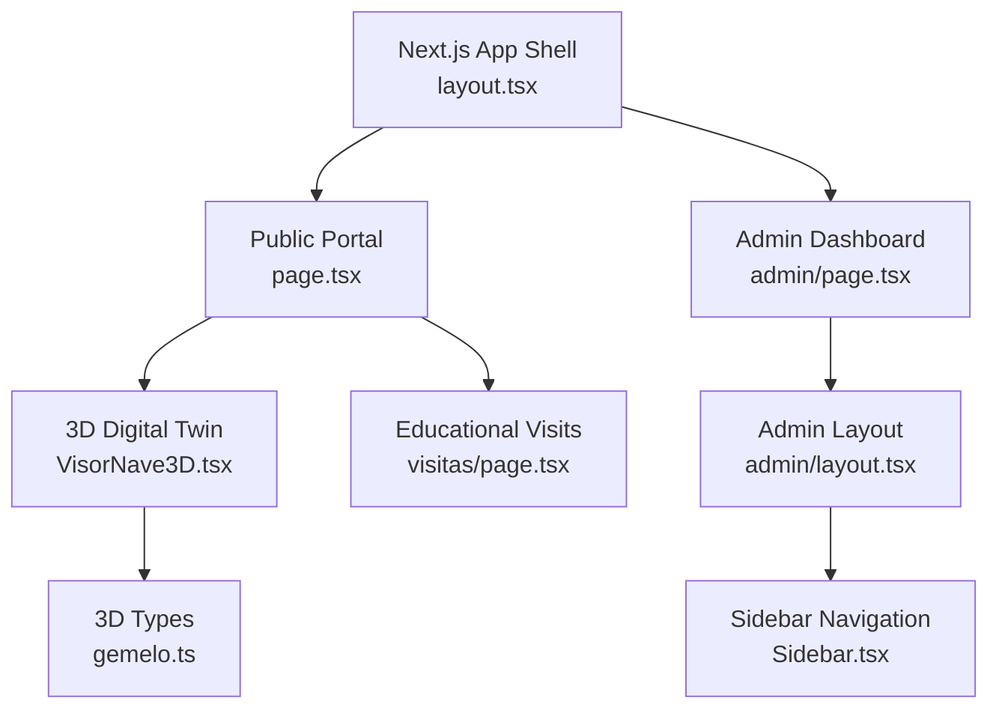
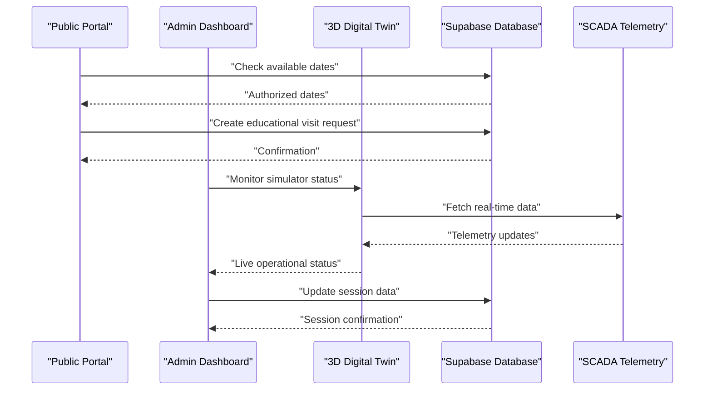
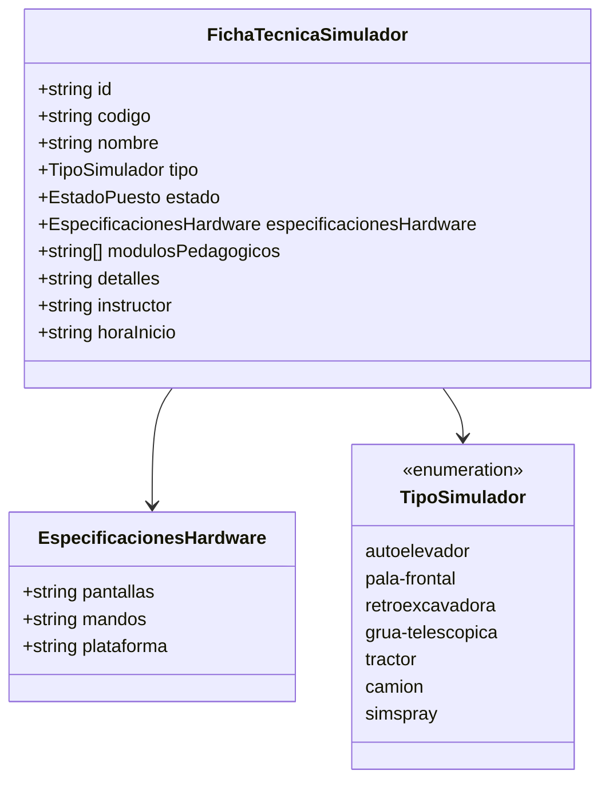
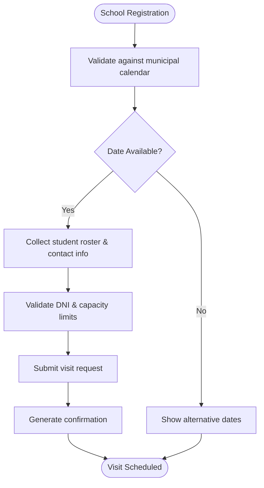
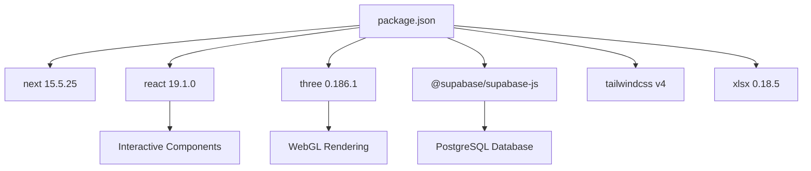

# Project Overview

<cite>
**Referenced Files in This Document**
- [README.md](file://README.md)
- [package.json](file://package.json)
- [src/app/layout.tsx](file://src/app/layout.tsx)
- [src/app/page.tsx](file://src/app/page.tsx)
- [src/components/gemelo/VisorNave3D.tsx](file://src/components/gemelo/VisorNave3D.tsx)
- [src/types/gemelo.ts](file://src/types/gemelo.ts)
- [src/app/visitas/page.tsx](file://src/app/visitas/page.tsx)
- [src/app/admin/page.tsx](file://src/app/admin/page.tsx)
- [src/app/admin/layout.tsx](file://src/app/admin/layout.tsx)
- [src/components/admin/Sidebar.tsx](file://src/components/admin/Sidebar.tsx)
- [supabase/migrations/0001_rls_visitas_educativas.sql](file://supabase/migrations/0001_rls_visitas_educativas.sql)
</cite>

## Update Summary
**Changes Made**
- Completely transformed from generic Next.js template to specialized municipal training center platform for Venado Tuerto, Argentina
- Added comprehensive 3D simulation capabilities with Three.js and SCADA integration
- Implemented educational visit management system with H4 module for school field trips
- Integrated TUP (Transporte Urbano de Pasajeros) logistics for municipal transportation
- Added administrative dashboard with real-time monitoring and activity registration
- Enhanced security with Row Level Security (RLS) policies for data protection

## Table of Contents
1. [Introduction](#introduction)
2. [Project Structure](#project-structure)
3. [Core Components](#core-components)
4. [Architecture Overview](#architecture-overview)
5. [Detailed Component Analysis](#detailed-component-analysis)
6. [Dependency Analysis](#dependency-analysis)
7. [Performance Considerations](#performance-considerations)
8. [Security and Data Protection](#security-and-data-protection)
9. [Conclusion](#conclusion)
10. [Appendices](#appendices)

## Introduction
Simu-Twin-Web has evolved into the official web platform for the **Municipal Simulator Training Center of Venado Tuerto**, a strategic initiative by the local government focused on technical training in heavy machinery, digital twin technology, and educational outreach. The system now provides:

- **3D Digital Twin**: Interactive industrial facility simulation with real-time SCADA telemetry
- **Educational Visit Management**: H4 module for coordinating school field trips to the simulator center
- **TUP Logistics Integration**: Municipal transportation coordination for student groups
- **Administrative Dashboard**: Real-time monitoring of simulator operations and session management
- **Safety-First Training Environment**: Zero-risk practical training for heavy machinery operation

The target audience includes schools, technical institutions, municipal authorities, and trainees seeking certification in heavy machinery operation. For beginners, this means an accessible platform where schools can book educational visits and students experience immersive training. For experienced developers, it offers a sophisticated Next.js architecture with Three.js 3D rendering, Supabase backend, and comprehensive TypeScript typing.

Practical examples:
- **Booking a museum visit**: Schools select available dates and time slots through the H4 form, with automatic validation against municipal calendars
- **Managing student groups**: Administrators coordinate transportation via TUP and track student attendance with Argentine DNI integration
- **Monitoring simulator operations**: Real-time 3D visualization shows which simulators are active, their consumption metrics, and operator status

**Section sources**
- [README.md:1-88](file://README.md#L1-L88)
- [package.json:1-34](file://package.json#L1-L34)

## Project Structure
The project follows a modern Next.js App Router structure with clear separation between public portal, administrative interface, and 3D simulation components:

**Diagram sources**
- [src/app/layout.tsx:1-35](file://src/app/layout.tsx#L1-L35)
- [src/app/page.tsx:1-69](file://src/app/page.tsx#L1-L69)
- [src/components/gemelo/VisorNave3D.tsx:1-388](file://src/components/gemelo/VisorNave3D.tsx#L1-L388)
- [src/app/visitas/page.tsx:1-28](file://src/app/visitas/page.tsx#L1-L28)
- [src/app/admin/page.tsx:1-38](file://src/app/admin/page.tsx#L1-L38)
- [src/app/admin/layout.tsx:1-26](file://src/app/admin/layout.tsx#L1-L26)
- [src/components/admin/Sidebar.tsx:1-113](file://src/components/admin/Sidebar.tsx#L1-L113)
- [src/types/gemelo.ts:1-92](file://src/types/gemelo.ts#L1-L92)

**Section sources**
- [src/app/layout.tsx:1-35](file://src/app/layout.tsx#L1-L35)
- [src/app/page.tsx:1-69](file://src/app/page.tsx#L1-L69)
- [src/app/visitas/page.tsx:1-28](file://src/app/visitas/page.tsx#L1-L28)
- [src/app/admin/page.tsx:1-38](file://src/app/admin/page.tsx#L1-L38)
- [src/app/admin/layout.tsx:1-26](file://src/app/admin/layout.tsx#L1-L26)
- [src/components/admin/Sidebar.tsx:1-113](file://src/components/admin/Sidebar.tsx#L1-L113)
- [src/types/gemelo.ts:1-92](file://src/types/gemelo.ts#L1-L92)

## Core Components
The platform consists of several interconnected modules that work together to provide comprehensive training and management capabilities:

### 3D Digital Twin and SCADA System
- **Industrial Facility Model**: Procedurally generated 3D environment representing the actual simulator facility (28m × 22m × 7.5m)
- **Seven Simulator Stations**: Autoelevador, pala frontal, retroexcavadora, grúa telescópica, tractor, camión articulado, and SimSpray VR
- **Animated Operators**: 3D characters with safety gear transitioning between rest, walking, and operating states
- **Real-time Telemetry**: Live monitoring of power consumption (kWh), cabin temperature, and active station status

### Educational Visit Management (H4 Module)
- **Public Booking Form**: Available for 5th and 6th year secondary school students (maximum 40 students per session)
- **Municipal Calendar Integration**: Availability validation against authorized dates (`fechas_habilitadas`)
- **Student Roster Management**: Dynamic upload of student and teacher lists with Argentine DNI validation
- **Insurance and Consent Management**: Digital processing of insurance policies, photo consent, and legal measures

### Administrative Dashboard
- **Live Operations Monitoring**: Real-time view of simulator status and operational metrics
- **Activity Registration**: Session management with timer, company/institution tracking, and participant rosters
- **Inclusion Metrics**: Gender-based statistics for equity analysis in technical trades
- **Automated Hour Accumulation**: Automatic tracking of machine usage hours per physical equipment

**Section sources**
- [src/components/gemelo/VisorNave3D.tsx:39-173](file://src/components/gemelo/VisorNave3D.tsx#L39-L173)
- [src/types/gemelo.ts:3-83](file://src/types/gemelo.ts#L3-L83)
- [README.md:22-44](file://README.md#L22-L44)

## Architecture Overview
The application employs a multi-layered architecture combining modern web technologies with industrial simulation capabilities:

**Diagram sources**
- [src/app/page.tsx:15-69](file://src/app/page.tsx#L15-L69)
- [src/app/admin/page.tsx:5-38](file://src/app/admin/page.tsx#L5-L38)
- [src/components/gemelo/VisorNave3D.tsx:179-221](file://src/components/gemelo/VisorNave3D.tsx#L179-L221)

The architecture separates concerns between:
- **Presentation Layer**: Next.js pages providing both public portal and administrative interfaces
- **Simulation Layer**: Three.js-based 3D rendering with SCADA integration
- **Business Logic**: Educational visit scheduling, TUP logistics coordination, and session management
- **Data Layer**: Supabase with Row Level Security policies protecting sensitive student data

## Detailed Component Analysis

### 3D Simulation Engine
The core simulation component provides an immersive industrial environment with advanced features:

**Diagram sources**
- [src/types/gemelo.ts:68-83](file://src/types/gemelo.ts#L68-L83)
- [src/types/gemelo.ts:3-10](file://src/types/gemelo.ts#L3-L10)

**Section sources**
- [src/types/gemelo.ts:1-92](file://src/types/gemelo.ts#L1-L92)
- [src/components/gemelo/VisorNave3D.tsx:39-173](file://src/components/gemelo/VisorNave3D.tsx#L39-L173)

### Educational Visit Management System
The H4 module handles the complete workflow for educational institution coordination:

**Diagram sources**
- [src/app/visitas/page.tsx:10-27](file://src/app/visitas/page.tsx#L10-L27)
- [supabase/migrations/0001_rls_visitas_educativas.sql:47-53](file://supabase/migrations/0001_rls_visitas_educativas.sql#L47-L53)

**Section sources**
- [src/app/visitas/page.tsx:1-28](file://src/app/visitas/page.tsx#L1-L28)
- [supabase/migrations/0001_rls_visitas_educativas.sql:1-107](file://supabase/migrations/0001_rls_visitas_educativas.sql#L1-L107)

### Administrative Interface
The admin dashboard provides comprehensive control over simulator operations and educational activities:

**Section sources**
- [src/app/admin/page.tsx:1-38](file://src/app/admin/page.tsx#L1-L38)
- [src/app/admin/layout.tsx:1-26](file://src/app/admin/layout.tsx#L1-L26)
- [src/components/admin/Sidebar.tsx:1-113](file://src/components/admin/Sidebar.tsx#L1-L113)

## Dependency Analysis
The platform leverages modern web technologies optimized for both performance and user experience:

**Diagram sources**
- [package.json:11-21](file://package.json#L11-L21)

Key dependencies include:
- **Next.js 15.5.25**: Modern React framework with App Router and Turbopack optimization
- **Three.js 0.186.1**: 3D graphics engine for digital twin visualization
- **Supabase**: Backend-as-a-service with PostgreSQL database and authentication
- **Tailwind CSS v4**: Utility-first styling framework
- **TypeScript 5.0**: Type safety across all components
- **XLSX**: Excel file processing for student roster management

**Section sources**
- [package.json:1-34](file://package.json#L1-L34)

## Performance Considerations
The platform is optimized for both the demanding 3D simulation requirements and efficient web delivery:

- **3D Rendering Optimization**: Three.js scenes use procedural generation and optimized geometry for smooth performance
- **Component Loading**: Dynamic imports for heavy 3D components prevent blocking initial page load
- **Database Queries**: Efficient Supabase queries with proper indexing for educational visit scheduling
- **Bundle Optimization**: Tree shaking and code splitting reduce JavaScript payload size
- **Real-time Updates**: Optimized state management for live SCADA telemetry without excessive re-renders
- **Mobile Responsiveness**: Adaptive layouts ensure accessibility across devices for TUP coordinators and teachers

## Security and Data Protection
The platform implements enterprise-grade security measures to protect sensitive educational and personal data:

### Row Level Security (RLS) Policies
- **Public Read Access**: Anonymous users can access catalog tables (schools, authorized dates) for the booking form
- **Authenticated Write Access**: Only authenticated administrators can modify operational data
- **Data Isolation**: Student personal information (DNIs, birth dates) is protected from anonymous access
- **Operational Field Protection**: Critical fields like insurance status, TUP coordination, and drive links are restricted

### Authentication and Authorization
- **Supabase Auth Integration**: Secure authentication for administrative access
- **Edge Middleware**: Server-side route protection for admin endpoints
- **Role-Based Access Control**: Different permission levels for instructors, administrators, and public users

**Section sources**
- [supabase/migrations/0001_rls_visitas_educativas.sql:1-107](file://supabase/migrations/0001_rls_visitas_educativas.sql#L1-L107)

## Conclusion
Simu-Twin-Web has successfully transformed from a generic Next.js template into a comprehensive municipal training platform that bridges the gap between educational outreach and industrial simulation technology. The system now serves as a complete solution for the Venado Tuerto Simulator Training Center, providing:

- **Immersive Learning Experience**: Advanced 3D simulations that prepare students for real-world heavy machinery operation
- **Streamlined Educational Coordination**: Automated scheduling and logistics management for school visits
- **Operational Excellence**: Real-time monitoring and administration of simulator facilities
- **Community Impact**: Contributing to technical education and employment opportunities in the region

The platform demonstrates how modern web technologies can be effectively applied to solve complex educational and industrial challenges while maintaining high standards of security, performance, and user experience.

## Appendices
- **Getting Started**: Development server setup with Node.js 20+ and Supabase configuration
- **Deployment**: Production deployment using Vercel with environment variable management
- **Documentation**: Comprehensive technical documentation available in the project wiki

**Section sources**
- [README.md:53-88](file://README.md#L53-L88)
- [package.json:5-10](file://package.json#L5-L10)