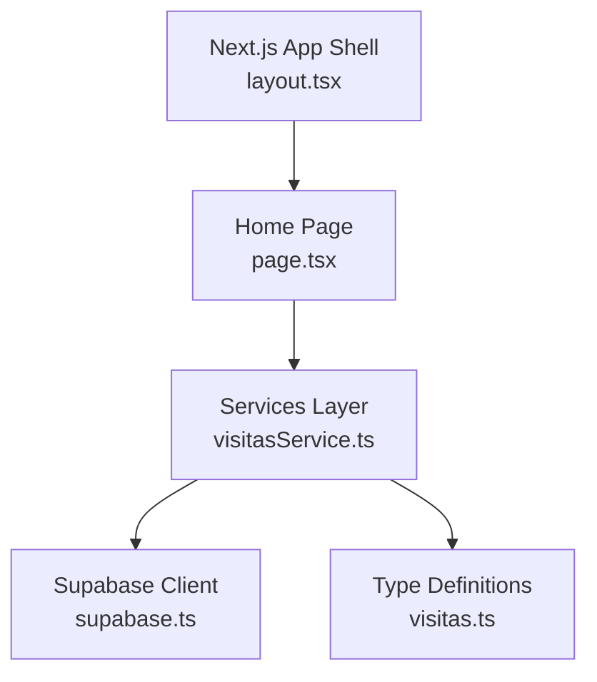
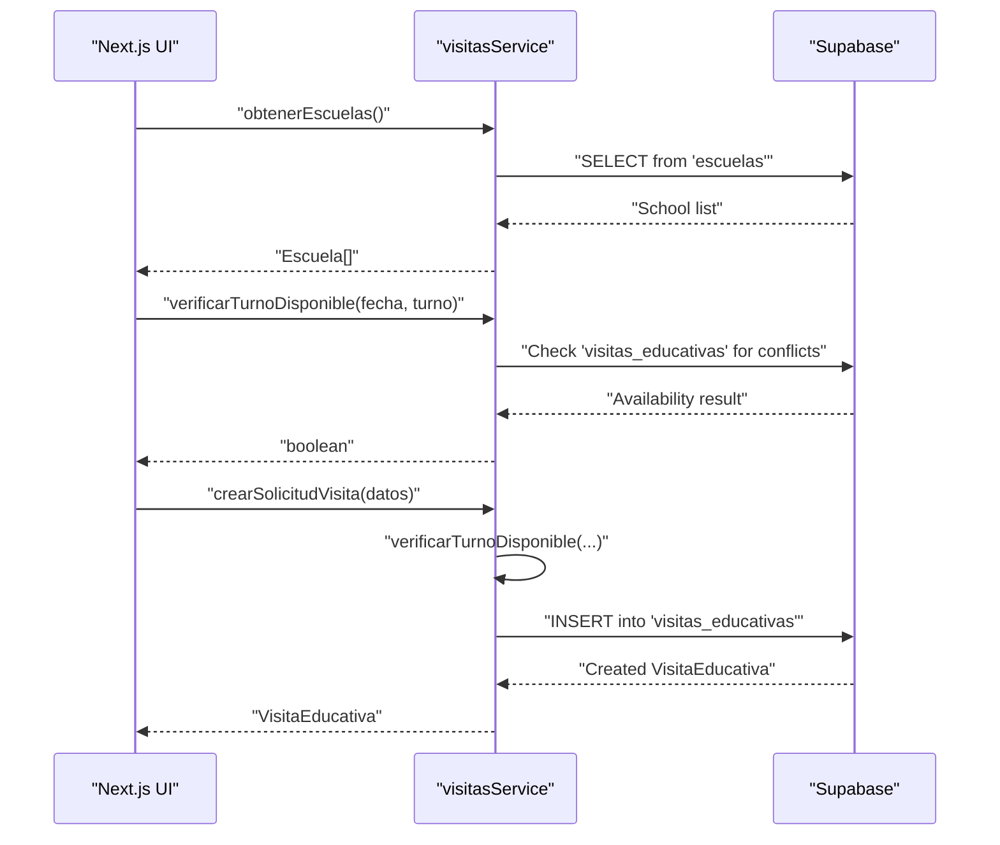
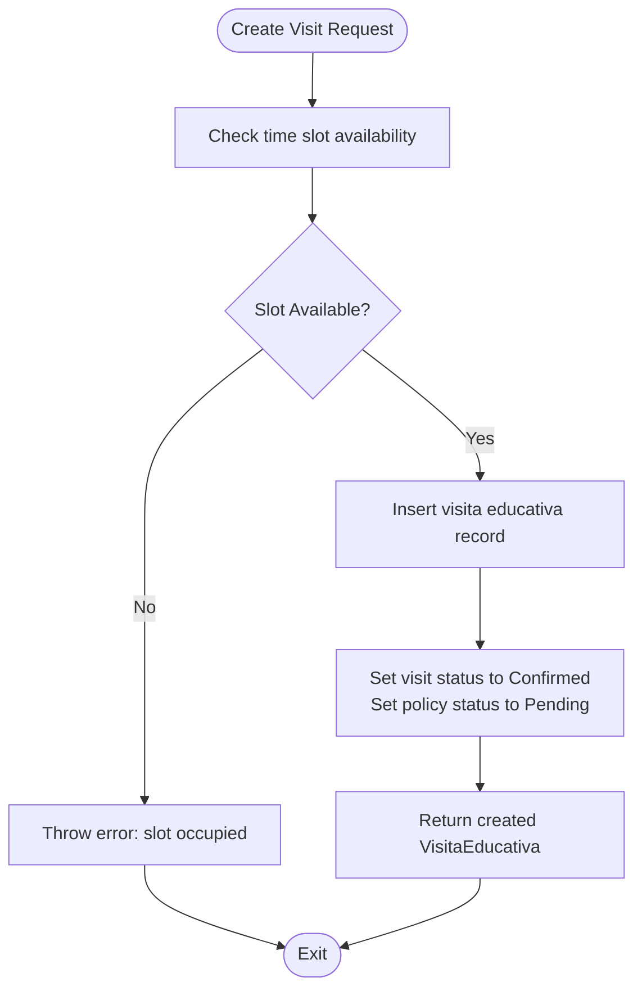
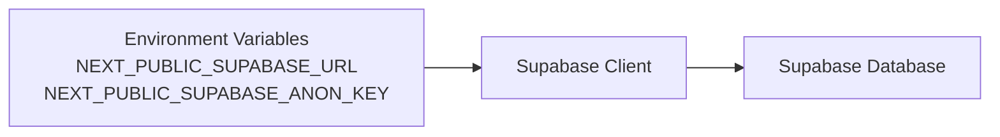
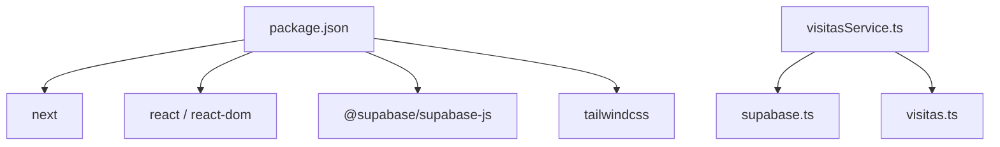

# Project Overview

<cite>
**Referenced Files in This Document**
- [README.md](file://README.md)
- [package.json](file://package.json)
- [src/app/layout.tsx](file://src/app/layout.tsx)
- [src/app/page.tsx](file://src/app/page.tsx)
- [src/lib/supabase.ts](file://src/lib/supabase.ts)
- [src/services/visitasService.ts](file://src/services/visitasService.ts)
- [src/types/visitas.ts](file://src/types/visitas.ts)
</cite>

## Table of Contents
1. [Introduction](#introduction)
2. [Project Structure](#project-structure)
3. [Core Components](#core-components)
4. [Architecture Overview](#architecture-overview)
5. [Detailed Component Analysis](#detailed-component-analysis)
6. [Dependency Analysis](#dependency-analysis)
7. [Performance Considerations](#performance-considerations)
8. [Troubleshooting Guide](#troubleshooting-guide)
9. [Conclusion](#conclusion)
10. [Appendices](#appendices)

## Introduction
Simu-Twin-Web is a Next.js-based frontend application designed to support educational visit management for schools and educational institutions. The system streamlines the process of planning and coordinating school field trips to museums and other educational facilities by enabling:
- School registration and management
- Educational visit scheduling with time slot management (morning and afternoon slots)
- Student group coordination through division and student count tracking
- Document integration via optional Google Drive links for attendance or related materials

The target audience includes schools, districts, and educational institutions that organize visits to external learning sites. For beginners, this means an easy-to-use platform where administrators can book museum visits, manage groups, and keep track of schedules. For experienced developers, it provides a modern Next.js architecture with TypeScript, Tailwind CSS styling, and Supabase as the backend data layer.

Practical examples:
- Booking a museum visit: A school selects a date and chooses either a morning or afternoon time slot; the system checks availability and creates a confirmed educational visit request.
- Managing student groups: Administrators specify the division and number of students per visit, ensuring capacity and logistics are planned appropriately.
- Integrating documents: Optional upload links (e.g., Google Drive URLs) can be attached to each visit for rosters or permissions.

**Section sources**
- [README.md:1-37](file://README.md#L1-L37)
- [package.json:1-29](file://package.json#L1-L29)

## Project Structure
The project follows a clean Next.js App Router structure with clear separation of concerns:
- Application shell and layout configuration
- Service layer for data operations
- Type definitions for consistent data modeling
- Supabase client initialization for database access



**Diagram sources**
- [src/app/layout.tsx:1-35](file://src/app/layout.tsx#L1-L35)
- [src/app/page.tsx:1-104](file://src/app/page.tsx#L1-L104)
- [src/services/visitasService.ts:1-59](file://src/services/visitasService.ts#L1-L59)
- [src/lib/supabase.ts:1-7](file://src/lib/supabase.ts#L1-L7)
- [src/types/visitas.ts:1-28](file://src/types/visitas.ts#L1-L28)

**Section sources**
- [src/app/layout.tsx:1-35](file://src/app/layout.tsx#L1-L35)
- [src/app/page.tsx:1-104](file://src/app/page.tsx#L1-L104)
- [src/services/visitasService.ts:1-59](file://src/services/visitasService.ts#L1-L59)
- [src/lib/supabase.ts:1-7](file://src/lib/supabase.ts#L1-L7)
- [src/types/visitas.ts:1-28](file://src/types/visitas.ts#L1-L28)

## Core Components
This section highlights the key building blocks that enable educational visit management:

- Data types and models:
  - Escuela: Represents a registered school/institution with identifiers and address details.
  - TurnoVisita: Time slot type for scheduling visits (morning or afternoon).
  - SolicitudVisitaInput: Input model for creating an educational visit request, including school ID, date, time slot, division, student count, and contact information.
  - VisitaEducativa: Extended model representing a created educational visit with status fields for visit and insurance policy.

- Services:
  - obtenerEscuelas: Retrieves all registered schools sorted by institution name.
  - verificarTurnoDisponible: Checks if a specific date and time slot are available, excluding canceled visits.
  - crearSolicitudVisita: Creates a new educational visit request after validating time slot availability and setting initial statuses.

- Backend integration:
  - Supabase client: Initializes the database client using environment variables for URL and anonymous key.

These components collectively support school management, visit scheduling, and document integration workflows.

**Section sources**
- [src/types/visitas.ts:1-28](file://src/types/visitas.ts#L1-L28)
- [src/services/visitasService.ts:1-59](file://src/services/visitasService.ts#L1-L59)
- [src/lib/supabase.ts:1-7](file://src/lib/supabase.ts#L1-L7)

## Architecture Overview
The application uses a layered architecture:
- Presentation layer: Next.js pages and layout provide the user interface.
- Service layer: Business logic for fetching schools, checking time slot availability, and creating visit requests.
- Data layer: Supabase handles persistent storage for schools and educational visits.



**Diagram sources**
- [src/services/visitasService.ts:9-58](file://src/services/visitasService.ts#L9-L58)
- [src/lib/supabase.ts:1-7](file://src/lib/supabase.ts#L1-L7)

## Detailed Component Analysis

### Types and Data Models
The type definitions define the core entities used across the application:
- Escuela: Captures school identity and location.
- TurnoVisita: Enumerates allowed time slots for scheduling.
- SolicitudVisitaInput: Encapsulates all required inputs for booking an educational visit, including optional document link.
- VisitaEducativa: Extends input with system-managed fields such as IDs and statuses.

```mermaid
classDiagram
class Escuela {
+string id
+string nombre_institucion
+string nombre_corto
+string direccion
}
class SolicitudVisitaInput {
+string id_escuela
+string fecha_visita
+TurnoVisita turno
+string division
+number cant_alumnos
+string nombre_director
+string cel_director
+string nombre_docente
+string cel_docente
+string drive_nomina_url
}
class VisitaEducativa {
+string id
+string estado_visita
+string estado_poliza
}
class TurnoVisita {
<<enum>>
"Mañana"
"Tarde"
}
VisitaEducativa --> SolicitudVisitaInput : "extends"
```

**Diagram sources**
- [src/types/visitas.ts:1-28](file://src/types/visitas.ts#L1-L28)

**Section sources**
- [src/types/visitas.ts:1-28](file://src/types/visitas.ts#L1-L28)

### Services Layer
The services layer encapsulates business logic and database interactions:
- Fetching schools: Retrieves a sorted list of schools for selection during registration or booking.
- Availability check: Ensures no conflicting educational visits exist for a given date and time slot, ignoring canceled visits.
- Creating visits: Validates availability and inserts a new educational visit with default statuses for visit confirmation and insurance policy pending state.



**Diagram sources**
- [src/services/visitasService.ts:20-58](file://src/services/visitasService.ts#L20-L58)

**Section sources**
- [src/services/visitasService.ts:1-59](file://src/services/visitasService.ts#L1-L59)

### Supabase Integration
The Supabase client is initialized with environment variables to connect to the backend database. This enables secure and typed access to tables such as schools and educational visits.



**Diagram sources**
- [src/lib/supabase.ts:1-7](file://src/lib/supabase.ts#L1-L7)

**Section sources**
- [src/lib/supabase.ts:1-7](file://src/lib/supabase.ts#L1-L7)

### Application Shell and Pages
The Next.js app shell configures fonts and metadata, while the home page serves as the entry point for the application. These files establish the foundation upon which educational visit features will be built.

**Section sources**
- [src/app/layout.tsx:1-35](file://src/app/layout.tsx#L1-L35)
- [src/app/page.tsx:1-104](file://src/app/page.tsx#L1-L104)

## Dependency Analysis
The application’s dependencies include Next.js for the framework, React for UI, Supabase for backend services, and Tailwind CSS for styling. The service layer depends on the Supabase client and type definitions to ensure consistent data handling.



**Diagram sources**
- [package.json:1-29](file://package.json#L1-L29)
- [src/services/visitasService.ts:1-59](file://src/services/visitasService.ts#L1-L59)
- [src/lib/supabase.ts:1-7](file://src/lib/supabase.ts#L1-L7)
- [src/types/visitas.ts:1-28](file://src/types/visitas.ts#L1-L28)

**Section sources**
- [package.json:1-29](file://package.json#L1-L29)
- [src/services/visitasService.ts:1-59](file://src/services/visitasService.ts#L1-L59)
- [src/lib/supabase.ts:1-7](file://src/lib/supabase.ts#L1-L7)
- [src/types/visitas.ts:1-28](file://src/types/visitas.ts#L1-L28)

## Performance Considerations
- Efficient queries: Use selective column retrieval when listing schools to minimize payload size.
- Availability checks: Query only necessary fields and filter out canceled visits to reduce processing overhead.
- Environment configuration: Ensure Supabase credentials are correctly set to avoid runtime errors and unnecessary retries.
- Frontend rendering: Keep UI components lightweight and leverage Next.js optimizations for faster load times.

[No sources needed since this section provides general guidance]

## Troubleshooting Guide
Common issues and resolutions:
- Missing environment variables: If Supabase client initialization fails, verify that NEXT_PUBLIC_SUPABASE_URL and NEXT_PUBLIC_SUPABASE_ANON_KEY are set.
- Time slot conflicts: When creating a visit request, if the selected slot is already occupied, the service throws an error indicating the slot is taken; choose an alternative date or time slot.
- Data integrity: Ensure that required fields (school ID, date, time slot, division, student count, and contacts) are provided before submitting a visit request.

**Section sources**
- [src/lib/supabase.ts:1-7](file://src/lib/supabase.ts#L1-L7)
- [src/services/visitasService.ts:20-58](file://src/services/visitasService.ts#L20-L58)

## Conclusion
Simu-Twin-Web provides a structured, scalable foundation for managing educational visits. With clear type definitions, robust service functions for school retrieval and visit scheduling, and reliable Supabase integration, the application supports both beginner-friendly workflows and advanced developer customization. Schools can efficiently register, schedule visits within managed time slots, coordinate student groups, and integrate relevant documents—making field trip planning more organized and accessible.

[No sources needed since this section summarizes without analyzing specific files]

## Appendices
- Getting started: Run the development server using the scripts defined in package.json to start local development.
- Deployment: The project is configured for deployment via Vercel, following Next.js best practices.

**Section sources**
- [README.md:1-37](file://README.md#L1-L37)
- [package.json:1-29](file://package.json#L1-L29)