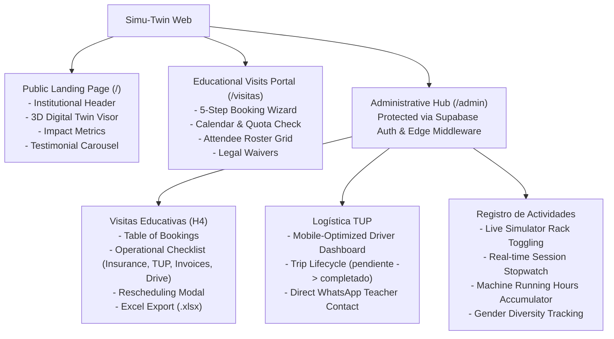

# Project Overview

<cite>
**Referenced Files in This Document**
- [README.md](file:///c:/Users/catra/Desktop/simu-twin-web/README.md)
- [package.json](file:///c:/Users/catra/Desktop/simu-twin-web/package.json)
- [src/app/layout.tsx](file:///c:/Users/catra/Desktop/simu-twin-web/src/app/layout.tsx)
- [src/app/page.tsx](file:///c:/Users/catra/Desktop/simu-twin-web/src/app/page.tsx)
- [src/middleware.ts](file:///c:/Users/catra/Desktop/simu-twin-web/src/middleware.ts)
- [src/lib/supabase/client.ts](file:///c:/Users/catra/Desktop/simu-twin-web/src/lib/supabase/client.ts)
- [src/lib/supabase/server.ts](file:///c:/Users/catra/Desktop/simu-twin-web/src/lib/supabase/server.ts)
- [src/components/gemelo/VisorNave3D.tsx](file:///c:/Users/catra/Desktop/simu-twin-web/src/components/gemelo/VisorNave3D.tsx)
- [src/components/gemelo/GemeloGalponCanvas.tsx](file:///c:/Users/catra/Desktop/simu-twin-web/src/components/gemelo/GemeloGalponCanvas.tsx)
- [src/app/visitas/page.tsx](file:///c:/Users/catra/Desktop/simu-twin-web/src/app/visitas/page.tsx)
- [src/app/admin/visitas-educativas/page.tsx](file:///c:/Users/catra/Desktop/simu-twin-web/src/app/admin/visitas-educativas/page.tsx)
- [src/app/admin/tup/page.tsx](file:///c:/Users/catra/Desktop/simu-twin-web/src/app/admin/tup/page.tsx)
- [src/app/admin/registro-actividades/page.tsx](file:///c:/Users/catra/Desktop/simu-twin-web/src/app/admin/registro-actividades/page.tsx)
- [src/types/gemelo.ts](file:///c:/Users/catra/Desktop/simu-twin-web/src/types/gemelo.ts)
- [src/types/visitas.ts](file:///c:/Users/catra/Desktop/simu-twin-web/src/types/visitas.ts)
- [src/types/tup.ts](file:///c:/Users/catra/Desktop/simu-twin-web/src/types/tup.ts)
- [src/types/actividades.ts](file:///c:/Users/catra/Desktop/simu-twin-web/src/types/actividades.ts)
</cite>

## Table of Contents
1. [Introduction](#introduction)
2. [Mission & Objectives](#mission--objectives)
3. [Core Systems & Modules](#core-systems--modules)
4. [High-Level Architecture](#high-level-architecture)
5. [User Roles and Workflows](#user-roles-and-workflows)
6. [Security and Privacy](#security-and-privacy)
7. [Dependencies & Tooling](#dependencies--tooling)
8. [Conclusion](#conclusion)

---

## Introduction
**Simu-Twin Web** is the official web application and operational management platform for the **Centro Municipal de Entrenamiento en Simuladores de Venado Tuerto** (Government of Venado Tuerto, Santa Fe, Argentina), located in the city's Industrial Park.

The application serves as both a public portal and an administrative hub:
- It features an interactive **3D Digital Twin (SCADA)** of the industrial simulation warehouse built with Three.js.
- It provides a public booking system for **Technical Educational Visits (H4)** for 5th and 6th-year secondary school students.
- It coordinates municipal transit with the **TUP (Transporte Urbano de Pasajeros)** to provide free school bus transportation to and from the Industrial Park.
- It includes a real-time **Equipment Rack & Session Management** tool to track simulator statuses, accumulated operational machine hours, and vocational gender inclusion metrics.

**Section sources**
- [README.md:1-50](file:///c:/Users/catra/Desktop/simu-twin-web/README.md#L1-L50)
- [src/app/page.tsx:1-69](file:///c:/Users/catra/Desktop/simu-twin-web/src/app/page.tsx#L1-L69)

---

## Mission & Objectives
The center bridges the gap between technical education, industrial safety, and high-demand vocational jobs (heavy machinery operators, forklift drivers, crane handlers, roadwork operators, and industrial painters).

Key objectives:
1. **Hands-On Immersive Training**: Provide realistic simulation training in heavy machinery (forklifts, front loaders, backhoes, telescopic cranes, tractors, articulated trucks, and SimSpray painting/welding).
2. **Educational Outreach**: Receive high school delegations from Venado Tuerto and surrounding towns (strictly capped at 40 students per shift).
3. **Logistical Accessibility**: Coordinate municipal school bus transportation for public schools via the TUP fleet.
4. **Telemetric Digital Twin**: Provide real-time SCADA visibility of energy consumption, active stations, and equipment load.
5. **Operational Accountability & Equity**: Track physical machine usage hours, company training sessions, and gender distribution in technical trades.

---

## Core Systems & Modules

### 1. 3D Digital Twin (SCADA)
Embedded directly on the home page via [`src/components/gemelo/VisorNave3D.tsx`](file:///c:/Users/catra/Desktop/simu-twin-web/src/components/gemelo/VisorNave3D.tsx) and [`src/components/gemelo/GemeloGalponCanvas.tsx`](file:///c:/Users/catra/Desktop/simu-twin-web/src/components/gemelo/GemeloGalponCanvas.tsx):
- Models a 28m x 22m x 7.5m steel truss industrial warehouse.
- 7 procedural simulator stations with multiple monitors, gamer seats, steering wheels, pedals, and hydraulic joysticks.
- Animated 3D human operators equipped with work overalls, safety hardhats, and VR headsets.
- Real-time SCADA HUD displaying estimated kWh power consumption, active bay count, and ambient cabin temperatures.

### 2. Educational Visits Booking (H4)
Accessible at [`src/app/visitas/page.tsx`](file:///c:/Users/catra/Desktop/simu-twin-web/src/app/visitas/page.tsx):
- Dynamic selection of municipal schools or external institutions.
- Multi-step validation preventing double bookings on dates defined in `fechas_habilitadas`.
- Strict attendee roster collection (`visita_asistentes`) with national ID (DNI), birthday, and role (Student / Teacher).
- Mandatory legal consent: insurance policy terms, image rights consent, and judicial protection declarations.

### 3. TUP Logistics (Municipal Transit)
Accessible at [`src/app/admin/tup/page.tsx`](file:///c:/Users/catra/Desktop/simu-twin-web/src/app/admin/tup/page.tsx):
- Dispatch board built for mobile devices and tablets used by municipal drivers and coordinators.
- Real-time status transitions: `pendiente` ➔ `en_camino` ➔ `en_destino` ➔ `completado` (or `cancelado`).
- Direct WhatsApp integration opening pre-formatted chat with the accompanying teacher.

### 4. Simulator Rack & Activity Session Recording
Accessible at [`src/app/admin/registro-actividades/page.tsx`](file:///c:/Users/catra/Desktop/simu-twin-web/src/app/admin/registro-actividades/page.tsx):
- Visual equipment rack to toggle station status (`libre`, `en_operacion`, `mantenimiento`).
- Live session controller tracking active duration with a stopwatch, attaching simulator IDs, and registering student/worker attendance.
- Gender inclusion categorization (`hombre`, `mujer`, `otro`, `no_especifica`) for civic equity metrics.
- Automatic server-side increment of `horas_uso_totales` on the `simuladores` table upon closing a session.

---

## High-Level Architecture
- **Next.js 15 (App Router)** with **React 19** and **TypeScript**.
- **Turbopack** for rapid development and production bundling.
- **Tailwind CSS v4** styling with official Government of Venado Tuerto design tokens (`#0091B3`, slate, dark zinc).
- **Three.js WebGL Engine** for procedural rendering.
- **Supabase SSR** (`@supabase/ssr`) with cookie-based session persistence across client components, Server Components, Server Actions, and Edge Middleware.
- **PostgreSQL 15+** with Row-Level Security (RLS) and custom triggers.

---

## User Roles and Workflows

| Role | Entry Points | Permissions & Responsibilities |
| :--- | :--- | :--- |
| **Public Visitor / Student / School Director** | `/`, `/visitas` | Browse simulator center details, view 3D twin, submit visit requests with student rosters, accept legal waivers. No access to other rosters or administrative checks. |
| **Municipal Administrator / Educational Coordinator** | `/login`, `/admin/visitas-educativas` | Approve/reschedule visits, verify operational checklist (insurance, TUP, invoicing, Drive SUM), export rosters to Excel. |
| **TUP Municipal Driver / Transit Operator** | `/login`, `/admin/tup` | View daily school transport schedule, trigger trip statuses, inspect student counts and school addresses, contact teachers via WhatsApp. |
| **Simulator Center Technician / Instructor** | `/login`, `/admin/registro-actividades` | Toggle simulator rack states, start and conclude live training sessions, register attendee rosters, log equipment maintenance. |

---

## Security and Privacy
- **Minor PII Protection**: Attendance rosters in `visita_asistentes` contain names and IDs of underage students. Unauthenticated users (`anon`) have `SELECT` denied by Postgres RLS.
- **Operational Flag Protection**: `visitas_educativas` operational checks (`check_poliza`, `check_tup`, etc.) cannot be mutated by public visitors. A database trigger (`trg_forzar_checks_no_autenticados`) forces them to `false` if `auth.uid() is null`.
- **Server Action Validation**: Strict validation and sanitization (`normalizarTextoNullable`) prevent empty string bugs in PostgreSQL `date`, `time`, and `uuid` columns.

---

## Dependencies & Tooling
- `next`: `15.5.25`
- `react`: `19.1.0`
- `three`: `^0.186.1`
- `@supabase/ssr`: `^0.12.7`
- `@supabase/supabase-js`: `^2.116.0`
- `xlsx`: `^0.18.5`
- `lucide-react`: `^1.45.0`
- `tailwindcss`: `^4`

---

## Conclusion
Simu-Twin Web represents a modern civic-tech solution uniting high-fidelity 3D simulation visualization, educational administration, municipal logistics, and industrial training tracking under a secure, performant Next.js 15 architecture.