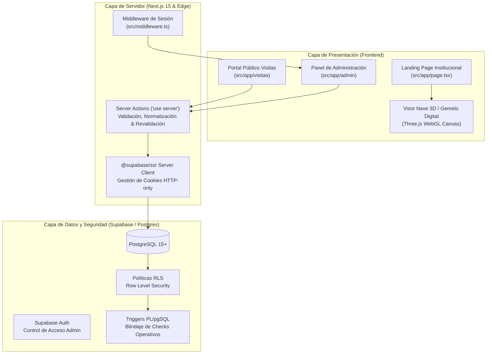

# WIKI OFICIAL: SIMU-TWIN WEB
## Centro de Entrenamiento en Simuladores — Gobierno de Venado Tuerto

Bienvenido a la documentación técnica y funcional oficial de **Simu-Twin Web**. Este repositorio alberga la plataforma web integral desarrollada para el **Centro Municipal de Entrenamiento en Simuladores de Venado Tuerto**, ubicado en el Parque Industrial de la ciudad de Venado Tuerto, Santa Fe, Argentina.

---

## 📑 Tabla de Contenidos

1. [Visión General y Misión Institucional](#1-visión-general-y-misión-institucional)
2. [Arquitectura y Stack Tecnológico](#2-arquitectura-y-stack-tecnológico)
3. [Estructura del Proyecto y Árbol de Directorios](#3-estructura-del-proyecto-y-árbol-de-directorios)
4. [Módulo 1: Gemelo Digital 3D y Nave Industrial (SCADA)](#4-módulo-1-gemelo-digital-3d-y-nave-industrial-scada)
5. [Módulo 2: Portal Público y Reserva de Visitas Educativas (H4)](#5-módulo-2-portal-público-y-reserva-de-visitas-educativas-h4)
6. [Módulo 3: Logística TUP (Transporte Urbano de Pasajeros)](#6-módulo-3-logística-tup-transporte-urbano-de-pasajeros)
7. [Módulo 4: Panel Administrativo y Registro de Actividades](#7-módulo-4-panel-administrativo-y-registro-de-actividades)
8. [Módulo 5: Seguridad, Autenticación y Base de Datos (RLS)](#8-módulo-5-seguridad-autenticación-y-base-de-datos-rls)
9. [Modelos de Datos y Sistema de Tipos](#9-modelos-de-datos-y-sistema-de-tipos)
10. [Guía de Instalación, Configuración y Despliegue](#10-guía-de-instalación-configuración-y-despliegue)
11. [Estándares de Ingeniería y Buenas Prácticas](#11-estándares-de-ingeniería-y-buenas-prácticas)

---

## 1. Visión General y Misión Institucional

El **Centro Municipal de Entrenamiento en Simuladores de Venado Tuerto** es una iniciativa estratégica del Gobierno local orientada a la capacitación para el empleo, la seguridad operativa y la vinculación con el sector socioproductivo de la región.

### Objetivos Clave
- **Formación técnica en maquinaria pesada**: Prácticas inmersivas en autoelevadores, palas frontales, retroexcavadoras, grúas telescópicas, tractores agrícolas, camiones articulados y simuladores de pintura industrial (SimSpray).
- **Programa de Visitas Educativas (H4)**: Recepción de contingentes de 5° y 6° año de escuelas secundarias técnicas y orientadas de Venado Tuerto (hasta 40 alumnos por turno) con talleres de orientación vocacional y dinámicas socioemocionales.
- **Logística con Inclusión**: Integración con el **TUP (Transporte Urbano de Pasajeros)** del municipio para garantizar el traslado gratuito de las escuelas públicas hasta el Parque Industrial.
- **Supervisión Digital en Tiempo Real (Digital Twin / SCADA)**: Monitoreo tridimensional de la nave con telemetría de consumo eléctrico, tiempos de uso y estado operativo de las bahías de simulación.
- **Seguimiento Administrativo y Equidad**: Registro de sesiones con empresas e instituciones, control de horas acumuladas de cada equipo y métricas de inclusión de género en el uso de maquinaria.

---

## 2. Arquitectura y Stack Tecnológico

La aplicación está construida sobre una arquitectura moderna basada en Next.js App Router, integrando renderizado WebGL procedural y una capa de persistencia reactiva en Supabase.



### Tecnologías Principales
| Categoría | Tecnología | Versión / Detalle |
| :--- | :--- | :--- |
| **Framework Web** | [Next.js](https://nextjs.org/) | `15.5.x` (App Router, Turbopack, Server Components) |
| **Librería UI** | [React](https://react.dev/) | `19.1.x` |
| **Lenguaje** | [TypeScript](https://www.typescriptlang.org/) | `5.x` (Modo estricto `"strict": true`) |
| **Estilos y Tokens** | [Tailwind CSS](https://tailwindcss.com/) | `v4` (`@tailwindcss/postcss`) con paleta institucional |
| **Gráficos 3D** | [Three.js](https://threejs.org/) | `^0.186.x` (Renderizado WebGL procedural y animaciones) |
| **Base de Datos / BaaS**| [Supabase](https://supabase.com/) | `@supabase/ssr` (`^0.12.x`), `@supabase/supabase-js` (`^2.116.x`) |
| **Exportación** | [XLSX (SheetJS)](https://sheetjs.com/) | `^0.18.5` (Reportes operativos y nóminas) |
| **Iconografía** | [Lucide React](https://lucide.dev/) | `^1.45.x` |

---

## 3. Estructura del Proyecto y Árbol de Directorios

```
simu-twin-web/
├── docs/                               # Documentación y guías del proyecto
│   └── WIKI.md                         # Esta Wiki técnica integral
├── public/                             # Recursos estáticos públicos (logos, imágenes, iconos)
├── src/
│   ├── app/                            # Rutas de Next.js (App Router)
│   │   ├── admin/                      # Rutas protegidas del panel administrativo
│   │   │   ├── layout.tsx              # Shell con Sidebar y Topbar
│   │   │   ├── page.tsx                # Dashboard principal de estado
│   │   │   ├── registro-actividades/   # Módulo de Rack en vivo y sesiones
│   │   │   │   ├── actions.ts          # Server Actions para actividades y rack
│   │   │   │   └── page.tsx            # Página del módulo de actividades
│   │   │   ├── tup/                    # Módulo de logística de traslados TUP
│   │   │   │   ├── actions.ts          # Server Actions para actualización de viajes
│   │   │   │   └── page.tsx            # Interfaz adaptativa/móvil para choferes
│   │   │   └── visitas-educativas/     # Módulo de gestión de visitas H4
│   │   │       ├── actions.ts          # Server Actions de edición y checks
│   │   │       └── page.tsx            # Tabla y gestión de reservas
│   │   ├── login/                      # Ruta de inicio de sesión administrativo
│   │   │   └── page.tsx                # Vista de autenticación
│   │   ├── visitas/                    # Portal público para escuelas
│   │   │   ├── actions.ts              # Server Action de solicitud de visita
│   │   │   └── page.tsx                # Formulario paso a paso de reserva
│   │   ├── globals.css                 # Estilos globales y tokens Tailwind v4
│   │   ├── layout.tsx                  # Layout raíz del sitio
│   │   └── page.tsx                    # Landing Page principal con visor 3D
│   ├── components/                     # Componentes React modulares
│   │   ├── admin/                      # Componentes del panel administrativo
│   │   │   ├── actividades/            # Rack en vivo, cronómetro, nómina y modal
│   │   │   ├── tup/                    # Tarjetas de traslado y panel móvil TUP
│   │   │   ├── visitas/                # Tabla de reservas, checks y modal de edición
│   │   │   ├── Sidebar.tsx             # Barra lateral con navegación y rutas
│   │   │   └── Topbar.tsx              # Barra superior con breadcrumbs y logout
│   │   ├── auth/                       # Componentes de autenticación
│   │   │   └── FormularioLogin.tsx     # Formulario con Supabase Auth
│   │   ├── gemelo/                     # Motor 3D del Gemelo Digital
│   │   │   ├── GemeloGalponCanvas.tsx  # Canvas Three.js con nave y operarios
│   │   │   └── VisorNave3D.tsx         # HUD, ficha técnica y controles de cámara
│   │   ├── landing/                    # Secciones de la Landing Page pública
│   │   │   ├── CarruselExperiencias.tsx# Testimonios de estudiantes y docentes
│   │   │   ├── Footer.tsx              # Pie de página institucional
│   │   │   ├── MetricasCentro.tsx      # Métricas cuantitativas del centro
│   │   │   ├── Navbar.tsx              # Barra de navegación institucional
│   │   │   └── SeccionVisitas.tsx      # Presentación del programa educativo
│   │   └── visitas/                    # Formulario de reserva pública
│   │       ├── FormularioVisita.tsx    # Wizard de reserva y consentimientos
│   │       └── GridNomina.tsx          # Carga de nómina de alumnos y docentes
│   ├── lib/                            # Utilidades compartidas y clientes
│   │   └── supabase/                   # Configuración del cliente Supabase
│   │       ├── client.ts               # Browser Client (@supabase/ssr)
│   │       └── server.ts               # Server Client con cookies (@supabase/ssr)
│   ├── services/                       # Servicios de consulta y consumo de API
│   │   └── visitasService.ts           # Consultas de catálogos y reservas
│   ├── types/                          # Contratos e interfaces TypeScript
│   │   ├── actividades.ts              # Modelos de rack, actividades y participantes
│   │   ├── gemelo.ts                   # Modelos de escena 3D, simuladores y operarios
│   │   ├── tup.ts                      # Modelos de logística de traslados TUP
│   │   └── visitas.ts                  # Modelos de visitas escolares, nómina y checks
│   └── middleware.ts                   # Middleware de Edge para control de sesión
├── supabase/                           # Esquema de base de datos y migraciones
│   └── migrations/
│       ├── 0001_rls_visitas_educativas.sql # Políticas RLS y triggers de visitas
│       └── 0003_agregar_columnas_tup.sql   # Columnas de horarios y estados TUP
├── galpon.html                         # Prototipo original de nave SCADA 3D
└── index.html                          # Prototipo original de cabina de simulación
```

---

## 4. Módulo 1: Gemelo Digital 3D y Nave Industrial (SCADA)

El proyecto cuenta con un gemelo digital inmersivo desarrollado en **Three.js** que reproduce digitalmente la nave del Centro de Entrenamiento en Simuladores (28 metros de largo por 22 metros de ancho y 7.5 metros de altura estructural).

### Componentes de Implementación
1. [`src/components/gemelo/GemeloGalponCanvas.tsx`](file:///c:/Users/catra/Desktop/simu-twin-web/src/components/gemelo/GemeloGalponCanvas.tsx):
   - Motor gráfico Three.js puro montado sobre un contenedor HTML5 Canvas.
   - Maneja la creación procedural de la arquitectura industrial: piso de hormigón pulido, columnas estructurales de acero, cerchas tipo Pratt, cubierta metálica a dos aguas, iluminación cenital y balizas LED.
   - Señalética de seguridad industrial: demarcación perimetral de pintura epóxica amarilla continua en el suelo, extintores ABC con señalización IRAM, tablero eléctrico general, botiquín de primeros auxilios y puente grúa con testeros.
   - Modelado procedural de **7 puestos de simulación**:
     - *Puesto 01*: Autoelevador industrial (mástil vertical y horquillas).
     - *Puesto 02*: Pala frontal articulada (brazos mecánicos y balde).
     - *Puesto 03*: Retroexcavadora vial (pluma y balde de excavación).
     - *Puesto 04*: Grúa telescópica de alto porte.
     - *Puesto 05*: Tractor agrícola con neumáticos traseros sobredimensionados.
     - *Puesto 06*: Camión de cargas pesadas / articulado con cabina elevada.
     - *Puesto 07*: SimSpray (cabina de entrenamiento en pintura electrostática y soldadura).
   - Simulación de **Operarios 3D Animados**:
     - Cada operario cuenta con uniforme de trabajo (mameluco azul), casco de seguridad amarillo y visor de realidad virtual (VR headset).
     - Máquina de estados cinemática: `'espera'` ➔ `'caminando'` ➔ `'sentandose'` ➔ `'operando'` ➔ `'levantandose'` ➔ `'retornando'`.
     - Ciclo de marcha procedural con interpolación armónica de miembros superiores e inferiores.
   - Sistema de Picking / Raycasting: Selección interactiva de bahías mediante clics en el canvas para enfocar la cámara y consultar la ficha técnica.

2. [`src/components/gemelo/VisorNave3D.tsx`](file:///c:/Users/catra/Desktop/simu-twin-web/src/components/gemelo/VisorNave3D.tsx):
   - Envoltorio React (`'use client'`) que integra el canvas con la interfaz de usuario.
   - **HUD SCADA**: Barra superior con telemetría en vivo: total de puestos, simuladores activos, consumo estimado en kWh, temperatura ambiente de cabina y tiempo de operación.
   - **Ficha Técnica Desplegable**: Panel lateral informativo que muestra especificaciones de hardware (pantallas triples, volantes y pedales con force feedback, joysticks hidráulicos, plataformas móviles con grados de libertad) y módulos pedagógicos de entrenamiento.
   - Controles de cámara: modo orbital libre, botón de centrado y modo seguimiento de operarios.

---

## 5. Módulo 2: Portal Público y Reserva de Visitas Educativas (H4)

Diseñado para las escuelas secundarias que desean reservar su jornada técnica en el Centro de Simuladores.

### Flujo de Usuario y Validación
1. **Acceso al Portal** ([`src/app/visitas/page.tsx`](file:///c:/Users/catra/Desktop/simu-twin-web/src/app/visitas/page.tsx)):
   - Presentación de requisitos: cupo máximo de **40 alumnos**, turnos mañana o tarde, destinatarios exclusivos de 5° y 6° año escolar.
2. **Formulario Interactivo** ([`src/components/visitas/FormularioVisita.tsx`](file:///c:/Users/catra/Desktop/simu-twin-web/src/components/visitas/FormularioVisita.tsx)):
   - **Paso 1: Institución y Turno**: Selección de escuela del catálogo oficial de Venado Tuerto o ingreso manual si es de otra localidad. Detección automática de requerimiento de transporte TUP.
   - **Paso 2: Calendario y Disponibilidad**: Consulta contra la tabla `fechas_habilitadas`. Las fechas con reservas previas no se pueden duplicar para el mismo turno.
   - **Paso 3: Contacto Institucional**: Datos de directivos y docentes a cargo (nombres, teléfonos celulares con validación de código de área y correos electrónicos).
   - **Paso 4: Consentimientos Legales**: Checkboxes obligatorios de aceptación de condiciones de la póliza de seguro, autorización de registro fotográfico/audiovisual institucional y declaración jurada sobre menores sin medidas judiciales prohibitivas.
   - **Paso 5: Nómina de Asistentes** ([`src/components/visitas/GridNomina.tsx`](file:///c:/Users/catra/Desktop/simu-twin-web/src/components/visitas/GridNomina.tsx)): Grilla dinámica para cargar alumnos y docentes con Apellido y Nombre, DNI argentino y fecha de nacimiento.
3. **Persistencia Segura** ([`src/app/visitas/actions.ts`](file:///c:/Users/catra/Desktop/simu-twin-web/src/app/visitas/actions.ts)):
   - Server Action que genera un código único de seguimiento (`VT-XXXX`), crea el registro en `visitas_educativas` con estado `Pendiente` e inserta la nómina en `visita_asistentes`.
   - **Defensa en profundidad**: La acción fija deliberadamente `check_poliza = false`, `check_tup = false`, `check_facturas = false` y `check_drive_sum = false`, bloqueando cualquier intento de inyección de valores operativos por parte del usuario final.

---

## 6. Módulo 3: Logística TUP (Transporte Urbano de Pasajeros)

El municipio de Venado Tuerto ofrece transporte gratuito mediante los colectivos urbanos del TUP para las visitas escolares públicas.

### Características Operativas
- **Ruta de Despacho**: [`src/app/admin/tup/page.tsx`](file:///c:/Users/catra/Desktop/simu-twin-web/src/app/admin/tup/page.tsx).
- **Diseño Mobile-First**: Optimizado especialmente para choferes y coordinadores de flota desde teléfonos móviles y tablets.
- **Ciclo de Vida del Traslado**:
  ```
  [ pendiente ] ➔ [ en_camino ] ➔ [ en_destino ] ➔ [ completado ]
                                            ↘ [ cancelado ]
  ```
- **Panel y Tarjetas de Viaje** ([`src/components/admin/tup/PanelLogisticaTup.tsx`](file:///c:/Users/catra/Desktop/simu-twin-web/src/components/admin/tup/PanelLogisticaTup.tsx) y [`CardTrasladoTup.tsx`](file:///c:/Users/catra/Desktop/simu-twin-web/src/components/admin/tup/CardTrasladoTup.tsx)):
  - Información de parada: Nombre de la escuela, dirección exacta de retiro y cantidad de pasajeros.
  - Franjas horarias de ida (ej. 08:30 a 09:00) y de regreso (ej. 12:00 a 12:30).
  - Nombre del chofer asignado al coche.
  - **Botón de Contacto Directo WhatsApp**: Abre automáticamente un chat con el número de teléfono celular del docente acompañante con un mensaje predefinido con los datos del coche y del traslado.
- **Server Action**: [`src/app/admin/tup/actions.ts`](file:///c:/Users/catra/Desktop/simu-twin-web/src/app/admin/tup/actions.ts), permitiendo actualizar el estado del traslado en tiempo real con revalidación instantánea de caché.

---

## 7. Módulo 4: Panel Administrativo y Registro de Actividades

El panel de administración (`/admin`) es el centro de control operativo para el personal municipal.

### A. Gestión de Visitas Educativas (H4)
- **Ruta**: [`src/app/admin/visitas-educativas/page.tsx`](file:///c:/Users/catra/Desktop/simu-twin-web/src/app/admin/visitas-educativas/page.tsx).
- **Componentes**: [`TablaVisitasAdmin.tsx`](file:///c:/Users/catra/Desktop/simu-twin-web/src/components/admin/visitas/TablaVisitasAdmin.tsx) y [`ModalEditarVisita.tsx`](file:///c:/Users/catra/Desktop/simu-twin-web/src/components/admin/visitas/ModalEditarVisita.tsx).
- **Checklist Operativo Rápido**:
  - `check_poliza`: Verificación de póliza de seguro de responsabilidad civil y accidentes personales.
  - `check_tup`: Coordinación confirmada con el área de Transporte Urbano.
  - `check_facturas`: Constancia administrativa / contable municipal.
  - `check_drive_sum`: Registro de nómina y fotografías subido a la carpeta oficial de Google Drive.
- **Exportación a Excel**: Generación mediante la librería `xlsx` de planillas con todas las reservas o la nómina detallada de estudiantes con un solo clic.
- **Edición y Reprogramación**: Modificación de fechas, asignación de choferes y franjas horarias sin perder la integridad referencial.

### B. Registro de Actividades y Rack de Simuladores en Vivo
- **Ruta**: [`src/app/admin/registro-actividades/page.tsx`](file:///c:/Users/catra/Desktop/simu-twin-web/src/app/admin/registro-actividades/page.tsx).
- **Rack de Simuladores** ([`RackSimuladores.tsx`](file:///c:/Users/catra/Desktop/simu-twin-web/src/components/admin/actividades/RackSimuladores.tsx)):
  - Vista tipo rack de servidores que refleja el estado de cada máquina física: `LIBRE`, `EN OPERACIÓN` o `MANTENIMIENTO`.
  - Conmutador manual para encender o apagar estaciones desde el puesto de control.
- **Panel de Sesión en Vivo** ([`PanelSesionEnVivo.tsx`](file:///c:/Users/catra/Desktop/simu-twin-web/src/components/admin/actividades/PanelSesionEnVivo.tsx)):
  - Permite iniciar una sesión de entrenamiento activa: empresa contratista, delegación institucional o curso de oficio.
  - Cronómetro de tiempo transcurrido en vivo.
  - Vinculación de los simuladores específicos utilizados durante la sesión.
  - Carga dinámica de participantes en tiempo real.
  - **Métricas de Inclusión y Género**: Registro tipado de participantes con selector de género (`Hombre`, `Mujer`, `Otro`, `N/E`) para generar estadísticas de participación de mujeres en oficios de maquinaria pesada.
  - **Cierre de Sesión**: Al finalizar, la Server Action calcula la duración exacta y suma automáticamente los minutos de uso al acumulador histórico `horas_uso_totales` de cada máquina física en la base de datos.
- **Acciones del Servidor**: [`src/app/admin/registro-actividades/actions.ts`](file:///c:/Users/catra/Desktop/simu-twin-web/src/app/admin/registro-actividades/actions.ts) contiene más de 900 líneas de lógica backend estrictamente validada y tipada.

---

## 8. Módulo 5: Seguridad, Autenticación y Base de Datos (RLS)

### A. Autenticación y Middleware Edge
- **Middleware** ([`src/middleware.ts`](file:///c:/Users/catra/Desktop/simu-twin-web/src/middleware.ts)):
  - Utiliza `@supabase/ssr` (`createServerClient`) en el runtime Edge de Next.js.
  - Protege todas las rutas bajo `/admin/*`: Si el usuario no tiene una sesión activa (`auth.getUser()`), es redirigido a `/login`.
  - Si un usuario ya autenticado entra a `/login`, se lo redirige inmediatamente a `/admin`.
  - Rutas estáticas, modelos 3D y assets de medios están excluidos del matcher para garantizar máxima velocidad y cero latencia.

### B. Seguridad en PostgreSQL y Row Level Security (RLS)
El proyecto implementa el principio de **cero confianza en el cliente**:

1. **Protección de Datos Personales (PII) de Menores**:
   - En la tabla `visita_asistentes`, los permisos de `SELECT` están **estrictamente revocados** para usuarios anónimos (`anon`).
   - Solo los usuarios administradores autenticados (`authenticated`) pueden leer las nóminas con nombres y DNI.
   - El rol público únicamente tiene permiso de `INSERT` acotado al envío de la solicitud.
2. **Inmutabilidad de Checks Operativos**:
   - `visitas_educativas` prohíbe el `UPDATE` a usuarios anónimos.
   - Adicionalmente, el trigger PL/pgSQL `trg_forzar_checks_no_autenticados` fuerza en `false` cualquier campo `check_*` si `auth.uid() is null`.
3. **Migraciones Versionadas**:
   - [`0001_rls_visitas_educativas.sql`](file:///c:/Users/catra/Desktop/simu-twin-web/supabase/migrations/0001_rls_visitas_educativas.sql): Habilita RLS en `visitas_educativas`, `visita_asistentes`, `escuelas` y `fechas_habilitadas`.
   - [`0003_agregar_columnas_tup.sql`](file:///c:/Users/catra/Desktop/simu-twin-web/supabase/migrations/0003_agregar_columnas_tup.sql): Incorpora `tup_horario_ida_desde`, `tup_horario_ida_hasta`, `tup_horario_vuelta_desde`, `tup_horario_vuelta_hasta`, `tup_chofer_nombre`, `tup_estado_traslado` y constraints de rango horario.

---

## 9. Modelos de Datos y Sistema de Tipos

Todos los modelos residen en `src/types/` y mantienen una correspondencia 1:1 con las entidades de base de datos.

### 1. Gemelo Digital y SCADA ([`src/types/gemelo.ts`](file:///c:/Users/catra/Desktop/simu-twin-web/src/types/gemelo.ts))
- `TipoSimulador`: `'autoelevador' | 'pala-frontal' | 'retroexcavadora' | 'grua-telescopica' | 'tractor' | 'camion' | 'simspray'`
- `EstadoSimulador`: `'detenido' | 'operando'`
- `ConfiguracionEstacion`: Coordenadas 3D `[x, y, z]`, rotación `rotY`, color e identificador.
- `OperarioState`: Mesh tridimensional, fase cinemática (`'espera'`, `'caminando'`, etc.) y progreso.
- `SCADANaveStatus`: Total de estaciones, activas, consumo kWh, temperatura ambiente y tiempo operativo.

### 2. Visitas Educativas ([`src/types/visitas.ts`](file:///c:/Users/catra/Desktop/simu-twin-web/src/types/visitas.ts))
- `Escuela`: Entidad escolar (ID, nombre institucional, nombre corto, dirección).
- `FechaHabilitada`: Fechas del calendario escolar habilitadas por el municipio.
- `TurnoVisita`: `'Mañana' | 'Tarde'`
- `AnioEscolar`: `'5°' | '6°'`
- `RolAsistente`: `'Alumno' | 'Docente'`
- `VisitaEducativa`: Fila completa persistida con código `VT-XXXX`, checks operativos y enlaces TUP.

### 3. Logística TUP ([`src/types/tup.ts`](file:///c:/Users/catra/Desktop/simu-twin-web/src/types/tup.ts))
- `EstadoTrasladoTup`: `'pendiente' | 'en_camino' | 'en_destino' | 'completado' | 'cancelado'`
- `TrasladoTupItem`: Proyección operativa que combina datos de la visita, horarios y teléfono docente.

### 4. Registro de Actividades ([`src/types/actividades.ts`](file:///c:/Users/catra/Desktop/simu-twin-web/src/types/actividades.ts))
- `TipoActividad`: `'empresa' | 'institucional' | 'capacitacion' | 'visita_especial' | 'mantenimiento' | 'otro'`
- `EstadoActividad`: `'planificada' | 'en_curso' | 'finalizada'`
- `GeneroParticipante`: `'hombre' | 'mujer' | 'otro' | 'no_especifica'`
- `Simulador`: Puesto de simulación con ID, nombre, estado y horas totales de uso.

---

## 10. Guía de Instalación, Configuración y Despliegue

### Requisitos Previos
- **Node.js**: `v20.x` o superior (LTS recomendado).
- **Gestor de paquetes**: `npm` (incluido) o `pnpm`.
- **Proyecto Supabase**: Base de datos Postgres con las migraciones ejecutadas.

### Paso 1: Clonar y configurar variables de entorno
Crear un archivo `.env.local` en la raíz del proyecto:
```env
NEXT_PUBLIC_SUPABASE_URL=https://<tu-proyecto>.supabase.co
NEXT_PUBLIC_SUPABASE_ANON_KEY=<tu-supabase-anon-key>
```

### Paso 2: Instalar dependencias
```bash
npm install
```

### Paso 3: Ejecutar las migraciones de Base de Datos
En el SQL Editor del panel de Supabase, ejecutar en orden:
1. `supabase/migrations/0001_rls_visitas_educativas.sql`
2. `supabase/migrations/0003_agregar_columnas_tup.sql`

### Paso 4: Iniciar el servidor de desarrollo
```bash
npm run dev
```
La aplicación quedará disponible en [http://localhost:3000](http://localhost:3000).

### Paso 5: Compilación para Producción
```bash
npm run build
npm run start
```

---

## 11. Estándares de Ingeniería y Buenas Prácticas

1. **Normalización de Nullables en Server Actions**:
   Nunca se envían cadenas vacías `""` a columnas `date`, `time` o `uuid` de PostgreSQL; se transforman explícitamente a `null` mediante funciones de saneamiento (`normalizarTextoNullable`).
2. **Protección PII en Logs de Auditoría**:
   Los logs de errores de PostgREST en el servidor omiten cualquier dato sensible de los alumnos o docentes; únicamente se registran el código de error y el mensaje técnico.
3. **Revalidación Selectiva de Caché**:
   Tras cada mutación exitosa mediante Server Action, se invoca `revalidatePath` en la ruta afectada (`/admin/visitas-educativas`, `/admin/tup`, `/admin/registro-actividades`) para mantener la interfaz siempre actualizada sin parpadeos ni inconsistencias de caché.
4. **Respeto a las Directivas de Identidad Municipal**:
   Se preservan rigurosamente los colores de identidad institucional del Gobierno de Venado Tuerto (`#0091B3`, slate, neutros), iconografía oficial y sellos de aprobación gubernamental.
